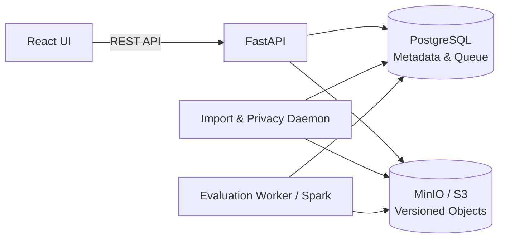

# DQ Scoring

**Hệ thống đánh giá chất lượng dữ liệu có thể giải thích và tái lập.**

DQ Scoring đo lường dữ liệu theo bộ quy tắc và chính sách chấm điểm, lưu kết quả đánh giá cùng bằng chứng, đồng thời quản lý phân loại và che dữ liệu nhạy cảm ở đầu ra. Hệ thống gồm REST API, giao diện web, hàng đợi PostgreSQL và worker tính toán Apache Spark.

[Hướng dẫn khởi động](docs/LOCAL_RUNBOOK.md) · [Hướng dẫn sử dụng](docs/engineering/USER_GUIDE.md) · [Lý thuyết chấm điểm](docs/theory/DQ_SCORING_THEORY.md) · [Triển khai Kubernetes](deploy/k8s/README.md)

> **Phạm vi sử dụng:** môi trường phát triển và kiểm chứng sử dụng dữ liệu tổng hợp (synthetic). Cấu hình Docker Compose không phải cấu hình production; có Helm chart hoặc preflight thành công không đồng nghĩa hạ tầng đã đáp ứng yêu cầu bảo mật hay tính sẵn sàng cao.

## Mục lục

- [Tổng quan](#tổng-quan)
- [Chức năng chính](#chức-năng-chính)
- [Kiến trúc](#kiến-trúc)
- [Khởi động cục bộ](#khởi-động-cục-bộ)
- [Quy trình sử dụng](#quy-trình-sử-dụng)
- [Kiểm thử và chất lượng mã nguồn](#kiểm-thử-và-chất-lượng-mã-nguồn)
- [Đóng gói và triển khai](#đóng-gói-và-triển-khai)
- [Cấu trúc dự án](#cấu-trúc-dự-án)
- [Tài liệu tham khảo](#tài-liệu-tham-khảo)

## Tổng quan

Hệ thống tách biệt ba khía cạnh của một kết quả đánh giá:

| Khía cạnh | Câu hỏi cần trả lời |
|---|---|
| **DQ Score** | Dữ liệu quan sát được đạt chất lượng đến đâu theo chính sách chấm điểm? |
| **Coverage** | Bao nhiêu phần kỳ vọng đã thực sự được đo lường? |
| **Confidence** | Bằng chứng đo lường đáng tin cậy đến mức nào? |

Các nguyên tắc chấm điểm:

- **Tái lập kết quả:** snapshot và đặc tả chạy được cố định để kiểm tra kết quả và `assessment_hash` qua replay.
- **Bảo toàn số lượng bản ghi:** `passed + failed + missing + miscast + not_applicable = total_observed`.
- **Không tạo điểm khi không đo được:** mẫu số bằng 0 được biểu diễn bằng trạng thái `NOT_APPLICABLE` hoặc `NOT_MEASURABLE` phù hợp, thay vì ép điểm về 0 hay 100.
- **Quality gate có thứ tự ưu tiên:** `ERROR → Critical FAIL → INSUFFICIENT_EVIDENCE → FAIL → WARN → PASS`.
- **Tách kết quả tư vấn khỏi điểm số:** quy tắc advisory không đóng góp vào score/gate.

Định nghĩa và công thức chi tiết nằm trong [DQ Scoring Theory](docs/theory/DQ_SCORING_THEORY.md).

## Chức năng chính

### Nhập và quản lý dữ liệu

- Tải tệp theo phần hoặc chọn object từ vùng staging trên MinIO/S3.
- Nhập CSV UTF-8, Parquet và JSONL; kiểm tra cấu trúc, xem mẫu, xác nhận đăng ký snapshot.
- Runtime đánh giá sử dụng snapshot `OBJECT_FILE` với descriptor canonical và phiên bản object được ghim.
- JSONL có một root object mỗi dòng; object/array trong cột được giữ dưới dạng JSON cell, không tự tách thành nhiều dòng.

### Đánh giá chất lượng

- Quản lý ruleset và scoring policy theo quy trình soạn thảo, gửi duyệt và phê duyệt.
- Thực thi đánh giá bất đồng bộ bằng PySpark; theo dõi run, điểm theo dimension và assessment.
- Hỗ trợ kiểm tra dữ liệu có cấu trúc trong ô bằng `JSON_FIELD`/`JSON_ARRAY` và kiểm tra văn bản bằng `TEXT_QUALITY`.
- `SPELLING` và `MOJIBAKE` là advisory. Kiểm tra chính tả cần từ điển do operator cung cấp qua `DQ_TEXT_DICTIONARY_MANIFEST`; không tự tải từ điển hoặc thay thế bằng wordlist dự phòng.

### Phân loại và bảo vệ đầu ra

- Workspace snapshot gồm ba tab: **Tổng quan & Profiling**, **Phân loại & Bảo vệ**, **Quy tắc phát hiện**.
- Phân loại cột theo asset và tên canonical; thay đổi theo batch có lý do và kiểm soát xung đột phiên bản.
- Detector privacy có revision bất biến; regex tùy chỉnh dùng RE2. Chạy thử chỉ trả thống kê/path; scan APPLY xử lý trong import daemon.
- Preview áp dụng chính sách bảo vệ hiện hành. Khi scan chưa hoàn tất, lỗi hoặc cấu hình detector đã cũ, hệ thống che mọi cột theo nguyên tắc fail-closed.
- Export Parquet đã che đọc object canonical theo phiên bản đã ghim, kiểm tra toàn vẹn và xử lý theo batch; không fallback sang raw/latest.

> Che đầu ra không mã hóa dữ liệu gốc và không thay đổi đầu vào tính điểm DQ. Checksum dùng để kiểm tra toàn vẹn, không thay thế mã hóa.

### Quản trị và vận hành

- Xác thực Argon2id/JWT, phân quyền theo tenant với PostgreSQL Row-Level Security.
- Phê duyệt theo nguyên tắc four-eyes: người tạo không tự phê duyệt cấu hình của mình.
- Hàng đợi có lease, heartbeat và `lease_generation` để ngăn worker hết hạn ghi đè kết quả.
- Giao diện Việt/Anh; `/monitor` dành cho WORKSPACE_ADMIN theo dõi daemon và Spark.

## Kiến trúc

Mã nguồn tổ chức theo Ports & Adapters: lõi chấm điểm tách khỏi API, cơ sở dữ liệu, lưu trữ và compute engine.



| Thành phần | Công nghệ / vai trò |
|---|---|
| Backend | Python ≥ 3.13, FastAPI, Pydantic |
| Tính toán | Apache Spark / PySpark |
| Metadata và hàng đợi | PostgreSQL 16 |
| Lưu trữ object | MinIO / S3, versioning cho snapshots |
| Frontend | React, TypeScript, Vite, Tailwind CSS |
| Công cụ phát triển | uv, Bun, pytest, Ruff, Vitest |
| Triển khai | Docker Compose; Helm/Kubernetes cho cấu hình cụm |

## Khởi động cục bộ

**Hướng dẫn đầy đủ:** [LOCAL_RUNBOOK.md](docs/LOCAL_RUNBOOK.md). Runbook bao gồm cấu hình secret, migration, cấp login database, đặt mật khẩu admin lần đầu và xử lý lỗi.

### Yêu cầu

- Docker và Docker Compose v2; `uv`; Bun.
- Python ≥ 3.13; Java 17 hoặc 21 nếu chạy evaluation worker trên host.
- Các cổng mặc định: PostgreSQL `5432`, MinIO `9000`/`9001`, API `8000`, UI `5173`.

### Chuẩn bị

Chạy từ thư mục gốc dự án; các lệnh dưới đây dùng shell Bash:

```bash
uv sync --locked
# Chỉ sao chép nếu chưa có .env; không ghi đè cấu hình hiện có.
test -f .env || cp .env.example .env
chmod 600 .env
```

Điền cấu hình trong `.env`, sau đó thực hiện **migration và cấp login theo runbook trước khi chạy backend**:

| Biến | Mục đích |
|---|---|
| `DQ_ADMIN_POSTGRES_DSN` | Migration và cấp quyền; không dùng cho runtime |
| `DQ_POSTGRES_DSN` | Login riêng của API, được cấp `dq_app_role` |
| `DQ_WORKER_POSTGRES_DSN` | Login riêng của hai daemon, được cấp `dq_worker_role` |
| `DQ_AUTH_SECRET_KEY` | Khóa ký JWT ngẫu nhiên, tối thiểu 32 ký tự; không dùng giá trị mẫu |
| `DQ_S3_*` | Endpoint, credentials và tên bucket MinIO/S3 |

API và worker phải dùng login không superuser, không `BYPASSRLS`. Không commit `.env`, không đưa credentials vào command line hoặc log.

### Thứ tự khởi động

```bash
# 1. PostgreSQL và MinIO
docker compose --env-file .env -p dq-scoring -f deploy/compose/dev.yml up -d --wait postgres minio
docker compose --env-file .env -p dq-scoring -f deploy/compose/dev.yml run --rm --no-deps minio-init

# 2. Chạy migration/cấp login theo LOCAL_RUNBOOK.md, sau đó mở các terminal riêng.
```

Trong **mỗi terminal backend**, từ thư mục gốc, đặt `export PYTHONPATH="$PWD/src"`. Chạy từng tiến trình riêng:

```bash
# Terminal API
uv run --locked --env-file .env uvicorn dq_scoring.presentation.api.app:create_app \
  --factory --host 127.0.0.1 --port 8000 --reload

# Terminal import daemon (bao gồm privacy scan)
uv run --locked --env-file .env python -m dq_scoring.workers.import_daemon

# Terminal evaluation worker (Spark local trên host)
uv run --locked --env-file .env python -m dq_scoring.workers.daemon
```

Terminal UI:

```bash
cd frontend
bun install --frozen-lockfile
bun run dev
```

| Địa chỉ | Chức năng |
|---|---|
| <http://localhost:5173> | Giao diện web; dùng URL thực tế Vite in ra |
| <http://127.0.0.1:8000/docs> | Swagger UI |
| <http://127.0.0.1:8000/redoc> | ReDoc |
| <http://127.0.0.1:8000/health> | Liveness API, không chứng minh DB/worker đã sẵn sàng |
| <http://localhost:9001> | MinIO console |

Vite proxy `/api` tới `http://127.0.0.1:8000`; đổi bằng `DQ_API_URL` khi cần. Swagger/ReDoc cần truy cập CDN để tải tài nguyên giao diện.

## Quy trình sử dụng

1. Đăng nhập bằng tài khoản đã provision; tài khoản admin seed cần đặt mật khẩu theo runbook.
2. Tại `/assets`, tạo asset, nhập tệp synthetic và xác nhận snapshot sau bước kiểm tra dữ liệu.
3. Xem profiling, rà soát phân loại cột và kết quả phát hiện dữ liệu nhạy cảm.
4. Tạo ruleset/policy, gửi duyệt và yêu cầu người có quyền khác phê duyệt.
5. Tại `/runs/new`, chọn snapshot cùng cấu hình ACTIVE và gửi đánh giá.
6. Theo dõi `/runs`, xem kết quả tại `/assessments`; kiểm tra heartbeat tại `/monitor` khi xử lý bị chậm hoặc kẹt.

## Kiểm thử và chất lượng mã nguồn

**Chỉ chạy test trên môi trường synthetic cô lập.** Fixture integration có thao tác `TRUNCATE`; không trỏ test vào database ứng dụng hoặc dữ liệu cần giữ. Fixture toàn cục cần MinIO test ngay cả khi chỉ chạy `tests/unit`.

Từ thư mục gốc, trong terminal không giữ các biến runtime dev/test cũ:

```bash
uv sync --locked
PYTHONPATH=src uv run --locked python scripts/setup_test_environment.py --prepare-env
docker compose --env-file .tmp/e2e.env -p dq-e2e-test -f deploy/compose/test.yml up -d --wait
PYTHONPATH=src uv run --locked python scripts/setup_test_environment.py --provision

uv run --locked ruff check src tests scripts
uv run --locked pytest
```

Script tạo cấu hình riêng `.tmp/e2e.env` (mode `0600`). PostgreSQL test dùng cổng `15432`, MinIO test dùng `19000`/`19001`; database runtime browser tách khỏi database bị fixture dọn dữ liệu. Test tạo bucket ngẫu nhiên và dọn bucket mình sở hữu.

Kiểm tra frontend:

```bash
cd frontend
bun install --frozen-lockfile
bun run test
bun run typecheck
bun run build
```

Lệnh trên là quy trình kiểm tra, không phải tuyên bố suite đang pass. Kết quả phải được xác nhận trong môi trường chạy tương ứng.

## Đóng gói và triển khai

### Docker images

Thay `dev` bằng tag phát hành phù hợp:

```bash
docker build -t dq-scoring:dev .
docker build -f Dockerfile.spark -t dq-scoring-spark:dev .
docker build -f frontend/Dockerfile -t dq-scoring-ui:dev .
```

- **API/import image:** không cài Java/PySpark.
- **Spark image:** chứa Spark và S3A connector; PySpark lấy từ `$SPARK_HOME` của image.
- **UI image:** phục vụ SPA tĩnh bằng nginx-unprivileged trên cổng `8080`; cần reverse proxy `/api` tới backend.

### Spark standalone trên Docker

Thay cho evaluation worker host, dùng `deploy/compose/spark.yml`:

```bash
docker compose --env-file .env -p dq-spark -f deploy/compose/spark.yml config --quiet
docker compose --env-file .env -p dq-spark -f deploy/compose/spark.yml up -d --build
```

Profile có hai Spark worker và một evaluation driver, tổng giới hạn cgroup `15872 MiB`, chưa gồm API/DB/MinIO/import daemon và hệ điều hành. Hai worker cùng host không phải HA. Dừng evaluation daemon host trước khi chuyển đổi; không scale evaluation driver lớn hơn một. Chi tiết network, bộ nhớ và dừng dịch vụ: [runbook](docs/LOCAL_RUNBOOK.md).

### Kubernetes và profile bảo vệ

Helm chart nằm tại `deploy/charts/dq-scoring`; UI tắt mặc định (`ui.enabled=false`). Profile `values-secure.yaml` yêu cầu operator cung cấp Secret, chứng thư và cấu hình hạ tầng:

- Cilium DNS allowlist và chính sách egress.
- Traefik xác minh TLS backend; PostgreSQL `verify-full`; S3 HTTPS và CA tin cậy.
- Spark RPC TLS/authentication và cấu hình scratch phù hợp.

`scripts/k3s/check_protected_processing.py` là preflight kiểm tra, không triển khai. Phải kiểm chứng enforcement trên cluster trước khi dùng dữ liệu thật. Xem [hướng dẫn Kubernetes](deploy/k8s/README.md).

## Cấu trúc dự án

```text
dq-scoring/
├── src/dq_scoring/
│   ├── core/           # Mô hình và hàm chấm điểm thuần nghiệp vụ
│   ├── ports/          # Hợp đồng compute, queue, assessment store, object store
│   ├── services/       # Điều phối đánh giá, import, privacy và quản trị
│   ├── adapters/       # Spark, PostgreSQL, queue, nguồn tệp và S3
│   ├── presentation/   # REST API và CLI
│   ├── workers/        # Evaluation, import, privacy scan và monitoring
│   └── common/         # Hash, redaction, transport và xử lý giá trị
├── frontend/           # React SPA
├── tests/              # Unit, integration, E2E và dữ liệu synthetic
├── scripts/            # Provision môi trường test và công cụ hạ tầng
├── deploy/             # Docker Compose, Helm và Kubernetes
├── docs/               # Đặc tả, lý thuyết, hướng dẫn và báo cáo
├── Dockerfile          # Image API/import daemon
├── Dockerfile.spark    # Image Spark
├── pyproject.toml      # Dependencies và cấu hình công cụ Python
└── .env.example        # Mẫu cấu hình, không chứa secret thực
```

## Tài liệu tham khảo

| Tài liệu | Nội dung |
|---|---|
| [Local Runbook](docs/LOCAL_RUNBOOK.md) | Khởi động Docker, migration, API, daemon, worker và UI |
| [User Guide](docs/engineering/USER_GUIDE.md) | Hướng dẫn sử dụng hệ thống |
| [DQ Scoring Theory](docs/theory/DQ_SCORING_THEORY.md) | Công thức, coverage, confidence và bất biến |
| [Yêu cầu phần mềm](docs/design/Chapter_2.md) | Phạm vi và yêu cầu chức năng |
| [Thiết kế kiến trúc](docs/design/Chapter_4.md) · [Thiết kế dữ liệu](docs/design/Chapter_5.md) | Kiến trúc và mô hình lưu trữ |
| [Infrastructure Design](docs/architecture/INFRASTRUCTURE_DESIGN.md) | Thiết kế hạ tầng |
| [Kubernetes README](deploy/k8s/README.md) | Hướng dẫn triển khai trên cụm |
| [Implementation & Reuse Guide](docs/engineering/IMPLEMENTATION_REUSE_GUIDE.md) | Quy ước triển khai và tái sử dụng |
| [Branch Workflow](docs/engineering/BRANCH_WORKFLOW.md) · [Commit Guide](commit_guide.md) | Quy trình đóng góp mã nguồn |

Các tài liệu đặc tả và báo cáo có thể phản ánh mốc triển khai trước đây. Với lệnh vận hành cục bộ, ưu tiên runbook hiện tại; với hợp đồng kỹ thuật, đối chiếu mã nguồn và kiểm thử tương ứng.
