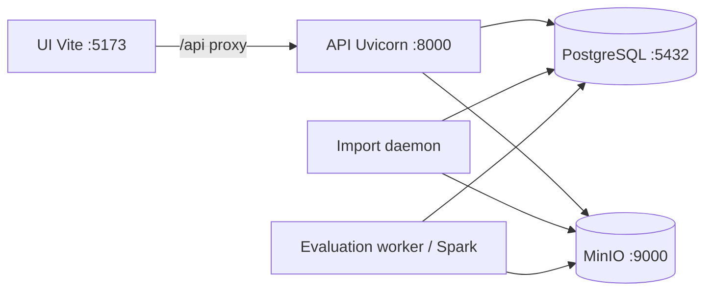

# Runbook triển khai cục bộ: Docker → API → daemon → worker → UI

**Mã tài liệu:** ENG-RUNBOOK-01
**Phạm vi:** máy phát triển đơn nút, dữ liệu synthetic. Không dùng cho production.
**Thay thế:** mục 6.1–6.2 của `DEPLOYMENT_GUIDE.md`.

Mọi lệnh chạy từ thư mục gốc dự án, trừ khi ghi khác.

Trong **mỗi terminal backend**, đặt `export PYTHONPATH="$PWD/src"` trước khi chạy lệnh Python/Uvicorn
(dự án dùng `tool.uv.package = false`). `uv --env-file .env` nạp biến cho cả daemon và Spark;
không cần `source .env`. Biến đã export trong shell có thể ghi đè file, nên tránh giữ cấu hình test cũ.

Import CSV/JSONL/Parquet dùng chung bộ chuẩn hóa batch (tối đa 8192 dòng hoặc 16 MiB
text/batch, 8 MiB/record). CSV giữ khoảng trắng trong cell và quoted multiline;
JSONL giữ độ chính xác Decimal và mã hóa container bằng canonical JSON;
Parquet scalar dùng Arrow string cast. Privacy scan lúc import nhận giá trị JSON gốc,
không scan chuỗi JSON đã encode thay cho object. Chuẩn hóa không đóng stream do caller sở hữu.

Descriptor snapshot v2 ghim đúng `version_id` và SHA-256 của một raw object; đọc phiên bản
lịch sử không phụ thuộc latest key. Source `shared` chỉ bật bằng cấu hình operator và
tenant-prefix không chồng lấn. Endpoint/bucket binding đổi thì snapshot fail closed.
Protected processing bắt buộc CA riêng `DQ_SOURCE_S3_CA_BUNDLE`; không mượn CA của owned store.
Migration 024 giữ fingerprint/profile legacy và từ chối rollback khi còn descriptor mới.



| Tiến trình | Lệnh | DSN dùng | Ghi chú |
|---|---|---|---|
| PostgreSQL + MinIO | `docker compose ... dev.yml up` | — | Volume `dq_scoring_postgres_data`, `dq_scoring_minio_data` |
| API | `uvicorn ...create_app --factory` | `DQ_POSTGRES_DSN` (app role) | Từ chối superuser/BYPASSRLS |
| Import daemon | `python -m dq_scoring.workers.import_daemon` | `DQ_WORKER_POSTGRES_DSN` | Xử lý import **và** privacy scan |
| Evaluation worker | `python -m dq_scoring.workers.daemon` **hoặc** Spark compose | `DQ_WORKER_POSTGRES_DSN` | Chỉ chạy **một** evaluation worker |
| UI | `bun run dev` | — | Proxy `/api` sang `DQ_API_URL` (mặc định `http://127.0.0.1:8000`) |

---

## 0. Yêu cầu

- Docker + Docker Compose v2, `uv`, `bun`.
- Java 17 hoặc 21 cho evaluation worker chạy trên host (`java -version`).
- Cổng trống: `5432`, `9000`, `9001`, `8000`, `5173`. Môi trường test dùng `15432`/`19000`, không xung đột.

## 1. Cấu hình `.env` (một lần)

```bash
cp -n .env.example .env
chmod 600 .env
uv sync --locked          # gồm nhóm dev → có PySpark cho worker host
```

Điền các biến sau trong `.env` (không commit, không dán lên chat/log):

| Biến | Yêu cầu |
|---|---|
| `DQ_POSTGRES_USER`, `DQ_POSTGRES_PASSWORD`, `DQ_POSTGRES_DB` | Superuser do container Postgres tạo **ở lần khởi tạo volume đầu tiên** |
| `DQ_ADMIN_POSTGRES_DSN` | DSN của **chính superuser ở trên**; chỉ dùng cho migration/cấp role |
| `DQ_POSTGRES_DSN` | Login API, ví dụ `dq_app_user`; không superuser |
| `DQ_WORKER_POSTGRES_DSN` | Login worker, ví dụ `dq_worker_user`; không superuser |
| `DQ_AUTH_SECRET_KEY` | Ngẫu nhiên ≥ 32 ký tự; giá trị mẫu bị API từ chối |
| `DQ_S3_ACCESS_KEY_ID`, `DQ_S3_SECRET_ACCESS_KEY` | Root credential của MinIO dev |
| `DQ_S3_ENDPOINT_URL` | `http://localhost:9000` |
| `DQ_SOURCE_S3_ENABLED` | `false` (mặc định). Chỉ bật khi có nguồn S3 dùng chung chỉ-đọc; khi đó bắt buộc các biến `DQ_SOURCE_S3_*` bên dưới |
| `DQ_SOURCE_S3_ENDPOINT_URL`, `DQ_SOURCE_S3_BUCKET` | Endpoint và bucket của nguồn; credential `DQ_SOURCE_S3_ACCESS_KEY_ID`/`DQ_SOURCE_S3_SECRET_ACCESS_KEY` riêng, chỉ-đọc, khác credential MinIO |
| `DQ_SOURCE_S3_TENANT_PREFIXES` | JSON `{"<tenant-uuid>":["prefix/"]}`; prefix kết thúc `/`, không chồng lấn giữa các tenant |
| `DQ_SOURCE_S3_RETENTION_GUARANTEED` | `false` trừ khi operator cam kết giữ mọi phiên bản object được tham chiếu (retention) |
| `DQ_SOURCE_S3_CA_BUNDLE` | Đường dẫn host của PEM CA riêng cho nguồn; compose mount read-only tại `/opt/dq/source-ca/source-s3-ca.pem` trên `evaluation-worker` và các Spark worker |

Mẫu `.env.example` để trống credential/CA. Khi `DQ_SOURCE_S3_ENABLED=false`, compose gốc chạy như cũ
(không cần CA; mount CA trỏ `/dev/null`). Kubernetes: Helm `sourceStore.*` (Secret credential riêng
`existingSecret`, CA riêng `caSecret` mount `/opt/dq/source-ca` trên API/import/driver/executor; executor lấy credential
bằng `secretKeyRef`, không có credential dạng rõ trong Spark conf). Chế độ protected yêu cầu endpoint HTTPS đúng
`<service>.<namespace>.svc.<clusterDomain>:<port>` khớp `sourceStore.allowedService` và `caSecret` riêng.

Sinh secret: `uv run python -c 'import secrets; print(secrets.token_urlsafe(48))'`.

> Mật khẩu trong DSN có ký tự đặc biệt (`@ : / ? #`) phải URL-encode.
> Đổi `DQ_POSTGRES_PASSWORD` sau khi volume đã tồn tại **không** đổi mật khẩu trong DB.

## 2. Khởi động Docker (PostgreSQL + MinIO)

```bash
docker compose --env-file .env -p dq-scoring -f deploy/compose/dev.yml up -d --wait postgres minio
docker compose --env-file .env -p dq-scoring -f deploy/compose/dev.yml run --rm --no-deps minio-init
docker compose --env-file .env -p dq-scoring -f deploy/compose/dev.yml ps -a
```

Kỳ vọng: `dq-scoring-postgres`, `dq-scoring-minio` ở trạng thái `healthy`; lệnh `minio-init`
thoát mã 0 sau khi tạo 3 bucket và bật versioning cho bucket snapshots.
MinIO console: <http://localhost:9001>.

Tách `minio-init` khỏi `--wait`: đây là container chạy một lần rồi thoát 0, không phải dịch vụ chạy liên tục.
Giữ tên project `dq-scoring` để tái sử dụng đúng volume dev hiện có.

## 3. Migration và login role (lần đầu, và sau mỗi lần pull có migration mới)

Script dùng admin DSN để chạy migration chưa áp dụng, rồi tạo/cập nhật login của API và worker
theo user/password lấy từ chính `DQ_POSTGRES_DSN` và `DQ_WORKER_POSTGRES_DSN`. Không in secret.
Hai login runtime phải khác nhau, khác login admin, và không phải các group role `dq_*_role`.
Chỉ dùng script trên sandbox synthetic; sao lưu trước khi áp dụng migration vào dữ liệu cần giữ.

```bash
uv run --locked --env-file .env python - <<'PY'
import os

import psycopg
from psycopg import sql
from psycopg.conninfo import conninfo_to_dict

from dq_scoring.adapters.db.migrator import apply_all_migrations

with psycopg.connect(os.environ["DQ_ADMIN_POSTGRES_DSN"]) as conn:
    runtime_users = [conninfo_to_dict(os.environ[k])["user"] for k in ("DQ_POSTGRES_DSN", "DQ_WORKER_POSTGRES_DSN")]
    admin = conn.execute("SELECT session_user").fetchone()[0]
    if len(set(runtime_users)) != 2 or any(u == admin or u.endswith("_role") for u in runtime_users):
        raise ValueError("Cần hai login runtime riêng, không dùng admin/group role")
    applied = apply_all_migrations(conn)
    for key, group in (("DQ_POSTGRES_DSN", "dq_app_role"), ("DQ_WORKER_POSTGRES_DSN", "dq_worker_role")):
        params = conninfo_to_dict(os.environ[key])
        user = params["user"]
        exists = conn.execute("SELECT 1 FROM pg_roles WHERE rolname = %s", (user,)).fetchone()
        verb = "ALTER" if exists else "CREATE"
        conn.execute(
            sql.SQL(verb + " ROLE {} LOGIN NOSUPERUSER NOBYPASSRLS NOCREATEDB NOCREATEROLE PASSWORD {}").format(
                sql.Identifier(user), sql.Literal(params["password"])
            )
        )
        conn.execute(sql.SQL("GRANT {} TO {}").format(sql.Identifier(group), sql.Identifier(user)))
    conn.commit()
print(f"Migration mới: {applied or 'không có'}; login app/worker đã sẵn sàng.")
PY
```

Kiểm tra lịch sử migration:

```bash
uv run --locked --env-file .env python -c 'import os, psycopg; c = psycopg.connect(os.environ["DQ_ADMIN_POSTGRES_DSN"]); print([r[0] for r in c.execute("SELECT version FROM schema_migrations ORDER BY version")])'
```

### Đặt mật khẩu tài khoản quản trị đầu tiên

Migration 001 tạo `admin@dqscoring.local` (WORKSPACE_ADMIN của tenant `default`) với hash giả,
nên chưa đăng nhập được. Đặt mật khẩu (nhập ẩn, không vào shell history):

```bash
uv run --locked --env-file .env python - <<'PY'
import getpass
import os

import psycopg

from dq_scoring.presentation.api.auth import hash_password

password = getpass.getpass("Mật khẩu mới cho admin@dqscoring.local: ")
with psycopg.connect(os.environ["DQ_ADMIN_POSTGRES_DSN"]) as conn:
    updated = conn.execute(
        "UPDATE users SET password_hash = %s, failed_login_attempts = 0, locked_until = NULL, updated_at = now() "
        "WHERE lower(email) = 'admin@dqscoring.local'",
        (hash_password(password),),
    ).rowcount
print(f"Đã cập nhật {updated} tài khoản.")
PY
```

## 4. Khởi động API

Terminal 1:

```bash
uv run --locked --env-file .env uvicorn \
  dq_scoring.presentation.api.app:create_app \
  --factory --app-dir src \
  --host 127.0.0.1 --port 8000 --reload
```

Kiểm tra:

```bash
curl -s http://127.0.0.1:8000/health
# {"status":"healthy","service":"dq-scoring-api"}
```

Swagger: <http://127.0.0.1:8000/docs>. Nếu shell có `DQ_RUNTIME_POSTGRES_DSN`, API dùng biến
này thay cho `DQ_POSTGRES_DSN`; `unset DQ_RUNTIME_POSTGRES_DSN` khi chạy dev.

## 5. Khởi động import daemon

Terminal 2:

```bash
uv run --locked --env-file .env python -m dq_scoring.workers.import_daemon
PYTHONPATH="$PWD/src" uv run --locked --env-file .env python -m dq_scoring.workers.daemon
```

Daemon này xử lý cả hàng đợi import và privacy scan. Thiếu `DQ_WORKER_POSTGRES_DSN` thì dừng ngay.

## 6. Khởi động evaluation worker (chọn một cách)

### 6a. Worker trên host, Spark `local[*]` (đơn giản nhất)

Terminal 3:

```bash
uv run --locked --env-file .env python -m dq_scoring.workers.daemon
```

- Cần Java 17/21. Lần chạy đầu Spark tải `org.apache.hadoop:hadoop-aws:3.5.0` từ Maven để đọc
  `s3a://` → cần Internet (jar được cache trong `~/.ivy2`).
- Tổng bộ nhớ driver + executor phải ≤ `DQ_SPARK_MAX_MEMORY_MB`, nếu không worker từ chối khởi động.

### 6b. Spark standalone trong Docker (2 worker + driver)

Không chạy song song với 6a. Container driver tự đổi host DSN thành `postgres:5432` và dùng
network `dq_scoring_network` của bước 2.

```bash
docker compose --env-file .env -p dq-spark -f deploy/compose/spark.yml config --quiet
docker compose --env-file .env -p dq-spark -f deploy/compose/spark.yml up -d --build
docker compose -p dq-spark ps
```

Phải luôn kèm `--env-file .env` (từ thư mục gốc) và `-p dq-spark`. Thiếu `--env-file`,
Compose báo `required variable DQ_WORKER_POSTGRES_DSN is missing a value`.
Khối lượng tài nguyên: xem README mục Spark (cgroup tổng ~15.5 GiB).

## 7. Khởi động UI

Terminal 4:

```bash
cd frontend
bun install --frozen-lockfile
bun run dev
```

Mở URL Vite in ra (mặc định <http://localhost:5173>). API ở máy/cổng khác:
`DQ_API_URL=http://host:port bun run dev`.

Build tĩnh: `bun run build` → `frontend/dist/`; khi phục vụ bản build, reverse proxy phải
chuyển `/api` sang API.

## 8. Kiểm tra toàn hệ thống

1. Đăng nhập UI bằng `admin@dqscoring.local` và mật khẩu ở bước 3.
2. `/monitor`: thấy heartbeat `IMPORT` và `EVALUATION` ở trạng thái ready (tươi trong 20 giây).
3. `/assets`: tạo asset, tải CSV synthetic, xác nhận đăng ký snapshot → import daemon xử lý.
4. `/runs/new`: chạy đánh giá bằng ruleset/policy ACTIVE → run chuyển `QUEUED → LEASED → RUNNING → SUCCEEDED`.
   Ruleset/policy cần được người khác phê duyệt theo cơ chế four-eyes; một tài khoản admin không tự duyệt cấu hình mình tạo.

## 9. Dừng hệ thống (giữ dữ liệu)

```bash
# Terminal API/daemon/UI: Ctrl+C (daemon dừng graceful qua SIGINT)
docker compose --env-file .env -p dq-spark -f deploy/compose/spark.yml stop # nếu dùng 6b
docker compose --env-file .env -p dq-scoring -f deploy/compose/dev.yml stop
```

`down` (không `-v`) xóa container nhưng giữ volume. **Không** dùng `down -v` trừ khi chủ động
xóa toàn bộ dữ liệu dev.

## 10. Lỗi thường gặp

| Triệu chứng | Nguyên nhân / cách xử lý |
|---|---|
| `required variable ... is missing a value` | Chạy Compose thiếu `--env-file .env` hoặc sai thư mục; chạy từ thư mục gốc |
| `password authentication failed` ở bước 3 | `DQ_ADMIN_POSTGRES_DSN` không khớp superuser đã tạo lúc khởi tạo volume |
| API trả 500, log `Privileged session_user is not permitted` | `DQ_POSTGRES_DSN` đang dùng superuser/BYPASSRLS; dùng login app ở bước 3 |
| API không khởi động: `DQ_AUTH_SECRET_KEY ... 32 characters` | Secret quá ngắn hoặc còn giá trị mẫu |
| Run kẹt `QUEUED` | Evaluation worker chưa chạy, hoặc dùng DSN app thay vì worker |
| Snapshot kẹt ở import | Import daemon chưa chạy hoặc không kết nối được MinIO |
| Worker lỗi `JAVA_HOME`/`Java gateway` | Cài Java 17/21, kiểm tra `java -version` |
| `PROTECTED_TRANSPORT_CONFIGURATION_REQUIRED` | `DQ_PROTECTED_PROCESSING_ENABLED` đang bật; dev cục bộ để trống biến này |
| Docker `up --wait` báo lỗi dù `minio-init` thoát 0 | Chạy tách hai lệnh ở bước 2, không đợi one-shot bằng `--wait` |
| `pytest` lỗi kết nối MinIO | Môi trường test (`dq-e2e-test`) chưa chạy; xem README mục Kiểm chứng cô lập |

## 11. Kết quả kiểm tra lệnh khi soạn tài liệu

- Docker Compose dev và Spark: `config --quiet` thành công.
- Khởi động riêng PostgreSQL/MinIO bằng `up -d --wait postgres minio`: mã 0, cả hai healthy.
- `run --rm --no-deps minio-init`: mã 0, bucket snapshots bật versioning.
- Import module API/import daemon/evaluation daemon thành công; các đoạn Python heredoc kiểm tra được cú pháp.
- **Chưa xác minh startup end-to-end API/daemon/worker/UI trong lượt soạn tài liệu này.**
  `DQ_ADMIN_POSTGRES_DSN` hiện có trong `.env` bị lỗi xác thực; kết nối dựng từ
  `DQ_POSTGRES_USER`/`DQ_POSTGRES_PASSWORD` thành công và DB dev mới ghi nhận migration đến `015`.
  Cần sửa admin DSN trong file riêng rồi thực hiện bước 3; không tự sửa credential hay chạy migration vào DB dev khi kiểm tra tài liệu.
- Sau smoke Docker, PostgreSQL/MinIO đã được dừng lại; volume dữ liệu được giữ.

## Profiling snapshot và AI advisory

Trang `/snapshots/:snapshotId?tab=overview` dùng chung endpoint preview đã masking, không có API profile
thứ hai. Bên trong có ba mục: **Dữ liệu mẫu**, **Hồ sơ cột**, **Thông tin**. KPI dòng/trường lấy từ
snapshot; fill rate lấy từ mẫu, cộng số ô non-null và số ô được quan sát trên tất cả cột có đủ profile.
Không có mẫu hoặc mẫu số bằng 0 thì hiển thị không khả dụng; không suy ra Unique/Duplicate % từ distinct count.
Tìm kiếm chỉ lọc tối đa 50 dòng mẫu đã tải, không quét toàn bộ dataset. Min/max của cột được bảo vệ
không được trả qua preview; UI tiếp tục ẩn chi tiết bảo vệ khi classification chưa tải được.

AI advisory là hành động chủ động, không chạy khi mở trang và không tham gia import, privacy scan hay
tính điểm/gate/hash assessment. Mặc định `DQ_LLM_ENABLED=false`; giữ tắt trên staging cho đến khi
gateway được phê duyệt. Output chỉ là gợi ý để sửa trong DRAFT và vẫn cần quy trình phê duyệt hiện có.
Narrative là plaintext tham vấn chưa xác minh; số điểm/coverage/gate trên trang vẫn lấy từ assessment.
Không gửi raw preview, evidence, min/max hoặc tên cột tới gateway: context dùng token cột và thống kê
allowlist. Lỗi AI không được làm hỏng heuristic recommendations hay truy xuất assessment.

Không bật local privacy REQUIRED khi chưa có runtime image/model digest, license, benchmark synthetic,
coverage toàn phần và ngân sách tài nguyên được duyệt. Không có artifact/model không đồng nghĩa scan local
đã thành công; scan deterministic hiện có không được quảng bá là local LLM enforcement.

API advisory (JWT, tenant-scoped): `GET /api/v1/ai/status` chỉ báo trạng thái; GET recommendations
hiện có vẫn heuristic. `POST /api/v1/snapshots/{id}/recommendations/ai` nhận `engine` (`LLM` hoặc
`HYBRID`), `domain`, `priorities`; chỉ người có quyền import được gọi. HYBRID có provenance/fallback
code khi gateway lỗi; LLM-only trả lỗi rõ ràng, không gắn nhãn nhầm heuristic là AI. Chỉ context từ
snapshot có scan COMPLETE/current mới đủ điều kiện. Kết quả bị loại nếu context/policy thay đổi trong
lúc gọi; không giữ DB connection qua inference. `POST /api/v1/assessments/{id}/narrative` tạo report
riêng; GET cùng đường dẫn chỉ đọc report mới nhất, không gọi model. Migration `021_assessment_narratives`
phải được áp dụng trước API mới; report không sửa immutable assessment/hash.
Mỗi POST thành công tạo report append-only mới; lỗi gateway hoặc context thay đổi không tạo report.
GET trả report mới nhất theo thời gian tạo và report ID, không kích hoạt inference. Các POST đồng thời
không ghi đè nhau; không cam kết thứ tự theo thời điểm bắt đầu request.

Cấu hình local qua `DQ_LLM_ENABLED`, `DQ_LLM_ENDPOINT` (HTTPS chat-completions URL đã duyệt),
`DQ_LLM_MODEL`, `DQ_LLM_API_KEY` (secret), tùy chọn `DQ_LLM_CA_BUNDLE`. Không dùng redirect, proxy
environment, retry hoặc provider fallback. UI dành 130 giây cho các POST advisory để vượt trần timeout
gateway 120 giây; các API thường giữ nguyên timeout. Đây là timeout vận chuyển, không phải cam kết
provider hoàn tất inference trong thời gian đó. Không cấu hình endpoint từ input của người dùng.

## Snapshot một nguồn bất biến

Import mới upload trực tiếp vào snapshot bucket đã bật versioning, giữ đúng một raw object và
descriptor v2; không tạo canonical Parquet. Chuẩn hóa được thực hiện theo batch khi đọc, giữ nguyên
SHA-256 của raw, mapping và normalization spec. Snapshot cũ vẫn đọc canonical đã ghim, không sửa lịch sử.
`POST /api/v1/imports` cho phép `source: {source_id: "shared", bucket, key, version_id}` với tenant-prefix
được operator cấp. Chỉ dùng tham chiếu khi nguồn có version và operator cam kết retention; nếu không,
worker giữ một raw thuộc hệ thống. Mất quyền hoặc mất phiên bản không tự đổi sang dữ liệu khác.
`DATA_ENGINEER` dùng luồng create → upload/complete (nếu upload trực tiếp) → worker VERIFIED → register.
Reconfigure dùng lại raw đã ghim; lỗi `IMPORT_REVERIFY_REQUIRED` yêu cầu configure cùng mapping rồi
đợi worker trước khi register lại, không upload lại. Source không thuộc workspace trả 404 chung.

### Luồng API với nguồn dùng chung

`DATA_ENGINEER`: `POST /api/v1/imports` (tham chiếu `source` hoặc upload) → worker VERIFIED → register → FULL profile →
`POST /api/v1/runs` → polling `GET /api/v1/runs/{id}/status`. Cam kết retention của operator
(`DQ_SOURCE_S3_RETENTION_GUARANTEED=true`) là điều kiện để giữ tham chiếu không copy raw vào owned bucket;
thiếu cam kết thì worker giữ một raw thuộc hệ thống. Request không có `idempotency_key` mặc định tái sử dụng
kết quả SUCCEEDED đã PUBLISHED của cùng user/tenant và đúng snapshot/ruleset/policy/FULL/execution/outlier,
trả **200** với run/assessment hiện có thay vì 202 tạo run mới. Hit là báo cáo lịch sử, không đọc lại nguồn.
Gửi `reuse_completed=false` để chạy mới, hoặc dùng explicit `idempotency_key` cho retry một run riêng.
Key đã dùng với payload hoặc owner khác trả 409 `IDEMPOTENCY_CONFLICT`; UI vẫn dùng explicit key như trước.
Compose mount CA owned tại `/opt/dq/owned-ca/s3-ca.pem` và source tại `/opt/dq/source-ca/source-s3-ca.pem`,
read-only trên driver và các Spark worker; env CA host path được chuyển sang đúng container path.
Trong Compose, `DQ_COMPOSE_S3_ENDPOINT_URL` chọn endpoint owned mà container truy cập được
(mặc định `http://minio:9000`); không dùng URL localhost dành cho host. Kubernetes không protected
không hỗ trợ private owned CA chỉ tồn tại trên driver: cấu hình đó bị từ chối thay vì truyền path
không được mount sang executor. Protected mode dùng owned CA trong `/opt/dq/security` và source CA riêng.

### Dọn orphan có kiểm soát

`PYTHONPATH=src DQ_MIGRATION_POSTGRES_DSN=... python -m dq_scoring.presentation.cli.prune_snapshot_orphans --tenant-id <uuid> --dry-run|--apply [--older-than-hours N>=24]`.
Chỉ xét session đã hết hạn ở trạng thái REGISTERED/FAILED/REJECTED/ABORTED, trong prefix `snapshots/{tenant}/{upload}/` và đúng staging key do session tạo;
không bao giờ nguồn bên ngoài. Version còn là root (snapshot, `_run_spec`, session chưa hết hạn hoặc đang active) được giữ.
Bucket không bật versioning chỉ được báo `UNVERSIONED_SKIPPED` kèm số byte chưa thu hồi. `--apply` lấy khóa tenant độc quyền (timeout 5s,
bận → `STORAGE_BUSY`, exit 1), kiểm lại root + HEAD trước mỗi lần xóa; bị từ chối/ObjectLock → `BLOCKED`, exit khác 0.
Snapshot legacy đã đăng ký (canonical/raw, report) không bị xóa hay sửa; không tự chạy cron.
Staging upload cũ chỉ được xét đúng key trong `imports/{tenant}/{upload}/`; object được chọn bằng
`source_ref` không thuộc deletion set. Cùng explicit run key nhưng ở tenant khác là hai namespace riêng;
retry thắng race trả trạng thái và thời điểm tạo đã lưu, không tự giả `QUEUED`.
MinIO có thể trả `InvalidRequest` cho object WORM đang retention; CLI vẫn báo `BLOCKED` và exit 1,
không thử bỏ retention hoặc xóa phiên bản khác thay thế.
CSV được giới hạn 8 MiB cho mỗi logical record (kể cả header và quoted multiline) trước khi parser
tạo đầy đủ các field; quá giới hạn trả `RECORD_TOO_LARGE`, không đọc hết record lớn vào bộ nhớ.
