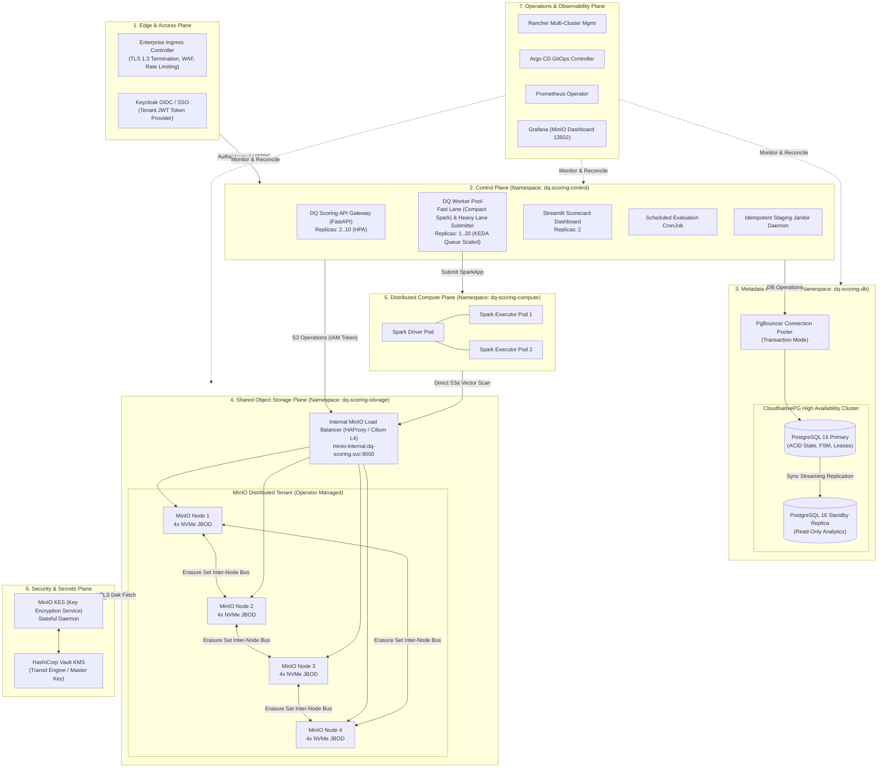
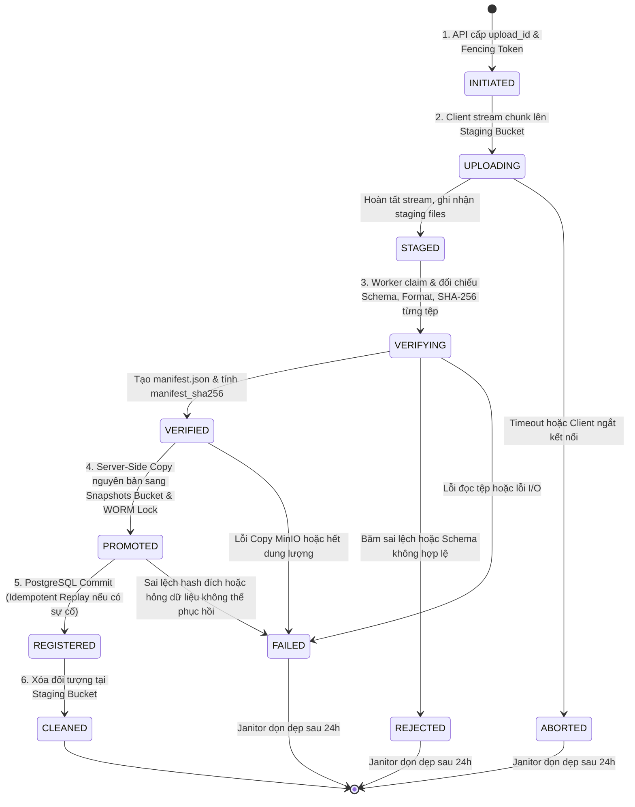

# THIẾT KẾ HẠ TẦNG SẢN XUẤT VÀ LƯU TRỮ ĐỐI TƯỢNG (MINIO & INFRASTRUCTURE DESIGN)
## DQ Scoring System — Tài liệu Đặc tả Hạ tầng Phân tán & Lưu trữ Bền vững
**Phiên bản:** 1.0 (Production Architecture Baseline)  
**Trạng thái:** Approved Architecture Specification  
**Phạm vi áp dụng:** Môi trường Triển khai Cục bộ, CI/CD, Staging và Cụm Kubernetes Sản xuất (k3s On-Premise)  
**Tài liệu liên quan:** `docs/Chapter_4.md` (§4.6, §4.7), `docs/Chapter_5.md` (§ADR-011, §5.2.1)

---

## MỤC LỤC

1. [Tổng quan, Mục tiêu & Phạm vi Thiết kế](#1-tổng-quan-mục-tiêu--phạm-vi-thiết-kế)
   - 1.1. Bối cảnh và Động lực
   - 1.2. Phân định Ranh giới 4 Môi trường (Local, CI, Staging, Production/DR)
   - 1.3. Mô hình Phân định Trách nhiệm (Shared Responsibility Model)
2. [Kiến trúc Phân tầng Mặt phẳng Hạ tầng (Multi-Plane Infrastructure)](#2-kiến-trúc-phân-tầng-mặt-phẳng-hạ-tầng-multi-plane-infrastructure)
   - 2.1. Bản đồ Phân tầng Hệ thống
   - 2.2. Luồng Mạng và Ranh giới Tường lửa (Network Topology & Isolation)
3. [Kiến trúc MinIO Sản xuất Phân tán (Distributed Multi-Node Multi-Drive)](#3-kiến-trúc-minio-sản-xuất-phân-tán-distributed-multi-node-multi-drive)
   - 3.1. Topology Nút và Ổ đĩa (MNMD Topology)
   - 3.2. Cơ chế Mã hóa Xóa (Erasure Coding & Parity Identity)
   - 3.3. Ràng buộc Phần cứng: Kiến trúc JBOD Không lồng RAID
   - 3.4. Quản trị Khai báo qua MinIO Kubernetes Operator
   - 3.5. Định mức Tính toán Dung lượng và Overhead Lưu trữ (Capacity Sizing)
4. [Hệ thống Phân loại Bucket & Không gian Tên Đối tượng (Taxonomy & Naming)](#4-hệ-thống-phân-loại-bucket--không-gian-tên-đối-tượng-taxonomy--naming)
   - 4.1. Phân định 3 Bucket Chuyên biệt theo Vòng đời Dữ liệu
   - 4.2. Quy chuẩn Định dạng Object Key (Content-Addressed Storage)
   - 4.3. Cách ly Người thuê Tuyệt đối (Tenant Isolation & Anti-Collision)
5. [Giao thức Đăng ký & Thăng cấp Dữ liệu Đơn định (Staging-Promotion Saga)](#5-giao-thức-đăng-ký--thăng-cấp-dữ-liệu-đơn-định-staging-promotion-saga)
   - 5.1. Mô hình Máy trạng thái Đơn vị Dữ liệu (Lifecycle FSM)
   - 5.2. Trình tự Luồng 6 Bước (Detailed Sequence Flow)
   - 5.3. Ma trận Xử lý Sự cố & Dọn dẹp Rác (Failure Recovery & Janitor)
6. [Chính sách Phân quyền IAM & Kiểm soát Truy cập (Least Privilege IAM)](#6-chính-sách-phân-quyền-iam--kiểm-soát-truy-cập-least-privilege-iam)
   - 6.1. Nguyên tắc Phân quyền Theo Danh tính Tác vụ (Workload IAM Identities)
   - 6.2. Ma trận Phân quyền Thao tác (RBAC Matrix)
   - 6.3. Khai báo Chính sách Phân quyền MinIO IAM Policies
7. [An toàn Dữ liệu, Mã hóa & Quản lý Khóa (Security, TLS & SSE-KMS)](#7-an-toàn-dữ-liệu-mã-hóa--quản-lý-khóa-security-tls--sse-kms)
   - 7.1. Mã hóa Đường truyền Toàn diện (mTLS & TLS 1.3 Termination)
   - 7.2. Mã hóa Dữ liệu Tại chỗ (Server-Side Encryption with SSE-KMS)
   - 7.3. Kiến trúc Tích hợp MinIO KES (Key Encryption Service) và Vault
8. [Khả năng Chịu lỗi, Sao lưu & Khắc phục Thảm họa (HA, Backup & DR)](#8-khả-năng-chịu-lỗi-sao-lưu--khắc-phục-thảm-họa-ha-backup--dr)
   - 8.1. Khả năng Tự phục hồi Nội bộ (Self-Healing & Drive Failure)
   - 8.2. Chiến lược Sao lưu Siêu dữ liệu và Cấu hình
   - 8.3. Cơ chế Sao chép Cụm Hai Chiều (MinIO Active-Passive Site Replication)
   - 8.4. Cam kết Chỉ số RPO và RTO
9. [Giám sát, Cảnh báo & Vận hành SRE (Observability & SRE Runbook)](#9-giám-sát-cảnh-báo--vận-hành-sre-observability--sre-runbook)
   - 9.1. Chỉ số Prometheus Chuẩn hóa và Dashboard 13502
   - 9.2. Ma trận Quy tắc Cảnh báo (Alert Rules Matrix)
   - 9.3. Sổ tay Xử lý Khủng hoảng Vận hành (Incident Runbooks)
10. [Ma trận So sánh Cấu hình Môi trường (Environment Comparison Matrix)](#10-ma-trận-so-sánh-cấu-hình-môi-trường-environment-comparison-matrix)
11. [Tiêu chí Nghiệm thu Kỹ thuật Hạ tầng (Infrastructure Acceptance Criteria)](#11-tiêu-chí-nghiệm-thu-kỹ-thuật-hạ-tầng-infrastructure-acceptance-criteria)
12. [Phụ lục: Bản Khai báo Kubernetes Manifest Mẫu](#12-phụ-lục-bản-khai-báo-kubernetes-manifest-mẫu)

---

## 1. TỔNG QUAN, MỤC TIÊU & PHẠM VI THIẾT KẾ

### 1.1. Bối cảnh và Động lực
Hệ thống **DQ Scoring System** thực thi nhiệm vụ đo lường và đánh giá chất lượng dữ liệu doanh nghiệp một cách đơn định, có thể tái lập và chống giả mạo. Theo nguyên tắc cốt lõi của Kiến trúc Hướng Dữ liệu Chuyên sâu (DDIA - Martin Kleppmann):
- **Tính Bất biến của Dữ liệu Nguồn (Immutable Source of Truth):** Một khi tập dữ liệu được đưa vào đánh giá, nội dung nhị phân phải được đóng băng bất biến (`Write-Once, Read-Many`). Bất kỳ sự sửa đổi byte nào cũng làm sai lệch giá trị băm `content_sha256`, dẫn đến kết quả đánh giá không còn giá trị pháp lý và kiểm toán.
- **Tách biệt Lưu trữ và Tính toán (Disaggregated Compute & Storage):** Không để dữ liệu thô nằm cục bộ trên bộ nhớ đệm hay ổ cứng tạm thời của Worker. Toàn bộ raw snapshots, tệp upload staging, và bằng chứng kiểm toán đã che mờ phải được quản lý trên tầng lưu trữ đối tượng tương thích Amazon S3 (S3-Compatible Object Storage) có tính sẵn sàng cao.
- **MinIO** được lựa chọn làm giải pháp lưu trữ đối tượng chuẩn hóa trên cụm máy chủ nội bộ (on-premise) và môi trường kiểm thử, hỗ trợ 100% chuẩn S3 API v4, bảo đảm tính di động tuyệt đối sang AWS S3, Google Cloud Storage hoặc Azure Blob Storage mà không thay đổi bất kỳ dòng mã nghiệp vụ nào.

### 1.2. Phân định Ranh giới 4 Môi trường
Tài liệu này xác lập rõ ranh giới kiến trúc và mục tiêu kỹ thuật giữa 4 môi trường:

| Môi trường | Topology MinIO | Cơ chế Lưu trữ & Chịu lỗi | Bảo vệ Dữ liệu & WORM | Mục đích Sử dụng |
| :--- | :--- | :--- | :--- | :--- |
| **1. Local Sandbox** | Standalone Single-Node Single-Drive (SNSD) qua Docker Compose hoặc Filesystem Adapter | Thư mục cục bộ / 1 Docker volume; Không có Erasure Coding; Không chịu lỗi phần cứng | Bật băm SHA-256; Không bắt buộc Object Lock; Xóa tự do khi reset môi trường | Dành cho lập trình viên phát triển tính năng, kiểm thử luồng nghiệp vụ trên máy trạm cá nhân. |
| **2. CI Pipeline** | Container MinIO tạm thời (Ephemeral MinIO) trên GitHub Actions / CI Runner | Bộ nhớ đệm container; tự hủy sau khi kết thúc run kiểm thử | Xác thực hợp đồng S3 API; xác minh băm SHA-256; không duy trì trạng thái lâu dài | Tự động hóa kiểm thử tích hợp (integration tests), kiểm thử hợp đồng adapter S3 với API thật. |
| **3. Staging** | Distributed MinIO Tenant (4 nodes, 4 drives/node) trên cụm K8s Staging | Erasure Coding EC:4; XFS volumes trên Ceph RBD hoặc Local NVMe | Bật Versioning, giả lập Object Lock Governance Mode, tích hợp Vault KMS | Kiểm thử tải, xác thực quy trình nâng cấp không gián đoạn, giả lập sự cố mất nút và diễn tập sao chép. |
| **4. Production & DR** | Distributed MinIO Tenant (Multi-Node Multi-Drive) trên cụm k3s Dedicated Storage Nodes | Erasure Coding EC:4; 16+ Local NVMe drives (JBOD trực tiếp); Active-Passive Site Replication | Bật WORM Compliance Mode; SSE-KMS mã hóa tại chỗ; Kiểm toán toàn diện; RPO ≤ 15m, RTO ≤ 30m | Phục vụ môi trường vận hành thực tế của doanh nghiệp; lưu trữ raw snapshots bất biến và bằng chứng kiểm toán. |

### 1.3. Mô hình Phân định Trách nhiệm (Shared Responsibility Model)

```
┌──────────────────────────────────────────────────────────────────────────────────────────────────┐
│                   MÔ HÌNH PHÂN ĐỊNH TRÁCH NHIỆM VẬN HÀNH HẠ TẦNG LƯU TRỮ                         │
├──────────────────────────────────────────────────────────────────────────────────────────────────┤
│ LỚP ỨNG DỤNG (DQ Scoring Team)                                                                  │
│  - Khai báo Schema và Metadata DatasetSnapshot trong PostgreSQL                                  │
│  - Điều phối Giao thức Staging-Promotion-Registration (Saga FSM)                                 │
│  - Che mờ PII tại nguồn (EvidenceRedactor) trước khi lưu trữ bằng chứng                          │
│  - Tính toán và xác thực mã băm nội dung SHA-256 trên mọi luồng đọc/ghi                          │
│  - Quản lý vòng đời và kích hoạt Garbage Collection dọn dẹp đối tượng mồ côi (Orphan Objects)    │
├──────────────────────────────────────────────────────────────────────────────────────────────────┤
│ LỚP DỊCH VỤ LƯU TRỮ ĐỐI TƯỢNG (MinIO Tenant & KES)                                               │
│  - Cung cấp giao diện S3 API v4 (Put, Get, Copy, Delete, Head, Multipart)                        │
│  - Thực thi thuật toán Mã hóa Xóa (Erasure Coding) và tự phục hồi dữ liệu (Self-Healing)        │
│  - Thực thi chính sách WORM / Object Lock và chính sách vòng đời Bucket Lifecycle (ILM)          │
│  - Tích hợp MinIO KES với Vault KMS để thực thi mã hóa tại chỗ (SSE-KMS)                         │
│  - Thực thi sao chép dữ liệu liên vùng (Site-to-Site Replication)                                 │
├──────────────────────────────────────────────────────────────────────────────────────────────────┤
│ LỚP NỀN TẢNG & HẠ TẦNG VẬT LÝ (Platform Engineering / SRE Team)                                  │
│  - Quản trị Cụm Kubernetes k3s, cài đặt và nâng cấp MinIO Kubernetes Operator                   │
│  - Cấu hình và cấp phát Local Persistent Volumes (NVMe JBOD mount XFS)                           │
│  - Thiết lập hạ tầng mạng phân tán 25GbE+, Top-of-Rack Switches, DNS và Ingress TLS 1.3           │
│  - Vận hành cụm HashiCorp Vault tập trung, quản lý vòng đời Master Key                           │
│  - Giám sát phần cứng vật lý, thay thế ổ đĩa hỏng và mở rộng Server Pools khi tăng trưởng        │
└──────────────────────────────────────────────────────────────────────────────────────────────────┘
```


---

## 2. KIẾN TRÚC PHÂN TẦNG MẶT PHẲNG HẠ TẦNG (MULTI-PLANE INFRASTRUCTURE)

### 2.1. Bản đồ Phân tầng Hệ thống
Toàn bộ hạ tầng của hệ thống DQ Scoring System được phân rã thành 7 mặt phẳng (planes) độc lập, bảo đảm ranh giới cô lập lỗi (fault domains) và phân quyền chặt chẽ:



### 2.2. Luồng Mạng và Ranh giới Tường lửa (Network Topology & Isolation)
Hạ tầng tuân thủ kiến trúc Zero-Trust thông qua Kubernetes `NetworkPolicy`:
1. **Ranh giới Storage Isolation:** Namespace `dq-scoring-storage` chỉ tiếp nhận traffic Ingress trên cổng `TCP 9000` (S3 API) từ hai nguồn duy nhất:
   - Pods có nhãn `app.kubernetes.io/part-of: dq-scoring` trong namespace `dq-scoring-control`.
   - Spark Driver/Executor pods trong namespace `dq-scoring-compute`.
   - Cấm hoàn toàn truy cập từ Ingress bên ngoài Internet vào cổng `TCP 9000`.
2. **MinIO Console Isolation:** Giao diện quản trị MinIO Console (`TCP 9001`) bị ngắt hoàn toàn khỏi Ingress công cộng. Chỉ cho phép truy cập thông qua Private Corporate VPN hoặc qua Rancher Bastion Proxy có xác thực SSO 2 yếu tố (MFA).
3. **Inter-Node Mesh:** Traffic giữa các nút MinIO trên cổng `9000` sử dụng mTLS nội bộ, chạy trên dải VLAN lưu trữ chuyên dụng (Storage VLAN 10.244.100.0/24) với chuẩn MTU 9000 (Jumbo Frames) để tối đa hóa thông lượng I/O.


---

## 3. KIẾN TRÚC MINIO SẢN XUẤT PHÂN TÁN (DISTRIBUTED MULTI-NODE MULTI-DRIVE)

### 3.1. Topology Nút và Ổ đĩa (MNMD Topology)
Hệ thống triển khai theo mô hình **Multi-Node Multi-Drive (MNMD)** chuẩn hóa của MinIO:
- **Quy mô Cụm Cơ sở (Base Server Pool):** Bao gồm tối thiểu 4 máy chủ vật lý hoặc 4 nút thợ Kubernetes chuyên dụng (Dedicated Storage Worker Nodes).
- **Phân bổ Ổ đĩa:** Mỗi nút được gắn trực tiếp 4 ổ đĩa NVMe Enterprise (PCIe Gen4, Write-Intensive). Tổng cộng cụm cơ sở có:
  $$\text{Tổng số ổ đĩa } N = 4 \text{ nodes} \times 4 \text{ drives/node} = 16 \text{ drives}$$
- **Phân nhóm Erasure Sets:** MinIO tự động phân chia 16 ổ đĩa thành 1 Erasure Set kích thước 16 đĩa (hoặc 2 Erasure Sets kích thước 8 đĩa tùy cấu hình phân bố pool). Các đĩa trong 1 Erasure Set được trải đều đối xứng trên 4 nút máy chủ vật lý khác nhau.

```
┌─────────────────────────────────────────────────────────────────────────────────────────────────┐
│              TỔNG THỂ CỤM MINIO PRODUCTION POOL (4 NODES x 4 DRIVES = 16 DRIVES)               │
├───────────────────┬───────────────────┬───────────────────┬─────────────────────────────────────┤
│   Nút Máy Chủ 1   │   Nút Máy Chủ 2   │   Nút Máy Chủ 3   │            Nút Máy Chủ 4            │
│   (Rack 1, Node A)│   (Rack 1, Node B)│   (Rack 2, Node C)│            (Rack 2, Node D)         │
├───────────────────┼───────────────────┼───────────────────┼─────────────────────────────────────┤
│ ┌───────────────┐ │ ┌───────────────┐ │ ┌───────────────┐ │ ┌───────────────┐                   │
│ │ Drive 1 (NVMe)│ │ │ Drive 5 (NVMe)│ │ │ Drive 9 (NVMe)│ │ │ Drive 13(NVMe)│                   │
│ ├───────────────┤ │ ├───────────────┤ │ ├───────────────┤ │ ├───────────────┤                   │
│ │ Drive 2 (NVMe)│ │ │ Drive 6 (NVMe)│ │ │ Drive 10(NVMe)│ │ │ Drive 14(NVMe)│                   │
│ ├───────────────┤ │ ├───────────────┤ │ ├───────────────┤ │ ├───────────────┤                   │
│ │ Drive 3 (NVMe)│ │ │ Drive 7 (NVMe)│ │ │ Drive 11(NVMe)│ │ │ Drive 15(NVMe)│                   │
│ ├───────────────┤ │ ├───────────────┤ │ ├───────────────┤ │ ├───────────────┤                   │
│ │ Drive 4 (NVMe)│ │ │ Drive 8 (NVMe)│ │ │ Drive 12(NVMe)│ │ │ Drive 16(NVMe)│                   │
│ └───────────────┘ │ └───────────────┘ │ └───────────────┘ │ └───────────────┘                   │
└───────────────────┴───────────────────┴───────────────────┴─────────────────────────────────────┘
        ▲                   ▲                   ▲                   ▲
        └───────────────────┴─────────┬─────────┴───────────────────┘
                                      ▼
             [ 16 DRIVES GHÉP NẰM TRONG CÙNG 1 ERASURE SET ]
             Cấu hình Parity: EC:4 (12 Data Shards + 4 Parity Shards)
```

### 3.2. Cơ chế Mã hóa Xóa (Erasure Coding & Parity Identity)
Hệ thống sử dụng thuật toán Mã hóa Xóa **Reed-Solomon** cấp độ khối (block-level erasure coding) độc quyền của MinIO. Khi một đối tượng nhị phân được ghi vào MinIO:
1. Đối tượng được băm xác định vị trí Erasure Set dựa trên tên và đường dẫn.
2. Đối tượng được chia thành $K$ mảnh dữ liệu (Data Shards) và $M$ mảnh chẵn lẻ (Parity Shards).
3. Cấu hình sản xuất bắt buộc ghim ở mức **`EC:4`** ($M = 4$ Parity Shards cho 12 Data Shards trong Set 16 đĩa).
4. **Bất biến Chịu Lỗi (Fault-Tolerance Invariants):**
   - **Đọc Quorum (Read Quorum):** Cần tối thiểu $K = 12$ ổ đĩa trực tuyến. Hệ thống cho phép hỏng tối đa $M = 4$ ổ đĩa bất kỳ mà việc đọc dữ liệu vẫn tiếp diễn $100\%$ bình thường mà không bị gián đoạn.
   - **Ghi Quorum (Write Quorum):** Cần tối thiểu $K + 1 = 13$ ổ đĩa trực tuyến (hoặc $K$ đĩa đối với đối tượng mới). Cho phép mất 1 nút máy chủ nguyên vẹn (4 đĩa trên cùng 1 nút) mà cụm vẫn tiếp nhận các thao tác ghi mới.


### 3.3. Ràng buộc Phần cứng: Kiến trúc JBOD Không lồng RAID
Tuân thủ tuyệt đối khuyến cáo phần cứng từ MinIO Engineering:
- **Cấm Hardware RAID (RAID 0, 5, 6, 10, 50, 60):** Bộ điều khiển RAID phần cứng che giấu trạng thái thực của các sector đĩa, làm vô hiệu hóa khả năng kiểm toán bit-rot tự động của MinIO, và tạo ra điểm nghẽn nghiêm trọng (single point of bottleneck) tại controller cache.
- **Cấm Distributed Storage Layers Lồng Nhau (Ceph over MinIO, GlusterFS, SAN):** Không triển khai MinIO trên các Persistent Volumes được cung cấp bởi Ceph hoặc NFS; việc nhân bản hai lần gây lãng phí IOPS gấp 4 lần và tạo hiện tượng cascade failover khi mạng quá tải.
- **Chuẩn hóa JBOD + XFS:** Các ổ đĩa NVMe phải được gắn trực tiếp (Just a Bunch of Drives - JBOD) vào bo mạch PCIe, định dạng tệp hệ thống bằng **XFS** với cờ phân bổ tối ưu:
  ```bash
  mkfs.xfs -L minio-nvme-01 -m crc=1 -f /dev/nvme0n1
  mount -o noatime,nodiratime,logbufs=8,logbsize=256k /dev/nvme0n1 /mnt/disk1
  ```

### 3.4. Quản trị Khai báo qua MinIO Kubernetes Operator
MinIO được triển khai và quản trị theo mô hình GitOps thông qua **MinIO Operator v5.0+**:
- Operator quản trị vòng đời cụm qua Custom Resource Definition (CRD) `Tenant`.
- Tự động cấu hình PodDisruptionBudgets (`minAvailable: 3` cho 4 nút), bảo đảm quá trình nâng cấp cụm Kubernetes không làm sập Quorum.
- Áp dụng `podAntiAffinity` mức độ `hard` (`requiredDuringSchedulingIgnoredDuringExecution`) trên nhãn `kubernetes.io/hostname` để triệt tiêu tình trạng 2 MinIO pods cùng thuộc 1 tenant nằm chung trên 1 máy chủ vật lý.

### 3.5. Định mức Tính toán Dung lượng và Overhead Lưu trữ (Capacity Sizing)
Hệ số tiêu tốn lưu trữ (Storage Overhead Ratio) của thuật toán Erasure Coding:
$$\text{Overhead Ratio} = \frac{N}{K} = \frac{N}{N - M} = \frac{16}{16 - 4} = \frac{16}{12} \approx 1.333 \quad (\approx 33.3\% \text{ overhead})$$

Bảng tính toán định mức dung lượng lưu trữ cho 1 năm vận hành:

| Hạng mục Dữ liệu | Khối lượng Thô Dự kiến/Năm | Hệ số EC:4 | Vùng Đệm Scratchpad & Phiên bản | Dung lượng Đĩa Thô Cần Cấp Phát (Raw NVMe) |
| :--- | :--- | :--- | :--- | :--- |
| **Raw Snapshots (`dq-snapshots`)** | 20 TB (ước tính 50GB/ngày) | $\times 1.333 = 26.66\text{ TB}$ | $\times 1.20$ (Metadata & Bit-rot buffer) | **32.0 TB** |
| **Staging Buffer (`dq-staging`)** | 1 TB (Dữ liệu luân chuyển 72h) | $\times 1.333 = 1.33\text{ TB}$ | $\times 1.50$ (Peak burst buffer) | **2.0 TB** |
| **Artifacts & Evidence (`dq-artifacts`)**| 2 TB (Scorecards, Redacted Evidence)| $\times 1.333 = 2.66\text{ TB}$ | $\times 1.20$ (Export archives) | **3.2 TB** |
| **TỔNG CỘNG HỆ THỐNG** | **23 TB Khả dụng** | — | — | **37.2 TB Raw NVMe** |

*Cấu hình khuyến nghị:* 4 Nodes $\times$ 4 Drives $\times$ 3.84 TB Enterprise NVMe SSD = **61.44 TB Raw Storage** (Đáp ứng tốt nhu cầu năm 1 và dự phòng 40% cho tăng trưởng).


---

## 4. HỆ THỐNG PHÂN LOẠI BUCKET & KHÔNG GIAN TÊN ĐỐI TƯỢNG (TAXONOMY & NAMING)

### 4.1. Phân định 3 Bucket Chuyên biệt theo Vòng đời Dữ liệu
Tuyệt đối không sử dụng một bucket duy nhất chứa lẫn lộn mọi loại dữ liệu. Hệ thống phân chia thành 3 buckets có chính sách bảo vệ và vòng đời hoàn toàn khác biệt:

```
┌──────────────────────────────────────────────────────────────────────────────────────────────────┐
│                      PHÂN BỔ BUCKET THEO CHU KỲ VÒNG ĐỜI VÀ MỨC ĐỘ BẢO MẬT                       │
├──────────────────────────────┬──────────────────────────────┬────────────────────────────────────┤
│ 1. dq-staging-<env>          │ 2. dq-snapshots-<env>        │ 3. dq-artifacts-<env>              │
├──────────────────────────────┼──────────────────────────────┼────────────────────────────────────┤
│ • Mục đích: Vùng đệm nạp     │ • Mục đích: Kho lưu trữ      │ • Mục đích: Báo cáo chất lượng,    │
│   tạm tệp upload, kiểm tra   │   snapshot gốc bất biến      │   bằng chứng che mờ, export bundles│
│ • Object Lock: TẮT           │ • Object Lock: BẬT (WORM)    │ • Object Lock: TẮT                 │
│ • Versioning: TẮT            │ • Versioning: BẬT            │ • Versioning: TẮT (Ghi đè báo cáo) │
│ • Vòng đời (ILM): Xóa tự động│ • Vòng đời (ILM): CẤM xóa tự │ • Vòng đời (ILM): Hết hạn 90 ngày  │
│   mồ côi sau 72 giờ          │   động; chỉ dọn qua GC Audit │   hoặc chuyển COLDTIER sau 30 ngày │
│ • Quyền: Uploader, Janitor   │ • Quyền: Committer, Workers  │ • Quyền: Publisher, Dashboard      │
└──────────────────────────────┴──────────────────────────────┴────────────────────────────────────┘
```

### 4.2. Quy chuẩn Định dạng Object Key (Content-Addressed Storage)
Không gian tên đối tượng được thiết kế theo nguyên tắc phân tán prefix tránh hiện tượng thắt cổ chai (hot-partitioning) trên metadata:

#### a. Quy chuẩn Key cho Snapshot Bất biến (`dq-snapshots-<env>`)
Cấu trúc tiền tố phân cấp theo chuẩn Kaggle Dataset Versioning, hỗ trợ cả tệp đơn lẻ và tập dữ liệu lớn đa phân vùng (Multi-part / Partitioned Datasets):

1. **Định dạng Tệp Đơn lẻ (Single-File Snapshots):**
```
dq-snapshots-<env>/
  └── snapshots/
      └── {tenant_id}/
          └── assets/
              └── {asset_slug}/
                  └── v{version_number}/
                      └── {content_sha256}.{ext}
```

2. **Định dạng Tập Dữ liệu Lớn Đa Phân vùng Đã Compact (Multi-part Compacted Snapshots, 10M+ rows):**
```
dq-snapshots-<env>/
  └── snapshots/
      └── {tenant_id}/
          └── assets/
              └── {asset_slug}/
                  └── v{version_number}/
                      └── {manifest_sha256}/
                          ├── manifest.json
                          ├── part-00000.parquet
                          ├── part-00001.parquet
                          └── part-0000N.parquet
```
- `{tenant_id}`: UUID định danh tổ chức sở hữu, ngăn ngừa rò rỉ đa người thuê.
- `{asset_slug}`: Slug định danh tài sản dữ liệu logic (ví dụ: `retail-sales`, `financial-ledger`).
- `v{version_number}`: Phiên bản logic tăng dần đơn điệu (`v1`, `v2`, `v3...`).
- `manifest.json`: Tệp chỉ mục chuẩn hóa (Canonical Manifest) chứa danh sách các part files, kích thước byte, mã băm SHA-256 từng part, tổng số dòng và schema Parquet.
- `{manifest_sha256}`: Chuỗi băm SHA-256 64 ký tự hex của nội dung tệp `manifest.json`.
- *(Hệ thống đồng thời hỗ trợ định dạng Content-Addressed gốc `snapshots/{tenant_id}/{hash[:2]}/{hash}.{ext}` để tương thích ngược tuyệt đối).*
- *Ví dụ thực tế:*
  `dq-snapshots-prod/snapshots/a0eebc99-9c0b-4ef8-bb6d-6bb9bd380a11/assets/retail-sales/v2/7f83b165...parquet`

#### b. Quy chuẩn Key cho Vùng Đệm Tạm (`dq-staging-<env>`)
```
dq-staging-<env>/
  └── staging/
      └── {tenant_id}/
          └── {upload_id}/
              └── {sanitized_filename}
```
- `{upload_id}`: UUID phiên tải lên do PostgreSQL cấp phát trong bảng `dataset_upload_sessions`.
- `{sanitized_filename}`: Tên tệp đã chuẩn hóa (chỉ giữ ký tự `[a-zA-Z0-9._-]`), chống tấn công Path Traversal.

#### c. Quy chuẩn Key cho Báo cáo & Bằng chứng (`dq-artifacts-<env>`)
```
dq-artifacts-<env>/
  └── {tenant_id}/
      └── artifacts/
          └── {assessment_id}/
              ├── summary_scorecard.json
              ├── evaluation_evidence_{rule_id}_redacted.parquet
              └── certification_badge.svg
```

### 4.3. Cách ly Người thuê Tuyệt đối (Tenant Isolation & Anti-Collision)
- **Không Deduplicate Xuyên Người Thuê (No Cross-Tenant Deduplication):** Dù hai tổ chức khác nhau nạp vào hai tệp có mã băm SHA-256 giống hệt nhau, hệ thống vẫn lưu thành hai đối tượng độc lập dưới hai prefix `{tenant_id}` riêng biệt. Việc deduplicate xuyên tenant tạo ra lỗ hổng bảo mật nghiêm trọng (Timing Attack và Existence Oracle, cho phép Tenant A suy đoán dữ liệu của Tenant B).
- **Ràng buộc Khóa Ngoại Ghép:** Mọi bản ghi `source_descriptor` trong bảng `dataset_snapshots` của PostgreSQL phải thỏa mãn khóa ngoại ghép `(tenant_id, asset_id)` và tiền tố bucket phải trùng khớp tuyệt đối với `tenant_id` của phiên đăng nhập (`BR-019`).


### 4.4. Quản lý Snapshot Đa Tệp Gốc và Cơ chế Canonical Manifest (Multi-Part Raw Snapshots & Canonical Manifest)

Trong các kiến trúc dữ liệu thực tế, các tập dữ liệu lớn thường được nạp dưới dạng nhiều tệp phân vùng gốc (ví dụ các tệp `part-*.parquet` hoặc nhiều tệp CSV theo ngày). Để đáp ứng yêu cầu xử lý nhưng vẫn tuân thủ tuyệt đối nguyên tắc **Bảo toàn Dữ liệu Nguồn (Read-only Data Integrity)**:
1. **Bảo tồn Byte Dữ liệu Gốc (No Compaction / No Rewriting):**
   - Hệ thống **tuyệt đối không tự ý coalesce, compact, hoặc chuyển đổi định dạng các tệp dữ liệu gốc** của khách hàng trước hoặc trong quá trình đánh giá chất lượng. Việc nén lại hoặc ghép tệp sẽ làm thay đổi mã băm SHA-256 của tệp nguồn và vi phạm tính pháp lý/nguyên trạng của snapshot.
2. **Cơ chế Canonical Manifest:**
   - Khi một phiên tải lên chứa nhiều tệp nguồn (multi-part raw dataset), Staging Worker kiểm tra tính hợp lệ và tính mã băm SHA-256 cho từng tệp thành phần riêng lẻ.
   - Worker sinh tệp `manifest.json` chuẩn hóa (JSON Canonicalization Scheme - RFC 8785) ghi nhận danh sách toàn bộ các tệp gốc (sắp xếp ổn định theo tên), kích thước byte, định dạng và mã băm SHA-256 từng tệp.
   - Mã băm SHA-256 của chính tệp `manifest.json` được định danh là `manifest_sha256` đại diện cho toàn bộ snapshot đa tệp.
3. **Thăng cấp Nguyên bản (Raw Server-Side Copy):**
   - Worker thực hiện sao chép nguyên bản (Server-Side Copy) toàn bộ các tệp nguồn gốc và tệp `manifest.json` từ vùng Staging sang vùng `dq-snapshots`, gắn kèm MinIO Object Lock (WORM / Compliance Mode) mà không thay đổi bất kỳ byte dữ liệu nào.
   - Khi thực hiện đo lường, Spark Engine trên k3s đọc trực tiếp từ các tệp nguồn thông qua đường dẫn manifest ở chế độ chỉ đọc.

---

### 4.5. Cơ Chế Quản Lý Vòng Đời Phiên Bản Dữ Liệu (Overwrite vs Archive Semantics)

Cung cấp cơ chế quản lý các phiên bản dữ liệu logic và vật lý tương tự kiến trúc phiên bản Kaggle:
1. **Cơ chế Ghi đè Con trỏ (Overwrite / Active Pointer Switch):**
   - Không bao giờ xóa byte vật lý của phiên bản cũ trong MinIO khi có dữ liệu mới.
   - Thao tác "ghi đè" thực chất là chuyển con trỏ logic `data_assets.current_snapshot_id` sang snapshot mới `v_{N+1}`, đồng thời cập nhật trạng thái của snapshot cũ `v_N` từ `ACTIVE` sang `SUPERSEDED` trong cùng transaction CSDL.
   - Lợi ích: Triệt tiêu rủi ro mất dữ liệu, cho phép quay lui (rollback) con trỏ tức thời nếu phiên bản mới bị phát hiện sai lệch hoặc nhiễm bẩn.
2. **Cơ chế Lưu trữ Độc lập (Immutable Archive):**
   - Các snapshot được chuyển trạng thái `ARCHIVED` được bảo vệ bằng MinIO Object Lock (WORM) và lưu giữ bền vững theo chính sách lưu giữ (Retention Policy).
   - Cho phép các đợt kiểm toán hồi tố (Retroactive Audit) và tái đánh giá (Re-scan) trên bất kỳ phiên bản nào trong quá khứ (`trigger_type = 'RE_SCAN'`) với bộ quy tắc mới mà không làm thay đổi dữ liệu gốc hay kết quả lịch sử.


---

## 5. GIAO THỨC ĐĂNG KÝ & THĂNG CẤP DỮ LIỆU ĐƠN ĐỊNH (STAGING-PROMOTION SAGA)

### 5.1. Mô hình Máy trạng thái Đơn vị Dữ liệu (Lifecycle FSM)
Để bảo đảm tính toàn vẹn giữa lưu trữ đối tượng MinIO và cơ sở dữ liệu PostgreSQL mà không thể có giao dịch phân tán ACID (Distributed 2PC), hệ thống sử dụng **Giao thức Saga Đơn định 6 bước (Deterministic Staging-Promotion Saga)** với máy trạng thái lưu vết tại bảng `dataset_upload_sessions`:



### 5.2. Trình tự Luồng 6 Bước (Detailed Sequence Flow)

```mermaid
sequenceDiagram
    autonumber
    actor Client as Data Engineer / Airflow
    participant API as DQ Scoring API Gateway
    participant DB as PostgreSQL (Metadata & Queue)
    participant MinioStaging as MinIO (dq-staging)
    participant MinioSnapshots as MinIO (dq-snapshots)
    participant Worker as Staging Promotion Worker

    %% Bước 1: Khởi tạo
    Client->>API: POST /api/v1/datasets/upload-intent (tenant_id, asset_id, claimed_sha256, format)
    API->>DB: INSERT INTO dataset_upload_sessions (status='INITIATED', claimed_sha256, expires_at)
    DB-->>API: Trả về upload_id & upload_token
    API-->>Client: Trả về upload_id & presigned URL (hoặc trực tiếp endpoint stream)

    %% Bước 2: Tải lên Staging
    Client->>MinioStaging: PUT /staging/{tenant_id}/{upload_id}/{sanitized_filename} (Streaming I/O)
    Note over MinioStaging: MinIO ghi tệp tạm thời. Stream hasher tính toán SHA-256 thực tế.
    Client->>API: POST /api/v1/datasets/upload-complete (upload_id)
    API->>DB: UPDATE dataset_upload_sessions SET status='STAGED'

    %% Bước 3: Xác thực Toàn vẹn & Sinh Canonical Manifest
    Worker->>DB: Claim upload session (status='STAGED') FOR UPDATE SKIP LOCKED
    Worker->>DB: Kiểm tra uq_upload_active_promotion & khóa asset: SELECT version_count+1 AS next_ver FROM data_assets WHERE tenant_id=:tenant_id AND asset_id=:asset_id FOR UPDATE
    Worker->>DB: UPDATE dataset_upload_sessions SET status='VERIFYING', target_version_number=next_ver, lease_owner=:worker_id, lease_generation=lease_generation+1, lease_expires_at=clock_timestamp()+INTERVAL '300s'
    Worker->>MinioStaging: Đọc header kiểm tra Magic Bytes, Format & Schema
    Worker->>MinioStaging: Tính toàn bộ SHA-256 của các tệp nguồn trong phiên
    alt Mã băm sai lệch (computed != claimed)
        Worker->>DB: UPDATE dataset_upload_sessions SET status='REJECTED', error_reason='Hash mismatch' WHERE upload_id=:upload_id AND lease_owner=:worker_id AND lease_generation=:gen
        Worker->>MinioStaging: DELETE /staging/{tenant_id}/{upload_id}/*
    else Xác thực thành công (Bảo toàn nguyên vẹn tệp gốc)
        Worker->>Worker: Tạo manifest.json (danh sách tệp gốc, size, sha256) & tính manifest_sha256
        Worker->>DB: UPDATE dataset_upload_sessions SET status='VERIFIED', computed_sha256=manifest_sha256, destination_location=:destination_path WHERE upload_id=:upload_id AND lease_owner=:worker_id AND lease_generation=:gen AND lease_expires_at > clock_timestamp()
        %% Bước 4: Thăng cấp Phía Server & Thiết lập Khóa Bất biến WORM
        Worker->>MinioSnapshots: Server-Side Copy nguyên bản toàn bộ tệp nguồn + manifest.json từ Staging sang: snapshots/{tenant_id}/assets/{asset_slug}/v{target_version_number}/
        Worker->>MinioSnapshots: Thiết lập Object Lock (WORM / Compliance Mode) trên toàn bộ tệp snapshot đích
        Worker->>DB: UPDATE dataset_upload_sessions SET status='PROMOTED' WHERE upload_id=:upload_id AND lease_owner=:worker_id AND lease_generation=:gen AND lease_expires_at > clock_timestamp()
    end

    %% Bước 5: Đăng ký Bất biến vào DB & Chuyển Pointer (Atomic, Fenced & Idempotent)

        %% Bước 5: Đăng ký Bất biến vào DB & Chuyển Pointer (Atomic, Fenced & Idempotent)
        Worker->>DB: BEGIN TRANSACTION (SET LOCAL app.current_tenant_id=:tenant_id)
        Note over DB: Khóa data_assets FOR UPDATE, kiểm tra lease fencing & idempotency
        Worker->>DB: INSERT INTO dataset_snapshots (snapshot_id, tenant_id, asset_id, version_number, version_status='ACTIVE', storage_location, manifest, ...)
        Worker->>DB: UPDATE dataset_snapshots SET version_status='SUPERSEDED' WHERE tenant_id=:tenant_id AND asset_id=:asset_id AND snapshot_id = (SELECT current_snapshot_id FROM data_assets WHERE tenant_id=:tenant_id AND asset_id=:asset_id)
        Worker->>DB: UPDATE data_assets SET current_snapshot_id=:snapshot_id, version_count=:target_version_number WHERE tenant_id=:tenant_id AND asset_id=:asset_id
        Worker->>DB: UPDATE dataset_upload_sessions SET status='REGISTERED' WHERE upload_id=:upload_id AND lease_owner=:worker_id AND lease_generation=:gen
        Worker->>DB: COMMIT TRANSACTION

        %% Bước 6: Dọn dẹp Staging
        Worker->>MinioStaging: DELETE /staging/{tenant_id}/{upload_id}/*
        Worker->>DB: UPDATE dataset_upload_sessions SET status='CLEANED'
    end
```


### 5.3. Ma trận Xử lý Sự cố & Dọn dẹp Rác (Failure Recovery & Janitor)
Để triệt tiêu tình trạng rác lưu trữ (storage leakage) và xử lý triệt để các tình huống Worker gặp sự cố gián đoạn (crash/partition) trong môi trường có MinIO Object Lock (WORM):

| Điểm Gặp Sự Cố | Trạng thái Session trong DB | Trạng thái Thực tế trên MinIO | Biện pháp Phục hồi Tự động của Idempotent Janitor / Worker |
| :--- | :--- | :--- | :--- |
| **Client ngắt mạng khi đang tải lên** | `INITIATED` hoặc `UPLOADING` | Đối tượng staging không hoàn chỉnh hoặc rác multipart | Định kỳ (ví dụ mỗi 6 giờ), Janitor quét các phiên có `expires_at < clock_timestamp()`. Gọi `s3:AbortMultipartUpload` hủy các parts dở dang và xóa đối tượng staging. Chuyển session thành `ABORTED`. |
| **Worker sập khi đang xác thực hoặc compaction** | `STAGED` hoặc `COMPACTING` | Đối tượng staging còn nguyên; destination chưa hoàn tất | Watchdog phát hiện lease hết hạn (`lease_expires_at < clock_timestamp()`). Dọn sạch scratchpad tạm. **Kiểm tra MinIO đích:** Nếu destination files đã đầy đủ và khớp mã băm (đã bật WORM lock), không ghi đè lại (tránh lỗi `ObjectLocked`), chuyển thẳng sang `PROMOTED`. Nếu tệp đích dở dang/chưa lock, xóa tệp đích dở dang và reset session về `STAGED` (tăng `lease_generation`) để worker khác nhận lại (hoặc `FAILED` nếu `attempt_count >= :max_attempts`). |
| **Worker sập khi đang copy hoặc trước khi cập nhật PROMOTED** | `VERIFIED` | Destination file có thể đã hoàn tất hoặc đang dở dang | Watchdog kiểm tra sự tồn tại và mã băm của snapshot đích. Nếu đã trọn vẹn và hợp lệ: kích hoạt Object Lock (nếu chưa) và cập nhật session sang `PROMOTED`. Nếu không hợp lệ: xóa tệp dở dang (nếu chưa lock WORM), reset về `STAGED`. Nếu tệp đã bị khóa WORM nhưng không hợp lệ: đánh dấu `FAILED`, ghi nhận vào `storage_quarantine_audit` và cách ly cho đến khi hết hạn WORM lock. |
| **Worker sập sau khi Copy/WORM nhưng chưa Commit DB** | `PROMOTED` | Object / Manifest đã xuất hiện ở `dq-snapshots` (đã khóa WORM), staging object vẫn còn | Worker phục hồi nhận lại session thấy `PROMOTED`: Kiểm tra xem bản ghi snapshot đã có trong `dataset_snapshots` chưa (phòng ngừa trường hợp DB commit thành công nhưng worker sập trước khi cập nhật session). Nếu chưa: chỉ việc thực thi tiếp Bước 5 (Commit DB & Switch Pointer) mà không cần copy lại (Idempotent replay). Nếu đã có: chuyển tiếp sang Bước 6. |
| **Worker sập sau khi Commit DB nhưng chưa xóa Staging** | `REGISTERED` | Object đã có ở `dq-snapshots`, DB đã cập nhật Snapshot & Pointer, staging object còn | Janitor quét các session `REGISTERED` quá 1 giờ: Gọi xóa Staging objects và chuyển sang `CLEANED`. Tuyệt đối không xóa Destination snapshot. |
| **Sự cố WORM Compliance Lock trên đối tượng lỗi/mồ côi** | Bất kỳ trạng thái nào | Đối tượng trên `dq-snapshots` đã bị gán WORM Compliance Lock nhưng session bị hỏng/hủy | Do MinIO WORM Compliance Mode từ chối lệnh `s3:DeleteObject`, đối tượng không thể bị xóa trước thời hạn. Janitor ghi nhận bản ghi vào `storage_quarantine_audit` kèm thời điểm `worm_locked_until`, đưa đối tượng vào trạng thái cách ly và tự động thu hồi chỉ sau khi thời hạn WORM lock kết thúc. |


---

## 6. CHÍNH SÁCH PHÂN QUYỀN IAM & KIỂM SOÁT TRUY CẬP (LEAST PRIVILEGE IAM)

### 6.1. Nguyên tắc Phân quyền Theo Danh tính Tác vụ (Workload IAM Identities)
Hệ thống tuân thủ nghiêm ngặt nguyên tắc **Đặc quyền Tối thiểu (Principle of Least Privilege)**:
- **Tuyệt đối Cấm Sử dụng Root Credentials:** Tài khoản quản trị cấp cao `minioadmin` chỉ được sử dụng một lần duy nhất lúc bootstrap cụm hạ tầng qua Script tự động hóa; sau đó lập tức thu hồi và vô hiệu hóa trong production.
- **Tách biệt Service Accounts theo Vai trò Thực thi:** Mỗi thành phần phần mềm (API, Worker, Janitor) được cấp một cặp Access Key / Secret Key riêng biệt với chính sách IAM được giới hạn tối đa.

### 6.2. Ma trận Phân quyền Thao tác (RBAC Matrix)

| Danh tính Tác vụ (IAM Role) | Thành phần Sử dụng | Quyền trên `dq-staging` | Quyền trên `dq-snapshots` | Quyền trên `dq-artifacts` | Giới hạn Phạm vi Tiền tố (Prefix Scope) |
| :--- | :--- | :--- | :--- | :--- | :--- |
| `dq-uploader` | FastAPI Gateway | `PutObject`, `AbortMultipart` | **CẤM** (No Access) | **CẤM** (No Access) | Chỉ được ghi vào prefix `{tenant_id}/staging/*` tương ứng. |
| `dq-committer` | Staging Promotion Worker | `GetObject`, `DeleteObject` | `PutObject`, `PutObjectRetention` | **CẤM** (No Access) | Đọc Staging của tenant sở hữu; Ghi sang Snapshots của cùng tenant. |
| `dq-worker-reader` | Spark Workers / Pods | **CẤM** (No Access) | `GetObject` (**Chỉ Đọc**) | **CẤM** (No Access) | Chỉ đọc các snapshot đã hoàn tất kiểm tra băm. CẤM Put/Delete. |
| `dq-artifact-writer`| Evaluation Assessor | **CẤM** (No Access) | **CẤM** (No Access) | `PutObject`, `GetObject` | Chỉ ghi kết quả Scorecards và bằng chứng đã che mờ PII. |
| `dq-janitor` | Background Cleaner | `ListBucket`, `DeleteObject` | **CẤM** (No Access) | `ListBucket`, `DeleteObject` | Chỉ dọn dẹp các tệp tạm hết hạn; cấm chạm vào `dq-snapshots`. |

### 6.3. Khai báo Chính sách Phân quyền MinIO IAM Policies

#### a. Chính sách Dành cho Worker Đo lường (`dq-worker-reader-policy`)
Worker chỉ được phép đọc snapshot; tuyệt đối không thể xóa hay sửa đổi bất kỳ byte nào của nguồn dữ liệu:
```json
{
  "Version": "2012-10-17",
  "Statement": [
    {
      "Sid": "AllowReadOnlyOnSnapshots",
      "Effect": "Allow",
      "Action": [
        "s3:GetObject",
        "s3:GetObjectVersion",
        "s3:HeadObject"
      ],
      "Resource": [
        "arn:aws:s3:::dq-snapshots-*/*"
      ]
    },
    {
      "Sid": "DenyAnyMutationOnSnapshots",
      "Effect": "Deny",
      "Action": [
        "s3:DeleteObject",
        "s3:DeleteObjectVersion",
        "s3:PutObject"
      ],
      "Resource": [
        "arn:aws:s3:::dq-snapshots-*/*"
      ]
    }
  ]
}
```

#### b. Chính sách Dành cho Bộ Thăng cấp Snapshot (`dq-committer-policy`)
Chỉ cho phép đọc/xóa ở staging và ghi sang snapshots:
```json
{
  "Version": "2012-10-17",
  "Statement": [
    {
      "Sid": "StagingBucketAccess",
      "Effect": "Allow",
      "Action": [
        "s3:GetObject",
        "s3:DeleteObject",
        "s3:AbortMultipartUpload"
      ],
      "Resource": "arn:aws:s3:::dq-staging-*/*"
    },
    {
      "Sid": "SnapshotsPromotionWrite",
      "Effect": "Allow",
      "Action": [
        "s3:PutObject",
        "s3:PutObjectRetention",
        "s3:PutObjectLegalHold"
      ],
      "Resource": "arn:aws:s3:::dq-snapshots-*/*"
    }
  ]
}
```


---

## 7. AN TOÀN DỮ LIỆU, MÃ HÓA & QUẢN LÝ KHÓA (SECURITY, TLS & SSE-KMS)

### 7.1. Mã hóa Đường truyền Toàn diện (mTLS & TLS 1.3 Termination)
- **Client-to-MinIO (North-South Traffic):** Mọi kết nối từ API Gateway, Workers, Dashboard và bên ngoài vào MinIO bắt buộc sử dụng giao thức HTTPS qua **TLS 1.3** (hoặc TLS 1.2 với bộ mã hóa mạnh: `ECDHE-ECDSA-AES256-GCM-SHA384`, `ECDHE-RSA-AES256-GCM-SHA384`). Chứng chỉ số công cộng/nội bộ do `cert-manager` tự động cấp phát và gia hạn thông qua Let's Encrypt hoặc Corporate CA.
- **Inter-Node Traffic (East-West Traffic):** Giao tiếp giữa các nút MinIO trong cụm sử dụng TLS hai chiều (Mutual TLS - mTLS) với chứng chỉ nội bộ tự sinh (Auto-Cert) do MinIO Operator quản lý, bảo đảm an toàn dữ liệu trên đường truyền nội bộ khi truyền các mảnh Erasure Shards.

### 7.2. Mã hóa Dữ liệu Tại chỗ (Server-Side Encryption with SSE-KMS)
Dữ liệu lưu trữ trên các ổ đĩa NVMe được mã hóa trong suốt ở tầng lưu trữ để chống lại rủi ro trộm cắp ổ đĩa vật lý hoặc rò rỉ snapshot hạ tầng:
- Bật mặc định **SSE-KMS** trên toàn bộ bucket `dq-snapshots-*` và `dq-artifacts-*`:
  ```bash
  mc encrypt set sse-kms dq-scoring-key myminio/dq-snapshots-prod
  ```
- Mỗi đối tượng được mã hóa bằng một Data Encryption Key (DEK) ngẫu nhiên 256-bit AES-GCM; DEK này sau đó được mã hóa bằng Master Key (KEK) lưu trữ an toàn trong KMS.

### 7.3. Kiến trúc Tích hợp MinIO KES (Key Encryption Service) và Vault
Để MinIO đạt hiệu năng hàng trăm nghìn IOPS mà không làm quá tải hệ thống KMS trung tâm, MinIO triển khai daemon đệm **MinIO KES (Key Encryption Service)**:
1. MinIO KES kết nối an toàn với **HashiCorp Vault** (Transit Secrets Engine) qua AppRole hoặc mTLS certificate.
2. Khi có yêu cầu ghi đối tượng mới, MinIO gọi KES để sinh nhanh một DEK mới. KES phối hợp với Vault tạo DEK mã hóa và lưu trữ DEK đã mã hóa (Ciphertext DEK) vào phần metadata của đối tượng trên MinIO.
3. Khi đọc dữ liệu, MinIO gửi Ciphertext DEK đến KES để giải mã. KES chỉ cần thực thi một phép tính giải mã duy nhất rồi bàn giao Plaintext DEK trong RAM của MinIO để giải mã luồng dữ liệu truyền cho client.


---

## 8. KHẢ NĂNG CHỊU LỖI, SAO LƯU & KHẮC PHỤC THẢM HỌA (HA, BACKUP & DR)

### 8.1. Khả năng Tự phục hồi Nội bộ (Self-Healing & Drive Failure)
Khi một ổ đĩa NVMe gặp sự cố phần cứng hoặc bị tháo rời:
1. MinIO lập tức đánh dấu ổ đĩa ở trạng thái `OFFLINE` mà không làm ngắt quãng bất kỳ truy vấn đọc/ghi nào nhờ cơ chế Erasure Coding `EC:4`.
2. SRE thay thế ổ đĩa vật lý mới và mount lại vào đúng điểm gắn (mount point).
3. MinIO Operator kích hoạt tiến trình **Auto-Heal (Tự phục hồi dữ liệu ngầm)**:
   - Hệ thống quét các Erasure Sets bị thiếu ổ đĩa.
   - Sử dụng các mảnh dữ liệu và mảnh chẵn lẻ từ các ổ đĩa còn lại để tính toán tái lập lại các khối dữ liệu bị mất và ghi vào ổ đĩa mới thay thế.
   - Quá trình tự phục hồi diễn ra hoàn toàn ở chế độ nền (background low-priority I/O) để không làm suy giảm hiệu năng đánh giá của Worker.

### 8.2. Chiến lược Sao lưu Siêu dữ liệu và Cấu hình
Mô hình sao lưu tách biệt giữa Siêu dữ liệu (Metadata) và Dữ liệu Nhị phân (Binary Payloads):
- **Cơ sở dữ liệu PostgreSQL:** Sử dụng **CloudNativePG** tự động sao lưu định kỳ:
  - Sao lưu toàn phần (Full Physical Backup) mỗi đêm lúc 01:00 UTC.
  - Lưu trữ liên tục nhật ký giao dịch ghi trước (WAL Archiving) lên bucket lưu trữ sao lưu chuyên dụng (`dq-postgres-backups`).
- **Cấu hình Cụm MinIO:** Toàn bộ bucket policies, user credentials, lifecycle rules được xuất bản định kỳ ra tệp cấu hình mã hóa và lưu vết vào GitOps repository:
  ```bash
  mc admin cluster bucket export myminio > cluster-config-backup.json
  ```

### 8.3. Cơ chế Sao chép Cụm Hai Chiều (MinIO Active-Passive Site Replication)
Để đối phó với thảm họa cấp độ Trung tâm Dữ liệu (Data Center Outage):
- Triển khai hai cụm MinIO độc lập tại hai Trung tâm Dữ liệu vật lý khác nhau: **Site A (Primary Data Center)** và **Site B (Disaster Recovery Site)**.
- Thiết lập **MinIO Site Replication** bất đồng bộ (Asynchronous Bucket Replication) thông qua mạng leased line bảo mật:
  ```bash
  mc replicate add myminio-site-a/dq-snapshots-prod \
    --remote-bucket https://dr-minio.internal:9000/dq-snapshots-prod \
    --replicate "delete,delete-marker,existing-objects" \
    --sync
  ```
- Toàn bộ metadata, phiên bản tệp, và trạng thái Object Lock được đồng bộ đơn định sang Site B.

### 8.4. Cam kết Chỉ số RPO và RTO

```
┌──────────────────────────────────────────────────────────────────────────────────────────────────┐
│                     CHỈ SỐ CAM KẾT PHỤC HỒI KHI GẶP THẢM HỌA TOÀN CỤM                            │
├────────────────────────────────────────────────────┬─────────────────────────────────────────────┤
│ CHỈ SỐ MỤC TIÊU                                    │ GIÁ TRỊ CAM KẾT (SLA)                       │
├────────────────────────────────────────────────────┼─────────────────────────────────────────────┤
│ Recovery Point Objective (RPO)                     │ ≤ 15 Phút                                   │
│ (Mức tổn thất dữ liệu tối đa chấp nhận được)       │ (Độ trễ sao chép bất đồng bộ sang DR Site)  │
├────────────────────────────────────────────────────┼─────────────────────────────────────────────┤
│ Recovery Time Objective (RTO)                      │ ≤ 30 Phút                                   │
│ (Thời gian tối đa để khôi phục toàn bộ dịch vụ)    │ (Thời gian trỏ DNS Ingress sang Site B      │
│                                                    │  và khởi động Worker Pods trên cụm DR)      │
└────────────────────────────────────────────────────┴─────────────────────────────────────────────┘
```


---

## 9. GIÁM SÁT, CẢNH BÁO & VẬN HÀNH SRE (OBSERVABILITY & SRE RUNBOOK)

### 9.1. Chỉ số Prometheus Chuẩn hóa và Dashboard 13502
MinIO tích hợp sẵn Prometheus metrics endpoint tại `/minio/v2/metrics/cluster` và `/minio/v2/metrics/bucket`. Hệ thống kết nối với Prometheus Operator qua `PodMonitor`.
- **Trực quan hóa:** Sử dụng bảng điều khiển chính thức **MinIO Grafana Dashboard (ID: 13502)** để theo dõi:
  - Dung lượng lưu trữ thực tế, tốc độ tăng trưởng đĩa.
  - Thông lượng đọc/ghi (I/O Throughput MB/s) và IOPS trên từng ổ đĩa.
  - Thời gian phản hồi S3 API (TTFB - Time to First Byte, p95/p99 latency).
  - Trạng thái trực tuyến của các ổ đĩa và tiến độ Auto-Healing.

### 9.2. Ma trận Quy tắc Cảnh báo (Alert Rules Matrix)

| Tên Cảnh Báo (Alert Rule) | Biểu Thức Prometheus (PromQL) | Ngưỡng Kích Hoạt | Mức Độ | Hành Động Phản Ứng Tức Thì |
| :--- | :--- | :--- | :--- | :--- |
| `MinioDiskOffline` | `minio_cluster_disk_offline_total > 0` | Ngay lập tức | **P2 - High** | Kiểm tra kết nối phần cứng; chuẩn bị ổ đĩa dự phòng nếu đĩa chết vật lý. |
| `MinioNodeOffline` | `minio_cluster_nodes_offline_total > 0` | Kéo dài > 1 phút | **P1 - Critical** | Kiểm tra nút máy chủ k3s; xác minh Quorum; kiểm tra mạng TOR Switch. |
| `MinioErasureReadQuorumAtRisk` | `minio_cluster_disk_offline_total >= 3` | Ngay lập tức | **P1 - Critical** | Cụm sắp mất Read Quorum (tối đa hỏng 4 đĩa). Dừng ngay các job nặng, thay đĩa khẩn cấp. |
| `MinioStorageCapacityNearFull` | `(minio_cluster_capacity_usable_free_bytes / minio_cluster_capacity_usable_total_bytes) < 0.20` | Kéo dài > 15 phút | **P2 - High** | Cảnh báo dung lượng khả dụng dưới 20%. Kích hoạt kế hoạch mở rộng Server Pool. |
| `MinioReplicationLagHigh` | `minio_bucket_replication_latency_seconds > 900` | Kéo dài > 15 phút | **P2 - High** | Kiểm tra băng thông leased line sang DR Site; kiểm tra tình trạng nghẽn hàng đợi sao chép. |
| `Minio5xxErrorRateHigh` | `rate(minio_s3_requests_5xx_errors_total[5m]) / rate(minio_s3_requests_total[5m]) > 0.01` | Kéo dài > 5 phút | **P1 - Critical** | Kiểm tra backend MinIO, deadlock hệ thống tệp hoặc cạn kiệt bộ nhớ RAM. |

### 9.3. Sổ tay Xử lý Khủng hoảng Vận hành (Incident Runbooks)

#### a. Quy trình Thay thế Ổ đĩa Hỏng (Drive Replacement Runbook)
1. **Xác định ổ đĩa lỗi:**
   ```bash
   mc admin info myminio --json | jq '.info.servers[].drives[] | select(.state != "ok")'
   ```
2. **Đưa nút vào chế độ bảo trì (Maintenance Mode):**
   ```bash
   mc admin service suspend myminio minio-node-02.storage.svc
   ```
3. **Thay thế phần cứng:** Rút caddy NVMe hỏng, lắp ổ đĩa mới, định dạng XFS với đúng UUID nhãn.
4. **Mở lại dịch vụ và kích hoạt Heal:**
   ```bash
   mc admin service resume myminio minio-node-02.storage.svc
   mc admin heal -r myminio
   ```
5. **Theo dõi tiến độ phục hồi:**
   ```bash
   mc admin heal -v myminio
   ```

#### b. Quy trình Mở rộng Cụm khi Hết Dung lượng (Pool Expansion Runbook)
MinIO mở rộng quy mô thông qua việc bổ sung thêm một Server Pool đồng nhất (không bổ sung từng đĩa lẻ để tránh mất cân bằng Erasure Set):
1. Chuẩn bị 4 nút mới với cấu hình phần cứng đồng nhất (4 nodes $\times$ 4 NVMe drives).
2. Cập nhật CRD `Tenant` của MinIO Operator, bổ sung `spec.pools` mới:
   ```yaml
   spec:
     pools:
       - servers: 4
         volumesPerServer: 4
         size: 3.84Ti
         storageClassName: local-nvme-sc
   ```
3. MinIO tự động nhận diện Pool 2 và phân phối các đối tượng mới vào Pool 2 theo tỷ lệ dung lượng trống mà không cần dừng cụm (Zero Downtime Rebalancing).


---

## 10. MA TRẬN SO SÁNH CẤU HÌNH MÔI TRƯỜNG (ENVIRONMENT COMPARISON MATRIX)

| Tiêu Chí Kỹ Thuật | Local Sandbox (Máy trạm Dev) | CI Automation (GitHub Actions) | Staging Cluster (K8s Staging) | Production Cluster (k3s Prod) |
| :--- | :--- | :--- | :--- | :--- |
| **Topology Deployment** | Docker Compose / Filesystem Adapter | Ephemeral Docker Container | MinIO Tenant K8s Operator | MinIO Tenant K8s Operator (MNMD) |
| **Số Lượng Node / Drive** | 1 Node / 1 Volume Cục bộ | 1 Node / 1 Volume Tạm | 4 Nodes / 4 Drives mỗi Node (16 đĩa) | 4 Nodes / 4 Drives mỗi Node (16 đĩa) |
| **Erasure Coding** | TẮT (Không hỗ trợ trên 1 đĩa) | TẮT (Mô phỏng chức năng) | BẬT (`EC:4`) | BẬT (`EC:4`) |
| **Bộ Điều Phối Quản Trị** | Không có | GitHub Actions Workflow | Kubernetes / Rancher | Kubernetes / Rancher Enterprise |
| **Cơ Chế Mã Hóa Lưu Trữ** | Không mã hóa | Không mã hóa | SSE-KMS (Vault Staging) | SSE-KMS (MinIO KES + Vault Enterprise) |
| **Giao Thức Truyền Thông** | HTTP (`http://localhost:9000`)| HTTP (`http://127.0.0.1:9000`) | HTTPS (TLS 1.3 nội bộ) | HTTPS (TLS 1.3 mTLS inter-node) |
| **Bảo Vệ Tính Bất Biến** | SHA-256 đối chiếu mã băm | SHA-256 đối chiếu mã băm | Versioning + Object Lock Governance | Versioning + Object Lock Compliance (WORM) |
| **Sao Chép Khắc Phục Thảm Họa** | Không có | Không có | Giả lập Site Replication | Active-Passive Multi-Site Replication |
| **Tích Hợp Giám Sát** | Console cục bộ | Console logs | Prometheus + Grafana (Dashboard 13502) | Prometheus Operator + Grafana + PagerDuty |

---

## 11. TIÊU CHÍ NGHIỆM THU KỸ THUẬT HẠ TẦNG (INFRASTRUCTURE ACCEPTANCE CRITERIA)

Một triển khai hạ tầng MinIO và lưu trữ của hệ thống DQ Scoring System chỉ được cấp chứng chỉ nghiệm thu để đưa vào vận hành thực tế khi thỏa mãn **10 tiêu chí nghiệm thu định lượng (IAC-01 đến IAC-10)** dưới đây:

- [ ] **IAC-01 (Mã hóa Xóa và Chịu lỗi Node):** Khi một nút máy chủ bất kỳ trong cụm 4 nút bị ngắt nguồn đột ngột (Hard Power Off), toàn bộ truy vấn đọc snapshot hiện hữu và truy vấn ghi snapshot mới vẫn hoạt động bình thường, không ghi nhận lỗi 5xx trên API Gateway.
- [ ] **IAC-02 (Tự Phục hồi Bit-Rot):** Khi tiến hành can thiệp hỏng byte vật lý giả lập trên 1 ổ đĩa NVMe, lệnh kiểm toán `mc admin heal` phát hiện lỗi toàn vẹn và phục hồi chính xác $100\%$ dữ liệu dựa trên các Parity Shards còn lại.
- [ ] **IAC-03 (Chống Ghi đè Tuyệt đối WORM):** Mọi nỗ lực gọi `s3:PutObject` hoặc `s3:DeleteObject` trên một snapshot đã hoàn tất đăng ký trong bucket `dq-snapshots-*` đều bị từ chối với mã lỗi `403 Access Denied` hoặc `ObjectLockConfigurationNotFoundError`.
- [ ] **IAC-04 (Bảo mật Cách ly Người thuê):** Phiên làm việc với thông tin định danh của Tenant A tuyệt đối không thể đọc, liệt kê (list) hay suy đoán sự tồn tại của các đối tượng thuộc tiền tố của Tenant B; vi phạm trả về mã lỗi `403 Access Denied`.
- [ ] **IAC-05 (Giao thức Thăng cấp Đơn định):** Trong kịch bản kiểm thử ngắt tiến trình worker ở bước giữa (sau khi Copy sang `dq-snapshots` nhưng trước khi commit PostgreSQL), tiến trình Janitor dọn dẹp hoặc tiến trình worker kế tiếp khôi phục thành công trạng thái nhất quán mà không để lại đối tượng mồ côi hay dữ liệu sai lệch.
- [ ] **IAC-06 (Hiệu năng Thông lượng Đọc Vector):** Apache Spark vectorized scan thông qua S3 gateway đạt thông lượng tối thiểu $\ge 400\text{ MB/s}$ trên mỗi executor worker trên mạng nội bộ 25GbE.
- [ ] **IAC-07 (Bảo mật Không Lưu Trữ Credentials):** Toàn bộ cơ sở dữ liệu PostgreSQL tuyệt đối không chứa access key, secret key, hay presigned URL trong bất kỳ trường JSONB nào (`DR-011`).
- [ ] **IAC-08 (Mã hóa Lưu trữ SSE-KMS):** Toàn bộ đối tượng ghi vào `dq-snapshots-*` đều mang cờ mã hóa `x-amz-server-side-encryption: aws:kms` và được bảo vệ bởi KEK trong HashiCorp Vault.
- [ ] **IAC-09 (Giám sát và Cảnh báo Tự động):** Rút cáp 1 ổ đĩa vật lý kích hoạt cảnh báo `MinioDiskOffline` trên Prometheus và gửi thông báo về Slack/PagerDuty của đội SRE trong vòng $\le 60\text{ giây}$.
- [ ] **IAC-10 (Kiểm thử Diễn tập Khắc phục Thảm họa DR):** Trong bài tập diễn tập ngắt toàn bộ kết nối tới Primary Site, thời gian phục hồi và trỏ Ingress sang DR Site hoàn tất trong vòng $\le 30\text{ phút}$ (đáp ứng RTO) và thất thoát dữ liệu $\le 15\text{ phút}$ (đáp ứng RPO).


---

## 12. PHỤ LỤC: BẢN KHAI BÁO KUBERNETES MANIFEST MẪU

### 12.1. Manifest MinIO Tenant CRD (`minio-tenant.yaml`)
```yaml
apiVersion: minio.min.io/v2
kind: Tenant
metadata:
  name: dq-minio-cluster
  namespace: dq-scoring-storage
  labels:
    app.kubernetes.io/part-of: dq-scoring
    app.kubernetes.io/component: object-store
spec:
  image: minio/minio:RELEASE.2024-09-13T20-26-02Z
  imagePullPolicy: IfNotPresent
  scheduler:
    name: ""
  pools:
    - servers: 4
      volumesPerServer: 4
      size: 3.84Ti
      storageClassName: local-nvme-sc
      securityContext:
        runAsUser: 10001
        runAsGroup: 10001
        fsGroup: 10001
        runAsNonRoot: true
      resources:
        requests:
          cpu: "4000m"
          memory: "16Gi"
        limits:
          cpu: "8000m"
          memory: "32Gi"
      nodeSelector:
        node.kubernetes.io/role: storage-node
      affinity:
        podAntiAffinity:
          requiredDuringSchedulingIgnoredDuringExecution:
            - labelSelector:
                matchExpressions:
                  - key: v1.min.io/tenant
                    operator: In
                    values:
                      - dq-minio-cluster
              topologyKey: kubernetes.io/hostname
  mountPath: /export
  subPath: /data
  requestAutoCert: false
  externalCertSecret:
    - name: minio-tls-certs
      type: kubernetes.io/tls
  kes:
    image: minio/kes:v2024-08-30T17-57-16Z
    replicas: 2
    keyName: dq-scoring-master-key
    externalCertSecret:
      name: kes-tls-certs
      type: kubernetes.io/tls
    clientCertSecret:
      name: kes-client-certs
      type: kubernetes.io/tls
```

### 12.2. Manifest Khởi tạo Bucket & Chính sách (`minio-bootstrap-job.yaml`)
```yaml
apiVersion: batch/v1
kind: Job
metadata:
  name: minio-bucket-bootstrap
  namespace: dq-scoring-storage
spec:
  template:
    spec:
      restartPolicy: OnFailure
      containers:
        - name: mc
          image: minio/mc:RELEASE.2024-09-16T17-43-14Z
          command: ["/bin/sh", "-c"]
          args:
            - |
              # 1. Cấu hình Alias
              mc alias set local https://minio-internal.dq-scoring-storage.svc:9000 $MINIO_ROOT_USER $MINIO_ROOT_PASSWORD --insecure;

              # 2. Tạo Buckets chuyên biệt
              mc mb --ignore-existing local/dq-staging-prod;
              mc mb --ignore-existing --with-lock local/dq-snapshots-prod;
              mc mb --ignore-existing local/dq-artifacts-prod;

              # 3. Bật SSE-KMS trên Snapshots & Artifacts
              mc encrypt set sse-kms dq-scoring-key local/dq-snapshots-prod;
              mc encrypt set sse-kms dq-scoring-key local/dq-artifacts-prod;

              # 4. Thiết lập Vòng đời ILM cho Staging (Hết hạn 72h)
              mc ilm rule add --expire-days 3 local/dq-staging-prod;

              # 5. Thiết lập Vòng đời ILM cho Artifacts (Hết hạn 90 ngày)
              mc ilm rule add --expire-days 90 local/dq-artifacts-prod;

              echo "MinIO Storage Bootstrap Completed Successfully.";
          env:
            - name: MINIO_ROOT_USER
              valueFrom:
                secretKeyRef:
                  name: minio-root-credentials
                  key: rootUser
            - name: MINIO_ROOT_PASSWORD
              valueFrom:
                secretKeyRef:
                  name: minio-root-credentials
                  key: rootPassword
```

---
*(Hết nội dung Tài liệu Thiết kế Hạ tầng Sản xuất và Lưu trữ Đối tượng MinIO — Phiên bản 1.0)*

