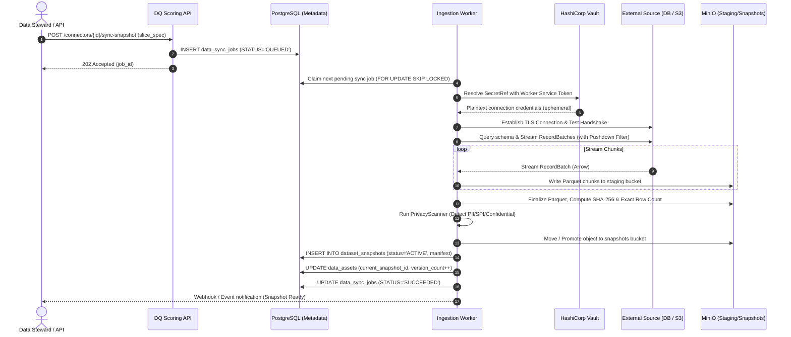

# ĐẶC TẢ KIẾN TRÚC VÀ GIAO THỨC BỘ KẾT NỐI ĐA NGUỒN (MULTI-SOURCE CONNECTOR SPECIFICATION)
## DQ Scoring System — Tài liệu Đặc tả Kỹ thuật Mở rộng Nguồn Dữ liệu Doanh nghiệp
**Phiên bản:** 1.0 (Enterprise Ingestion Architecture Baseline)  
**Trạng thái:** Approved Architecture Specification  
**Phạm vi áp dụng:** Lớp Ingestion, Compute Engine (PySpark), Metadata Repository & Worker Daemons  
**Tài liệu liên quan:** `docs/architecture/INFRASTRUCTURE_DESIGN.md`, `docs/Chapter_4.md` (§4.3, §4.5), `docs/Chapter_5.md` (§ADR-004, §ADR-008)

---

## MỤC LỤC

1. [Tổng quan, Mục tiêu & Phạm vi Hệ thống](#1-tổng-quan-mục-tiêu--phạm-vi-hệ-thống)
   - 1.1. Bối cảnh và Động lực Kiến trúc
   - 1.2. Các Nguyên tắc Bất biến Cốt lõi (Architectural Invariants)
2. [Mô hình Phân tầng & Hợp đồng Cổng kết nối (Ports & Adapters Architecture)](#2-mô-hình-phân-tầng--hợp-đồng-cổng-kết-nối-ports--adapters-architecture)
   - 2.1. Định nghĩa Cổng `ISourceConnectorPort`
   - 2.2. Định nghĩa Cổng `ISourceCatalogPort`
   - 2.3. Bản đồ Phân loại Bộ kết nối (Connector Taxonomy)
3. [Quản trị Bảo mật, Định danh & Cách ly Người thuê (Security & Tenant Isolation)](#3-quản-trị-bảo-mật-định-danh--cách-ly-người-thuê-security--tenant-isolation)
   - 3.1. Nguyên tắc Không lưu Secret Dưới dạng Bản rõ (Zero Plaintext Secrets)
   - 3.2. Mô hình Tham chiếu Khóa Vault / KMS (`SecretRef`)
   - 3.3. Phân lập Mạng và Ranh giới Kết nối Egress
4. [Tính Bất biến của Ảnh chụp & Địa chỉ hóa Nội dung (Snapshot Immutability)](#4-tính-bất-biến-của-ảnh-chụp--địa-chỉ-hóa-nội-dung-snapshot-immutability)
   - 4.1. Cơ chế Vật lý hóa Sang Parquet Chuẩn hóa (Physical Materialization)
   - 4.2. Cơ chế Ghim Phiên bản Ảo cho Lakehouse (Virtual Version Pinning)
5. [Khám phá Lược đồ & Ma trận Ánh xạ Kiểu Dữ liệu Chuẩn (Schema Discovery & Type Mapping)](#5-khám-phá-lược-đồ--ma-trận-ánh-xạ-kiểu-dữ-liệu-chuẩn-schema-discovery--type-mapping)
   - 5.1. Bảng Đối chiếu Kiểu Dữ liệu Gốc sang DQ Scoring Canonical Types
   - 5.2. Chuẩn hóa Cấu trúc Bán cấu trúc (JSON / Nested Structs & Arrays)
   - 5.3. Xử lý Sai lệch Lược đồ (Schema Drift & Breaking Changes)
6. [Hàng rào Kiểm soát Tài nguyên & Thực thi Truy vấn (Resource & Query Guards)](#6-hàng-rào-kiểm-soát-tài-nguyên--thực-thi-truy-vấn-resource--query-guards)
   - 6.1. Kỹ thuật Đẩy vị từ Xuống Nguồn (Predicate Pushdown & Partition Pruning)
   - 6.2. Giới hạn Trích xuất & Bộ ngắt Mạch (Circuit Breakers & Extraction Budgets)
7. [Máy Trạng thái Đồng bộ & Vòng đời Ảnh chụp (Ingestion State Machine)](#7-máy-trạng-thái-đồng-bộ--vòng-đời-ảnh-chụp-ingestion-state-machine)
   - 7.1. Máy trạng thái 7 Giai đoạn
   - 7.2. Sơ đồ Tuần tự Luồng Đồng bộ Nguồn
8. [Đặc tả Giao diện API REST & Schema Hợp đồng (API Specification)](#8-đặc-tả-giao-diện-api-rest--schema-hợp-đồng-api-specification)
   - 8.1. Endpoints Quản lý Bộ kết nối & Tác vụ Đồng bộ
   - 8.2. Khai báo JSON Schema Mẫu
9. [Tiêu chuẩn Kiểm thử & Tiêu chí Nghiệm thu (Verification & Acceptance Criteria)](#9-tiêu-chuẩn-kiểm-thử--tiêu-chí-nghiệm-thu-verification--acceptance-criteria)

---

## 1. TỔNG QUAN, MỤC TIÊU & PHẠM VI HỆ THỐNG

### 1.1. Bối cảnh và Động lực Kiến trúc
Ở giai đoạn nền tảng (Milestone 1–4), DQ Scoring tiếp nhận dữ liệu kiểm thử thông qua giao thức tải tệp trực tiếp (`tabular_import.py`) hỗ trợ các định dạng `CSV`, `PARQUET`, và `JSONL` thông qua tải lên phân đoạn (Multipart Chunk Upload) lên MinIO S3 Staging.

Tuy nhiên, trong môi trường doanh nghiệp thực tế, dữ liệu cần đánh giá chất lượng phân tán tại nhiều hệ thống lưu trữ và xử lý khác nhau:
- **Cơ sở dữ liệu Quan hệ / OLAP:** PostgreSQL, MySQL, Oracle Database, Microsoft SQL Server, ClickHouse, Snowflake, Google BigQuery.
- **Kho Đối tượng & Hồ Dữ liệu (Object Stores & Data Lakes):** AWS S3, Google Cloud Storage (GCS), Azure Data Lake Storage Gen2 (ADLS Gen2).
- **Định dạng Lakehouse Hiện đại:** Apache Iceberg, Delta Lake, Apache Hudi với khả năng du hành thời gian (Time Travel) và cô lập ACID.
- **Luồng Sự kiện Bất đồng bộ (Streaming & Message Brokers):** Apache Kafka, Debezium Change Data Capture (CDC).

Tài liệu này đặc tả kiến trúc, hợp đồng giao diện chuẩn (Port-Adapter Contracts), quy chuẩn an toàn bảo mật, và ma trận ánh xạ kiểu dữ liệu để mở rộng DQ Scoring thành một nền tảng đánh giá chất lượng dữ liệu đa nguồn toàn diện.

### 1.2. Các Nguyên tắc Bất biến Cốt lõi (Architectural Invariants)

Mọi bộ kết nối mở rộng phải tuân thủ nghiêm ngặt 5 nguyên tắc bất biến kiến trúc sau:

1. **Strict Multi-Tenant Isolation (Cách ly Tuyệt đối theo Người thuê):**
   - Mọi cấu hình bộ kết nối, thông tin xác thực, và metadata đồng bộ đều được gắn cứng với `tenant_id`.
   - Không người thuê nào có thể đọc, sử dụng, hoặc suy diễn cấu hình nguồn của người thuê khác.

2. **Zero Plaintext Secrets (Không bao giờ lưu Bí mật dưới dạng Bản rõ):**
   - Mật khẩu cơ sở dữ liệu, API keys, Access Tokens, Private Keys tuyệt đối không được ghi vào cơ sở dữ liệu metadata hoặc in ra log.
   - Hệ thống áp dụng mô hình `SecretRef` ủy quyền cho HashiCorp Vault, AWS Secrets Manager, hoặc Azure Key Vault.

3. **Snapshot Immutability & Content Addressing (Ảnh chụp Bất biến):**
   - Đánh giá chất lượng dữ liệu (Evaluation Run) chỉ được thực thi trên một bản ảnh chụp bất biến (`dataset_snapshots`).
   - Kết quả trích xuất từ nguồn ngoài phải được vật lý hóa thành Parquet chuẩn hóa có mã băm SHA-256 nội dung hoặc được ghim phiên bản commit cụ thể (Time Travel snapshot ID) không thể thay đổi sau khi tạo.

4. **Resource & Query Guards (Bảo vệ Hệ thống Nguồn & Hạ tầng Đánh giá):**
   - Bộ kết nối không được gây nghẽn hoặc quá tải hệ thống nguồn (Rate Limiting, Pushdown Projection, Row Budgeting, Connection Pool Limits).
   - Mọi truy vấn trích xuất bắt buộc phải có timeout chặn cứng (mặc định tối đa 300 giây).

5. **Canonical Schema Normalization (Chuẩn hóa Lược đồ Duy nhất):**
   - Mọi kiểu dữ liệu đặc thù của nguồn (Vendor-Specific Types) phải được chuyển đổi tất định sang tập kiểu dữ liệu chuẩn của DQ Scoring trước khi thực thi biên dịch luật.

---

## 2. MÔ HÌNH PHÂN TẦNG & HỢP ĐỒNG CỔNG KẾT NỐI (PORTS & ADAPTERS ARCHITECTURE)

Hệ thống áp dụng Kiến trúc Lục giác (Hexagonal Architecture) tách biệt ranh giới nghiệp vụ lõi khỏi các thư viện điều khiển nguồn thứ ba.

```
+-------------------------------------------------------------------------+
|                          Domain & Service Layer                         |
|  [EvaluationOrchestrator]   [DatasetImportService]   [PrivacyService]   |
+-------------------------------------------------------------------------+
                                    |
                    +---------------+---------------+
                    |                               |
                    v                               v
    +------------------------------+  +------------------------------+
    |     ISourceConnectorPort     |  |      ISourceCatalogPort      |
    | (Data Ingestion & Slicing)   |  |   (Metadata & Discovery)     |
    +------------------------------+  +------------------------------+
                    ^                               ^
                    |                               |
       +------------+------------+     +------------+------------+
       |                         |     |                         |
+---------------+       +---------------+       +-----------------+
| JdbcConnector |       | LakehouseConn |       | ObjectStoreConn |
| (PostgreSQL,  |       | (Delta Lake,  |       | (S3, GCS,       |
|  Oracle, SQL) |       |  Iceberg)     |       |  ADLS Gen2)     |
+---------------+       +---------------+       +-----------------+
```

### 2.1. Định nghĩa Cổng `ISourceConnectorPort`

Cổng chịu trách nhiệm kết nối, kiểm tra tính khả dụng, và trích xuất dữ liệu thành bản ảnh chụp chuẩn hóa:

```python
from abc import abstractmethod
from collections.abc import AsyncIterator, Iterator
from dataclasses import dataclass
from typing import Any, Protocol
from uuid import UUID
from pyarrow import RecordBatch, Schema

@dataclass(frozen=True)
class ConnectionTestResult:
    is_successful: bool
    latency_ms: float
    server_version: str | None
    error_code: str | None
    error_message: str | None

@dataclass(frozen=True)
class IngestionSliceSpec:
    table_identifier: str
    selected_columns: list[str] | None = None
    where_predicate: str | None = None
    partition_filter: dict[str, Any] | None = None
    row_limit: int | None = None
    snapshot_version: str | None = None  # Dùng cho Time-travel

@dataclass(frozen=True)
class MaterializedSliceOutcome:
    raw_record_count: int
    content_sha256: str
    size_bytes: int
    storage_parquet_key: str
    inferred_schema: dict[str, Any]
    warnings: list[str]

class ISourceConnectorPort(Protocol):
    """Cổng kết nối nguồn dữ liệu ngoài phục vụ kiểm tra và trích xuất."""

    @abstractmethod
    def test_connection(self, tenant_id: UUID, config: dict[str, Any]) -> ConnectionTestResult:
        """Kiểm tra tính kết nối tới nguồn, chứng thực và đo độ trễ."""
        ...

    @abstractmethod
    def extract_and_materialize(
        self,
        tenant_id: UUID,
        asset_id: UUID,
        config: dict[str, Any],
        slice_spec: IngestionSliceSpec,
        destination_bucket: str,
        destination_prefix: str,
    ) -> MaterializedSliceOutcome:
        """Trích xuất lát cắt dữ liệu, ghi thành Parquet chuẩn hóa trên S3 Staging."""
        ...

    @abstractmethod
    def stream_batches(
        self,
        tenant_id: UUID,
        config: dict[str, Any],
        slice_spec: IngestionSliceSpec,
        batch_size: int = 10_000,
    ) -> Iterator[RecordBatch]:
        """Duyệt theo luồng RecordBatch dùng cho trích xuất hoặc profiling streaming."""
        ...
```

### 2.2. Định nghĩa Cổng `ISourceCatalogPort`

Cổng chịu trách nhiệm dò quét siêu dữ liệu (Schema Discovery & Profiling Metadata):

```python
@dataclass(frozen=True)
class ColumnMetadata:
    name: str
    source_type: str
    canonical_type: str
    is_nullable: bool
    comment: str | None = None
    extra_metadata: dict[str, Any] | None = None

@dataclass(frozen=True)
class TableMetadata:
    identifier: str
    table_name: str
    schema_name: str | None
    columns: list[ColumnMetadata]
    total_rows_estimate: int | None
    size_bytes_estimate: int | None
    partition_keys: list[str]
    supported_features: list[str]  # e.g., ['TIME_TRAVEL', 'PARTITION_PRUNING', 'PREDICATE_PUSHDOWN']

class ISourceCatalogPort(Protocol):
    """Cổng khám phá danh mục bảng và siêu dữ liệu lược đồ từ hệ thống nguồn."""

    @abstractmethod
    def list_tables(self, tenant_id: UUID, config: dict[str, Any]) -> list[str]:
        """Liệt kê danh sách bảng/đối tượng mà cấu hình kết nối được phép đọc."""
        ...

    @abstractmethod
    def describe_table(self, tenant_id: UUID, config: dict[str, Any], table_name: str) -> TableMetadata:
        """Trích xuất chi tiết lược đồ cột, kiểu dữ liệu và thông tin phân vùng."""
        ...

    @abstractmethod
    def sample_rows(
        self,
        tenant_id: UUID,
        config: dict[str, Any],
        table_name: str,
        sample_limit: int = 50,
    ) -> list[dict[str, Any]]:
        """Lấy mẫu bản ghi an toàn phục vụ xem trước (Preview) và suy diễn cấu trúc."""
        ...
```

### 2.3. Bản đồ Phân loại Bộ kết nối (Connector Taxonomy)

| Nhóm Bộ kết nối | Hệ thống Mục tiêu | Thư viện Driver Nền tảng | Cơ chế Thực thi Trích xuất |
|---|---|---|---|
| **Relational (RDBMS)** | PostgreSQL, MySQL, SQL Server, Oracle | `psycopg3`, `asyncpg`, `pymysql`, `cx_Oracle`, `pyodbc` | Streaming Cursor theo Batch hoặc PySpark JDBC Connector |
| **Cloud OLAP Warehouse** | ClickHouse, Snowflake, BigQuery | `clickhouse-connect`, `snowflake-connector-python`, `google-cloud-bigquery` | Direct Arrow Stream / Storage Read API |
| **Object Storage S3/Blob** | AWS S3, MinIO, GCS, Azure Blob | `pyarrow.fs.S3FileSystem`, `boto3`, `adlfs`, `gcsfs` | Direct Parquet/CSV Range Scan & Chunk Streaming |
| **Lakehouse Formats** | Apache Iceberg, Delta Lake | `pyiceberg`, `delta-rs` (`deltalake`) | Snapshot Commit Log Inspection & Direct File Addressing |
| **Message Streaming** | Apache Kafka, Debezium CDC | `confluent-kafka`, `kafka-python` | Bounded Window Micro-Batch Offset Consumer |

---

## 3. QUẢN TRỊ BẢO MẬT, ĐỊNH DANH & CÁCH LY NGƯỜI THUÊ (SECURITY & TENANT ISOLATION)

### 3.1. Nguyên tắc Không lưu Secret Dưới dạng Bản rõ (Zero Plaintext Secrets)

Mọi thông tin nhạy cảm bắt buộc không được lưu trong bảng cấu hình `source_connectors` ở định dạng rõ:
- Cấm lưu trữ `password`, `secret_access_key`, `token`, `private_key` trong cột cấu hình dạng JSON thông thường.
- Cột cấu hình chỉ lưu trữ các tham số phi nhạy cảm (Host, Port, Database, Schema, Table, SSL Mode, Timeout).

### 3.2. Mô hình Tham chiếu Khóa Vault / KMS (`SecretRef`)

Hệ thống triển khai cấu trúc tham chiếu định danh khóa (`SecretRef`):

```json
{
  "connector_type": "POSTGRESQL",
  "host": "prod-db.internal.net",
  "port": 5432,
  "database": "core_banking",
  "username": "dq_readonly_svc",
  "auth_method": "VAULT_SECRET_REF",
  "secret_ref": {
    "engine": "hashicorp_vault",
    "vault_path": "secret/data/tenants/{tenant_id}/connectors/core_banking",
    "key_mapping": {
      "password": "db_password",
      "client_cert": "tls_cert"
    }
  },
  "ssl_mode": "verify-full",
  "ssl_ca_secret_ref": "secret/data/tenants/{tenant_id}/ca_chain"
}
```

**Cơ chế Phân giải Bí mật (Secret Resolution Lifecycle):**
1. Khi Worker nhận tác vụ trích xuất (`IngestionWorker`), Worker sử dụng định danh K8s Service Account có gắn token ngắn hạn truy vấn HashiCorp Vault.
2. Token yêu cầu quyền đọc bị cô lập chặt chẽ bởi AppRole / Kubernetes Auth Role chỉ gắn với `tenant_id` của tác vụ đang chạy: `path "secret/data/tenants/<tenant_id>/*" { capabilities = ["read"] }`.
3. Secret được giữ tạm thời trong bộ nhớ đệm tiến trình Python (`temp memory buffer`), kết nối được thiết lập, và vùng nhớ được xóa ngay khi hoàn thành handshake (hoặc sau khi đóng pool).
4. Không bao giờ ghi secret ra tệp tạm trên ổ đĩa.

### 3.3. Phân lập Mạng và Ranh giới Kết nối Egress

```
+-------------------------------------------------------------+
|               Kubernetes Cluster (Private VPC)              |
|                                                             |
|  +--------------------------+                               |
|  | Ingestion Worker Pod     |                               |
|  | (NetworkPolicy: Restrict)|                               |
|  +--------------------------+                               |
|               |                                             |
|               v                                             |
|  +--------------------------+     mTLS / IPSec              |
|  | Egress Proxy & Guard     | -------------------> Khách hàng |
|  | (DNS / CIDR Whitelist)   |                      (On-Prem / |
|  +--------------------------+                      Cloud VPC) |
+-------------------------------------------------------------+
```

- **Egress NetworkPolicy:** Mọi Worker thực thi tác vụ trích xuất chỉ được phép mở kết nối ra ngoài qua Egress Gateway kiểm soát.
- **FQDN / IP Whitelisting:** Quản trị viên người thuê phải đăng ký danh sách IP/Domain hợp lệ của cơ sở dữ liệu nguồn. Các yêu cầu tới địa chỉ nội bộ nhạy cảm (`127.0.0.1`, `169.254.169.254` AWS Metadata, mạng nội bộ K8s `10.96.0.0/12`) bị chặn lập tức (Phòng ngừa SSRF).
- **Transport Encryption (TLS 1.3):** Bắt buộc bật `ssl_mode=verify-full` hoặc `require` cho toàn bộ kết nối JDBC/ODBC và S3.

---

## 4. TÍNH BẤT BIẾN CỦA ẢNH CHỤP & ĐỊA CHỈ HÓA NỘI DUNG (SNAPSHOT IMMUTABILITY)

Để bảo đảm tính khả lặp (Reproducibility) và sự nhất quán của các kết quả đánh giá chất lượng qua thời gian, hệ thống chia cơ chế liên kết dữ liệu thành hai chiến lược:

```
                          Chiến lược Liên kết Dữ liệu
                                       |
                +----------------------+----------------------+
                |                                             |
                v                                             v
  [1. Vật lý hóa (Materialization)]             [2. Ghim Phiên bản (Pinning)]
  - Áp dụng cho: RDBMS, Files, Streams          - Áp dụng cho: Delta Lake, Iceberg
  - Dữ liệu được trích xuất thành               - Không sao chép dữ liệu (Zero-Copy)
    Parquet chuẩn hóa trên S3                   - Ghim cứng `snapshot_id` hoặc
  - Sinh mã băm SHA-256 bất biến                  `commit_timestamp` trong manifest
  - Tính toán số dòng tuyệt đối                 - Đảm bảo truy vấn lặp lại đồng nhất
```

### 4.1. Cơ chế Vật lý hóa Sang Parquet Chuẩn hóa (Physical Materialization)

Áp dụng cho các nguồn dữ liệu thay đổi liên tục không có cơ chế log commit bất biến (RDBMS như Postgres/MySQL, CSV/JSON trên S3, luồng Kafka):
1. **Trích xuất có Hạn ngạch (Bounded Extract):** Worker đọc dữ liệu theo truy vấn đã ghim điều kiện (`WHERE created_at >= '2026-10-01' AND created_at < '2026-10-15'`).
2. **Ghi Parquet Chuẩn hóa:** Dữ liệu được ghi thành các tệp Parquet chuẩn hóa theo chuẩn nén Snappy hoặc ZSTD tại `s3://dq-staging/...`.
3. **Thăng cấp Sang Snapshot:** Chạy qua `TabularImportAdapter.inspect_and_normalize`:
   - Tính toán `exact_row_count`.
   - Tính mã băm nội dung SHA-256 (`content_sha256`).
   - Tự động chạy quét dữ liệu nhạy cảm (`PrivacyScanner`).
   - Ghi vào bảng `dataset_snapshots` với trạng thái `version_status = 'ACTIVE'`.
   - Sau thời điểm này, trigger `enforce_snapshot_immutability()` trong PostgreSQL khóa hoàn toàn bản ghi không cho sửa đổi.

### 4.2. Cơ chế Ghim Phiên bản Ảo cho Lakehouse (Virtual Version Pinning)

Đối với các bảng thuộc định dạng Lakehouse (Apache Iceberg, Delta Lake) vốn đã cung cấp khả năng lưu trữ bất biến và cô lập phiên bản qua Transaction Log:
- **Zero-Copy Optimization:** Không cần trích xuất toàn bộ hàng tỷ bản ghi sang Parquet mới.
- **Pinning Manifest:** Hệ thống truy vấn metadata nguồn và ghi nhận:
  - Delta Lake: `delta_table.version()` (ví dụ: Commit Version `142`).
  - Apache Iceberg: `table.current_snapshot().snapshot_id` (ví dụ: `8942109841294812L`).
- **Thực thi Đánh giá:** Khi Spark thực thi lượt đánh giá, Spark Engine tải bảng tại chính xác phiên bản đã ghim:
  ```python
  # Delta Lake
  spark.read.format("delta").option("versionAsOf", 142).load(delta_path)

  # Apache Iceberg
  spark.read.format("iceberg").option("snapshot-id", 8942109841294812).load(iceberg_table)
  ```
- Nếu hệ thống nguồn thực hiện dọn dẹp (Vacuum / Retention Expiration) làm mất commit đã ghim, hệ thống gắn cờ lỗi rõ ràng `SOURCE_SNAPSHOT_EXPIRED`.

---

## 5. KHÁM PHÁ LƯỢC ĐỒ & MA TRẬN ÁNH XẠ KIỂU DỮ LIỆU CHUẨN (SCHEMA DISCOVERY & TYPE MAPPING)

### 5.1. Bảng Đối chiếu Kiểu Dữ liệu Gốc sang DQ Scoring Canonical Types

Mọi kiểu dữ liệu gốc của nhà cung cấp phải được phân giải tất định về 9 kiểu chuẩn của DQ Scoring:

| Canonical Type | PostgreSQL | MySQL | Oracle | SQL Server | Snowflake / BigQuery | PyArrow Type |
|---|---|---|---|---|---|---|
| `INTEGER` | `INT2`, `INT4`, `INT8`, `SERIAL` | `TINYINT`, `SMALLINT`, `INT`, `BIGINT` | `NUMBER(p, 0)` ($p \le 18$) | `TINYINT`, `SMALLINT`, `INT`, `BIGINT` | `INT`, `INTEGER`, `BIGINT` | `pa.int64()` |
| `DECIMAL` | `NUMERIC`, `DECIMAL`, `MONEY` | `DECIMAL`, `NUMERIC` | `NUMBER(p, s)` ($s > 0$) | `DECIMAL`, `NUMERIC`, `SMALLMONEY` | `NUMBER(p, s)`, `BIGNUMERIC` | `pa.decimal128(p, s)` |
| `DOUBLE` | `FLOAT4`, `FLOAT8`, `DOUBLE PRECISION` | `FLOAT`, `DOUBLE` | `BINARY_FLOAT`, `BINARY_DOUBLE` | `REAL`, `FLOAT` | `FLOAT`, `FLOAT8`, `DOUBLE` | `pa.float64()` |
| `STRING` | `VARCHAR`, `CHAR`, `TEXT`, `NAME` | `VARCHAR`, `CHAR`, `TEXT`, `MEDIUMTEXT` | `VARCHAR2`, `NVARCHAR2`, `CLOB` | `VARCHAR`, `NVARCHAR`, `CHAR`, `TEXT` | `VARCHAR`, `STRING`, `TEXT` | `pa.string()` |
| `BOOLEAN` | `BOOL`, `BOOLEAN` | `TINYINT(1)`, `BOOLEAN` | `NUMBER(1)` | `BIT` | `BOOLEAN` | `pa.bool_()` |
| `DATE` | `DATE` | `DATE` | `DATE` (không có phần giờ) | `DATE` | `DATE` | `pa.date32()` |
| `TIMESTAMP` | `TIMESTAMP`, `TIMESTAMPTZ` | `DATETIME`, `TIMESTAMP` | `TIMESTAMP`, `TIMESTAMP WITH TIME ZONE` | `DATETIME`, `DATETIME2`, `DATETIMEOFFSET` | `TIMESTAMP_NTZ`, `TIMESTAMP_TZ` | `pa.timestamp('us', 'UTC')` |
| `JSON_OBJECT` | `JSON`, `JSONB` | `JSON` | `VARCHAR2` chứa JSON, `JSON` | `NVARCHAR` có ISJSON check | `VARIANT`, `OBJECT` | `pa.string()` (Encoding JSON) |
| `JSON_ARRAY` | Kiểu Mảng (`TEXT[]`, `INT[]`), `JSONB` mảng | `JSON` mảng | `VARRAY`, `JSON` mảng | `NVARCHAR` mảng JSON | `ARRAY` | `pa.string()` (Encoding JSON) |

### 5.2. Chuẩn hóa Cấu trúc Bán cấu trúc (JSON / Nested Structs & Arrays)

Theo kiến trúc chuẩn hóa bán cấu trúc đã hoàn thiện ở Bước 1 & 2:
1. Cột có kiểu phức hợp (Nested Struct, Map, Array, JSON/JSONB) được lưu trong bảng Parquet dưới dạng `pa.string()` với siêu dữ liệu:
   ```json
   {
     "name": "metadata_payload",
     "logical_type": "JSON_OBJECT",
     "structural_encoding": "JSON",
     "nested_level_max": 4
   }
   ```
2. Giá trị rỗng hoặc Null trong nguồn được ánh xạ đúng về SQL Null.
3. Không thực hiện ép kiểu số làm mất độ chính xác đối với các trường số thực lớn hoặc chuỗi thập phân dài trong JSON (bảo toàn qua `Decimal` và chuỗi JSON nguyên bản).
4. Các quy tắc kiểm tra sâu (`JSON_FIELD`, `JSON_ARRAY`) áp dụng chuẩn RFC 6901 Pointer (ví dụ: `/customer/contacts/0/email`) để đánh giá trực tiếp trên các cột này.

### 5.3. Xử lý Sai lệch Lược đồ (Schema Drift & Breaking Changes)

Khi một bộ kết nối thực hiện đồng bộ ảnh chụp mới (Snapshot phiên bản $N+1$ so với $N$):
- **Phát hiện Drift:** Bộ kết nối so sánh danh sách cột và kiểu dữ liệu:
  ```python
  def detect_schema_drift(old_schema: dict[str, Any], new_schema: dict[str, Any]) -> SchemaDriftReport:
      ...
  ```
- **Phân loại Mức độ:**
  - `NON_BREAKING` (Tương thích xuôi): Thêm cột mới có `is_nullable = True`. Không ảnh hưởng ruleset hiện tại.
  - `POTENTIALLY_BREAKING` (Cảnh báo): Đổi tên cột, cột bị xóa, hoặc cột mới có ràng buộc Not-Null.
  - `BREAKING` (Vi phạm hợp đồng): Cột đang được sử dụng bởi các quy tắc chất lượng đang kích hoạt (`ACTIVE ruleset`) bị đổi kiểu dữ liệu hoặc bị biến mất.
- **Biện pháp Xử lý:** Hệ thống cho phép đăng ký Snapshot kèm cờ cảnh báo `SCHEMA_DRIFT_DETECTED`, đồng thời gửi thông báo tới `DATA_STEWARD` và `DATA_OWNER` trước khi cho phép kích hoạt chạy đánh giá.

---

## 6. HÀNG RÀO KIỂM SOÁT TÀI NGUYÊN & THỰC THI TRUY VẤN (RESOURCE & QUERY GUARDS)

Nhằm ngăn chặn tình trạng việc đánh giá chất lượng làm cạn kiệt tài nguyên (CPU, I/O, Pool kết nối) của cơ sở dữ liệu nghiệp vụ khách hàng:

### 6.1. Kỹ thuật Đẩy vị từ Xuống Nguồn (Predicate Pushdown & Partition Pruning)

- **Pushdown Projection:** Chỉ trích xuất các cột thực sự cần thiết theo danh sách cột được cấu hình hoặc các cột được tham chiếu bởi Ruleset (`referenced_columns`). Tuyệt đối không tự động chạy `SELECT *` khi người dùng chỉ đánh giá 5 trên 100 cột.
- **Partition Pruning:** Khi nguồn có bảng phân vùng (Partitioned Table theo ngày/tháng):
  - Bộ kết nối bắt buộc sinh điều kiện lọc khớp với khóa phân vùng (ví dụ: `txn_date >= '2026-10-01' AND txn_date < '2026-10-15'`).
  - Tránh triệt để thao tác Full Table Scan trên các bảng terabyte.

### 6.2. Giới hạn Trích xuất & Bộ ngắt Mạch (Circuit Breakers & Extraction Budgets)

1. **Row Budget (Hạn mức Dòng):**
   - Mặc định mỗi tác vụ trích xuất đồng bộ bị giới hạn tối đa `10,000,000` dòng (trừ khi cấu hình gói Enterprise có chỉ định `ALLOW_LARGE_DATASET`).
2. **Execution Timeout (Hết hạn Thực thi):**
   - Socket Timeout: 30 giây.
   - Query Execution Timeout: tối đa 300 giây (5 phút). Sau 300 giây, driver tự động phát tín hiệu `CANCEL QUERY` hoặc đóng socket để giải phóng tài nguyên nguồn.
3. **Connection Concurrency Limit:**
   - Mỗi bộ kết nối chỉ duy trì tối đa 2 kết nối đồng thời trên mỗi Tenant.
4. **Memory Guard on Worker:**
   - Quá trình đọc stream sử dụng buffer tối đa 128MB. Nếu dữ liệu vượt quá, dữ liệu được xả thẳng xuống tệp đệm trên đĩa NVMe cục bộ thay vì tích lũy trên RAM.

---

## 7. MÁY TRẠNG THÁI ĐỒNG BỘ & VÒNG ĐỜI ẢNH CHỤP (INGESTION STATE MACHINE)

### 7.1. Máy trạng thái 7 Giai đoạn

```
[INITIALIZING]
      |
      v
[CONNECTING & AUTH] ----(Handshake Fail / Auth Expired)----> [FAILED]
      |
      v
[DISCOVERING_SCHEMA] --(Schema Read Failure / Timeout)-----> [FAILED]
      |
      v
[EXTRACTING_DATA] -----(Network Cut / Row Budget Limit)----> [FAILED]
      |
      v
[NORMALIZING_PARQUET] -(Format Violation / Corrupt Data)---> [FAILED]
      |
      v
[INSPECTING_PRIVACY] --(Privacy Scan Limit Exceeded)-------> [FAILED]
      |
      v
[PROMOTED_ACTIVE] (Immutable Snapshot Created in DB)
```

### 7.2. Sơ đồ Tuần tự Luồng Đồng bộ Nguồn



---

## 8. ĐẶC TẢ GIAO DIỆN API REST & SCHEMA HỢP ĐỒNG (API SPECIFICATION)

### 8.1. Endpoints Quản lý Bộ kết nối & Tác vụ Đồng bộ

| Phương thức | Đường dẫn API | Quyền yêu cầu (RBAC) | Mô tả Chức năng |
|---|---|---|---|
| `POST` | `/api/v1/connectors` | `WORKSPACE_ADMIN`, `DATA_OWNER` | Khởi tạo cấu hình bộ kết nối mới cho Tenant |
| `GET` | `/api/v1/connectors` | Mọi vai trò trừ `VIEWER_UNPRIVILEGED` | Danh sách bộ kết nối kèm trạng thái sức khỏe |
| `GET` | `/api/v1/connectors/{id}` | Mọi vai trò trừ `VIEWER_UNPRIVILEGED` | Chi tiết cấu hình bộ kết nối (đã ẩn secrets) |
| `POST` | `/api/v1/connectors/{id}/test` | `WORKSPACE_ADMIN`, `DATA_OWNER`, `DATA_STEWARD` | Kiểm tra kết nối mạng và xác thực tới nguồn |
| `GET` | `/api/v1/connectors/{id}/tables` | `DATA_OWNER`, `DATA_STEWARD`, `DATA_ENGINEER` | Danh sách bảng/đối tượng phát hiện được |
| `GET` | `/api/v1/connectors/{id}/tables/{table}/schema` | `DATA_OWNER`, `DATA_STEWARD`, `DATA_ENGINEER` | Chi tiết lược đồ cột và kiểu dữ liệu chuẩn |
| `POST` | `/api/v1/connectors/{id}/sync` | `DATA_OWNER`, `DATA_STEWARD`, `DATA_ENGINEER` | Kích hoạt tác vụ trích xuất đồng bộ ảnh chụp |
| `GET` | `/api/v1/sync-jobs/{job_id}` | Mọi vai trò trừ `VIEWER_UNPRIVILEGED` | Tra cứu tiến độ và nhật ký thực thi đồng bộ |

### 8.2. Khai báo JSON Schema Mẫu

#### Payload Khởi tạo Bộ kết nối (`CreateConnectorRequest`):
```json
{
  "$schema": "http://json-schema.org/draft-07/schema#",
  "title": "CreateConnectorRequest",
  "type": "object",
  "required": ["connector_code", "name", "connector_type", "connection_parameters"],
  "properties": {
    "connector_code": {
      "type": "string",
      "pattern": "^[a-z0-9_-]{3,64}$"
    },
    "name": {
      "type": "string",
      "minLength": 3,
      "maxLength": 128
    },
    "connector_type": {
      "type": "string",
      "enum": ["POSTGRESQL", "MYSQL", "ORACLE", "SQLSERVER", "CLICKHOUSE", "SNOWFLAKE", "S3", "GCS", "DELTA_LAKE", "ICEBERG", "KAFKA"]
    },
    "connection_parameters": {
      "type": "object",
      "required": ["host", "port"],
      "properties": {
        "host": { "type": "string" },
        "port": { "type": "integer", "minimum": 1, "maximum": 65535 },
        "database": { "type": "string" },
        "username": { "type": "string" },
        "secret_ref": {
          "type": "object",
          "required": ["engine", "vault_path"],
          "properties": {
            "engine": { "type": "string", "enum": ["hashicorp_vault", "aws_secrets_manager", "env_direct"] },
            "vault_path": { "type": "string" },
            "key_mapping": { "type": "object" }
          }
        },
        "ssl_mode": { "type": "string", "default": "verify-full" }
      }
    }
  }
}
```

#### Payload Yêu cầu Đồng bộ Ảnh chụp (`TriggerSyncJobRequest`):
```json
{
  "asset_id": "8a719240-9a21-4d92-b673-98214faec102",
  "table_identifier": "public.orders_daily",
  "slice_spec": {
    "where_predicate": "order_date >= CURRENT_DATE - INTERVAL '7 days'",
    "selected_columns": ["order_id", "customer_id", "total_amount", "currency", "order_date", "raw_payload"],
    "row_limit": 1000000
  },
  "enable_privacy_scan": true
}
```

---

## 9. TIÊU CHUẨN KIỂM THỬ & TIÊU CHÍ NGHIỆM THU (VERIFICATION & ACCEPTANCE CRITERIA)

Mọi mã nguồn hiện thực các lớp Adapter dựa trên đặc tả này phải thỏa mãn các tiêu chí kiểm định sau:

1. **Bộ Mock Test Cô lập (Isolated Mock Environment):**
   - Thiết lập synthetic containers trong Docker Compose cho ít nhất:
     - 1 PostgreSQL test instance có bật mTLS.
     - 1 MinIO S3 test instance.
     - 1 Mock Vault instance.
2. **Kiểm tra Ranh giới Bảo mật (Security & Isolation Checks):**
   - Không có trường mật khẩu hoặc private key nào lọt vào bảng metadata hoặc stdout logs (Kiểm tra bằng regex quét secret trong bài test CI).
   - Truy vấn với Tenant A không thể truy cập hoặc giải mã bộ kết nối của Tenant B (HTTP 404/403).
3. **Kiểm tra Tính Bất biến (Immutability Verification):**
   - Tệp Parquet tạo ra phải vượt qua kiểm tra mã băm SHA-256 đối chiếu với bản ghi trong `dataset_snapshots`.
   - Cố gắng thực hiện câu lệnh `UPDATE` trên bảng `dataset_snapshots` đối với bản ghi đã kích hoạt phải bị chặn bởi Database Trigger với lỗi `illegal snapshot state transition`.
4. **Kiểm tra Tính Toàn vẹn Dữ liệu Nhạy cảm (Privacy Scanner Integration):**
   - Dữ liệu trích xuất từ nguồn ngoài có chứa email, số điện thoại, CCCD phải được tự động nhận diện và cập nhật vào `sensitive_data_findings` và `manifest.sensitive_scan`.
5. **Kiểm tra Khả năng Chịu lỗi & Phục hồi (Failure Recovery):**
   - Nếu kết nối nguồn bị ngắt giữa chừng, tệp tạm trong bucket staging phải được dọn dẹp sạch sẽ bởi Janitor routine trong vòng 1 giờ, không làm rò rỉ rác lưu trữ.
