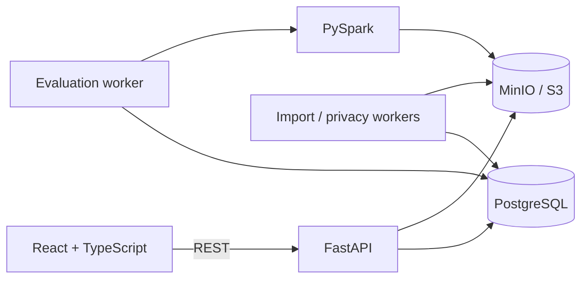

# DQ Scoring — tổng quan thiết kế

Tài liệu này là điểm vào ngắn cho kiến trúc hiện có. Hợp đồng chi tiết ở các tài liệu chuyên ngành bên dưới; khi mô tả hành vi đang chạy, mã nguồn và kiểm thử là căn cứ cuối cùng. Các chương thiết kế lịch sử có thể mô tả kiến trúc đích hoặc đề xuất, không mặc nhiên là bằng chứng đã triển khai.

## Mục tiêu và nguyên tắc

DQ Scoring đánh giá chất lượng snapshot dữ liệu theo ruleset và scoring policy có phiên bản, lưu Assessment có thể kiểm chứng và đưa ra kết quả có giải thích. Thiết kế tách biệt:

- **DQ Score:** chất lượng theo các quy tắc đã đo.
- **Coverage:** phạm vi trọng số yêu cầu thực sự đo được.
- **Confidence:** độ tin cậy của bằng chứng.

Các bất biến cốt lõi: nguồn chỉ đọc; các bộ đếm `passed + failed + missing + miscast + not_applicable = total_observed`; không ép mẫu số không thành điểm; kết quả advisory không ảnh hưởng score/gate; cùng snapshot và cấu hình phải tái lập được. Chi tiết công thức và thứ tự Quality Gate: [lý thuyết chấm điểm](../theory/DQ_SCORING_THEORY.md).

## Kiến trúc logic

Backend tổ chức theo Ports & Adapters: `core` chứa mô hình và luật nghiệp vụ; `services` điều phối; `ports` định nghĩa hợp đồng; `adapters` nối PostgreSQL, object storage và compute; `presentation` cung cấp API/CLI; `workers` chạy tác vụ nền. Frontend là SPA độc lập gọi REST API. PostgreSQL lưu cấu hình, trạng thái, hàng đợi và kết quả; object storage lưu snapshot. Worker dùng lease và `lease_generation` để tránh tiến trình hết hạn công bố kết quả cũ.

## Luồng dữ liệu

1. Nhập CSV, Parquet hoặc JSONL và đăng ký snapshot bất biến; object được định danh/xác minh bằng checksum.
2. Import/profile/privacy workers xử lý tác vụ nền và lưu trạng thái cùng kết quả profiling/phân loại.
3. Người dùng cấu hình ruleset và policy; quy trình phê duyệt yêu cầu người phê duyệt khác người tạo.
4. Evaluation được đưa vào hàng đợi PostgreSQL, worker lấy lease và thực thi đo lường bằng PySpark trên snapshot đã ghim.
5. Assessment được lưu cùng kết quả, cấu hình và bằng chứng giới hạn/đã bảo vệ; API và UI đọc trạng thái, scorecard và chi tiết.

Privacy masking ở đầu ra không mã hóa hay sửa dữ liệu nguồn, và không thay đổi đầu vào chấm điểm. Xem [hướng dẫn người dùng](../engineering/USER_GUIDE.md) và [runbook](../LOCAL_RUNBOOK.md) cho thao tác cụ thể.

## Ranh giới triển khai

- Docker Compose phục vụ phát triển và kiểm chứng cục bộ; không phải cấu hình production.
- Helm/Kubernetes và preflight là cấu hình/kiểm tra triển khai, không chứng minh cluster đã thực thi đầy đủ các kiểm soát an ninh hoặc HA.
- Yêu cầu tài nguyên, topology MinIO, DR và SLA trong tài liệu hạ tầng là mục tiêu thiết kế cần xác minh trên môi trường thực tế.
- Dùng dữ liệu tổng hợp cho phát triển và kiểm thử; không dùng môi trường test có thao tác dọn dữ liệu với database cần giữ.

## Tài liệu theo chủ đề

| Chủ đề | Tài liệu |
|---|---|
| Yêu cầu và phạm vi | [Project brief](PROJECT_BRIEF_DQ_SCORING.md), [SRS](Chapter_2.md) |
| Kiến trúc phần mềm | [Chương 4](Chapter_4.md), [Chương 3 — mô hình hệ thống](Chapter_3.md) |
| Mô hình dữ liệu | [Chương 5](Chapter_5.md) |
| Công thức và semantics | [DQ Scoring Theory](../theory/DQ_SCORING_THEORY.md) |
| Hạ tầng và object storage | [Infrastructure Design](../architecture/INFRASTRUCTURE_DESIGN.md) |
| Kết nối nguồn dữ liệu | [Multi-source connector specification](../architecture/MULTI_SOURCE_CONNECTOR_SPECIFICATION.md) |
| Khởi động và vận hành | [Local Runbook](../LOCAL_RUNBOOK.md), [Kubernetes guide](../../deploy/k8s/README.md) |
| Sử dụng UI/API | [User Guide](../engineering/USER_GUIDE.md) |

Các tài liệu đặc tả chi tiết hiện được lưu trong `docs/design/`; tài liệu này thay thế phần mô tả kiến trúc lặp lại trong README, không thay thế các hợp đồng chi tiết.
