# CHƯƠNG 3: PHÂN TÍCH VÀ MÔ HÌNH HÓA HỆ THỐNG (SYSTEM MODELING)

**Hệ thống:** DQ Scoring System  
**Mã hồ sơ:** AD-004-MODEL  
**Phiên bản:** 1.7  
**Ngày:** 2026-09-24  
**Trạng thái:** Review Candidate  
**Cơ sở kỹ thuật:** Đối soát trực tiếp từ Chương 2 (SRS v1.7 Review Candidate), Kiến trúc phần mềm Chương 4 v1.7 và Thiết kế dữ liệu Chương 5 v1.7

---

## THÔNG TIN VÀ KIỂM SOÁT TÀI LIỆU

### Lịch sử phiên bản và phê duyệt

| Phiên bản | Ngày | Tóm tắt thay đổi | Trạng thái | Tác giả / Người sửa |
| :--- | :--- | :--- | :--- | :--- |
| **1.0** | 2026-08-27 | Khóa Baseline toàn bộ sơ đồ Use Case, Analysis Class Model và Behavioral Diagrams | **Approved Baseline** | Nguyễn Hoàng Tùng |
| **1.1** | 2026-08-28 | Chuẩn hóa 8 UC và 9 SEQ; gộp đặc tả Outlier trùng; đồng bộ Gate, approval, statuses, evidence limit và canonical contracts với SRS v1.1 | Review Candidate | Nguyễn Hoàng Tùng |
| **1.2** | 2026-09-04 | Đồng bộ UC-005 async lifecycle; chuẩn hóa Canonical UC Names; phân biệt Primary/Supporting Actor trên diagram; bổ sung Actor Generalization; thêm Activity Diagram UC-008; phân tách rõ phạm vi FR-ASM | Review Candidate | Nguyễn Hoàng Tùng |
| **1.3** | 2026-09-08 | Đồng bộ mô hình hóa 3 lớp với AD-012 và SRS v1.3: bổ sung điểm mở rộng cho UC-007 (chia sẻ, thảo luận, khuyến nghị), cập nhật UC-002 on-demand, UC-005 progress/history, UC-008 đa định dạng và quy hoạch Roadmap Use Cases (UC-009..011) | Review Candidate | Nguyễn Hoàng Tùng |
| **1.4** | 2026-09-15 | Đồng bộ kiến trúc Spark Lakehouse: bổ sung UC-012 Kho Rule và chính sách che mờ; cập nhật UC-005 thực thi phân tán và UC-007 che mờ đa tầng | Review Candidate | Nguyễn Hoàng Tùng |
| **1.5** | 2026-09-16 | Mô hình hóa Đa thuê bao (Tenant Lớp 0, khóa ghép); đồng bộ ngữ cảnh tenant, kiểm tra sở hữu và tính lũy đẳng xuyên suốt các sơ đồ Use Case, Sequence và State Machine | Review Candidate | Nguyễn Hoàng Tùng |
| **1.6** | 2026-09-17 | Bổ sung thực thể Mẫu Đánh giá Domain trong UC-003; mở rộng kịch bản Trợ lý Cố vấn LLM Advisory và chuẩn hóa 6 cấp Quality Gate | Approved Specification | Nguyễn Hoàng Tùng |
| **1.7** | 2026-09-24 | Chuẩn hóa Apache Spark trên cụm k3s đơn nút; mô hình hóa hợp đồng phân định Worker điều phối - Spark tính toán - Worker công bố; bảo toàn tệp gốc qua manifest (không compact/coalesce) và kiểm soát lease fencing | **Review Candidate** | Nguyễn Hoàng Tùng |

---

## 1. MÔ HÌNH HÓA CHỨC NĂNG (FUNCTIONAL MODELING)

### 1.1. Danh mục Tác nhân (Actor Catalog)

Căn cứ theo tài liệu phân tích tác nhân `AD-002` và đặc tả yêu cầu `SRS v1.2`, hệ thống DQ Scoring phiên bản 1.0 tương tác với 5 tác nhân con người và 1 tác nhân hệ thống:

| Mã Tác nhân | Tên Tác nhân | Loại | Trách nhiệm và Tương tác chính |
| :--- | :--- | :--- | :--- |
| **ACT-H-001** | **Data Engineer / Operator** | Human Actor | Đăng ký Data Asset, nạp file Snapshot CSV/Parquet, submit `RunSpec`, theo dõi lifecycle và yêu cầu cancellation; không trực tiếp thực thi Worker. |
| **ACT-H-002** | **Data Owner** | Human Actor | Phê duyệt riêng Ruleset và Scoring Policy bằng `approve_ruleset()` / `approve_policy()`; chịu trách nhiệm cuối về mức chất lượng chấp nhận được. |
| **ACT-H-003** | **Data Steward** | Human Actor | Soạn thảo Ruleset, cấu hình Null Policy, gán trọng số và mức nghiêm trọng; submit cấu hình ở trạng thái DRAFT để Data Owner phê duyệt; theo dõi Coverage và Unresolved Results. |
| **ACT-H-004** | **Dataset Consumer** | Human Actor | Truy vấn Scorecard, đọc DQ Score, kiểm tra độ bao phủ (Coverage) và phân tích các dòng lỗi mẫu (Drill-down Bounded Evidence). |
| **ACT-H-005** | **Domain Expert** | Human Actor | Xem và thẩm định các tín hiệu ngoại lệ IQR advisory theo góc độ nghiệp vụ. |
| **ACT-H-006** | **Workspace Administrator** | Human Actor | Khởi tạo Workspace/Tenant, quản trị thành viên (gửi thư mời, gán vai trò RBAC), cấu hình các kênh thông báo đa kênh (Email, Webhook, Slack), và quản lý khóa API phục vụ tích hợp. |
| **ACT-S-001** | **Data Source Provider** | External System Actor | Cung cấp tệp CSV/Parquet nguồn cho hệ thống. |

*(Lưu ý: ACT-S-001 nằm ngoài ranh giới DQ Scoring. Dataset Store là thành phần nội bộ của hệ thống, không phải Actor.)*

*(Ghi chú kiến trúc về phân định trách nhiệm nghiệp vụ của ACT-H-001):* Mã tác nhân **ACT-H-001 (Data Engineer / Operator)** đại diện cho vai trò vận hành kỹ thuật của hệ thống. Trong thực tế tổ chức doanh nghiệp, Data Engineer (chịu trách nhiệm về kiến trúc dữ liệu, đăng ký asset, trích xuất schema tự động) và Platform/Data Operator (chịu trách nhiệm kích hoạt lượt chạy, theo dõi tiến trình lifecycle, xuất báo cáo đánh giá) có thể là hai cá nhân hoặc hai đội ngũ chuyên trách tách biệt. Tuy nhiên, trong phạm vi triển khai phiên bản v1.0 (môi trường Standalone CLI / Local Execution trên máy trạm, chưa tích hợp hệ thống IAM/RBAC tập trung), cả hai vai trò đều có cùng tập quyền thực thi qua giao diện dòng lệnh (`submit run`, `cancel run`, `export report`, `register asset`). Do đó, việc hợp nhất dưới mã tác nhân chung `ACT-H-001` phản ánh chính xác thực tế "cùng quyền, cùng use case" trong v1.0, đồng thời bảo đảm sơ đồ Use Case tổng quan luôn tinh gọn, rõ ràng. Sự phân tách trách nhiệm nghiệp vụ và lộ trình phân quyền RBAC được đặc tả tường minh qua mô hình kế thừa UML tại Mục 1.1.1.

#### 1.1.1. Quan hệ Kế thừa và Phân định Vai trò (Actor Generalization)

Nhằm giữ sự tinh giản trên biểu đồ chính nhưng vẫn bảo đảm 100% tính chính xác theo chuẩn hình thức UML, mối quan hệ kế thừa (`Generalization`) giữa các tác nhân vận hành được mô hình hóa thông qua tác nhân trừu tượng `Platform Operator` cùng hai tác nhân con chuyên biệt:

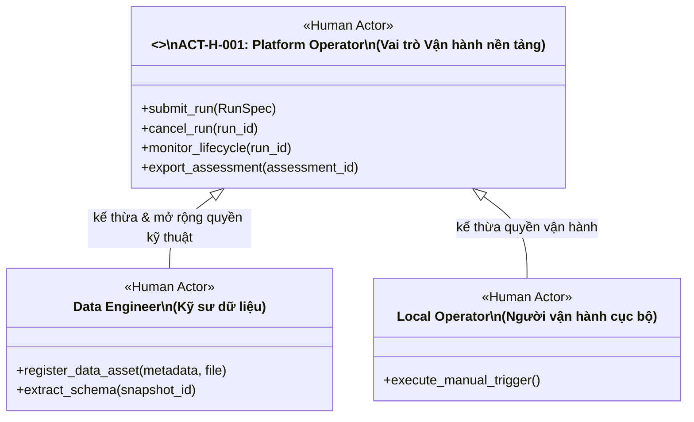

* **Tác nhân trừu tượng cơ sở (`Platform Operator`):** Đóng gói toàn bộ tập quyền và hành vi vận hành nền tảng qua CLI/API: kích hoạt lượt đánh giá bất đồng bộ (`UC-005`), yêu cầu hủy tiến trình run (`cancellation`), giám sát tiến độ xử lý và trích xuất báo cáo kết quả (`UC-008`).
* **Tác nhân chuyên biệt Kỹ thuật (`Data Engineer`):** Kế thừa toàn bộ năng lực của `Platform Operator`, đồng thời mở rộng các đặc quyền kỹ thuật liên quan đến quản trị tài sản dữ liệu: tiếp nhận tệp nguồn, tính mã băm SHA-256 nội dung, nhận diện schema tự động và đăng ký Data Asset vào hệ thống (`UC-001`).
* **Tác nhân chuyên biệt Vận hành (`Local Operator`):** Kế thừa tập quyền vận hành chuẩn của `Platform Operator` để thực hiện việc trigger run định kỳ, giám sát trạng thái và xuất báo cáo kiểm toán phục vụ các bên liên quan.
* **Ý nghĩa kiến trúc:** Trong sơ đồ Use Case tổng quan (Mục 1.3), hệ thống sử dụng định danh gộp `ACT-H-001: Data Engineer / Operator` (đại diện cho lớp trừu tượng `Platform Operator`) để giữ biểu đồ mạch lạc. Khi hệ thống tiến hóa lên phiên bản phân tán có IAM/RBAC, mô hình kế thừa này sẽ được chuyển hóa trực tiếp thành Role Hierarchy trong cơ chế kiểm soát truy cập dựa trên vai trò (Role-Based Access Control) mà không phải tái cấu trúc lại các Use Case đã thiết kế.

#### 1.1.2. Ngữ cảnh Thuê bao Đa khách hàng và Ranh giới Data Marketplace (Tenant Context & Marketplace Boundary)

Nhằm chuẩn bị sẵn sàng cho mô hình **Data Marketplace** theo chuẩn `BR-018` và `BR-019`:
1. **Ràng buộc Sở hữu Thuê bao (Tenant Ownership):** Mọi tác nhân con người (`ACT-H-001` đến `ACT-H-005`) khi thao tác với hệ thống đều hoạt động trong một **Ngữ cảnh Thuê bao xác định** (`Tenant Context`, định danh bởi `tenant_id: UUID`), được xác thực thông qua JWT token hoặc API header `X-Tenant-ID`.
2. **Cô lập Tài nguyên & Dữ liệu:** Mọi tài sản (`DataAsset`), bản chụp (`DatasetSnapshot`), luật chất lượng (`Ruleset`), chính sách (`ScoringPolicy`, `ProtectionPolicy`), lượt đánh giá (`EvaluationRun`) và bảng điểm (`Assessment`) thuộc quyền sở hữu độc quyền của một Tenant duy nhất.
3. **Ranh giới Giao dịch trên Data Marketplace:** Người tiêu dùng dữ liệu (`ACT-H-004: Dataset Consumer`) từ một Tenant đối tác (ví dụ Tenant B) chỉ được phép xem Scorecard của Tenant A khi có thỏa thuận chia sẻ dữ liệu (Data Sharing Agreement / Access Grant). Tuyệt đối không cho phép truy cập chéo dữ liệu thô, các phát hiện nhạy cảm (`SensitiveDataFinding`) hoặc bằng chứng lỗi mẫu (`evidence_payload`). Toàn bộ việc cô lập được bảo đảm bằng khóa ngoại ghép `(tenant_id, id)` ở tầng CSDL và Row-Level Security (RLS).

---

### 1.2. Danh mục Use Case (Use Case Catalog)

Bảng sau liệt kê toàn bộ 8 Use Case của hệ thống, phân theo Actor chính, quan hệ phụ thuộc, mô tả tổng quan các công việc thực hiện và yêu cầu chức năng (FR) liên quan:

| Mã UC | Tên Use Case | Actor chính | Actor hỗ trợ | Quan hệ | Mô tả tổng quan | FR liên quan |
| :--- | :--- | :--- | :--- | :--- | :--- | :--- |
| **UC-001** | Đăng ký Data Asset | ACT-H-001 Data Engineer / Operator | ACT-S-001 Data Source Provider | — | Tiếp nhận tệp dữ liệu nguồn (CSV/Parquet) hoặc bảng Delta Lake trong namespace của Tenant (`lakehouse/{tenant_id}/...`); kiểm tra định dạng và tính duy nhất tên tài sản theo tenant `(tenant_id, asset_name)`; tính mã băm SHA-256 hoặc đóng băng Delta `versionAsOf`; tự động trích xuất schema; lưu trữ metadata vào PostgreSQL với khóa ghép `(tenant_id, id)` và tạo Dataset Snapshot bất biến. | FR-ASSET-001..004, DR-024, DR-025, BR-018, BR-019, AC-016 |
| **UC-002** | Lập hồ sơ dữ liệu & Nhận diện dữ liệu nhạy cảm (Profiling & PII Scan) | ACT-H-001 Data Engineer / Operator (On-Demand) | — | Được UC-005 `<<include>>` (hoặc chạy độc lập theo yêu cầu) | Thực hiện quét vector hóa đẩy xuống Apache Spark trên k3s trong ngữ cảnh Tenant; tính toán chỉ số thống kê nền tảng; đối soát Classification Rules (gồm mẫu chuẩn hệ thống và quy tắc riêng của tenant) để phát hiện và gán nhãn dữ liệu nhạy cảm 4 nhóm (`SensitiveDataFinding`). | FR-PROF-001..006, NFR-SEC-005, DR-020, DR-024 |
| **UC-003** | Khởi tạo & Soạn thảo Cấu hình từ Mẫu (Template) và Kho Rule (Draft) | ACT-H-003 Data Steward | — | Hỗ trợ tham vấn qua Trợ lý LLM Advisory (Optional) | Khai báo và cấu hình danh mục quy tắc chất lượng và chính sách tính điểm thuộc sở hữu Tenant thông qua: (1) Áp dụng Mẫu Đánh giá Domain (`RulesetTemplate` + `ScoringPolicyTemplate`) kết hợp khảo sát nhu cầu, hoặc (2) Nhận gợi ý quy tắc từ Trợ lý LLM Advisory (`source = 'AI_ADVISORY'`), hoặc (3) Soạn thảo thủ công từ Kho Rule tập trung (`RuleCatalogTemplate`); gán Ruleset theo tài sản `(tenant_id, asset_id)` hoặc dùng chung; cấu hình `DataProtectionPolicy`; hệ thống tính canonical config hash và lưu các phiên bản ở trạng thái DRAFT. | FR-GOV-001..003, FR-GOV-005, FR-GOV-011..014, DR-021..027, NFR-AI-001 |
| **UC-004** | Phê duyệt Ruleset & Scoring Policy (Approve) | ACT-H-002 Data Owner | ACT-H-003 Data Steward | — | Data Owner của Tenant xem xét và thẩm định nội dung cấu hình DRAFT; thực hiện 2 thao tác phê duyệt độc lập để chuyển trạng thái sang ACTIVE sẵn sàng cho các đợt đánh giá, hoặc từ chối phê duyệt (Reject) kèm lý do; ghi nhận nhật ký kiểm toán bất biến theo tenant. | FR-GOV-004, FR-GOV-006..007, DR-024 |
| **UC-005** | Khởi tạo và Thực thi Lượt Đánh giá Bất đồng bộ (Async Evaluation Run) | ACT-H-001 Data Engineer / Operator | — | `<<include>>` UC-002, UC-006 | Tiếp nhận yêu cầu đánh giá bất đồng bộ kèm `tenant_id` và `idempotency_key` theo tenant; kiểm tra tính toàn vẹn tham chiếu phân tầng `(tenant_id, id)`; lưu Run `QUEUED` vào hàng đợi PostgreSQL; worker claim lease và điều phối đo lường bằng cách gửi và giám sát `SparkApplication` trên cụm k3s; thu thập 5 phân hoạch counts và bounded evidence đã che mờ; kiểm tra hàng rào lease fencing; tính điểm in-memory và commit Assessment nguyên tử. | FR-RUN-001..012, FR-VAL-001..006, FR-SCORE-001..009, FR-ASM-001..004, DR-024, DR-025, BR-018, BR-019 |
| **UC-006** | Phát hiện Ngoại lệ IQR (Advisory) | — | — | Được UC-005 `<<include>>` | Sử dụng phương pháp khoảng tứ phân vị Tukey ($k=1.5$) trên các cột số mục tiêu dựa trên dữ liệu phân vị từ Profiling; nhận diện các dòng dị biệt trong ngữ cảnh dữ liệu của Tenant; ghi nhận tín hiệu cảnh báo tham vấn (`is_advisory = True`, trọng số 0); không làm suy giảm điểm DQ Score hay chặn Quality Gate. | FR-DET-001..006, BR-012 |
| **UC-007** | Xem Scorecard & Drill-down Bằng chứng có Che mờ Động (Role-Based Masking) | ACT-H-004 Dataset Consumer | ACT-H-001 Data Engineer / Operator, ACT-H-002 Data Owner, ACT-H-003 Data Steward, ACT-H-005 Domain Expert | Mở rộng qua `<<extend>>` sang Export View, Thảo luận, Khuyến nghị | Truy cập Dashboard trong phạm vi Tenant (hoặc đối tác marketplace có Grant); xem tổng quan Scorecard (DQ Score, 6 chiều, Coverage, Quality Gate); drill-down quy tắc vi phạm với cơ chế che mờ động (Dynamic Role-Based Masking): người không đặc quyền chỉ thấy evidence đã che mờ PII theo `DataProtectionPolicy` của Tenant. | IF-UI-001..016, FR-ASM-001..003, NFR-SEC-006, BR-018 |
| **UC-008** | Xuất Báo cáo Đánh giá (Export) | ACT-H-001 Data Engineer / Operator | — | — | Tiếp nhận yêu cầu xuất báo cáo trong phạm vi Tenant; đọc bản ghi Immutable Assessment; chuyển đổi sang định dạng JSON Canonical, HTML tĩnh, CSV/Excel hoặc bảng dẹt BI; áp dụng quy tắc che mờ PII theo vai trò người xuất; tính mã băm SHA-256 phục vụ kiểm toán dài hạn. | FR-ASM-001..005, NFR-COR-001, NFR-SEC-006, DR-024 |
| **UC-012** | Đăng ký, Đăng nhập & Quản lý Phiên (Authentication & Session Management) | Toàn bộ tác nhân (ACT-H-001..006) | — | — | Tiếp nhận yêu cầu đăng ký người dùng mới, tự tạo Workspace hoặc gia nhập Workspace qua Token mời; xác thực thông tin đăng nhập (email + mật khẩu) bằng Argon2id; cấp phát cặp Access Token (JWT) và Refresh Token; xoay vòng Refresh Token an toàn và phát hiện tái sử dụng; xử lý đăng xuất, thu hồi phiên và đặt lại mật khẩu an toàn. | FR-AUTH-001..006, NFR-SEC-003, BR-022, AC-023 |
| **UC-013** | Mời & Quản trị Thành viên Không gian làm việc (Workspace Member Management) | ACT-H-006 Workspace Administrator | ACT-H-001..005 | — | Cho phép Quản trị viên gửi thư mời thành viên vào Workspace qua email; thiết lập trước vai trò nghiệp vụ (`DATA_STEWARD`, `DATA_OWNER`, `DATA_ENGINEER`, `BUSINESS_VIEWER`); người nhận kích hoạt tài khoản qua Token bảo mật; quản trị viên có quyền cập nhật vai trò hoặc thu hồi quyền truy cập của thành viên. | FR-AUTH-007, NFR-SEC-003, BR-020, AC-020 |
| **UC-014** | Cấu hình Kênh Thông báo & Đăng ký Cảnh báo Sự kiện (Notification & Webhook Management) | ACT-H-006 Workspace Administrator | ACT-H-001..005 | — | Cho phép Quản trị viên khai báo kênh nhận thông báo (Email SMTP, Webhook HTTP/HTTPS, Slack, Teams) kèm cơ chế phòng vệ SSRF; thành viên đăng ký các sự kiện cần theo dõi (`RUN_FAILED`, `QUALITY_GATE_FAIL`, `POLICY_SUBMITTED_FOR_APPROVAL`) và ngưỡng nghiêm trọng tối thiểu; hệ thống ký số HMAC-SHA256 khi phát Webhook ngoại vi. | FR-NOTIF-001..005, NFR-NOTIF-001..002, NFR-SEC-015, BR-024, AC-024 |

---

### 1.3. Biểu đồ Use Case tổng quan của hệ thống (System Use Case Diagram)

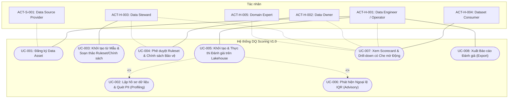

**Quy ước UML:** Đường liền nét `---` biểu diễn `Association` của Tác nhân chính (Primary Actor); đường nét đứt `-.-` biểu diễn `Association` của Tác nhân hỗ trợ (Supporting Actor); mũi tên nét đứt `-.->|<<include>>|` hướng từ Use Case cơ sở đến Use Case được bao gồm. Mô hình không dùng `<<extend>>` vì không có hành vi mở rộng tùy chọn tại một extension point; UC-004 là Use Case độc lập với tiền điều kiện cấu hình đang ở trạng thái `DRAFT`.

---

### 1.4.1. Use Case 1: Đăng ký Data Asset (UC-001)

#### a. Sơ đồ hoạt động (Activity Diagram)

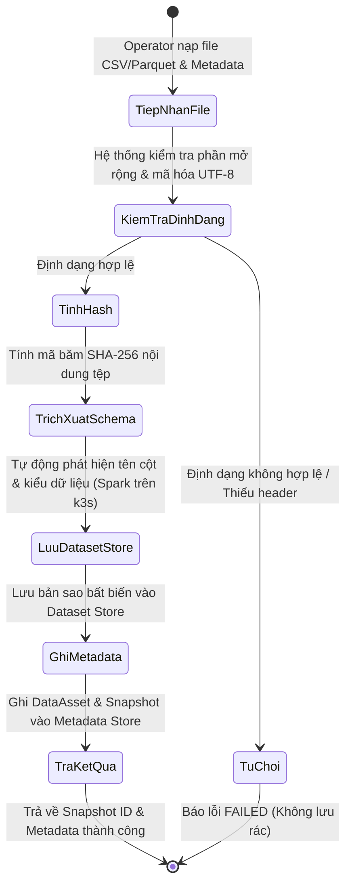

#### b. Kịch bản chi tiết (Use Case Specification)

- **Mã Use Case:** `UC-001`
- **Tên Use Case:** Đăng ký Data Asset
- **Tác nhân chính:** ACT-H-001 (Data Engineer / Operator).
- **Tác nhân hỗ trợ:** ACT-S-001 (Data Source Provider).
- **Mục tiêu nghiệp vụ:** `BG-001`, `BG-004`.
- **Yêu cầu chức năng đáp ứng:** `FR-ASSET-001`, `FR-ASSET-002`, `FR-ASSET-003`, `FR-ASSET-004`, `DR-001`, `DR-002`, `DR-024`, `DR-025`, `BR-018`, `BR-019`, `AC-016`.

*(Ghi chú kiến trúc: Mục tiêu của Use Case là đăng ký tài sản dữ liệu vào hệ thống theo đúng không gian tên thuê bao (Tenant Namespace). Bản ghi Dataset Snapshot bất biến, mã băm SHA-256 và schema trích xuất tự động là các tạo tác kỹ thuật được hệ thống tự động khởi tạo như một hệ quả tất yếu (Postcondition) của quá trình đăng ký, không phải một thao tác rời rạc của người dùng.)*

- **Tiền điều kiện (Preconditions):**
  1. Operator được xác thực trong một Tenant Context hợp lệ (`tenant_id: UUID`, hoặc mặc định `00000000-0000-0000-0000-000000000001` ở môi trường single-tenant).
  2. Tệp dữ liệu CSV hoặc Parquet đã sẵn sàng trên máy tính cục bộ hoặc hệ thống lưu trữ đích.
  3. Người dùng cung cấp tên tài sản dữ liệu (`asset_name`) và nguồn gốc dữ liệu (`provenance_url`).
- **Hậu điều kiện (Postconditions):**
  1. Các tệp nhị phân gốc được lưu trữ bất biến nguyên bản trong `Dataset Store` theo namespace riêng của Tenant (`lakehouse/{tenant_id}/{asset_slug}/...`) kèm tệp `manifest.json` ghi nhận danh sách tệp, kích thước, định dạng và mã băm SHA-256 từng tệp.
  2. Bản ghi `DataAsset` được xác lập với khóa ngoại ghép `(tenant_id, id)` và ràng buộc duy nhất tên trong phạm vi tenant `uq_data_assets_tenant_name`; bản ghi `DatasetSnapshot` được tự động khởi tạo trong `Metadata Store` bảo toàn ghép `(tenant_id, snapshot_id)` kèm mã băm `manifest_sha256` và schema trích xuất.
  3. Dữ liệu nguồn ban đầu giữ nguyên vẹn 100% (Read-only, tuyệt đối không can thiệp sửa đổi, coalesce hay compact làm biến đổi tệp gốc).
- **Luồng sự kiện chính (Main Flow):**
  1. Operator chọn tệp dữ liệu CSV/Parquet (hoặc thư mục chứa các tệp phân vùng gốc) và nhập thông tin `asset_name`, `provenance_url`, `description` trong phiên làm việc của Tenant.
  2. Hệ thống trích xuất `tenant_id` từ Security Context / JWT Claim hoặc Header API.
  3. Hệ thống kiểm tra tính toàn vẹn của tệp (kiểm tra header, cấu trúc bảng).
  4. Hệ thống tính toán mã băm SHA-256 của từng tệp nhị phân gốc và sinh `manifest.json` chuẩn hóa kèm mã băm `manifest_sha256`.
  5. Hệ thống sử dụng Apache Spark trên k3s để quét cấu trúc và trích xuất schema (tên cột, kiểu dữ liệu inferred, số cột).
  6. Hệ thống sao chép nguyên bản các tệp vào thư mục `Dataset Store` với đường dẫn phân lập theo tenant: `lakehouse/{tenant_id}/{asset_slug}/...`.
  7. Hệ thống tạo bản ghi `DataAsset` (nếu chưa có trong tenant) và bản ghi `DatasetSnapshot` chứa `tenant_id`, metadata, thời điểm tạo, schema JSON và mã băm manifest.
  8. Hệ thống trả về `asset_id`, `snapshot_id` và hiển thị xác nhận đăng ký Data Asset thành công trên giao diện.
- **Luồng thay thế (Alternative Flows):**
  - *Asset đã tồn tại trong cùng Tenant:* Nếu cặp `(tenant_id, asset_name)` đã có trong hệ thống, hệ thống gán Snapshot mới vào làm một phiên bản mới của Asset đó mà không tạo lại Asset. Hai tenant khác nhau hoàn toàn có thể đặt cùng `asset_name` mà không gây xung đột.
- **Luồng ngoại lệ (Exception Flows):**
  - *E1: Tệp hỏng hoặc không đúng định dạng bảng:* Hệ thống dừng tiến trình, thông báo mã lỗi `INVALID_PAYLOAD_FORMAT`, không ghi bản ghi vào CSDL.
  - *E2: Trùng lặp Snapshot:* Nếu SHA-256 trùng khớp hoàn toàn với một Snapshot đã có của cùng tenant, hệ thống trả về thông báo Snapshot đã tồn tại kèm `snapshot_id` hiện hữu.
  - *E3: Sai lệch Tenant Context:* Nếu `tenant_id` không tồn tại hoặc bị vô hiệu hóa (`status != 'ACTIVE'`), hệ thống chặn yêu cầu với mã lỗi `TENANT_INACTIVE_OR_NOT_FOUND`.

---

### 1.4.2. Use Case 2: Lập hồ sơ dữ liệu & Quét nhận diện dữ liệu nhạy cảm (Profiling & PII Discovery) (UC-002)

#### a. Sơ đồ hoạt động (Activity Diagram)

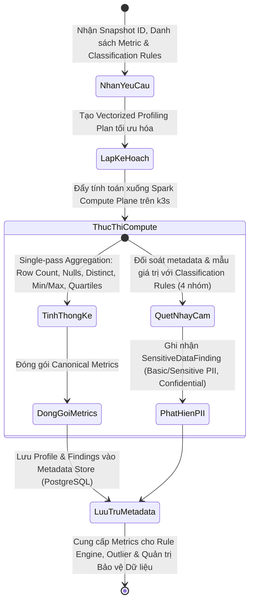

#### b. Kịch bản chi tiết (Use Case Specification)

- **Mã Use Case:** `UC-002`
- **Tên Use Case:** Lập hồ sơ dữ liệu & Quét nhận diện dữ liệu nhạy cảm (Profiling & PII Discovery)
- **Tác nhân trực tiếp:** Không có; `UC-002` được `UC-005` bao gồm bằng quan hệ `<<include>>` (hoặc chạy On-Demand bởi Data Engineer qua API).
- **Mục tiêu nghiệp vụ:** `BG-002`, `BG-005`, `BG-007`.
- **Yêu cầu chức năng đáp ứng:** `FR-PROF-001..006`, `NFR-SEC-005`, `DR-003`, `DR-020`, `DR-022`, `DR-024`.
- **Tiền điều kiện:** Bản ghi `DatasetSnapshot` hợp lệ thuộc sở hữu Tenant `(tenant_id, snapshot_id)` trên Lakehouse Delta Lake (hoặc Parquet/CSV trong Dataset Store) và metadata schema đã nạp.
- **Hậu điều kiện:** Bản ghi `Profile` chứa tập hợp `Canonical Metrics` cùng các phát hiện `SensitiveDataFinding` được lưu trữ an toàn trong Metadata Store gắn chặt với `(tenant_id, snapshot_id)`.
- **Luồng sự kiện chính:**
  1. Phân hệ tiếp nhận `tenant_id`, `snapshot_id`, danh sách các cột cần đo và tập `ClassificationRule` đang có hiệu lực (gồm quy tắc chuẩn hệ thống có `tenant_id IS NULL` và quy tắc riêng của tenant).
  2. Profiling Engine lập kế hoạch truy vấn vector hóa gom cụm (Single-pass Aggregation Plan) đẩy xuống Apache Spark trên k3s trong môi trường phân lập của tenant.
  3. Thực thi truy vấn quét bảng dữ liệu trong namespace của tenant mà không nạp dữ liệu thô vào heap Python.
  4. Tính toán các chỉ số thống kê tiêu chuẩn: tổng số dòng, số lượng rỗng/null, số giá trị duy nhất (cardinality), min/max, và các tứ phân vị ($Q1, Q2, Q3$).
  5. Đồng thời đối soát tên cột và quét mẫu giá trị với biểu thức chính quy để nhận diện các trường thuộc 4 nhóm dữ liệu nhạy cảm: (1) Dữ liệu cá nhân cơ bản, (2) Dữ liệu cá nhân nhạy cảm, (3) Dữ liệu kinh doanh bí mật, (4) Dữ liệu thông thường.
  6. Đóng gói kết quả thành danh sách đối tượng `CanonicalMetric` và danh sách `SensitiveDataFinding` chuẩn hóa kèm `tenant_id`.
  7. Lưu trữ Profile và Findings vào Metadata Store (PostgreSQL 16) bảo đảm cô lập tenant qua khóa ngoại ghép `(tenant_id, snapshot_id)` và chuyển giao cho Rule Engine, Outlier Detector và cơ chế Masking.
- **Luồng ngoại lệ:**
  - *E1: Snapshot rỗng (0 dòng):* Ghi nhận `row_count = 0`, các metric thống kê khác gán trạng thái `NOT_MEASURABLE` (`INSUFFICIENT_DATA`), không sinh PII finding.
  - *E2: Không tìm thấy Snapshot hoặc không khớp Tenant:* Báo lỗi `SNAPSHOT_NOT_FOUND`, dừng tiến trình.

---

### 1.4.3. Use Case 3: Khởi tạo Cấu hình Đánh giá từ Mẫu Domain và Kho Rule (Draft) (UC-003)

#### a. Sơ đồ hoạt động (Activity Diagram)

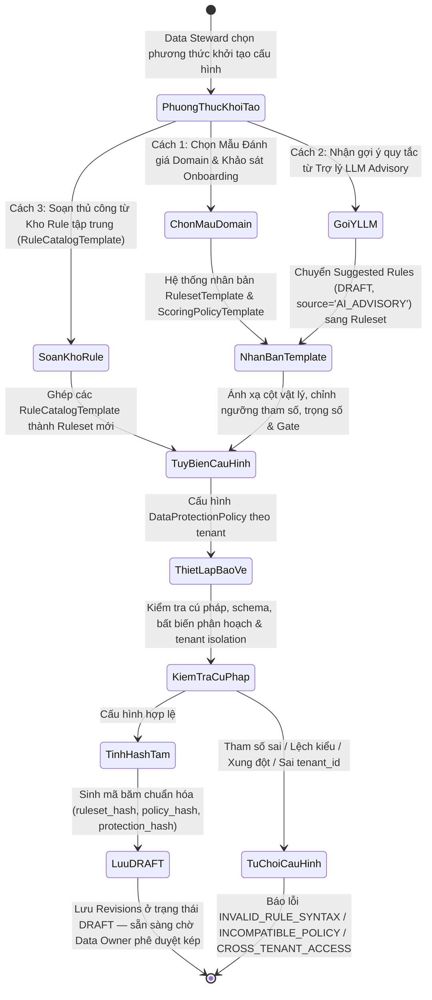

#### b. Kịch bản chi tiết (Use Case Specification)

- **Mã Use Case:** `UC-003`
- **Tên Use Case:** Khởi tạo Cấu hình Đánh giá từ Mẫu Domain và Kho Rule (Draft)
- **Tác nhân chính:** ACT-H-003 (Data Steward).
- **Tác nhân hỗ trợ:** Trợ lý Cố vấn AI (LLM Advisory Assistant) — hỗ trợ gợi ý mẫu và đề xuất quy tắc tham vấn.
- **Mục tiêu nghiệp vụ:** `BG-001`, `BG-003`, `BG-008`.
- **Yêu cầu chức năng & an toàn đáp ứng:** `FR-GOV-001..003`, `FR-GOV-005`, `FR-GOV-011..014`, `DR-004`, `DR-006`, `DR-021..027`, `NFR-AI-001`, `BR-018`.
- **Tiền điều kiện:** Data Steward đã xác thực trong Tenant Context; Data Asset (nếu gắn riêng) thuộc quyền sở hữu của tenant `(tenant_id, asset_id)`.
- **Hậu điều kiện:** `RulesetRevision` (gắn với `derived_from_template_id`), `ScoringPolicyRevision` (gắn với `derived_from_template_id`), và `DataProtectionPolicy` được lưu trữ ở trạng thái `DRAFT` thuộc tenant kèm mã băm nội dung bất biến; chưa thể gán vào `RunSpec` cho đến khi được phê duyệt kép tại `UC-004`.
- **Luồng sự kiện chính:**
  1. Data Steward lựa chọn một trong ba phương thức khởi tạo:
     - *Phương thức 1 (Khởi tạo từ Mẫu Đánh giá Domain):* Người dùng thực hiện khảo sát nhanh nhu cầu (Onboarding Survey: domain, loại dữ liệu, SLA/mục đích sử dụng); hệ thống lọc và nạp bộ đôi tương thích gồm `RulesetTemplate` (FR-GOV-013) và `ScoringPolicyTemplate` (FR-GOV-014).
     - *Phương thức 2 (Hỗ trợ từ Trợ lý LLM Advisory):* Hệ thống trích xuất schema an toàn và các chỉ số `CanonicalMetric` tổng hợp (tuyệt đối không gửi raw data/evidence); LLM đề xuất danh sách `SuggestedRule` (DRAFT, gắn nhãn `source = 'AI_ADVISORY'`) kèm giải thích ngữ cảnh để Steward xem xét.
     - *Phương thức 3 (Soạn thảo thủ công):* Steward tra cứu và nhặt từng mẫu quy tắc nguyên tử từ Kho Rule tập trung (`RuleCatalogTemplate`, FR-GOV-011).
  2. Hệ thống thực hiện nhân bản sâu (Deep Clone) cấu hình mẫu thành hai bản ghi riêng biệt thuộc sở hữu của tenant: `RulesetRevision` (DRAFT) và `ScoringPolicyRevision` (DRAFT), gắn trường vết nguồn gốc `derived_from_template_id`.
  3. Data Steward thực hiện tùy biến an toàn:
     - Ánh xạ tên cột vật lý của tài sản vào các cột logic của mẫu (`column_mapping`).
     - Điều chỉnh tham số kiểm tra (min, max, regex, SLA), gán mức độ nghiêm trọng (`CRITICAL` vs. `STANDARD`), và điều chỉnh trọng số quy tắc $w_r$.
     - Điều chỉnh trọng số 6 chiều ($W_d \ge 0, \sum W_d = 1.0$), ngưỡng phân loại Quality Gate (`pass_min`, `warn_min`), và ngưỡng công bố `publication_threshold` (mặc định chuẩn `0.80`).
  4. Cấu hình chính sách bảo vệ dữ liệu (`DataProtectionPolicy`): thiết lập chiến lược che mờ (`FULL_MASK`, `PARTIAL_MASK`, `HASH_SHA256`, `TOKENIZE`) cho từng vai trò người dùng trong tenant.
  5. Hệ thống kiểm tra hợp lệ ngữ nghĩa, kiểu dữ liệu, các bất biến toán học và tính toàn vẹn sở hữu tenant.
  6. Hệ thống chuẩn hóa JSON Canonical, tính toán mã băm SHA-256 (`ruleset_hash`, `scoring_policy_hash`, `protection_policy_hash`) và lưu các bản ghi ở trạng thái `DRAFT` thuộc tenant.
- **Luồng ngoại lệ:**
  - *E1: Lỗi cú pháp hoặc xung đột tham số:* Hệ thống báo lỗi `INVALID_RULE_SYNTAX` hoặc `INCOMPATIBLE_POLICY`, yêu cầu chỉnh sửa.
  - *E2: Tham chiếu chéo Tenant (Cross-tenant Reference Violation):* Nếu tài sản hoặc mẫu tùy chỉnh không thuộc sở hữu của `tenant_id`, hệ thống chặn với mã `CROSS_TENANT_ACCESS_DENIED`.
  - *E3: Sự cố kết nối Trợ lý LLM (LLM Timeout / Service Unavailable):* Hệ thống thông báo lỗi dịch vụ cố vấn AI cục bộ, tự động chuyển sang chế độ soạn thảo thủ công hoặc chọn mẫu từ Catalog mà không làm gián đoạn luồng làm việc của Steward.

---

### 1.4.4. Use Case 4: Phê duyệt Ruleset, Chính sách Bảo vệ & Scoring Policy (Approve) (UC-004)

#### a. Sơ đồ hoạt động (Activity Diagram)

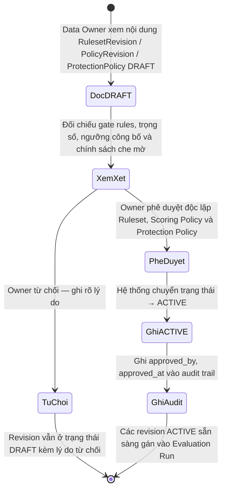

#### b. Kịch bản chi tiết (Use Case Specification)

- **Mã Use Case:** `UC-004`
- **Tên Use Case:** Phê duyệt Ruleset, Chính sách Bảo vệ & Scoring Policy (Approve)
- **Tác nhân chính:** ACT-H-002 (Data Owner).
- **Tác nhân hỗ trợ:** ACT-H-003 (Data Steward) — cung cấp ngữ cảnh nghiệp vụ khi cần.
- **Mục tiêu nghiệp vụ:** `BG-001`, `BG-003`, `BG-008`.
- **Yêu cầu chức năng đáp ứng:** `FR-GOV-004`, `FR-GOV-006..007`, `FR-GOV-012`, `DR-004`, `DR-023`, `DR-024`, `BR-018`.
- **Tiền điều kiện:** Tồn tại `RulesetRevision`, `ScoringPolicyRevision`, hoặc `DataProtectionPolicy` ở trạng thái `DRAFT` thuộc quyền sở hữu của cùng một Tenant mà Data Owner đại diện `(tenant_id, id)`.
- **Hậu điều kiện (Luồng thành công):** Các bản sửa đổi được duyệt riêng trong phạm vi tenant; audit log ghi nhận đầy đủ `tenant_id`, `submitted_by`, `submitted_at`, `approved_by`, `approved_at`; trạng thái chuyển sang `ACTIVE`.
- **Hậu điều kiện (Luồng từ chối):** Giữ nguyên trạng thái `DRAFT`; bản ghi ghi nhận lý do từ chối để Data Steward chỉnh sửa.
- **Luồng sự kiện chính:**
  1. Data Owner xác thực danh tính và Tenant Context, đọc nội dung Revision DRAFT (danh sách quy tắc, trọng số, gate rules, chính sách che mờ).
  2. Hệ thống kiểm tra quyền Data Owner đối với `tenant_id` sở hữu cấu hình.
  3. Đối chiếu với yêu cầu nghiệp vụ, tiêu chuẩn chấp nhận và quy định an toàn dữ liệu.
  4. Thực hiện các thao tác phê duyệt độc lập: `approve_ruleset()`, `approve_policy()`, và `approve_protection_policy()`.
  5. Hệ thống cập nhật từng revision thành `ACTIVE` và ghi nhật ký kiểm toán không thể sửa đổi (Immutable Audit Trail) kèm `tenant_id`.
- **Luồng ngoại lệ:**
  - *E1: Owner từ chối:* Hệ thống ghi nhận lý do từ chối; trạng thái vẫn giữ `DRAFT`; gửi thông báo cho Data Steward.
  - *E2: Sai lệch thẩm quyền Tenant:* Nếu người dùng không có vai trò Data Owner trên `tenant_id` sở hữu tài nguyên, hệ thống chặn với mã `FORBIDDEN_TENANT_OPERATION`.

---

### 1.4.5. Use Case 5: Khởi tạo và Thực thi Lượt Đánh giá Bất đồng bộ trên Lakehouse (Async Lakehouse Run) (UC-005)

#### a. Sơ đồ hoạt động (Activity Diagram)

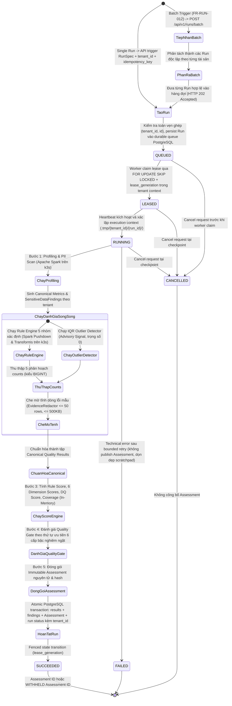

#### b. Kịch bản chi tiết (Use Case Specification)

- **Mã Use Case:** `UC-005`
- **Tên Use Case:** Khởi tạo và Thực thi Lượt Đánh giá Bất đồng bộ trên Lakehouse (Async Lakehouse Run)
- **Tác nhân chính:** ACT-H-001 (Data Engineer / Operator) hoặc Pipeline Agent qua API bất đồng bộ.
- **Mục tiêu nghiệp vụ:** `BG-001`, `BG-002`, `BG-003`, `BG-004`, `BG-005`, `BG-006`, `BG-008`.
- **Yêu cầu chức năng đáp ứng:** `FR-RUN-001..012`, `FR-VAL-001..006`, `FR-SCORE-001..009`, `FR-ASM-001..004`, `NFR-SEC-005..006`, `DR-024`, `DR-025`, `BR-015`, `BR-018`, `BR-019`, `AC-016`.
- **Năng lực nội bộ tích hợp:** Tích hợp trực tiếp BUC-005 (Tổng hợp điểm số và đánh giá Cổng chất lượng, `SEQ-007`) và Atomic Assessment Publication (`SEQ-008`).
- **Tiền điều kiện:** 
  1. Lakehouse hoàn tất commit snapshot dữ liệu mới tại namespace của Tenant (`lakehouse/{tenant_id}/...`), đóng băng qua `versionAsOf` hoặc SHA-256 (hoặc tệp snapshot CSV/Parquet hợp lệ đã được lưu trữ trong Dataset Store).
  2. Các thực thể tham chiếu `snapshot_id`, `ruleset_id`, `scoring_policy_id` đều thuộc quyền sở hữu của cùng `tenant_id`, đang ở trạng thái `ACTIVE` và tương thích schema.
- **Hậu điều kiện:** 
  1. Bản ghi `EvaluationRun` hoàn tất với trạng thái `SUCCEEDED` hoặc `CANCELLED`/`FAILED` trong PostgreSQL 16 gắn với `tenant_id`.
  2. Với Run `SUCCEEDED`, một `Immutable Assessment` nguyên tử được persist kèm `tenant_id`, đúng 6 Dimension Results (score có thể `null`), Coverage, Gate, config hashes và `assessment_hash`; `WITHHELD` bắt buộc có `dq_score = null`. Toàn bộ dữ liệu tạm trong `.tmp/{tenant_id}/{run_id}/` được thu hồi sạch sẽ.
- **Luồng sự kiện chính:**
  1. Lakehouse Ingestion pipeline hoặc Data Engineer gửi yêu cầu đánh giá bất đồng bộ kèm `tenant_id`, `idempotency_key` (phân lập theo tenant: `uq_eval_runs_tenant_idempotency`), `snapshot_id`, `ruleset_id` (`FR-RUN-011`, `FR-RUN-012`).
  2. API kiểm tra xác thực quyền sở hữu: bảo đảm `(tenant_id, snapshot_id)` và `(tenant_id, ruleset_id)` hoàn toàn nhất quán về `tenant_id`, loại trừ triệt để khả năng rò rỉ hoặc tham chiếu chéo giữa các bên (`BR-019`). Kiểm tra trạng thái `ACTIVE` của các revision cấu hình.
  3. API lưu bản ghi Run với trạng thái `QUEUED` và `priority` (mặc định 5=Normal; 1=Interactive cho on-demand tức thì) vào hàng đợi PostgreSQL và trả về ngay `run_id` (Non-blocking response). Nếu `idempotency_key` đã tồn tại trong cùng tenant, trả về ngay Run hiện hữu mà không tạo mới. **Dual-Mode Dispatch:** PostgreSQL trigger tự động phát `pg_notify('dq_run_queued', run_id)` ngay sau INSERT để đánh thức Worker với latency <50ms (wakeup hint). Worker duy trì đồng thời `LISTEN dq_run_queued` và polling mỗi 15 giây (safety net thẩm quyền — NOTIFY là ephemeral).
  4. Worker pool claim Run bằng giao dịch ngắn với `FOR UPDATE SKIP LOCKED ORDER BY priority ASC, created_at ASC`, tăng `lease_generation`, chuyển trạng thái `QUEUED → LEASED → RUNNING`, khởi tạo thư mục làm việc phân lập `.tmp/{tenant_id}/{run_id}/` và kích hoạt heartbeat định kỳ.
  5. Worker kích hoạt Profiling (`UC-002`) thông qua động cơ tính toán Apache Spark trên k3s để tính toán `Canonical Metrics` và đối soát `ClassificationRule` phát hiện dữ liệu nhạy cảm (`SensitiveDataFinding`).
  6. Worker điều phối các tác vụ đo lường chất lượng bằng cách đệ trình và theo dõi `SparkApplication` trên cụm k3s:
     - Spark Driver đọc snapshot từ URI chỉ đọc (`lakehouse/{tenant_id}/...`), áp dụng Column Projection Pushdown (chỉ đọc các cột cần thiết).
     - Đẩy tính toán đo lường xuống Spark Executors: thực thi 5 nhóm quy tắc xác định bằng Native Spark Transforms và biểu thức Spark SQL tối ưu hóa, nhúng biểu thức che mờ PII trực tiếp vào projection, và phát hiện ngoại lệ IQR (`UC-006`).
  7. Tầng tính toán thu thập 5 phân hoạch counts dạng số nguyên BIGINT ($passed, failed, missing, miscast, not\_applicable$) và tối đa 50 dòng mẫu lỗi vi phạm ($\le 500\text{ KB}$). Dòng mẫu lỗi được che mờ PII tầng 1 (`EvidenceRedactor`) trước khi đưa về lưu trữ.
  8. Chuẩn hóa toàn bộ kết quả thành tập `Canonical Quality Results`.
  9. Thực thi bộ máy tính điểm nội bộ (`ScoreEngine` - in-memory): tạo đúng 6 `DimensionResult`, tái chuẩn hóa DQ Score trên các chiều `MEASURED`, và tính toán Coverage độc lập.
  10. Đánh giá cổng Quality Gate trong bộ nhớ theo đúng thứ tự ưu tiên 6 cấp bậc của BR-010: (1) `ERROR` (nếu có bất kỳ phép đo bắt buộc nào, bao gồm cả score-enabled lẫn gate-only, bị `FAILED_TO_MEASURE`) $\succ$ (2) Critical `FAIL` (có quy tắc critical bị vi phạm) $\succ$ (3) `INSUFFICIENT_EVIDENCE` (Coverage < policy.publication_threshold, thiếu phép đo bắt buộc, hoặc chiều bắt buộc thiếu phép đo thuộc $R_d^m$) $\succ$ (4) `FAIL` (DQ Score < policy.warn_min) $\succ$ (5) `WARN` (policy.warn_min $\le$ DQ Score < policy.pass_min) $\succ$ (6) `PASS` (DQ Score $\ge$ policy.pass_min). Nếu vi phạm điều kiện công bố, đánh dấu trạng thái công bố là `WITHHELD` với `dq_score = null`.
  11. Worker thực hiện giao dịch ghi nguyên tử (Atomic Publication) vào PostgreSQL 16: kiểm tra fencing `lease_generation`, lưu toàn bộ Quality Results, Dimension Results, Findings, Assessment (toàn bộ mang `tenant_id`) và chuyển Run sang `SUCCEEDED`. Dọn dẹp thư mục tạm `.tmp/{tenant_id}/{run_id}/`.
- **Luồng phụ (Alternative Flows):**
  - *A1: Tiếp nhận và Phân rã Đánh giá Hàng loạt Đa Tài sản (Batch Evaluation Decomposition - FR-RUN-012):*
    Khi nhận yêu cầu qua endpoint `POST /api/v1/runs/batch` chứa mảng danh sách nhiều tài sản và snapshot, API Gateway thực hiện phân rã (decomposition) payload thành các bản ghi `EvaluationRun` hoàn toàn độc lập theo từng `(tenant_id, asset_id, snapshot_id)`. Mỗi phần tử hợp lệ được kiểm thực độc lập, cấp `idempotency_key` riêng và đưa vào hàng đợi với trạng thái `QUEUED`. API trả về ngay mã HTTP 202 Accepted kèm mảng danh sách `run_id` tương ứng. Nếu một số tài sản không hợp lệ (ví dụ: snapshot không tồn tại hoặc ruleset chưa `ACTIVE`), lỗi kiểm thực được khoanh vùng ở cấp tài sản đó, tuyệt đối không làm gián đoạn hoặc hủy bỏ việc tiếp nhận các tài sản hợp lệ khác trong cùng batch.
- **Luồng ngoại lệ:**
  - *E1: Lỗi kỹ thuật (Cluster/IO Failure):* Retry có giới hạn nếu retryable; nếu hết lượt retry hoặc gặp lỗi non-retryable, chuyển sang `FAILED`, lưu `EXECUTION_ERROR`, dọn dẹp scratchpad, tuyệt đối không công bố Assessment.
  - *E2: Cấu hình chưa được phê duyệt hoặc xung đột Tenant:* API từ chối tiếp nhận với mã lỗi `CONFIGURATION_NOT_APPROVED` hoặc `CROSS_TENANT_REFERENCE_VIOLATION`.
  - *E3: Lease hết hạn:* Runtime recovery cấp lease cho worker khác; worker cũ bị fencing (thế hệ cũ) và bị chặn ghi khi cố commit.
  - *E4: Hủy lượt chạy (Cancellation):* Ghi nhận audit log, worker dừng tại checkpoint kế tiếp, dọn dẹp thư mục tạm và không tạo Assessment.

---

### 1.4.6. Use Case 6: Phát hiện Ngoại lệ IQR (Advisory) (UC-006)

#### a. Sơ đồ hoạt động (Activity Diagram)

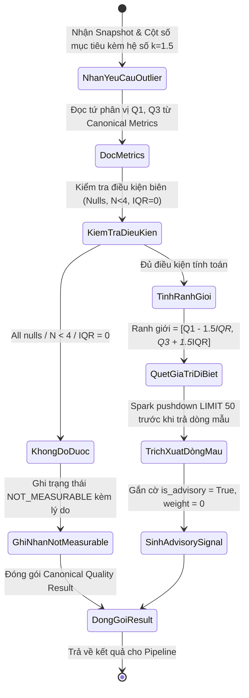

#### b. Kịch bản chi tiết (Use Case Specification)

- **Mã Use Case:** `UC-006`
- **Tên Use Case:** Phát hiện Ngoại lệ IQR (Advisory)
- **Tác nhân trực tiếp:** Không có; `UC-006` được `UC-005` bao gồm bằng quan hệ `<<include>>`.
- **Mục tiêu nghiệp vụ:** `BG-005`, `BG-006`.
- **Yêu cầu chức năng đáp ứng:** `FR-DET-001..006`, `BR-006`, `BR-012`.
- **Tiền điều kiện:** Cột dữ liệu mục tiêu có kiểu số (Integer/Float) và đã có Canonical Metrics.
- **Hậu điều kiện:** Sinh tín hiệu `CanonicalQualityResult` ở chế độ cảnh báo (`ADVISORY`), không làm đổi điểm số hay cổng chất lượng.
- **Luồng sự kiện chính:**
  1. Phân hệ nhận cấu hình Outlier: tên cột số, hệ số $k=1.5$.
  2. Đọc $Q1, Q3$ từ Canonical Metrics; tính $IQR = Q3 - Q1$.
  3. Xác lập khoảng an toàn Tukey: $[LowerBound = Q1 - 1.5 \cdot IQR, UpperBound = Q3 + 1.5 \cdot IQR]$.
  4. Quét bảng dữ liệu qua Apache Spark trên k3s để lọc các dòng có giá trị nằm ngoài khoảng an toàn.
  5. Đếm tổng số lượng bản ghi dị biệt, tính tỷ lệ ngoại lệ và trích xuất danh sách dòng mẫu.
  6. Đóng gói kết quả với cờ `is_advisory = True`, `contribution_weight = 0`.
- **Luồng ngoại lệ:**
  - *E1: Cột toàn null hoặc $IQR = 0$:* Trả về kết quả với trạng thái `NOT_MEASURABLE`, ghi rõ nguyên nhân `ALL_NULL_COLUMN` hoặc `ZERO_IQR_CONSTANT_DATA`.
  - *E2: Detector lỗi thực thi:* Trả advisory `FAILED_TO_MEASURE`, `is_advisory=true`, trọng số 0; Rule Results, Coverage score-enabled và Assessment vẫn được công bố.

---

### 1.4.7. Use Case 7: Xem Scorecard & Drill-down Bằng chứng có Che mờ Động (UC-007)

#### a. Sơ đồ hoạt động (Activity Diagram)

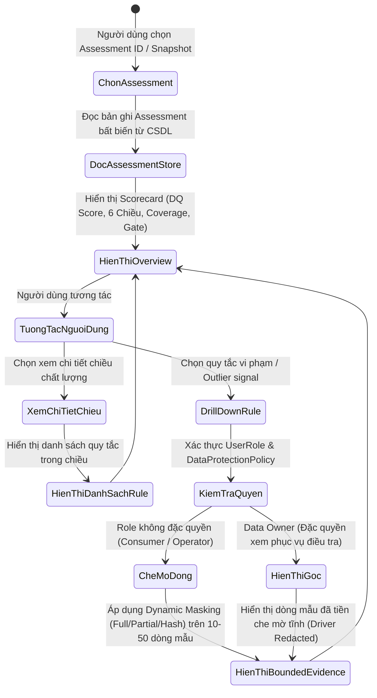

#### b. Kịch bản chi tiết (Use Case Specification)

- **Mã Use Case:** `UC-007`
- **Tên Use Case:** Xem Scorecard & Drill-down Bằng chứng có Che mờ Động
- **Tác nhân chính:** ACT-H-004 (Dataset Consumer).
- **Tác nhân thứ cấp:** ACT-H-001 (Data Engineer / Operator), ACT-H-002 (Data Owner), ACT-H-003 (Data Steward), ACT-H-005 (Domain Expert).
- **Mục tiêu nghiệp vụ:** `BG-003`, `BG-004`, `BG-007`.
- **Yêu cầu chức năng & giao diện đáp ứng:** `IF-UI-001..016`, `FR-ASM-001..003`, `FR-SCORE-006`, `NFR-SEC-006`, `BR-016`.
- **Điểm mở rộng (Extension Points):**
  - *Extension Point 1 (Chia sẻ & Xuất Thẻ điểm):* Mở rộng tính năng xuất nhanh ảnh thẻ điểm và sao chép liên kết chia sẻ trực tiếp (`IF-UI-010`).
  - *Extension Point 2 (Ghi chú Thảo luận Cộng tác):* Mở rộng thêm luồng đính kèm giải trình ngữ cảnh và thảo luận nhóm trên quy tắc vi phạm (`FR-COLLAB-001`).
  - *Extension Point 3 (Khuyến nghị Sửa lỗi):* Mở rộng hiển thị khuyến nghị khắc phục chất lượng dữ liệu kèm script mẫu (`FR-RECOM-001`).
  - *Extension Point 4 (Diễn giải Báo cáo Tự nhiên từ AI - Scorecard Narrative Report):* Trợ lý LLM Advisory nhận đầu vào là các `DimensionResult` và kết luận Gate của `ImmutableAssessment` đã công bố (tuyệt đối không nhận raw data hay evidence records); sinh đoạn văn bản tóm tắt tự nhiên (song ngữ Anh/Việt) nêu rõ điểm mạnh, chiều suy giảm và lưu ý khắc phục; báo cáo mang nhãn `source = 'AI_ADVISORY'` và không làm thay đổi số liệu bất biến (`NFR-AI-001`).
- **Tiền điều kiện:** 
  1. Người dùng đã xác thực trong Tenant Context (`tenant_id`).
  2. Bản ghi Assessment thuộc quyền sở hữu của Tenant `(tenant_id, assessment_id)`, HOẶC người dùng từ Tenant đối tác đã được cấp quyền thông qua Data Marketplace Access Grant (`BR-018`).
- **Hậu điều kiện:** Người dùng xem được Scorecard và dòng mẫu lỗi mà không làm lộ lọt thông tin định danh khách hàng (PII) hoặc bí mật kinh doanh; ranh giới cô lập giữa các bên được bảo toàn tuyệt đối.
- **Luồng sự kiện chính:**
  1. Người dùng mở giao diện Dashboard và chọn bản đánh giá cần xem (`assessment_id`).
  2. Hệ thống kiểm tra quyền hạn và ranh giới Tenant:
     - Nếu truy cập nội bộ Tenant: kiểm tra sự tồn tại của cặp `(tenant_id, assessment_id)`.
     - Nếu truy cập từ bên ngoài qua Data Marketplace: kiểm tra hiệu lực của Thỏa thuận chia sẻ dữ liệu (Access Grant). Trường hợp này, người xem CHỈ được truy cập bảng điểm công bố Scorecard, hệ thống chặn toàn bộ quyền xem bằng chứng lỗi mẫu (`evidence_payload`) và các phát hiện dữ liệu nhạy cảm (`BR-018`).
  3. Dashboard tải bản ghi `Assessment` nguyên vẹn từ Metadata Store mà không tính toán lại điểm số.
  4. Hiển thị Scorecard: DQ Score hoặc `WITHHELD`, đúng 6 Dimension Results với score nullable, Coverage và Gate (`PASS`/`WARN`/`FAIL`/`INSUFFICIENT_EVIDENCE`/`ERROR`).
  5. Người dùng nội bộ nhấp vào từng chiều chất lượng để xem danh sách quy tắc chi tiết.
  6. Người dùng nội bộ thực hiện Drill-down vào quy tắc bị vi phạm hoặc tín hiệu Outlier để xem mẫu số hợp lệ, số lượng lỗi, tỷ lệ vi phạm và bảng dữ liệu mẫu vi phạm (Bounded Evidence 10–50 dòng, $\le 500\text{ KB}$).
  7. Hệ thống thực thi **Che mờ Động theo Vai trò (Dynamic Role-Based Masking)** dựa trên `DataProtectionPolicy` của Tenant: người dùng không đặc quyền (Dataset Consumer) chỉ xem dữ liệu đã được che mờ (mask/hash), trong khi Data Owner nội bộ được cấp quyền xem dữ liệu giải trình phục vụ điều tra lỗi.
  8. Người dùng đối soát hash Snapshot, Ruleset, Policy, Outlier Config và `assessment_hash`.
- **Luồng ngoại lệ:**
  - *E1: Không có quyền truy cập hoặc cố tình xem trộm Tenant khác:* Hệ thống chặn yêu cầu với mã lỗi `FORBIDDEN_TENANT_RESOURCE`.
  - *E2: Assessment không tồn tại:* Trả về mã lỗi `ASSESSMENT_NOT_FOUND`.

---

### 1.4.8. Use Case 8: Xuất Báo cáo Đánh giá (Export) (UC-008)

#### a. Sơ đồ hoạt động (Activity Diagram)

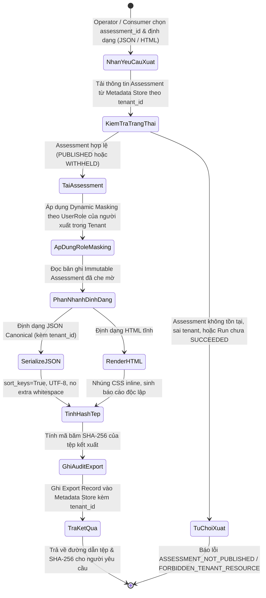

#### b. Kịch bản chi tiết (Use Case Specification)

- **Mã Use Case:** `UC-008`
- **Tên Use Case:** Xuất Báo cáo Đánh giá (Export)
- **Tác nhân chính:** ACT-H-001 (Data Engineer / Operator) hoặc ACT-H-004 (Dataset Consumer).
- **Mục tiêu nghiệp vụ:** `BG-004`, `BG-007`, `BG-008`.
- **Yêu cầu chức năng đáp ứng:** `FR-ASM-001..005`, `NFR-COR-001`, `NFR-SEC-006`, `DR-024`, `BR-018`.
- **Tiền điều kiện:** Assessment đã được công bố trong Metadata Store (`run_status = SUCCEEDED`) và thuộc quyền sở hữu của Tenant `(tenant_id, assessment_id)`.
- **Hậu điều kiện:** Tệp JSON Canonical, HTML tĩnh, CSV/Excel hoặc cấu trúc BI Schema được tạo ra chứa toàn bộ `Immutable Assessment`; nội dung đã được che mờ phù hợp với vai trò người xuất và khớp với bản ghi trong CSDL; có metadata `tenant_id` phục vụ kiểm toán.
- **Luồng sự kiện chính:**
  1. Người dùng trong Tenant Context chọn `assessment_id` cần xuất và định dạng mong muốn (JSON Canonical / HTML tĩnh / CSV-Excel / BI Schema).
  2. Hệ thống xác thực cặp `(tenant_id, assessment_id)` và tải bản ghi Assessment từ Metadata Store, không tính toán lại điểm số.
  3. Hệ thống áp dụng Dynamic Role-Based Masking trên evidence payload nếu người xuất không mang vai trò Data Owner của Tenant.
  4. Hệ thống serialize Assessment theo định dạng yêu cầu (với JSON Canonical: bao gồm thuộc tính `tenant_id`, `sort_keys=True`, UTF-8, không khoảng trắng thừa).
  5. Hệ thống sinh tệp xuất và ghi SHA-256 của tệp vào metadata Export Record kèm `tenant_id`.
  6. Trả về đường dẫn tệp xuất để người dùng lưu trữ hoặc tải về.
- **Luồng ngoại lệ:**
  - *E1: Assessment không tồn tại hoặc Run chưa SUCCEEDED:* Hệ thống từ chối xuất với lỗi `ASSESSMENT_NOT_PUBLISHED`.
  - *E2: Sai lệch Tenant Context:* Hệ thống từ chối với lỗi `FORBIDDEN_TENANT_RESOURCE`.


### 1.4.9. Use Case 12: Đăng ký, Đăng nhập & Quản lý Phiên làm việc (UC-012)

#### a. Kịch bản Đặc tả Nghiệp vụ (Use Case Narrative)
- **Tác nhân chính:** Toàn bộ tác nhân người dùng (ACT-H-001 đến ACT-H-006).
- **Mục tiêu:** Cung cấp cơ chế xác thực an toàn, cấp phát và thu hồi token phiên làm việc, chống tấn công dò quét tài khoản và bảo vệ phiên làm việc theo các tiêu chuẩn OWASP và NIST SP 800-63B.
- **Tiền điều kiện:** Dịch vụ xác thực khả dụng; kết nối CSDL PostgreSQL 16 ổn định.
- **Hậu điều kiện thành công:** Người dùng nhận được cặp Access Token (JWT) và Refresh Token hợp lệ mang đầy đủ thông tin danh tính (`user_id`, `tenant_id`, `roles`, `scopes`).
- **Luồng sự kiện chính:**
  1. *Đăng ký tài khoản mới:* Người dùng cung cấp Email, Họ tên, Mật khẩu và Tên Workspace muốn khởi tạo. Hệ thống kiểm tra tính duy nhất của Email, thực thi thuật toán băm Argon2id (RFC 9106) để mã hóa mật khẩu, tạo bản ghi `Tenant` mới và bản ghi `User`, gán vai trò `WORKSPACE_ADMIN` trong bảng `tenant_memberships`.
  2. *Đăng nhập hệ thống:* Người dùng nhập Email và Mật khẩu. Hệ thống thực thi hàm kiểm tra băm mật khẩu với cơ chế thời gian hằng số (Constant-Time Dummy Execution kể cả khi Email không tồn tại để triệt tiêu chênh lệch thời gian Timing Attack theo BR-022).
  3. *Cấp phát Token:* Khi xác thực thành công, hệ thống sinh Access Token (JWT có thời hạn sống 15 phút) và Refresh Token (UUIDv4 ngẫu nhiên có thời hạn 14 ngày), đồng thời lưu mã băm SHA-256 của Refresh Token vào bảng `user_sessions`.
  4. *Xoay vòng Token (Refresh Token Rotation):* Khi Access Token hết hạn, Client gửi Refresh Token lên endpoint `/auth/refresh`. Hệ thống xác thực mã băm của Refresh Token, lập tức thu hồi token cũ, cấp phát một cặp Access Token và Refresh Token hoàn toàn mới.
  5. *Đăng xuất:* Người dùng gửi yêu cầu đăng xuất. Hệ thống đánh dấu thu hồi (`revoked_at = NOW()`) bản ghi session tương ứng, vô hiệu hóa hoàn toàn khả năng làm mới token.
- **Luồng ngoại lệ:**
  - *E1: Sai thông tin đăng nhập:* Hệ thống trả về lỗi chuẩn hóa `"Invalid email or password"` (HTTP 401), tăng bộ đếm `failed_login_attempts`.
  - *E2: Đăng nhập sai quá 5 lần liên tiếp:* Hệ thống tự động khóa tài khoản tạm thời 15 phút (`locked_until = NOW() + INTERVAL '15 minutes'`), từ chối mọi yêu cầu đăng nhập tiếp theo với mã `ACCOUNT_TEMPORARILY_LOCKED` (HTTP 423).
  - *E3: Phát hiện tái sử dụng Refresh Token (Reuse Detection):* Nếu nhận được một Refresh Token đã bị thu hồi trước đó, hệ thống nhận diện nguy cơ chiếm đoạt phiên (Session Hijacking), lập tức thu hồi toàn bộ các phiên hoạt động (`user_sessions`) của người dùng đó và yêu cầu xác thực lại từ đầu.

---

### 1.5. Định hướng Mở rộng Use Case (Roadmap Use Cases - Post-1.0)


### 1.4.10. Use Case 13: Mời & Quản trị Thành viên Không gian làm việc (UC-013)

#### a. Kịch bản Đặc tả Nghiệp vụ (Use Case Narrative)
- **Tác nhân chính:** ACT-H-006 Workspace Administrator.
- **Tác nhân hưởng lợi:** ACT-H-001 đến ACT-H-005.
- **Mục tiêu:** Quản trị danh sách thành viên trong Workspace/Tenant, phân định vai trò RBAC, gửi lời mời tham gia an toàn và kiểm soát vòng đời truy cập của nhân sự.
- **Tiền điều kiện:** Quản trị viên đã đăng nhập và sở hữu vai trò `WORKSPACE_ADMIN` trên Tenant tương ứng.
- **Hậu điều kiện thành công:** Thành viên mới được kích hoạt tài khoản và gán đúng vai trò nghiệp vụ trong bảng `tenant_memberships`.
- **Luồng sự kiện chính:**
  1. *Gửi thư mời:* Quản trị viên nhập Email của nhân sự và chọn vai trò nghiệp vụ (`DATA_STEWARD`, `DATA_OWNER`, `DATA_ENGINEER`, `BUSINESS_VIEWER`).
  2. *Khởi tạo Invitation Token:* Hệ thống sinh mã token ngẫu nhiên cryptographically secure, lưu mã băm SHA-256 vào bảng `user_invitations` kèm `tenant_id`, vai trò và thời hạn sống TTL 48 giờ.
  3. *Gửi thư:* Hệ thống chuyển tiếp email chứa liên kết kích hoạt đến người nhận.
  4. *Tiếp nhận và Kích hoạt:* Người dùng nhấn vào liên kết, cung cấp Họ tên và Mật khẩu mới (nếu chưa có tài khoản trong hệ thống) hoặc xác nhận gia nhập Workspace (nếu đã có tài khoản).
  5. *Ghi nhận thành viên:* Hệ thống kiểm tra mã băm Token, tạo hoặc liên kết bản ghi `User`, thêm bản ghi vào `tenant_memberships` với vai trò đã định trước, và đánh dấu `accepted_at = NOW()` trong `user_invitations`.
- **Luồng ngoại lệ:**
  - *E1: Token lời mời hết hạn:* Hệ thống từ chối kích hoạt với mã `INVITATION_TOKEN_EXPIRED` (HTTP 410), yêu cầu Quản trị viên gửi lại lời mời mới.
  - *E2: Người dùng đã là thành viên của Workspace:* Hệ thống thông báo người dùng đã có quyền truy cập, không tạo bản ghi trùng lặp (`USER_ALREADY_MEMBER`).

### 1.4.11. Use Case 14: Cấu hình Kênh Thông báo & Đăng ký Cảnh báo Sự kiện (UC-014)

#### a. Kịch bản Đặc tả Nghiệp vụ (Use Case Narrative)
- **Tác nhân chính:** ACT-H-006 Workspace Administrator (cấu hình kênh), Toàn bộ người dùng ACT-H-001..005 (đăng ký cảnh báo).
- **Mục tiêu:** Thiết lập các kênh kết nối gửi cảnh báo đa phương tiện (Email, Webhook, Slack, Teams), phòng vệ tấn công SSRF trên URL webhook ngoại vi, và cho phép thành viên đăng ký nhận cảnh báo theo ngưỡng sự kiện mong muốn.
- **Tiền điều kiện:** Quản trị viên đăng nhập vào Workspace; các dịch vụ tiếp nhận webhook/SMTP ngoại vi đang hoạt động.
- **Hậu điều kiện thành công:** Kênh thông báo được lưu trữ an toàn; các lượt chạy hoặc biến cố chất lượng vi phạm tự động phân phối cảnh báo tới đúng người nhận.
- **Luồng sự kiện chính:**
  1. *Khai báo Kênh Thông báo:* Quản trị viên chọn loại kênh (`EMAIL`, `WEBHOOK`, `SLACK`, `TEAMS`), nhập tên kênh và cấu hình kết nối (ví dụ: Webhook URL, Webhook Secret).
  2. *Kiểm tra Phòng vệ SSRF & Ranh giới Mạng:* Trước khi lưu hoặc thực hiện ping thử nghiệm, hệ thống phân giải DNS của Webhook URL, đối chiếu địa chỉ IP đích với danh sách cấm (RFC 1918 Private IPs, RFC 1122 Loopback, Cloud Metadata IPs `169.254.169.254`). Nếu phát hiện địa chỉ nội bộ, hệ thống lập tức chặn đứng theo BR-024.
  3. *Lưu trữ Kênh:* Hệ thống mã hóa khóa bí mật (Secret Key) và lưu cấu hình vào bảng `notification_channels` kèm `tenant_id`.
  4. *Đăng ký Nhận Cảnh báo:* Thành viên thiết lập quy tắc đăng ký trong bảng `alert_subscriptions`: chọn sự kiện cần nhận (`RUN_FAILED`, `QUALITY_GATE_FAIL`, `POLICY_SUBMITTED_FOR_APPROVAL`) và mức độ nghiêm trọng tối thiểu (`WARN`, `CRITICAL`).
  5. *Phân phối Cảnh báo Bất đồng bộ:* Khi Worker hoàn tất một Run hoặc xảy ra sự kiện, hệ thống đẩy bản ghi sự kiện vào `notification_logs`/outbox; tiến trình Dispatcher nền đọc sự kiện, đóng gói JSON payload, tạo chữ ký số HMAC-SHA256 (`X-DQ-Signature`) và timestamp (`X-DQ-Timestamp`), sau đó phát HTTP POST tới Webhook URL ngoại vi.
- **Luồng ngoại lệ:**
  - *E1: URL vi phạm phòng vệ SSRF:* Hệ thống từ chối cấu hình với mã lỗi `SSRF_TARGET_BLOCKED` (HTTP 400), không thực hiện bất kỳ kết nối mạng nào đến URL đó.
  - *E2: Webhook ngoại vi phản hồi lỗi hoặc timeout:* Hệ thống ghi nhận trạng thái `FAILED` trong `notification_logs`, tự động kích hoạt cơ chế thử lại (Exponential Backoff Retry) tối đa 3 lần trước khi đánh dấu thất bại vĩnh viễn.

Nhằm bảo đảm tính tinh gọn của Baseline v1.0 nhưng vẫn duy trì khả năng truy vết và tiến hóa kiến trúc (Evolutionary Architecture), các Use Case cấp cao phục vụ tự động hóa và tích hợp doanh nghiệp được quy hoạch vào lộ trình phát triển sau v1.0 (Post-1.0 Roadmap theo AD-012):

| Mã UC | Tên Use Case Lộ Trình | Tác Nhân Chính | Mục Tiêu & Kịch Bản Nghiệp Vụ | Yêu Cầu SRS Liên Quan |
| :--- | :--- | :--- | :--- | :--- |
| **UC-009** | Lập lịch Đánh giá Định kỳ Tự động (Scheduled Evaluation) | ACT-H-001 Data Engineer / Operator | Cho phép người vận hành thiết lập lịch chạy tự động theo biểu thức Cron (hàng giờ, hàng ngày, hàng tuần) cho từng cặp Snapshot/Ruleset; hệ thống tự động sinh `RunSpec` và đưa vào durable queue mà không cần kích hoạt thủ công. | FR-SCHED-001..002 |
| **UC-010** | Kiểm tra Cổng Chất lượng Dữ liệu CI/CD (CI/CD Quality Gate Pipeline) | CI/CD Runner / Pipeline Agent | Tích hợp vào quy trình tích hợp liên tục; kích hoạt đánh giá dữ liệu ở chế độ headless qua CLI; kiểm tra trạng thái Quality Gate (`PASS`/`FAIL`) và trả về exit code (0: Pass, 1: Fail) để chặn việc deploy model hoặc ETL pipeline khi chất lượng vi phạm. | IF-CLI-002, NFR-INT-001 |
| **UC-011** | Quy trình Phê duyệt Cấu hình Đa cấp & Ủy quyền (Multi-level Configuration Approval Workflow) | ACT-H-002 Data Owner, ACT-H-003 Data Steward | Thiết lập quy trình xét duyệt nhiều bước (Multi-step Approval) cho các thay đổi quan trọng trong Ruleset và Scoring Policy; hỗ trợ ủy quyền tạm thời và phân định trách nhiệm kiểm toán theo chuẩn doanh nghiệp. | FR-GOV-009 |

---

## 2. MÔ HÌNH HÓA CẤU TRÚC PHÂN TÍCH (ANALYSIS CLASS MODEL)

Biểu đồ lớp phân tích biểu diễn các khái niệm nghiệp vụ cốt lõi và mối quan hệ giữa chúng trong không gian bài toán DQ Scoring:

```mermaid
classDiagram
    class Tenant {
        +UUID tenant_id
        +String tenant_name
        +String tenant_slug
        +String status
        +DateTime created_at
    }

    class DataAsset {
        +UUID asset_id
        +UUID tenant_id
        +String asset_name
        +String provenance_url
        +String format
        +DateTime created_at
    }

    class DatasetSnapshot {
        +UUID snapshot_id
        +UUID tenant_id
        +UUID asset_id
        +String file_path
        +String sha256_hash
        +JSON schema_definition
        +Int total_rows
        +DateTime captured_at
    }

    class CanonicalMetric {
        +UUID metric_id
        +UUID tenant_id
        +UUID snapshot_id
        +String column_name
        +String metric_name
        +Float metric_value
        +JSON summary_payload
        +String method
    }

    class RuleCatalogTemplate {
        +UUID template_id
        +UUID? tenant_id
        +String template_name
        +String category
        +String dimension
        +String rule_type
        +JSON default_parameters
        +String suggested_null_policy
        +String default_severity
        +Float default_weight
        +Boolean is_system_standard
    }

    class QualityRule {
        +UUID rule_id
        +UUID tenant_id
        +String rule_name
        +String dimension
        +String target_column
        +String rule_type
        +JSON parameters
        +String null_policy
        +Float weight
        +String severity
        +Boolean is_advisory
        +Boolean is_required
        +Boolean gate_enabled
        +Boolean score_enabled
        +Float? acceptance_threshold
        +String? conflict_group
        +Boolean is_primary_scoring_rule
        +String source
    }

    class ClassificationRule {
        +UUID rule_id
        +UUID? tenant_id
        +String rule_name
        +String sensitive_category
        +String pattern_regex
        +List~String~ column_name_patterns
        +Float confidence_threshold
        +String default_masking_strategy
        +Boolean is_active
    }

    class SensitiveDataFinding {
        +UUID finding_id
        +UUID tenant_id
        +UUID snapshot_id
        +String column_name
        +String sensitive_category
        +UUID classification_rule_id
        +Float confidence_score
        +Int sample_matches_count
        +DateTime detected_at
    }

    class DataProtectionPolicy {
        +UUID policy_id
        +UUID tenant_id
        +UUID? asset_id
        +String policy_name
        +String version
        +String status
        +JSON masking_rules_by_role
        +String config_hash
        +String submitted_by
        +DateTime submitted_at
        +String approved_by
        +DateTime approved_at
    }

    class RulesetTemplate {
        +UUID template_id
        +UUID? tenant_id
        +String template_code
        +String name
        +String domain
        +String data_type
        +String target_use_case
        +JSON rules_payload
        +Boolean is_system_template
    }

    class ScoringPolicyTemplate {
        +UUID template_id
        +UUID? tenant_id
        +String template_code
        +String name
        +String domain
        +String target_use_case
        +Map dimension_weights
        +Float publication_threshold
        +JSON gate_rules
        +Boolean is_system_template
    }

    class Ruleset {
        +UUID ruleset_id
        +UUID tenant_id
        +UUID? asset_id
        +UUID? derived_from_template_id
        +String version
        +String config_hash
        +String status
        +String submitted_by
        +DateTime submitted_at
        +String approved_by
        +DateTime approved_at
        +List~QualityRule~ rules
    }

    class ScoringPolicy {
        +UUID policy_id
        +UUID tenant_id
        +UUID? asset_id
        +UUID? derived_from_template_id
        +String version
        +String config_hash
        +String status
        +String submitted_by
        +DateTime submitted_at
        +String approved_by
        +DateTime approved_at
        +Map dimension_weights
        +Float publication_threshold
        +JSON gate_rules
    }

    class EvaluationRun {
        +UUID run_id
        +UUID tenant_id
        +UUID snapshot_id
        +UUID ruleset_id
        +UUID policy_id
        +UUID? protection_policy_id
        +JSON outlier_config
        +String outlier_config_hash
        +String run_status
        +Int attempt_count
        +String lease_owner
        +Int lease_generation
        +DateTime lease_expires_at
        +DateTime heartbeat_at
        +DateTime cancel_requested_at
        +String idempotency_key
        +String execution_error
        +DateTime created_at
        +DateTime started_at
        +DateTime completed_at
    }

    class CanonicalQualityResult {
        +UUID result_id
        +UUID tenant_id
        +UUID run_id
        +UUID rule_id
        +UUID ruleset_id
        +String rule_config_hash
        +String source_kind
        +String target_column
        +String dimension
        +String measurement_status
        +Int passed_count
        +Int failed_count
        +Int missing_count
        +Int miscast_count
        +Int not_applicable_count
        +Int total_observed
        +Float computed_score
        +Boolean is_advisory
        +Boolean is_required
        +Boolean gate_enabled
        +Boolean score_enabled
        +JSON evidence_payload
    }

    class DimensionResult {
        +String dimension_name
        +String measurement_status
        +Float dimension_score
        +Float dimension_weight
        +Int total_rules
        +Int measured_rules
    }

    class Assessment {
        +UUID assessment_id
        +UUID tenant_id
        +UUID run_id
        +UUID snapshot_id
        +Float dq_score
        +String publication_status
        +Float coverage_ratio
        +String confidence_status
        +String quality_gate
        +Map config_hashes
        +String assessment_hash
        +DateTime published_at
    }

    Tenant "1" *-- "0..*" DataAsset : owns
    Tenant "1" *-- "0..*" Ruleset : owns
    Tenant "1" *-- "0..*" ScoringPolicy : owns
    Tenant "1" *-- "0..*" DataProtectionPolicy : owns
    Tenant "1" *-- "0..*" EvaluationRun : owns
    Tenant "1" *-- "0..*" Assessment : owns
    Tenant "1" o-- "0..*" RuleCatalogTemplate : customizes
    Tenant "1" o-- "0..*" ClassificationRule : customizes
    Tenant "1" o-- "0..*" RulesetTemplate : customizes
    Tenant "1" o-- "0..*" ScoringPolicyTemplate : customizes

    RulesetTemplate "1" o-- "0..*" Ruleset : instantiates
    ScoringPolicyTemplate "1" o-- "0..*" ScoringPolicy : instantiates
    DataAsset "1" *-- "1..*" DatasetSnapshot : contains
    DatasetSnapshot "1" *-- "0..*" CanonicalMetric : profiled_into
    DatasetSnapshot "1" *-- "0..*" SensitiveDataFinding : discovers
    ClassificationRule "1" --> "0..*" SensitiveDataFinding : identifies
    RuleCatalogTemplate "1" o-- "0..*" QualityRule : instantiates
    Ruleset "1" *-- "1..*" QualityRule : composes
    DataProtectionPolicy "1" --> "0..*" CanonicalQualityResult : masks_evidence
    
    EvaluationRun "0..*" --> "1" DatasetSnapshot : evaluates (composite)
    EvaluationRun "0..*" --> "1" Ruleset : executes (composite)
    EvaluationRun "0..*" --> "1" ScoringPolicy : applies (composite)
    EvaluationRun "0..*" --> "1" DataProtectionPolicy : enforces (composite)
    
    EvaluationRun "1" *-- "0..*" CanonicalQualityResult : produces
    EvaluationRun "1" *-- "0..1" Assessment : publishes
    
    Assessment "1" *-- "6" DimensionResult : contains
    Assessment "1" o-- "0..*" CanonicalQualityResult : aggregates
```

### Bảng từ điển các thực thể phân tích chính

| Tên Thực thể | Định nghĩa và Trách nhiệm nghiệp vụ | Mối quan hệ chính |
| :--- | :--- | :--- |
| **Tenant** | Đại diện cho tổ chức hoặc khách hàng sở hữu dữ liệu và tài nguyên; là ranh giới cô lập bảo mật cao nhất (Lớp 0) trong kiến trúc Data Marketplace (`DR-024`). | Sở hữu độc quyền `DataAsset`, `Ruleset`, `ScoringPolicy`, `DataProtectionPolicy`, `EvaluationRun` và `Assessment`. |
| **DataAsset** | Đại diện cho tài sản dữ liệu logic độc lập với phiên bản vật lý, thuộc sở hữu của một Tenant duy nhất (`DR-001`). Tên tài sản là duy nhất trong phạm vi tenant. | Thuộc về 1 `Tenant`; chứa 1 hoặc nhiều `DatasetSnapshot` bảo toàn ghép `(tenant_id, id)`. |
| **DatasetSnapshot** | Bản ghi dữ liệu vật lý bất biến gắn với snapshot Delta Lake (hoặc file CSV/Parquet) và mã SHA-256 / `versionAsOf`, lưu trữ trong namespace của Tenant (`lakehouse/{tenant_id}/...`). | Thuộc về 1 `DataAsset` và 1 `Tenant`; sinh ra tập `CanonicalMetric` và `SensitiveDataFinding`. |
| **CanonicalMetric** | Chỉ số thống kê tính toán 1 lần dùng chung cho toàn bộ quá trình đánh giá, phân lập theo tenant (`DR-003`). | Gắn liền với 1 `DatasetSnapshot` qua cặp ghép `(tenant_id, snapshot_id)`. |
| **RuleCatalogTemplate** | Mẫu quy tắc chuẩn hóa có thể tái sử dụng từ Kho Rule tập trung (`FR-GOV-011`). Hỗ trợ mẫu hệ thống (`tenant_id IS NULL`) và mẫu riêng của từng tenant. | Được tham chiếu và tùy biến thành `QualityRule`. |
| **RulesetTemplate** | Mẫu bộ quy tắc đánh giá chuẩn hóa theo Domain, Data Type và Mục đích sử dụng (`FR-GOV-013`, `DR-026`). Hỗ trợ mẫu hệ thống (`tenant_id IS NULL`) và mẫu riêng của tenant. | Được nhân bản thành `Ruleset` DRAFT của Tenant qua trường `derived_from_template_id`. |
| **ScoringPolicyTemplate** | Mẫu chính sách tính điểm và luật Quality Gate tương thích theo Domain và Mục đích sử dụng (`FR-GOV-014`, `DR-027`). Hỗ trợ mẫu hệ thống (`tenant_id IS NULL`) và mẫu riêng của tenant. | Được nhân bản thành `ScoringPolicy` DRAFT của Tenant qua trường `derived_from_template_id`. |
| **QualityRule** | Định nghĩa kỳ vọng kiểm tra xác định trên 1 cột hoặc nhiều cột gắn với chiều chất lượng (`DR-005`). | Thuộc về 1 `Tenant`; là phần tử cấu thành nên `Ruleset`. |
| **ClassificationRule** | Quy tắc nhận diện dữ liệu nhạy cảm theo 4 phân loại dựa trên regex và pattern tên cột (`NFR-SEC-005`). Hỗ trợ chuẩn hệ thống hoặc rule riêng của tenant. | Định danh các `SensitiveDataFinding` trong quá trình Profiling. |
| **SensitiveDataFinding** | Bản ghi phát hiện trường dữ liệu nhạy cảm kèm mức độ tin cậy và phân loại 4 nhóm (`DR-020`), thuộc sở hữu Tenant. | Thuộc về 1 `DatasetSnapshot` qua cặp ghép `(tenant_id, snapshot_id)`. |
| **DataProtectionPolicy** | Chính sách bảo vệ dữ liệu quy định chiến lược che mờ động theo vai trò người dùng (`FR-GOV-012`), cấu hình theo từng Tenant hoặc từng Asset (`DR-023`). | Thuộc về 1 `Tenant`; được thực thi bởi `EvidenceService` khi drill-down bằng chứng. |
| **Ruleset** | Tập hợp các quy tắc đánh giá có phiên bản và mã băm đóng băng, gắn theo `asset_id` hoặc dùng chung trong Tenant (`DR-004`). | Thuộc về 1 `Tenant`; liên kết với `EvaluationRun` qua cặp ghép `(tenant_id, ruleset_id)`. |
| **ScoringPolicy** | Chính sách tính điểm, trọng số, ngưỡng công bố và luật cổng chất lượng thuộc sở hữu của Tenant (`DR-006`). | Thuộc về 1 `Tenant`; liên kết với `EvaluationRun` qua cặp ghép `(tenant_id, policy_id)`. |
| **EvaluationRun** | Thể hiện một lượt thực thi đánh giá cụ thể với trạng thái vòng đời bất đồng bộ, phân lập theo Tenant với `idempotency_key` riêng biệt (`DR-007`, `DR-024`). | Ràng buộc tính toàn vẹn ghép `(tenant_id, snapshot_id)`, `(tenant_id, ruleset_id)`; sinh ra `Assessment`. |
| **CanonicalQualityResult** | Kết quả chuẩn hóa duy nhất của từng quy tắc hoặc bộ phát hiện, thuộc sở hữu Tenant (`DR-008`). | Thuộc về `EvaluationRun` qua cặp ghép `(tenant_id, run_id)`; tổng hợp vào `Assessment`. |
| **DimensionResult** | Kết quả tổng hợp của 1 trong 6 chiều chất lượng dữ liệu (`DR-009`). | Là thành phần cấu thành của `Assessment`. |
| **Assessment** | Bản ghi tổng kết chất lượng bất biến công bố cho người dùng hoặc chia sẻ có kiểm soát trên Data Marketplace (`DR-010`, `BR-018`). | Thuộc về 1 `Tenant`; được tạo ra từ 1 `EvaluationRun` thành công duy nhất qua cặp ghép `(tenant_id, run_id)`. |

---

## 3. MÔ HÌNH HÓA HÀNH VI (BEHAVIORAL MODELING)

### 3.1. Biểu đồ tuần tự (Sequence Diagrams)

#### 3.1.1. Tuần tự Đăng ký Data Asset (SEQ-001)

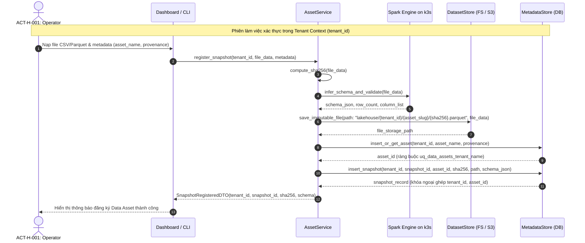

---

#### 3.1.2. Tuần tự Thực thi Profiling Engine & Nhận diện PII (SEQ-002)

*(Lưu ý kiến trúc: Động cơ Profiling thực thi phân tán qua Spark Compute Adapter trên k3s thông qua SparkApplication lifecycle. Động cơ thực thi hợp nhất profiling aggregates và partition counts vào **một lượt quét vector hóa duy nhất** (Single-Pass Fusion), áp dụng **Column Projection Pushdown** chỉ đọc các cột cần thiết của ruleset từ snapshot URI, và nhúng **In-Engine PII Redaction** expressions trực tiếp vào DataFrame projection trước khi kết quả trả về cho Worker.)*

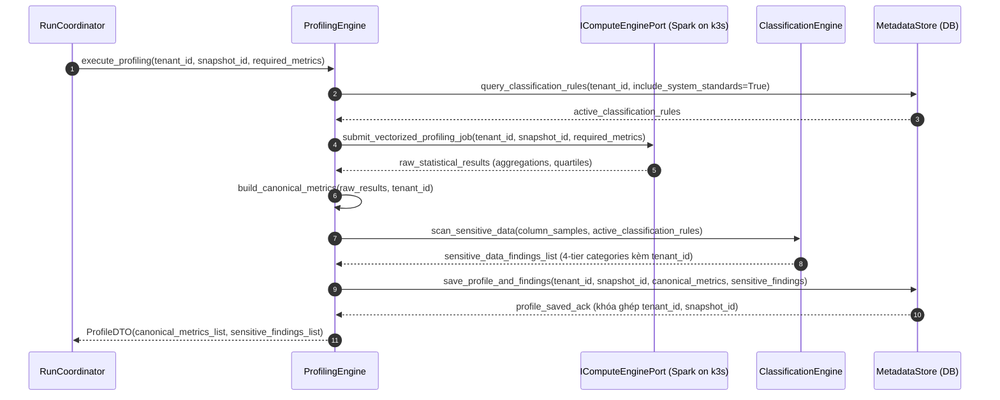

---

#### 3.1.3. Tuần tự Soạn thảo Ruleset & Scoring Policy (Draft - SEQ-003)

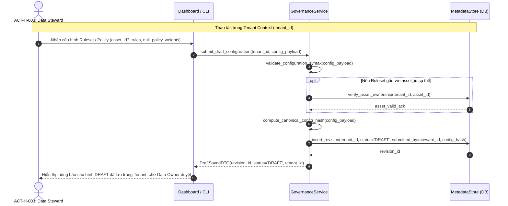

---

#### 3.1.4. Tuần tự Phê duyệt Ruleset & Scoring Policy (Approve - SEQ-004)

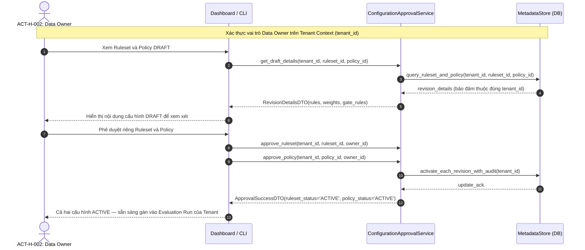

---

#### 3.1.5. Tuần tự Thực thi Rule Engine & Đo lường Phân hoạch (SEQ-005)

*(Lưu ý kiến trúc: Sơ đồ dưới đây minh họa luồng đo lường phân hoạch 5 nhóm qua `IComputeEnginePort` với `SparkComputeAdapter` trên cụm k3s: phép đo được thực thi phân tán trực tiếp trên Spark DataFrames/SQL pushdown từ snapshot namespace `lakehouse/{tenant_id}/...`).*

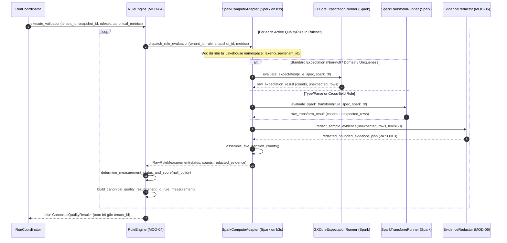

---

#### 3.1.6. Tuần tự Thực thi IQR Outlier Detector (SEQ-006)

*(Lưu ý kiến trúc: Phát hiện ngoại lệ đơn biến trên cột số được đẩy tính toán xuống SparkComputeAdapter trên k3s; kết quả luôn mang cờ is_advisory = True và weight = 0).*

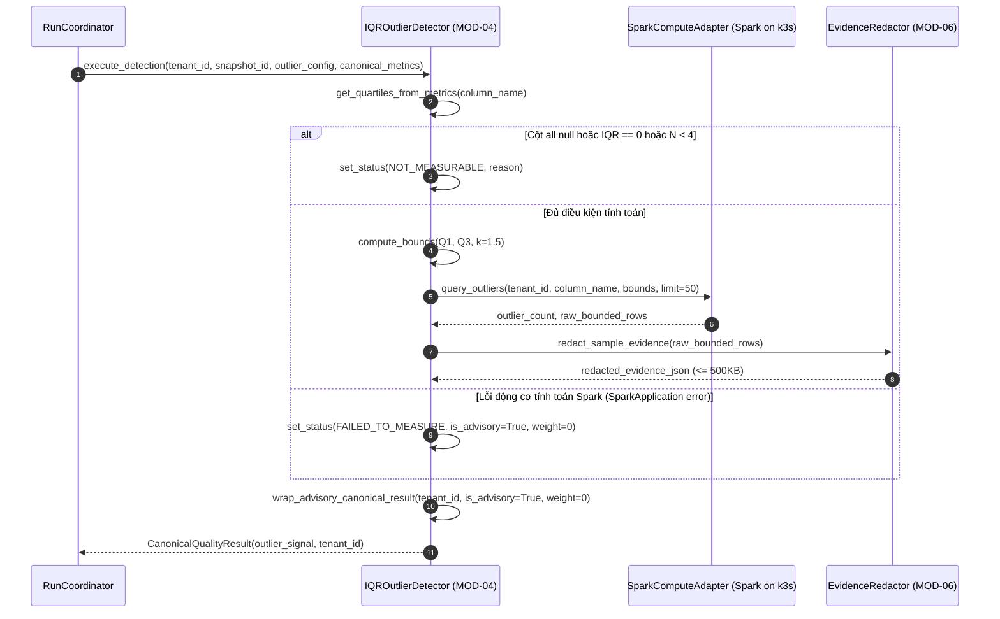

---

#### 3.1.7. Tuần tự Tổng hợp Điểm số và Đánh giá Quality Gate (SEQ-007)

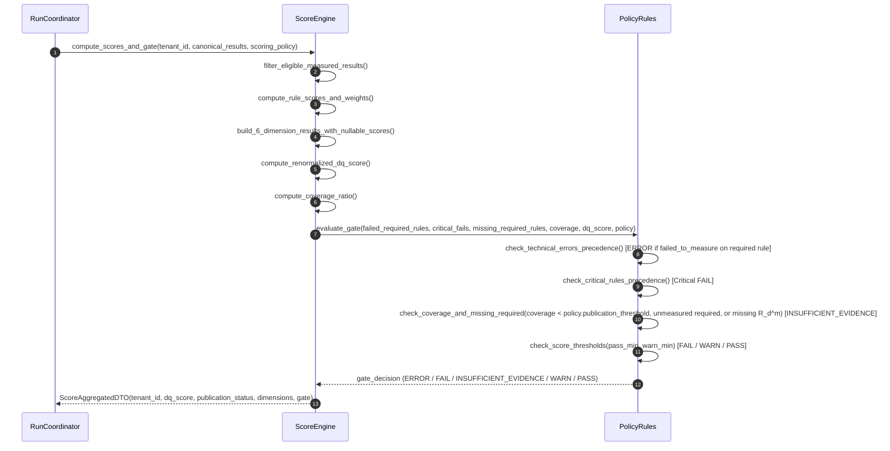

---

#### 3.1.8. Tuần tự Đóng gói và Công bố Assessment nguyên tử (SEQ-008)

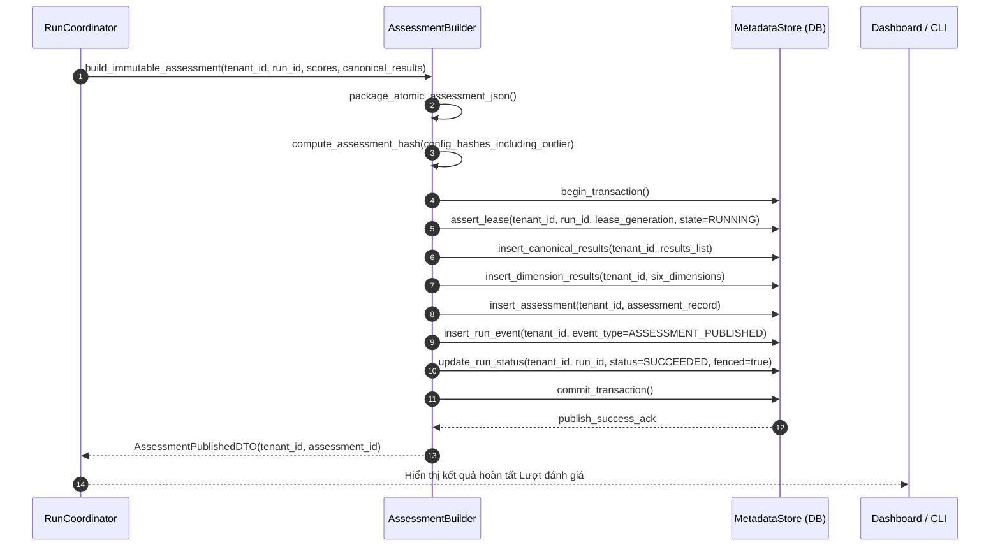

---

#### 3.1.9. Tuần tự Truy vấn Scorecard và Drill-down Bằng chứng có Che mờ Động (SEQ-009)

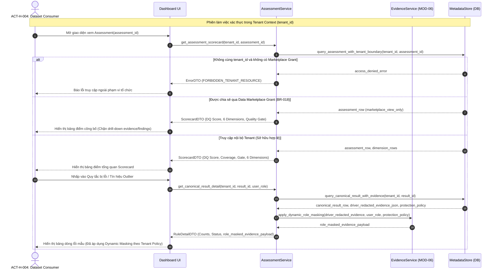

---

#### 3.1.10. Tuần tự Tra cứu và Tái sử dụng Kho Rule tập trung (SEQ-010)

```mermaid
sequenceDiagram
    autonumber
    actor Steward as ACT-H-003: Data Steward
    participant UI as Dashboard / CLI
    participant CatalogSvc as RuleCatalogService
    participant MetaDB as MetadataStore (DB)

    Note over Steward,MetaDB: Thao tác trong Tenant Context (tenant_id)
    Steward->>UI: Truy cập Kho Rule tập trung lọc theo Dimension / Category
    UI->>CatalogSvc: list_templates(tenant_id, dimension, category)
    CatalogSvc->>MetaDB: query_rule_catalog_templates(tenant_id, include_system_standards=True)
    Note over MetaDB: Trả về Template hệ thống (tenant_id IS NULL) + Template riêng của tenant
    MetaDB-->>CatalogSvc: template_records_list
    CatalogSvc-->>UI: List~RuleCatalogTemplateDTO~
    UI-->>Steward: Hiển thị danh mục mẫu quy tắc chuẩn hóa và mẫu riêng của tenant

    Steward->>UI: Chọn Template và tùy biến tham số cho Data Asset của Tenant
    UI->>CatalogSvc: instantiate_rule_from_template(tenant_id, template_id, asset_id, custom_params)
    CatalogSvc->>CatalogSvc: validate_and_bind_parameters(template, custom_params)
    CatalogSvc-->>UI: QualityRuleDraftDTO(rule_id, tenant_id, asset_id, dimension, parameters, weight)
    UI-->>Steward: Đưa quy tắc vào bản nháp RulesetRevision DRAFT của Tenant
```


#### 3.1.11. Tuần tự Đăng nhập, Xác thực Token & Triệt tiêu Timing Attack (SEQ-011)

```mermaid
sequenceDiagram
    autonumber
    actor User as ACT-H-001..006: User
    participant API as FastAPI Inbound Adapter
    participant AuthSvc as AuthenticationService
    participant Hasher as Argon2idPasswordHasher
    participant SessionRepo as UserSessionRepository
    participant DB as PostgreSQL 16 (users & sessions)

    User->>API: POST /api/v1/auth/login (email, password)
    API->>AuthSvc: authenticate(email, password, client_ip, user_agent)
    AuthSvc->>DB: find_user_by_email(email)
    
    alt User tồn tại trong hệ thống
        DB-->>AuthSvc: UserRecord (user_id, password_hash, failed_attempts, locked_until)
        AuthSvc->>AuthSvc: check_account_lockout(locked_until)
        AuthSvc->>Hasher: verify(password, password_hash)
        Hasher-->>AuthSvc: is_valid (True / False)
    else User KHÔNG tồn tại trong hệ thống
        DB-->>AuthSvc: NULL
        Note over AuthSvc,Hasher: Thực thi Dummy Hash để triệt tiêu chênh lệch thời gian (BR-022)
        AuthSvc->>Hasher: verify(password, DUMMY_ARGON2ID_HASH)
        Hasher-->>AuthSvc: False
    end

    alt Xác thực Thất bại (Password sai hoặc User không tồn tại)
        AuthSvc->>DB: increment_failed_attempts(email) / lock nếu >= 5 lần
        AuthSvc-->>API: AuthenticationError("Invalid email or password")
        API-->>User: HTTP 401 Unauthorized {"code": "INVALID_CREDENTIALS", "message": "Invalid email or password"}
    else Xác thực Thành công
        AuthSvc->>DB: reset_failed_attempts(user_id)
        AuthSvc->>DB: get_tenant_memberships(user_id)
        DB-->>AuthSvc: memberships (tenant_id, role, scopes)
        AuthSvc->>AuthSvc: generate_access_token_jwt(user_id, tenant_id, role, scopes, ttl=15m)
        AuthSvc->>AuthSvc: generate_opaque_refresh_token(ttl=14d)
        AuthSvc->>SessionRepo: save_session(session_id, user_id, tenant_id, sha256(refresh_token), client_ip)
        SessionRepo->>DB: INSERT INTO user_sessions (...)
        DB-->>SessionRepo: session_persisted
        AuthSvc-->>API: TokenPairDTO(access_token, refresh_token, token_type="Bearer", expires_in=900)
        API-->>User: HTTP 200 OK TokenPairDTO
    end
```

#### 3.1.12. Tuần tự Phân phối Cảnh báo Sự kiện & Ký số Webhook An toàn SSRF (SEQ-012)

```mermaid
sequenceDiagram
    autonumber
    participant Worker as RunCoordinator / Worker
    participant DB as PostgreSQL 16 (outbox & logs)
    participant Dispatcher as NotificationDispatcherDaemon
    participant SSRFGuard as SSRFProtectionValidator
    participant HTTPClient as SafeHttpClient
    participant External as External Webhook / Slack / Teams

    Note over Worker,DB: Checkpoint hoàn tất Run hoặc vi phạm Quality Gate
    Worker->>DB: enqueue_notification_event(tenant_id, event_type, run_id, severity, payload)
    DB-->>Worker: event_enqueued_in_outbox

    loop Định kỳ mỗi 5–10 giây (hoặc qua PG NOTIFY)
        Dispatcher->>DB: claim_pending_notification_events(batch_size=20)
        DB-->>Dispatcher: List~NotificationEventRecord~
        
        loop Cho từng Notification Event
            Dispatcher->>DB: resolve_subscribers_and_channels(tenant_id, event_type, severity)
            DB-->>Dispatcher: List~NotificationChannelRecord~ (channel_type, url, secret_hash)
            
            alt Kênh Webhook HTTP / HTTPS
                Dispatcher->>SSRFGuard: validate_outbound_url(webhook_url)
                Note over SSRFGuard: Phân giải DNS & Chặn IP Loopback, Private RFC 1918, Cloud Metadata (BR-024)
                
                alt Phát hiện URL nội bộ hoặc IP nhạy cảm (SSRF)
                    SSRFGuard-->>Dispatcher: SSRFBlockedException("Private IP target")
                    Dispatcher->>DB: update_notification_log(log_id, status='SSRF_BLOCKED')
                else URL an toàn (Public HTTPS)
                    SSRFGuard-->>Dispatcher: ValidatedUrl(ip_pinned)
                    Dispatcher->>Dispatcher: sign_payload(payload_json, secret_key) -> signature_sha256
                    Dispatcher->>HTTPClient: post(url, payload, headers={'X-DQ-Signature': 'sha256=...', 'X-DQ-Timestamp': ts})
                    HTTPClient->>External: POST HTTPS Payload kèm HMAC Signature
                    External-->>HTTPClient: HTTP 200 OK / Response
                    HTTPClient-->>Dispatcher: DeliverySuccess(status_code=200)
                    Dispatcher->>DB: update_notification_log(log_id, status='DELIVERED')
                end
            end
        end
    end
```

---

### 3.2. Biểu đồ trạng thái (State Machine Diagrams)

#### 3.2.1. Biểu đồ trạng thái Vòng đời Evaluation Run

```mermaid
stateDiagram-v2
    [*] --> QUEUED: API validate khóa ngoại ghép (tenant_id, id) và persist RunSpec snapshot
    QUEUED --> LEASED: Worker claim lease trong tenant context và tăng generation
    LEASED --> RUNNING: Heartbeat bắt đầu, xác lập .tmp/{tenant_id}/{run_id}/
    
    state RUNNING {
        [*] --> Precheck: Kiểm tra Snapshot, schema, 2 revision ACTIVE & tính toàn vẹn ghép (tenant_id, id)
        Precheck --> Profiling: Hợp lệ & đóng băng config hashes
        Profiling --> Validation: Chạy Rule Engine & Outlier Detector (Spark trên k3s)
        Validation --> Scoring: Tính Điểm & Đánh giá Quality Gate
        Scoring --> Publishing: Đóng gói Atomic Assessment & Hash
        Publishing --> [*]
    }
    
    RUNNING --> FAILED: Hết bounded retry hoặc lỗi kỹ thuật non-retryable (dọn dẹp scratchpad)
    RUNNING --> SUCCEEDED: Atomic publication thành công với lease hợp lệ và ghi tenant_id
    QUEUED --> CANCELLED: Cancel trước claim
    LEASED --> CANCELLED: Cancel tại checkpoint
    RUNNING --> CANCELLED: Cancel tại checkpoint (dọn dẹp scratchpad)
    
    FAILED --> [*]: Ghi mã lỗi kỹ thuật, không tạo Assessment
    CANCELLED --> [*]: Ghi audit/event, không tạo Assessment
    SUCCEEDED --> [*]: Assessment bất biến, PUBLISHED hoặc WITHHELD
```

---

#### 3.2.2. Biểu đồ trạng thái Đo lường Quy tắc (Quality Rule Measurement Status)

```mermaid
stateDiagram-v2
    [*] --> KiemTraDieuKienDo: Bắt đầu đánh giá tiền điều kiện
    
    KiemTraDieuKienDo --> NOT_APPLICABLE: Cột không áp dụng / Mẫu số = 0 do điều kiện lọc
    KiemTraDieuKienDo --> NOT_MEASURABLE: Dữ liệu toàn null / Không đủ quan sát / Thiếu metadata
    KiemTraDieuKienDo --> FAILED_TO_MEASURE: Lỗi kỹ thuật SQL / Exception thực thi
    KiemTraDieuKienDo --> MEASURED: Đo lường thành công trên mẫu số hợp lệ
    
    MEASURED --> TinhRuleScore: Tính Rule Score = Passed / EligibleUnits
    NOT_APPLICABLE --> BoQuaTinhDiem: Không sinh điểm (Loại khỏi mẫu số chiều và Coverage)
    NOT_MEASURABLE --> BoQuaTinhDiem: Không sinh điểm (Làm giảm Coverage, kích hoạt Gate INSUFFICIENT_EVIDENCE)
    FAILED_TO_MEASURE --> BoQuaTinhDiem: Không sinh điểm (Làm giảm Coverage, kích hoạt Gate ERROR)
    
    TinhRuleScore --> [*]
    BoQuaTinhDiem --> [*]
```

---

#### 3.2.3. Biểu đồ trạng thái Quyết định Cổng Chất lượng (Quality Gate Decision Tree)

```mermaid
stateDiagram-v2
    [*] --> CheckTechnicalError: Đánh giá Run SUCCEEDED theo 6 cấp ưu tiên (BR-010)
    
    state CheckTechnicalError <<choice>>
    CheckTechnicalError --> GateERROR: Có phép đo score-enabled bắt buộc bị FAILED_TO_MEASURE
    CheckTechnicalError --> CheckCritical: Không có lỗi FAILED_TO_MEASURE trên quy tắc bắt buộc
    
    state CheckCritical <<choice>>
    CheckCritical --> GateFAIL: Có bất kỳ Critical Rule nào bị VI PHẠM (Failed > 0)
    CheckCritical --> CheckCoverage: Không có Critical Rule bị vi phạm
    
    state CheckCoverage <<choice>>
    CheckCoverage --> GateINSUFFICIENT: Thiếu phép đo bắt buộc (NOT_MEASURABLE) hoặc Coverage < 80%
    CheckCoverage --> CheckScoreRange: Đủ evidence và Coverage >= 80%
    
    state CheckScoreRange <<choice>>
    CheckScoreRange --> GateFAIL: DQ Score < 60
    CheckScoreRange --> GateWARN: 60 <= DQ Score < 80
    CheckScoreRange --> GatePASS: DQ Score >= 80
    
    GateERROR --> [*]: Kết luận Cổng = ERROR
    GateFAIL --> [*]: Kết luận Cổng = FAIL
    GateINSUFFICIENT --> [*]: Kết luận Cổng = INSUFFICIENT_EVIDENCE
    GateWARN --> [*]: Kết luận Cổng = WARN
    GatePASS --> [*]: Kết luận Cổng = PASS
```

---
*(Hết nội dung Chương 3 — Phiên bản 1.7 Review Candidate)*
