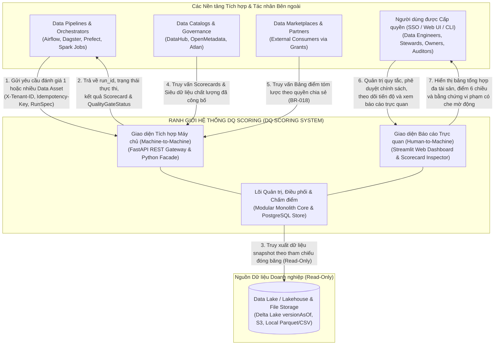
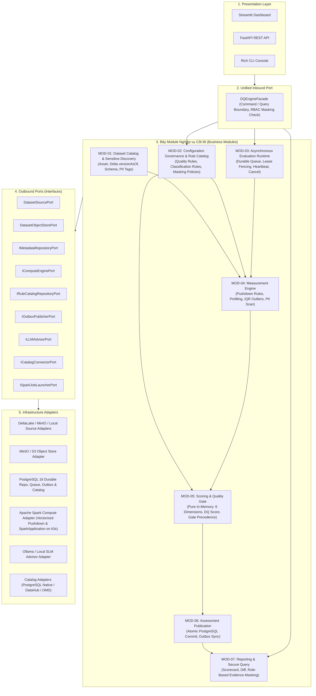
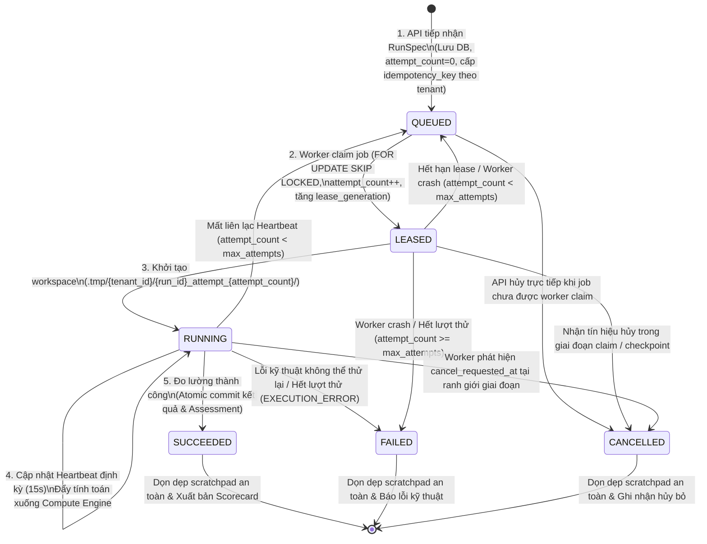
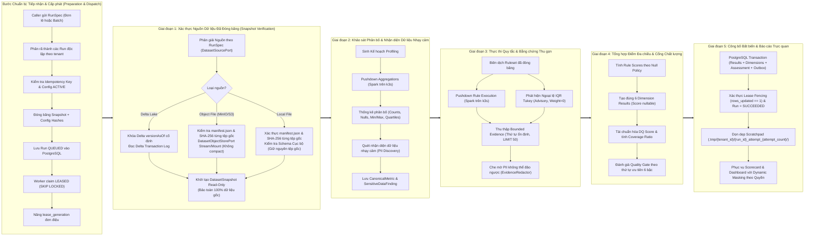
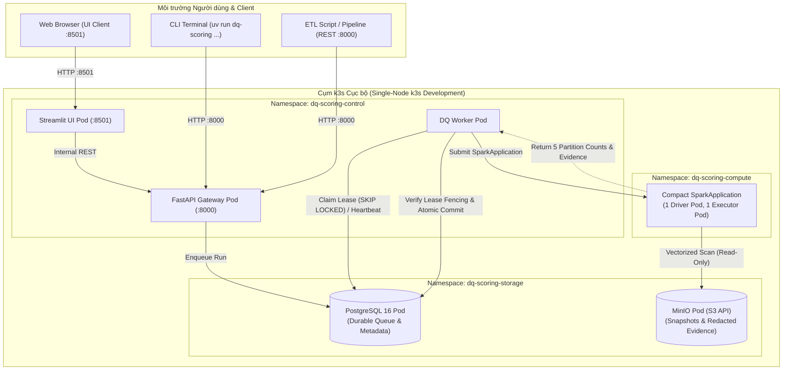
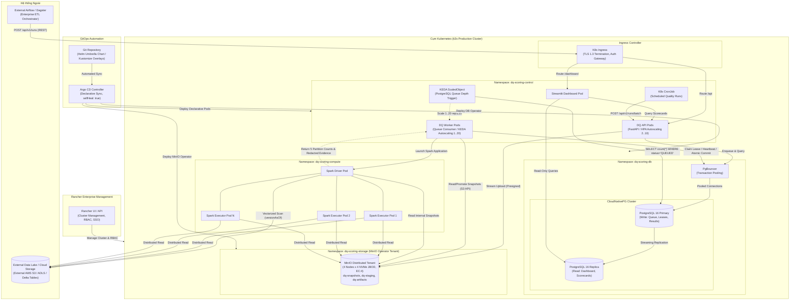

# CHƯƠNG 4: KIẾN TRÚC HỆ THỐNG VÀ THIẾT KẾ PHẦN MỀM (SYSTEM ARCHITECTURE & SOFTWARE DESIGN)

**Hệ thống:** DQ Scoring System  
**Mã hồ sơ:** AD-009-ARCH  
**Phiên bản:** 1.7
**Ngày:** 2026-09-22
**Trạng thái:** Review Candidate
**Tiêu chuẩn áp dụng:** ISO/IEC/IEEE 42010:2011 (Systems and software engineering — Architecture description) kết hợp IEEE 1016-2009 (Software Design Descriptions)
**Cơ sở kỹ thuật:** Đối soát trực tiếp từ SRS v1.7 Review Candidate (`docs/Chapter_2.md`), Mô hình hóa hệ thống Chapter 3 v1.7 (`docs/Chapter_3.md`), Thiết kế CSDL Chapter 5 v1.7 (`docs/Chapter_5.md`), và Lý thuyết đo lường chất lượng (`docs/theory/DQ_SCORING_THEORY.md`).

---

## THÔNG TIN VÀ KIỂM SOÁT TÀI LIỆU

**Nguồn yêu cầu kỹ thuật:** `docs/Chapter_2.md` (SRS v1.7 Review Candidate)
**Nguồn mô hình hóa chức năng & hành vi:** `docs/Chapter_3.md` (AD-004 v1.7 Review Candidate)
**Nguồn thiết kế dữ liệu & DDL:** `docs/Chapter_5.md` (AD-005 v1.7 Review Candidate)
**Tài liệu định hướng tái sử dụng mã nguồn:** `docs/engineering/IMPLEMENTATION_REUSE_GUIDE.md`
**Đặc tả lý thuyết đo lường:** `docs/theory/DQ_SCORING_THEORY.md`

### Lịch sử phiên bản và phê duyệt

| Phiên bản | Ngày | Tóm tắt thay đổi | Trạng thái | Tác giả / Người duyệt |
| :--- | :--- | :--- | :--- | :--- |
| **0.1** | 2026-08-24 | Khởi tạo khung thiết kế kiến trúc tổng thể | Draft | Nguyễn Hoàng Tùng |
| **0.2** | 2026-08-25 | Điều chỉnh kiến trúc Hexagonal (Ports-and-Adapters) và cách ly Core Facade | Review Candidate | Nguyễn Hoàng Tùng |
| **0.3** | 2026-08-26 | Hoàn thiện đặc tả 8 Packages và luồng Pipeline 5 giai đoạn | Review Candidate | Nguyễn Hoàng Tùng |
| **1.0** | 2026-08-27 | Khóa Baseline toàn bộ sơ đồ kiến trúc, biểu đồ gói và biểu đồ triển khai | **Approved Baseline** | Nguyễn Hoàng Tùng (Approved) |
| **1.1** | 2026-08-28 | Chuẩn hóa ID; lưu evidence trong DB; đồng bộ fault boundary, nullable dimensions, config approval và assessment hashing | Review Candidate | Nguyễn Hoàng Tùng |
| **1.2** | 2026-09-04 | Chuẩn hóa PostgreSQL 16 là durable metadata/runtime store duy nhất; loại bỏ hoàn toàn legacy compatibility adapter; đồng bộ async evaluation pipeline và package PKG-006 | Review Candidate | Nguyễn Hoàng Tùng |
| **1.3** | 2026-09-15 | Mở rộng nguồn Lakehouse (Delta Lake + Spark K8s); chuẩn hóa 7 module Clean Architecture và phân định 2 deployment profile | Review Candidate | Nguyễn Hoàng Tùng |
| **1.4** | 2026-09-15 | Tinh chỉnh kiến trúc async; thử nghiệm GX Core trong Spark adapter; thiết lập Kho Rule tập trung và cơ chế che mờ dữ liệu hai tầng | Review Candidate | Nguyễn Hoàng Tùng |
| **1.5** | 2026-09-16 | Tái định hình kiến trúc ISO 42010/IEEE 1016: xác lập DuckDB mặc định, Spark mở rộng; chuẩn hóa hợp đồng tích hợp, cách ly đa thuê bao, bảo vệ bằng chứng và công bố bất biến | Review Candidate | Nguyễn Hoàng Tùng |
| **1.6** | 2026-09-17 | Bổ sung ADR-008 và Outbound Port cho LLM Advisory Assistant; cập nhật cấu trúc gói PKG-002/006 và năng lực Mẫu Đánh giá Domain | Review Candidate | Nguyễn Hoàng Tùng |
| **1.7** | 2026-09-22 | Tối ưu hóa hiệu năng & độ tin cậy: Column Projection Pushdown, Single-Pass SQL Fusion, In-Engine PII Redaction trong PKG-005; kiến trúc Dual-Mode Dispatch và Dual-Lane Worker Pool tránh HOLB; bổ sung tie-breaker đơn định `ORDER BY created_at DESC, assessment_id ASC` cho truy vấn Assessment | Approved Specification | Nguyễn Hoàng Tùng |
| **1.8** | 2026-09-24 | Chuẩn hóa kiến trúc đích k3s đơn nút, ngân sách tối đa 8GB RAM toàn nút (1 Spark run đồng thời), bảo toàn snapshot gốc qua manifest (không compact/coalesce), phân định hợp đồng Worker điều phối - Spark tính toán - Worker công bố, và định nghĩa SLA end-to-end có điều kiện benchmark | **Review Candidate** | Nguyễn Hoàng Tùng |

---

## 4.1. MỤC ĐÍCH, PHẠM VI VÀ TỔ CHỨC CHƯƠNG

### 4.1.1. Mục đích và Phạm vi Hệ thống

Tài liệu này xác lập bản đặc tả kiến trúc phần mềm và thiết kế hệ thống chính thức cho **Hệ thống Chấm điểm Chất lượng Dữ liệu (DQ Scoring System)**, tuân thủ phương pháp luận của tiêu chuẩn quốc tế **ISO/IEC/IEEE 42010:2011** (*Systems and software engineering — Architecture description*) kết hợp với các nguyên tắc đặc tả thành phần của **IEEE 1016-2009** (*Software Design Descriptions*).

**Định vị hệ thống:**
**DQ Scoring là hệ thống đánh giá và chấm điểm chất lượng dữ liệu, được thiết kế để vận hành độc lập và sẵn sàng tích hợp với các hệ thống dữ liệu khác.** Hệ thống chịu trách nhiệm đối với:
1. **Quản trị cấu hình chất lượng:** Quản lý tập trung vòng đời các quy tắc chất lượng, mẫu quy tắc dùng chung, chính sách chấm điểm và chính sách bảo vệ dữ liệu nhạy cảm theo từng đối tượng thuê bao (`tenant_id`).
2. **Điều phối đánh giá bất đồng bộ:** Tiếp nhận, kiểm tra tính hợp lệ và tổ chức thực thi các yêu cầu đánh giá chất lượng cho một hoặc nhiều Data Asset mà không chặn tiến trình gọi (non-blocking).
3. **Thực thi đo lường dữ liệu:** Đẩy các phép tính thống kê và kiểm tra quy tắc xuống động cơ tính toán phù hợp mà không tải toàn bộ dữ liệu thô vào bộ nhớ ứng dụng.
4. **Tính điểm và kiểm soát cổng chất lượng:** Tổng hợp điểm số đa chiều và kết luận cổng chất lượng theo các quy tắc toán học đơn định (cùng dữ liệu đầu vào luôn cho cùng kết quả điểm số), hoàn toàn độc lập với công nghệ đo lường bên dưới.
5. **Lưu trữ và công bố kết quả:** Lưu toàn bộ kết quả đánh giá trong một giao dịch cơ sở dữ liệu duy nhất; tính bất biến được bảo đảm bởi ranh giới phân quyền và trigger CSDL (Write-Once, Read-Many), kết hợp mã băm toàn vẹn chuẩn hóa (`assessment_hash`) để kiểm chứng độc lập tính toàn vẹn và khả năng tái lập kết quả.
6. **Cung cấp kết quả và báo cáo trực quan:** Cung cấp giao diện tích hợp có cấu trúc cho các hệ thống máy chủ và giao diện trực quan cho người dùng theo dõi tình trạng chất lượng dữ liệu.

**Phân biệt ranh giới Hệ thống và Thành phần bên trong:**
- **Hệ thống DQ Scoring (DQ Scoring System):** Toàn bộ sản phẩm phần mềm, bao gồm các dịch vụ quản trị cấu hình, điều phối lượt chạy, lưu trữ kết quả và giao diện tương tác.
- **Thành phần đo lường và Thành phần tính điểm:** Các module nghiệp vụ nội bộ bên trong hệ thống (Measurement Engine `MOD-04` và Scoring Engine `MOD-05`).
- **Động cơ tính toán (Compute Engine):** Apache Spark trên k3s (thực thi đo lường phân tán qua Spark Operator / `SparkApplication`), được kết nối qua cổng adapter chuyên biệt `SparkComputeAdapter`.
- **Giao diện truy cập nội bộ (Internal Facade):** Khả năng sử dụng lõi xử lý dưới dạng thư viện Python (`DQEngineFacade`) là một hình thức tích hợp phục vụ nhúng trực tiếp trong cùng tiến trình của ứng dụng gọi; khả năng này không đồng nhất toàn bộ hệ thống với một thư viện hay engine đơn lẻ.

### 4.1.2. Tổ chức Chương Kiến trúc

Chương 4 được cấu trúc chặt chẽ để trả lời năm câu hỏi kỹ thuật trọng tâm:

1. **DQ Scoring là hệ thống gì và chịu trách nhiệm đến đâu?** Trình bày tại **Mục 4.1** (Mục đích, phạm vi) và **Mục 4.2** (Bối cảnh, ranh giới hệ thống).
2. **Hệ thống tích hợp với những hệ thống nào và trao đổi thông tin gì?** Trình bày tại **Mục 4.2** (Hệ thống tích hợp, quan hệ hai chiều, hợp đồng giao tiếp Inbound và Outbound).
3. **Phần mềm gồm những thành phần nào và được tổ chức theo kiến trúc nào?** Trình bày tại **Mục 4.3** (Kiến trúc tổng thể, nguyên tắc bảo đảm tính đúng đắn) và **Mục 4.4** (Phân rã 7 module nghiệp vụ, 8 package mã nguồn và hợp đồng dữ liệu).
4. **Yêu cầu đánh giá được xử lý và kết quả được cung cấp như thế nào?** Trình bày tại **Mục 4.5** (Vòng đời lượt chạy, pipeline đánh giá, cơ chế phục hồi và báo cáo trực quan).
5. **Các thành phần được triển khai và vận hành ra sao?** Trình bày tại **Mục 4.6** (Công nghệ sử dụng), **Mục 4.7** (Hồ sơ triển khai, ngân sách tài nguyên, bảo vệ bằng chứng) và **Mục 4.8** (Truy vết yêu cầu và đối soát tính nhất quán).

---


## 4.2. BỐI CẢNH HỆ THỐNG VÀ THIẾT KẾ SẴN SÀNG TÍCH HỢP (SYSTEM CONTEXT & INTEGRATION ARCHITECTURE)

### 4.2.1. Vị thế Kiến trúc và Quan hệ Tích hợp Hai chiều

Triết lý cốt lõi của DQ Scoring System là **trung lập về nguồn dữ liệu và sẵn sàng tích hợp (Integration-Ready)**. Hệ thống vận hành độc lập, cung cấp các giao diện và hợp đồng chuẩn hóa để các nền tảng dữ liệu trong doanh nghiệp có thể gửi yêu cầu đánh giá, kiểm tra trạng thái và khai thác kết quả chất lượng.

```
┌──────────────────────────────────────────────────────────────────────────────────────────────────┐
│                             HỆ SINH THÁI TÍCH HỢP XUNG QUANH DQ SCORING                          │
│                                                                                                  │
│  [Data Pipelines / Orchestrators]         [Data Catalogs / Governance]         [Marketplaces]    │
│  (Airflow, Dagster, Spark Ingestion)     (DataHub, OpenMetadata, Atlan)      (Data Sharing)     │
│             │                                           ▲                             ▲          │
│             │ 1. Request Run (Single/Multi-Asset)       │ 2. Query Scorecards         │ Grant    │
│             ▼                                           │                             │          │
│  ┌────────────────────────────────────────────────────────────────────────────────────────────┐  │
│  │                            HỆ THỐNG DQ SCORING (DQ SCORING SYSTEM)                         │  │
│  │   - Bề mặt Tiếp nhận: REST API Gateway, Python Facade, Web Visual Dashboard                │  │
│  │   - Lõi Nghiệp vụ: Quản trị Quy tắc, Điều phối Đánh giá, Đo lường, Chấm điểm, Công bố      │  │
│  │   - Lưu trữ Bền vững: PostgreSQL 16 (Hàng đợi, Cấu hình, Kết quả, Assessment Bất biến)     │  │
│  └───────────────────────────────┬────────────────────────────────────────────┬───────────────┘  │
│                                  │ DatasetSourcePort / DatasetObjectStorePort │ IComputeEnginePort│
│                                  ▼                                            ▼                  │
│                [Data Lake / Lakehouse & Shared Object Stores]   [Compute Backend on k3s]         │
│            (Delta Lake, MinIO/S3, Local CSV/Parquet)             (Apache Spark on k3s)           │
└──────────────────────────────────────────────────────────────────────────────────────────────────┘
```

#### Bảng Vai trò và Quan hệ Trao đổi với Các Hệ thống Tích hợp

| Hệ thống Đối tác Bên ngoài | Vai trò trong Hệ sinh thái | Dòng thông tin Trao đổi với DQ Scoring | Quyền hạn và Ranh giới Tích hợp |
| :--- | :--- | :--- | :--- |
| **Data Pipelines & Orchestrators**<br/>(Airflow, Dagster, Prefect, Spark Ingestion) | Hệ thống điều phối nạp và chuyển đổi dữ liệu | - **Gửi:** Yêu cầu đánh giá/chấm điểm chất lượng cho 1 hoặc nhiều Data Asset (`POST /api/v1/runs`, `POST /api/v1/runs/batch`).<br/>- **Nhận:** Trạng thái xử lý, điểm chất lượng (`dq_score`), và kết luận Cổng Chất lượng (`QualityGateStatus`). | Sử dụng kết luận chất lượng của DQ Scoring để tự quyết định dừng hoặc tiếp tục pipeline hạ nguồn. DQ Scoring không can thiệp trực tiếp vào tiến trình của pipeline. |
| **Data Lake / Lakehouse & Data Stores**<br/>(Delta Lake, Object Storage S3/GCS/MinIO, File cục bộ) | Kho lưu trữ dữ liệu nguồn của doanh nghiệp | - **Cung cấp:** Dữ liệu bảng ở chế độ Read-Only thông qua tham chiếu snapshot đã đóng băng (`SHA-256` hoặc Delta `versionAsOf`).<br/>- **Nhận:** Bản sao Scorecard/Assessment phục vụ lưu trữ phân tích (nếu cấu hình Outbox). | DQ Scoring chỉ truy cập dữ liệu ở chế độ chỉ đọc (Read-Only); không ghi đè, chỉnh sửa hay làm thay đổi dữ liệu nguồn. |
| **Data Catalogs & Governance Platforms**<br/>(DataHub, OpenMetadata, Atlan) | Nền tảng quản trị siêu dữ liệu doanh nghiệp | - **Nhận:** Bảng điểm chất lượng (Scorecard), kết quả 6 chiều, tỷ lệ bao phủ (`coverage_ratio`), và nguồn gốc cấu hình đánh giá (Audit Lineage). | Truy vấn siêu dữ liệu chất lượng đã công bố thông qua API có cấu trúc để đồng bộ lên giao diện danh mục dữ liệu doanh nghiệp. |
| **Data Marketplaces & Sharing Platforms**<br/>(Hệ thống chia sẻ dữ liệu nội bộ / đối tác) | Nền tảng giao dịch và chia sẻ dữ liệu | - **Nhận:** Bảng điểm chất lượng tóm lược (`ScorecardDTO`) có áp dụng chính sách che mờ bảo vệ dữ liệu (`BR-018`). | Chỉ được xem bảng điểm chất lượng tóm lược (`ScorecardDTO`); không có quyền truy cập dữ liệu thô, mẫu bằng chứng vi phạm hay kết quả phát hiện dữ liệu nhạy cảm. |
| **Người dùng được Cấp quyền**<br/>(Data Engineers, Stewards, Owners, Auditors) | Người dùng tương tác qua giao diện Web (Dashboard) hoặc dòng lệnh (CLI) | - **Gửi:** Định nghĩa quy tắc, phê duyệt chính sách, yêu cầu đánh giá, yêu cầu hủy.<br/>- **Nhận:** Báo cáo trực quan (Dashboard), chi tiết vi phạm có che mờ theo quyền. | Phân quyền theo vai trò (RBAC) và theo tài sản (Asset Authorization) trong phạm vi đối tượng thuê bao (`tenant_id`). |

### 4.2.2. Biểu đồ Bối cảnh Hệ thống (System Context Diagram)

Biểu đồ dưới đây xác định rõ ranh giới kiến trúc của Hệ thống DQ Scoring với các hệ thống và tác nhân bên ngoài:



### 4.2.3. Bề mặt Giao tiếp và Hợp đồng Tích hợp (Inbound & Outbound Integration Contracts)

#### a. Bề mặt Giao tiếp Tiếp nhận (Inbound Integration Surfaces)

DQ Scoring cung cấp ba hình thức giao tiếp tiếp nhận đáp ứng đầy đủ các kịch bản tích hợp tự động và tương tác người dùng:

1. **Python In-Process Facade (`DQEngineFacade`):**
   - **Bản chất:** Là một Application Facade (theo mẫu GoF) được cài đặt trong gói `dq_scoring.facade` (`PKG-004`). Đây là điểm truy cập nội bộ (in-process) duy nhất của toàn bộ hệ thống, cho phép các ứng dụng hoặc pipeline Python nhúng trực tiếp lõi xử lý mà không phát sinh độ trễ mạng hay chi phí chuyển đổi dữ liệu qua HTTP.
   - **Ranh giới Command/Query (CQS Boundary):** Phân tách rõ ràng giữa tác vụ thay đổi trạng thái (Command) và tác vụ truy vấn dữ liệu (Query, không gây tác dụng phụ). Toàn bộ các phương thức bắt buộc nhận ngữ cảnh danh tính xác thực `auth: AuthContext` để kiểm tra phân quyền ranh giới:
     - *Cấu trúc Ngữ cảnh Danh tính (`AuthContext`):*
       ```python
       @dataclass(frozen=True)
       class AuthContext:
           user_id: UUID
           tenant_id: UUID
           roles: frozenset[
               str
           ]  # DATA_STEWARD, DATA_OWNER, WORKSPACE_ADMIN, BUSINESS_VIEWER, PUBLIC_CONSUMER
           scopes: frozenset[
               str
           ]  # run:create, run:cancel, governance:approve, evidence:read, scorecard:read
           client_ip: Optional[str] = None
       ```
     - *Commands (Thay đổi trạng thái):* `enqueue_run(spec: RunSpec, auth: AuthContext) -> RunEnqueuedDTO`, `enqueue_batch_runs(request: BatchRunRequestDTO, auth: AuthContext) -> BatchRunResponseDTO`, `cancel_run(run_id: UUID, auth: AuthContext) -> CancelResultDTO`, `approve_ruleset(ruleset_id: UUID, auth: AuthContext) -> RulesetApprovedDTO`, `approve_policy(policy_id: UUID, auth: AuthContext) -> PolicyApprovedDTO`.
     - *Queries (Truy vấn thuần túy, Side-Effect-Free):* `get_run_status(run_id: UUID, auth: AuthContext) -> RunStatusDTO`, `get_assessment(assessment_id: UUID, auth: AuthContext) -> AssessmentDetailDTO`, `get_scorecard(assessment_id: UUID, auth: AuthContext) -> ScorecardDTO`, `get_evidence(assessment_id: UUID, auth: AuthContext) -> MaskedEvidenceDTO`, `get_public_scorecard(assessment_id: UUID, share_token: Optional[str] = None) -> PublicScorecardProjectionDTO`, `list_scorecards(filters: FilterSpec, auth: AuthContext) -> List[ScorecardDTO]`.
   - **Mối quan hệ với REST API:** Các API controller trong `PKG-007` (FastAPI) đóng vai trò như lớp bọc mỏng (thin adapter) quanh Facade. Controller trích xuất `tenant_id`, `user_id`, `roles`, `scopes` từ JWT/API Key, khởi tạo đối tượng `AuthContext`, gọi trực tiếp phương thức tương ứng của `DQEngineFacade`, và chuyển đổi kết quả trả về thành mã HTTP (`202 Accepted`, `200 OK`, `403 Forbidden`, `404 Not Found`). Nhờ vậy, quy tắc nghiệp vụ và kiểm tra phân quyền chống BOLA (OWASP API1) được quy tụ duy nhất tại Facade và Domain, không bị phân tán hay trùng lặp.
   - **Ranh giới trách nhiệm (What it does NOT do):**
     - *Không trực tiếp tính toán:* Facade không tự nạp dữ liệu hay thực thi phép đo; nó ủy quyền việc điều phối cho tầng Services (`PKG-003`), tầng này sẽ giao tiếp qua cổng tính toán `IComputeEnginePort`.
     - *Không trực tiếp thao tác CSDL:* Facade không chứa câu lệnh SQL hay phiên kết nối cơ sở dữ liệu; việc đọc/ghi dữ liệu được thực hiện qua các repository ports (`IMetadataRepositoryPort`).
     - *Kiểm soát bảo mật và phân quyền:* Mọi lệnh và truy vấn qua Facade đều được xác thực ranh giới tenant, kiểm tra quyền sở hữu đối tượng nội bộ tenant (`Authorizer`) và áp dụng chính sách che mờ dữ liệu đa tầng (`MaskingAuthorizer`) trước khi trả kết quả cho phía gọi.
2. **REST API Gateway (FastAPI):** Dành cho các hệ thống điều phối phân tán (Airflow, Dagster), dịch vụ microservices và hệ thống tích hợp bên ngoài:
   - **Cơ chế Xác thực & Kiểm thực Ranh giới Người thuê (Authentication & Tenant Assertion):**
     - Header `X-Tenant-ID` (UUID) là **khai báo phạm vi yêu cầu (Requested Scope)** từ client, **tuyệt đối không được coi là bằng chứng danh tính**.
     - API Controller / Middleware bắt buộc trích xuất và kiểm thực danh tính người gọi qua `Authorization: Bearer <JWT>` hoặc `X-API-Key`.
     - *Nguyên tắc Kiểm tra Ranh giới (Boundary Verification Rule):* Bắt buộc kiểm tra `token.claims.tenant_id == X-Tenant-ID` (hoặc `X-Tenant-ID in token.claims.allowed_tenants` với tài khoản quản trị).
     - Nếu thiếu token hoặc token không hợp lệ $\rightarrow$ Trả về mã lỗi `401 Unauthorized`.
     - Nếu token hợp lệ nhưng `X-Tenant-ID` không nằm trong danh sách tenant được cấp quyền $\rightarrow$ Trả về ngay mã lỗi `403 Forbidden` (Fail-Closed), không chuyển tiếp vào Facade hay CSDL.
   - **Danh mục Endpoints Tiêu chuẩn v1.0:**
     - `POST /api/v1/runs`: Tiếp nhận yêu cầu đánh giá chất lượng cho một Data Asset đơn lẻ. Header bắt buộc: `Authorization`, `X-Tenant-ID` (UUID) và `Idempotency-Key`. Body chứa `RunSpec` (định danh snapshot, ruleset_id, policy_id, outlier_config). Trả về ngay mã `202 Accepted` kèm `run_id` và trạng thái `QUEUED` (`AC-016`).
     - `POST /api/v1/runs/batch`: Tiếp nhận yêu cầu đánh giá chất lượng cho **nhiều Data Asset** trong một lần gọi tích hợp (*Thiết kế bổ sung mở rộng*). Body chứa danh sách các mục đánh giá `items: List[BatchRunItemSpec]`. Hệ thống tách thành các lượt chạy (`EvaluationRun`) độc lập cho từng Data Asset, trả về danh sách kết quả tiếp nhận kèm `run_id` tương ứng hoặc lý do từ chối nếu không hợp lệ. Lỗi của một tài sản không làm ảnh hưởng đến việc tiếp nhận và thực thi các tài sản khác.
     - `GET /api/v1/runs/{run_id}`: Truy vấn trạng thái thực thi (`QUEUED`, `LEASED`, `RUNNING`, `SUCCEEDED`, `FAILED`, `CANCELLED`), tiến độ và thời gian chờ. Bắt buộc kiểm tra `run.tenant_id == auth.tenant_id`.
     - `POST /api/v1/runs/{run_id}/cancel`: Yêu cầu hủy bỏ tiến trình đang chờ hoặc đang chạy; kiểm tra quyền sở hữu (`run.created_by == auth.user_id` hoặc `WORKSPACE_ADMIN`).
     - `GET /api/v1/assessments/{assessment_id}`: Truy xuất bản ghi đánh giá hoàn chỉnh hoặc bảng điểm tóm tắt (`ScorecardDTO`) gồm DQ Score, 6 Dimension Results, Coverage Ratio và Quality Gate (chỉ đọc assessment thuộc tenant sở hữu và người gọi có quyền đọc).
     - `GET /api/v1/assessments/{assessment_id}/evidence`: Truy xuất các mẫu dòng lỗi vi phạm có áp dụng chính sách che mờ động theo quyền hạn của người gọi (`ProtectionPolicy`); yêu cầu quyền `evidence:read` và người gọi là chủ sở hữu hoặc được cấp quyền trực tiếp qua `AccessGrant`.
     - `GET /api/v1/public/scorecards/{assessment_id}`: Truy xuất bản chiếu an toàn công khai (`PublicScorecardProjectionDTO`); chỉ áp dụng cho Assessment mang trạng thái `PUBLISHED` và có phạm vi công bố `PUBLIC_READ` hoặc đi kèm Share Token ký số hợp lệ; loại bỏ 100% raw data, bằng chứng và thông tin cấu hình nội bộ.
     - `GET /api/v1/scorecards`: Truy vấn danh sách Scorecard theo tenant, phục vụ hiển thị tình trạng chất lượng đa tài sản.
   - **Ma trận Kiểm soát Truy cập & Phân quyền Ranh giới (Inbound Security Matrix):**

| Điểm Tiếp nhận (Endpoint / Facade Method) | Hành động (Action) | Quyền Tối thiểu (Required Scope) | Kiểm tra Ranh giới & Quyền Sở hữu (Isolation & Anti-BOLA) | Chính sách Che mờ & An toàn (Protection Policy) |
| :--- | :--- | :--- | :--- | :--- |
| `POST /api/v1/runs` / `enqueue_run` | Tạo lượt chạy | `run:create` | `snapshot.tenant_id == ruleset.tenant_id == policy.tenant_id == auth.tenant_id` VÀ (`asset.owner_id == auth.user_id` HOẶC có quyền `EXECUTE_RUN` qua `AccessGrant`) | Gắn cứng `created_by = auth.user_id`; chặn đứng tham chiếu chéo tenant; từ chối `403` nếu có đối tượng khác tenant hoặc không có quyền. |
| `POST /api/v1/runs/batch` / `enqueue_batch_runs` | Tạo lô lượt chạy | `run:create` | Từng item trong batch phải độc lập, thuộc `auth.tenant_id` và hợp lệ quyền sở hữu | Cô lập lỗi theo từng tài sản; không cho phép chèn asset ngoài tenant. |
| `GET /api/v1/runs/{id}` / `get_run_status` | Đọc tiến độ Run | `run:read` | `run.tenant_id == auth.tenant_id` VÀ (`run.created_by == auth.user_id` HOẶC `WORKSPACE_ADMIN` HOẶC có grant) | Trả về `404 Not Found` (không để lộ sự tồn tại của run khác tenant hoặc run riêng tư của user khác). |
| `POST /api/v1/runs/{id}/cancel` / `cancel_run` | Hủy lượt chạy | `run:cancel` | `run.tenant_id == auth.tenant_id` VÀ (`run.created_by == auth.user_id` HOẶC `WORKSPACE_ADMIN`) và trạng thái $\in \{\text{QUEUED}, \text{LEASED}, \text{RUNNING}\}$ | Ghi nhận `cancelled_by = auth.user_id` và timestamp vào Audit Event. Chặn người dùng khác tự ý hủy run. |
| `GET /api/v1/assessments/{id}` / `get_assessment` | Xem kết quả chi tiết | `assessment:read` | `assessment.tenant_id == auth.tenant_id` VÀ (`owner` HOẶC `visibility_scope == 'WORKSPACE'` HOẶC có grant) | Trả về `AssessmentDetailDTO` (số liệu tổng hợp, 6 chiều, metrics; không chứa raw rows). |
| `GET /api/v1/assessments/{id}/evidence` / `get_evidence` | Xem mẫu lỗi vi phạm | `evidence:read` | `assessment.tenant_id == auth.tenant_id` VÀ (`owner` HOẶC có `READ_EVIDENCE` grant) | Cắt mẫu tối đa 50 dòng / $\le 500$ KB; che mờ tĩnh tại compute plane và che mờ động theo vai trò người gọi. |
| `GET /api/v1/public/scorecards/{id}` / `get_public_scorecard` | Xem Scorecard công khai | *Không yêu cầu auth nội bộ* (hoặc Token ký số) | `assessment.publication_status == 'PUBLISHED'` VÀ (`visibility_scope == 'PUBLIC_READ'` HOẶC Share Token hợp lệ chưa hết hạn) | Trả về `PublicScorecardProjectionDTO` (Allowlist: score, dimensions, gate, coverage, hash, timestamp; 0 raw data, 0 evidence, 0 PII findings). |
| `GET /api/v1/scorecards` / `list_scorecards` | Liệt kê bảng điểm | `scorecard:list` | Cưỡng chế lọc theo `auth.tenant_id` và phạm vi hiển thị (`owner` hoặc `WORKSPACE`) | Chỉ hiển thị các asset thuộc quyền truy cập của người gọi trong tenant. |
| Facade: `approve_ruleset` / `approve_policy` | Phê duyệt cấu hình | `governance:approve` | `resource.tenant_id == auth.tenant_id`, caller role $\in \{\text{DATA\_OWNER}, \text{WORKSPACE\_ADMIN}\}$, và `auth.user_id != resource.submitted_by` (Segregation of Duties) | Ghi nhận `approved_by = auth.user_id` và timestamp vào Audit Trail (`BR-014`). Cấm tự phê duyệt (Self-Approval) nếu cấu hình bắt buộc tách vai trò. |

   - **Ràng buộc Cách ly & Chống Tấn công Nguồn Dữ liệu (Source Sandboxing & Storage Constraints):**
     1. *Kiểm soát Nguồn Tệp Cục bộ (`LOCAL_FILE` Security Sandbox):* Mọi đường dẫn tệp `file_path` khai báo qua Source Descriptor bắt buộc phải được giải quyết chuẩn hóa (`os.path.realpath()` hoặc `Path.resolve()`) và đối chiếu với danh sách trắng các thư mục dữ liệu được cấu hình an toàn (`ALLOWED_DATA_DIRECTORIES`). Cấm tuyệt đối hành vi thoát thư mục (Path Traversal via `../`, `..\\`), đường dẫn tuyệt đối trỏ vào tệp hệ thống (`/etc`, `/var`, `C:\Windows`), hoặc liên kết mềm (symlink) có đích đến nằm ngoài thư mục sandbox. Vi phạm sẽ lập tức kích hoạt lỗi an ninh và bị từ chối ở tầng tiếp nhận.
     2. *Kiểm soát Nguồn Đối tượng (`OBJECT_FILE` Tenant Prefix Jail):* Bucket phải nằm trong danh mục bucket được hệ thống cho phép (`ALLOWED_BUCKETS`). Object key bắt buộc phải tuân thủ nghiêm ngặt tiền tố phân vùng người thuê: `staging/{tenant_id}/*` cho giai đoạn tải lên tạm và `snapshots/{tenant_id}/{hash[:2]}/{hash}.{ext}` cho snapshot đã thăng cấp. Tuyệt đối cấm Worker hoặc API đọc/ghi vào object key thuộc tiền tố của tenant khác, loại trừ hoàn toàn nguy cơ rò rỉ dữ liệu qua việc giả mạo object key.
     3. *Giới hạn Tài nguyên Luồng Nhận (Bounded Stream Ingestion):* Quá trình tiếp nhận dữ liệu tệp stream (`put_stream`) bắt buộc kiểm tra kích thước tối đa (`Content-Length` $\le \text{MAX\_FILE\_SIZE}$) trước khi đọc vào bộ đệm; cấm tuyệt đối đọc toàn bộ luồng dữ liệu không kiểm soát kích thước vào bộ nhớ máy chủ (Heap Memory) để triệt tiêu nguy cơ cạn kiệt tài nguyên (OOM DoS).
3. **Giao diện Báo cáo Trực quan và Các Bản chiếu Phân quyền (Visual Reporting & Multi-Persona Projections):**
   Cung cấp giao diện bảng điều khiển trực quan (Streamlit Web Dashboard hoặc Web UI) phục vụ người dùng nội bộ và đối tác, thực thi cơ chế chiếu dữ liệu đa tầng (Role-Based Projections):
   - **Bản chiếu Nghiệp vụ / Lãnh đạo (Executive / Business Projection):**
     - Dành cho Giám đốc Dữ liệu (CDO), Quản lý dự án và người tiêu dùng dữ liệu tổng quát (`BUSINESS_VIEWER`).
     - Tập trung vào chỉ số cấp cao: Điểm chất lượng tổng thể (`dq_score`), biểu đồ radar 6 chiều chất lượng, kết luận Cổng Chất lượng (Quality Gate `PASS`/`WARN`/`FAIL`), xu hướng thay đổi lịch sử và tỷ lệ bao phủ (`coverage_ratio`).
     - Hoàn toàn ẩn giấu các chi tiết kỹ thuật như lỗi cú pháp rule, mã hash nội bộ, SQL query hoặc mẫu vi phạm dữ liệu.
   - **Bản chiếu Chuyên sâu cho Giám sát viên & Kiểm toán (Auditor & Data Steward Diagnostic Projection):**
     - Dành cho Kỹ sư Dữ liệu (`DATA_ENGINEER`), Quản trị viên (`DATA_STEWARD`) và Kiểm toán viên tuân thủ có quyền `evidence:read`.
     - Cung cấp bảng tra cứu toàn diện từng quy tắc kiểm tra (Rule-Level Score, Passed / Failed / Missing Counts, Null Policy).
     - Tích hợp công cụ kiểm tra bằng chứng vi phạm (**Evidence Inspector**): Cho phép xem tối đa 50 dòng vi phạm mẫu đã được che mờ PII tĩnh từ tầng Compute Plane và che mờ động theo quyền hạn người dùng (`MaskedEvidenceDTO`).
     - Tích hợp thẻ cảnh báo nhận diện dữ liệu nhạy cảm (**Sensitive Data Findings**) để phục vụ gán nhãn tuân thủ (Governance Labeling theo `BR-015`).
   - **Bản chiếu Công khai An toàn (Sanitized Public Scorecard Projection):**
     - Dành cho khách vãng lai, đối tác Data Marketplace hoặc nhúng iframe vào Confluence/Notion qua liên kết chia sẻ an toàn (`IF-UI-010`).
     - Áp dụng DTO chuyên biệt `PublicScorecardProjectionDTO` với danh sách trường cho phép nghiêm ngặt (Strict Whitelist): Tên tài sản, Snapshot ID, DQ Score, 6 Dimension Scores, Quality Gate, Coverage Ratio, Assessment Hash, Thời gian công bố.
     - **Cam kết an toàn tuyệt đối:** 0 dòng dữ liệu thô (raw data), 0 dòng bằng chứng lỗi (evidence), 0 thông tin credentials hoặc cấu trúc tệp máy chủ nội bộ. Mọi quyền truy cập mẫu vi phạm hoặc profiling sâu đều bị chặn đứng ở tầng Facade.

#### b. Bề mặt Giao tiếp Hướng hạ tầng (Outbound Integration Surfaces)

Toàn bộ tương tác với hạ tầng lưu trữ dữ liệu, động cơ tính toán và cơ sở dữ liệu bên ngoài được cách ly thông qua các **Outbound Ports**, được khai báo dưới dạng **Python Protocols (`typing.Protocol` theo chuẩn PEP 544)** trong gói `dq_scoring.ports` (`PKG-002`).

**Cơ chế Đảo ngược Phụ thuộc (Dependency Inversion Principle - DIP):**
- Lõi nghiệp vụ (`domain` và `services`) chỉ phụ thuộc vào các giao diện hợp đồng trừu tượng (Ports), hoàn toàn không phụ thuộc vào thư viện cụ thể hay driver bên thứ ba (PySpark, SQLAlchemy, psycopg2).
- Các Adapter cụ thể (`PKG-005`, `PKG-006`) cài đặt các Protocol này theo cơ chế kiểm tra kiểu cấu trúc (Structural Subtyping / Static Duck Typing), giúp dễ dàng thay thế công nghệ hạ tầng mà không ảnh hưởng đến logic nghiệp vụ.

##### Bảng Ánh xạ Outbound Port, Hợp đồng Phương thức và Adapter Hiện thực hóa

| Cổng Outbound (Protocol) | Trách nhiệm Trừu tượng & Phương thức Cốt lõi | Adapter Hiện thực hóa | Công nghệ Hạ tầng Liên kết | Trạng thái |
| :--- | :--- | :--- | :--- | :--- |
| **`DatasetSourcePort`** | Xác thực mô tả nguồn và phân giải thành handle/URI dữ liệu Read-Only an toàn cho động cơ tính toán Apache Spark trên k3s.<br/>- `resolve_source(descriptor) -> SourceHandle`<br/>- `verify_integrity(snapshot) -> SourceVerificationResult` | `LocalFileSourceAdapter`<br/>`ObjectFileSourceAdapter`<br/>`DeltaLakeSourceAdapter` | Tệp Parquet/CSV cục bộ (SHA-256)<br/>Tệp trên MinIO/S3 (SHA-256 verified streaming/mount)<br/>Delta Lake (versionAsOf / timestamp) trên S3/ADLS/MinIO | **Baseline** (Local)<br/>**Specified Target Architecture** (Object)<br/>*Mở rộng* (Delta) |
| **`DatasetObjectStorePort`** | Quản lý lưu trữ đối tượng nhị phân chia sẻ (MinIO/S3) cho raw snapshots, staging uploads và artifacts xuất bản. Cung cấp streaming I/O không nạp toàn bộ tệp vào RAM, giao thức thăng cấp staging-promotion saga đơn định chống lỗi phân tán, và kiểm tra băm toàn vẹn SHA-256 (Đặc tả chi tiết tại `docs/architecture/INFRASTRUCTURE_DESIGN.md`).<br/>- `put_stream(bucket, key, stream, length, content_sha256) -> str`<br/>- `get_stream(bucket, key) -> BinaryIO`<br/>- `object_exists(bucket, key) -> bool`<br/>- `copy_object(src_bucket, src_key, dst_bucket, dst_key) -> None`<br/>- `delete_object(bucket, key) -> bool` | `MinioObjectStoreAdapter` (Target SDK)<br/>`FilesystemObjectStoreAdapter` (Testing/Local Mock)<br/>`S3ObjectStoreAdapter` | MinIO 2024+ (S3 API compatibility on Kubernetes k3s)<br/>Hệ thống tệp cục bộ (Testing Sandbox)<br/>AWS S3 / GCS S3-compat | **Specified Target Architecture** (MinIO/S3)<br/>*Testing Sandbox* (Filesystem)<br/>*Mở rộng* (Cloud S3) |
| **`IComputeEnginePort`** | Đẩy việc thực thi quy tắc xuống engine tính toán; thu thập số đếm theo 5 nhóm phân loại và mẫu bằng chứng vi phạm đã che mờ tại nguồn.<br/>- `compute_metrics(plan) -> List[CanonicalMetric]`<br/>- `execute_rules(plan) -> List[CanonicalQualityResult]`<br/>- `scan_pii(plan) -> List[SensitiveDataFinding]` | `SparkComputeAdapter` | Apache Spark 3.5+ (Distributed on k3s via Spark Operator) | **Specified Target Architecture** |
| **`IMetadataRepositoryPort`** | Lưu trữ bền vững trạng thái và điều phối hàng đợi theo từng tenant.<br/>- `enqueue_run(spec) -> RunID`<br/>- `claim_lease(worker_id) -> LeasedRun`<br/>- `heartbeat(run_id, worker_id, lease_gen) -> bool`<br/>- `commit_assessment(assessment, run_id, worker_id, lease_gen) -> bool` | `PostgreSQLMetadataRepo` | PostgreSQL 16 (Hàng đợi bền vững qua `FOR UPDATE SKIP LOCKED`, RLS, Khóa ngoại ghép) | **Baseline** |
| **`IRuleCatalogRepositoryPort`** | Quản lý kho mẫu quy tắc dùng chung, mẫu Assessment Template theo Domain và cấu hình quy tắc riêng của từng tenant.<br/>- `get_template(template_id) -> RuleCatalogTemplate`<br/>- `get_assessment_template(domain, use_case) -> AssessmentTemplateBundle`<br/>- `save_ruleset(ruleset) -> RulesetRevision`<br/>- `get_active_ruleset(tenant_id, asset_id) -> Ruleset` | `PostgreSQLRuleCatalogRepo` | PostgreSQL 16 (JSONB storage, Versioned Revisions, Config Hashes) | **Baseline** |
| **`IOutboxPublisherPort`** | Ghi nhận sự kiện công bố kết quả sang bảng outbox theo mô hình Transactional Outbox để bảo đảm tính nhất quán dữ liệu.<br/>- `publish_outbox_event(event) -> void` | `PostgreSQLOutboxPublisher` | PostgreSQL 16 `assessment_outbox` table (hỗ trợ CDC / polling publisher) | **Baseline** |
| **`ILLMAdvisorPort`** | Cung cấp dịch vụ cố vấn AI cục bộ/nội bộ (Read-Only): gợi ý template, đề xuất draft rules từ schema & aggregated metrics (đã lọc bỏ min/max trên cột nhạy cảm theo `NFR-AI-001`), sinh báo cáo diễn giải tự nhiên (narrative report), giải thích cảnh báo. Tuyệt đối không nhận raw data hay evidence records; kết quả gợi ý mang nguồn gốc `AI_ADVISORY` và bắt buộc có sự phê duyệt của Data Owner.<br/>- `suggest_template(survey, schema) -> TemplateRecommendation`<br/>- `suggest_rules(metrics_summary) -> List[SuggestedRule]`<br/>- `generate_narrative_report(assessment, lang) -> String`<br/>- `explain_alert(alert_context) -> String` | `OllamaLLMAdvisorAdapter`<br/>`MockLLMAdvisorAdapter` | Local SLM / Ollama REST API (MiniCPM5-2B / Llama-3-8B nội bộ on-premise) | **Baseline** (Local/Mock) |
| **`ICatalogConnectorPort`** | Tích hợp và đồng bộ siêu dữ liệu với Enterprise Data Catalog bên ngoài: ánh xạ metadata tài sản dữ liệu, đồng bộ kết quả đánh giá chất lượng và xuất bản Scorecard ra catalog doanh nghiệp.<br/>- `sync_asset_metadata(asset_id) -> CatalogSyncResult`<br/>- `publish_scorecard(assessment_id) -> CatalogPublishResult` | `PostgreSQLNativeCatalogAdapter`<br/>`DataHubCatalogAdapter`<br/>`OpenMetadataCatalogAdapter` | PostgreSQL Native Catalog (Baseline)<br/>DataHub / OpenMetadata REST APIs (Mở rộng) | **Baseline** (Native)<br/>*Mở rộng* (DataHub/OMD) |
| **`ISparkJobLauncherPort`** | Khởi tạo, theo dõi trạng thái và hủy Spark driver / application pod trên hạ tầng tính toán phân tán k3s thông qua Spark Operator CRD.<br/>- `submit_job(app_spec) -> String`<br/>- `get_job_status(job_id) -> JobStatus`<br/>- `cancel_job(job_id) -> bool` | `SparkJobLauncherAdapter` (đồng hành cùng `SparkComputeAdapter`) | k3s API / Spark Operator (`SparkApplication` CRD) | **Specified Target Architecture** |

### 4.2.4. Phân lập Đa thuê bao và Kiểm soát Quyền Truy cập (Tenant Isolation & Authorization Boundary)

Nhằm bảo đảm an toàn dữ liệu và đáp ứng các quy định bảo mật (`BR-018`, `BR-019`, `DR-024`):

1. **Lan truyền Ngữ cảnh Thuê bao (Tenant Context Propagation):**
   Mọi yêu cầu kích hoạt qua API/CLI hoặc Facade đều phải mang `tenant_id` hợp lệ. Ngữ cảnh này được duy trì xuyên suốt qua các tầng: API Gateway $\rightarrow$ Hàng đợi PostgreSQL $\rightarrow$ Worker điều phối $\rightarrow$ Động cơ tính toán $\rightarrow$ Thư mục tạm.
2. **Khóa Ngoại Ghép và Cách ly Ranh giới Dữ liệu (Composite Foreign Keys & Access Boundaries):**
   Hệ thống áp dụng mô hình cơ sở dữ liệu dùng chung bảng có cột định danh tenant (*Shared Database, Shared Schema with Tenant Discriminator Column*). Mọi bảng CSDL nghiệp vụ đều chứa cột `tenant_id: UUID`. Các quan hệ ràng buộc toàn vẹn dữ liệu bắt buộc sử dụng khóa ngoại ghép `FOREIGN KEY (tenant_id, foreign_id) REFERENCES parent(tenant_id, id)` nhằm ngăn ngừa triệt để nguy cơ trỏ nhầm dữ liệu giữa các tenant ở tầng lưu trữ. Ranh giới ủy quyền truy cập (Read/Write Authorization) được thực thi nghiêm ngặt qua xác thực caller token, bộ lọc ngữ cảnh tenant tại tầng ứng dụng và chính sách Row-Level Security (RLS) trên PostgreSQL. Các bản ghi mẫu dùng chung toàn hệ thống (System Assessment Templates / Rule Catalog Templates) được định danh đặc biệt với `tenant_id IS NULL`, bắt buộc mang cờ `is_system_template = TRUE` và trạng thái `status = 'ACTIVE'`, chỉ cho phép truy cập ở chế độ Read-Only và tuyệt đối cấm sửa đổi (`DR-021`, `DR-026`, `DR-027`).
3. **Kiểm soát Quyền Cấp Tài nguyên và Chống BOLA Nội bộ (Resource-Level Authorization & Anti-BOLA):**
   Việc thuộc cùng một tổ chức/tenant không đồng nghĩa với quyền truy cập toàn bộ dữ liệu của nhau. Để triệt tiêu hoàn toàn lỗ hổng Broken Object Level Authorization (OWASP API1:2023):
   - Mọi tài nguyên nghiệp vụ (Asset, Snapshot, Ruleset, Scoring Policy, Evaluation Run, Assessment) đều gắn liền với người tạo/sở hữu (`owner_user_id` / `created_by`).
   - Mặc định, tài nguyên là **riêng tư (Private by Default)** đối với người tạo.
   - Thẩm quyền truy cập tài nguyên được thẩm định tại tầng Facade (`Authorizer`) theo thứ tự: (1) Người dùng là chủ sở hữu (`owner_user_id == auth.user_id`), (2) Người dùng có vai trò quản trị `WORKSPACE_ADMIN`, (3) Người dùng hoặc nhóm vai trò được cấp quyền tường minh qua bảng `access_grants` còn hiệu lực, (4) Tài nguyên có phạm vi hiển thị `visibility_scope = 'WORKSPACE'`.
   - Phân định rạch ròi thẩm quyền chức năng (OWASP API5:2023 - BFLA): Người soạn thảo (`submitted_by` mang vai trò `DATA_STEWARD`) không thể tự phê duyệt chính sách của mình; hành động `approve` bắt buộc kiểm tra vai trò `DATA_OWNER` và kiểm tra nguyên tắc độc lập (`auth.user_id != submitted_by`).
4. **Phân lập Không gian Làm việc Tạm (Workspace Isolation):**
   Mỗi lượt chạy (Run) và mỗi lần thử (Attempt) được cấp một thư mục tạm riêng biệt theo tenant dạng `.tmp/{tenant_id}/{run_id}_attempt_{attempt_count}/` (trong đó `attempt_count: INTEGER` khởi tạo bằng 0 trong CSDL Chương 5 và mang giá trị $\ge 1$ tương ứng với lần thử đang được worker thực thi). Worker dùng thư mục này làm không gian đệm khi xử lý tệp và tự động dọn dẹp sau khi hoàn tất.
5. **Ranh giới Chia sẻ Data Marketplace và Chiếu Dữ liệu Công bố (`BR-018`, `BR-021`):**
   Khi chia sẻ kết quả chất lượng cho đối tác Marketplace bên ngoài thông qua quyền chia sẻ (`AccessGrant` / Share Token):
   - Trạng thái kỹ thuật `PublicationStatus.PUBLISHED` chỉ là điều kiện cần (chất lượng đo đạc đạt chuẩn $C_{DQ} \ge 80\%$), không tự động biến tài nguyên thành truy cập công khai.
   - Đối tác bên ngoài chỉ được phép nhận **Bản chiếu Công khai An toàn (`PublicScorecardProjectionDTO`)** bao gồm: điểm `dq_score` tổng thể, điểm 6 chiều chất lượng, tỷ lệ bao phủ, kết luận Quality Gate, mã băm `assessment_hash` và timestamp.
   - Tuyệt đối loại bỏ và che giấu: Dữ liệu thô (raw data), danh sách phát hiện dữ liệu nhạy cảm (`SensitiveDataFinding`), mẫu bằng chứng lỗi vi phạm (`evidence_payload`), cấu hình quy tắc nội bộ và đường dẫn tệp hạ tầng.
   - Quyền yêu cầu đánh giá và quyền xem Scorecard được phân tách độc lập; quyền xem Scorecard chia sẻ không cấp quyền kích hoạt lượt đánh giá mới. Mọi yêu cầu trái thẩm quyền đều bị từ chối với mã lỗi an toàn (`403 Forbidden` hoặc `404 Not Found`).

6. **Kiến trúc Phòng vệ Chống Rò rỉ Dữ liệu Toàn diện — Kể cả Dữ liệu Không Quan trọng (Zero-Trust Data Leak Prevention):**
   Triết lý phòng vệ Zero-Trust của DQ Scoring xác định rằng ngay cả dữ liệu phi nhạy cảm hoặc "không quan trọng" (tên cột, metadata cấu trúc, định dạng schema, thông báo lỗi kỹ thuật, hay các con số thống kê tổng hợp) đều có thể trở thành véc-tơ tấn công suy diễn, fingerprinting hoặc leo thang đặc quyền:
   - **Triệt tiêu Rò rỉ Cấu trúc & Metadata (Schema & Metadata Shielding - `NFR-SEC-011`):** Đối với bản chiếu công khai (`PublicScorecardProjectionDTO`) hoặc người dùng không có thẩm quyền, toàn bộ tên cột, định dạng schema nội bộ và danh mục thuộc tính bị loại bỏ hoàn toàn, chỉ trả về các chỉ số tổng hợp cấp Dataset/Dimension; ngăn ngừa kẻ tấn công suy đoán cấu trúc dữ liệu kinh doanh hoặc bí mật tổ chức qua metadata.
   - **Chuẩn hóa Xử lý Lỗi & Vệ sinh Dấu vết Máy chủ (RFC 9457 Problem Details & Anti-Fingerprinting - `NFR-SEC-012`):** Mọi ngoại lệ (SQL syntax, lỗi SparkApplication, lỗi hạ tầng) được chặn tại `ErrorSanitizerMiddleware`. Client chỉ nhận cấu trúc lỗi chuẩn RFC 9457 gồm mã lỗi chuẩn hóa (`DQ-ERR-...`) và mã truy vết ngẫu nhiên (`trace_id`), 0 byte stack trace, 0 SQL query, 0 server file path; đồng thời loại bỏ toàn bộ HTTP header nhận diện công nghệ (`Server`, `X-Powered-By`).
   - **Triệt tiêu Tấn công Kênh phụ Đo lường Thời gian (Timing Attack Neutralization - `BR-022`):** Tại các điểm xác thực danh tính (đăng nhập, đổi mật khẩu), nếu tài khoản không tồn tại, hệ thống vẫn kích hoạt phép băm giả lập Argon2id (Constant-Time Dummy Execution) để thời gian phản hồi giữa tài khoản có thực và không có thực là đồng nhất, ngăn chặn kẻ tấn công dò quét sự tồn tại của người dùng. Với tài nguyên không có quyền truy cập, hệ thống trả về `404 Not Found` (thay vì `403 Forbidden`) để chống enum enumeration.
   - **Phòng chống Tiêm Công thức qua Tệp Xuất (CSV / Excel Formula Injection Sanitizer - `BR-023`, `NFR-SEC-014`):** Khi kết xuất báo cáo CSV/Excel, `FormulaSanitizer` tự động chèn tiền tố dấu nháy đơn `'` vào trước bất kỳ trường văn bản nào bắt đầu bằng `=`, `+`, `-`, `@`, `\t`, `\r`, vô hiệu hóa hoàn toàn nguy cơ thực thi macro khi mở bằng Microsoft Excel hoặc Google Sheets.
   - **Phòng chống Suy diễn Thống kê Mẫu Nhỏ (Statistical Inference & K-Anonymity Suppression - `NFR-SEC-013`):** Trong các chỉ số Profiling, khi số dòng hoặc quy mô phân nhóm $N < 5$, hệ thống tự động ẩn hoặc làm mờ các giá trị cực trị (Min, Max, Outliers) để ngăn chặn việc tái nhận diện cá nhân từ dữ liệu tổng hợp.
   - **Phòng vệ Kênh Webhook Ngoại vi & Chống SSRF (SSRF-Protected Outbound Dispatcher - `BR-024`, `NFR-SEC-015`):** Bộ điều phối Webhook thực hiện phân giải DNS và ghim IP (DNS Pinning), chặn đứng toàn bộ dải IP private (RFC 1918), loopback, và link-local/cloud metadata (`169.254.169.254`); mọi payload phát đi đều được ký số HMAC-SHA256 (`X-DQ-Signature`) kèm timestamp (`X-DQ-Timestamp`) chống Replay Attack.
   - **Tẩy sạch Dữ liệu Vùng Nháp Scratchpad (Scratchpad Zeroization):** Không gian tạm `.tmp/{tenant_id}/` được phân quyền OS `0700`. Các tệp trung gian và spill đĩa được ghi đè byte 0 (`truncate(0)`) trước khi xóa vật lý khỏi đĩa; tiến trình định kỳ dọn dẹp orphan temp files mỗi 6 giờ.


---

## 4.3. KIẾN TRÚC ỨNG DỤNG VÀ NGUYÊN TẮC THIẾT KẾ (APPLICATION ARCHITECTURE & DESIGN PRINCIPLES)

### 4.3.1. Kiến trúc Ứng dụng: Modular Monolith kết hợp Ports-and-Adapters

Hệ thống DQ Scoring được tổ chức theo kiến trúc **Modular Monolith kết hợp Kiến trúc Lục giác (Hexagonal Architecture / Ports-and-Adapters)**, được phân định rõ ràng trên ba cấp độ:

1. **Kiến trúc Ứng dụng (Application Architecture — Modular Monolith với Phân tách Control Plane & Compute Plane):**
   - **Tổ chức ứng dụng nghiệp vụ:** DQ Scoring tổ chức toàn bộ các module nghiệp vụ—tiếp nhận yêu cầu, quản trị danh mục và cấu hình, điều phối đánh giá, chấm điểm, công bố và truy vấn kết quả—dưới dạng một ứng dụng **Modular Monolith**. Các module cộng tác thông qua giao diện nội bộ và hợp đồng dữ liệu tường minh thay vì bị phân mảnh thành các vi dịch vụ nghiệp vụ (microservices). Lựa chọn này giúp mã nguồn dễ hiểu và dễ theo dõi luồng xử lý (Local Reasoning), tập trung kiểm soát quy tắc nghiệp vụ, đồng thời loại bỏ độ trễ mạng giữa các module nội bộ. Mô hình Modular Monolith xác định ranh giới tổ chức mã nguồn và logic nghiệp vụ, không đồng nghĩa với việc toàn bộ hệ thống phải chạy trong một tiến trình duy nhất.
   - **Lớp Điều phối & Nghiệp vụ (Control Plane):** Chịu trách nhiệm tiếp nhận yêu cầu từ client, xác thực thẩm quyền và ngữ cảnh thuê bao, quản trị Ruleset và Scoring Policy, xác lập cấu hình đánh giá, ghi nhận và điều phối Run qua hàng đợi bền vững PostgreSQL. Sau khi nhận kết quả đo lường, Control Plane thực thi logic chấm điểm và đánh giá Quality Gate độc lập với công nghệ đo, rồi công bố bản ghi `ImmutableAssessment`. Trong mô hình vận hành, API process tiếp nhận lệnh và phục vụ truy vấn; Worker process đảm nhận claim lease, heartbeat, xử lý yêu cầu hủy và điều phối pipeline đánh giá—cả hai đều vận hành trên nền tảng các module nghiệp vụ của cùng ứng dụng Modular Monolith.
   - **Lớp Thực thi Đo lường Dữ liệu (Compute Plane):** Chịu trách nhiệm đọc snapshot dữ liệu nguồn ở chế độ chỉ đọc (Read-Only), thực thi profiling, rà soát dữ liệu nhạy cảm và kiểm tra các quy tắc chất lượng dữ liệu bằng các phép xử lý vector hóa phân tán. Control Plane ủy quyền tác vụ này thông qua Outbound Port `IComputeEnginePort`, trong đó `SparkComputeAdapter` tương tác với Apache Spark trên cụm k3s. Compute Plane chỉ trả về các metrics chuẩn hóa, số đếm phân hoạch 5 trạng thái và bằng chứng vi phạm mẫu đã được giới hạn và che mờ; Compute Plane không nắm giữ logic chấm điểm, không quyết định Quality Gate và không tự ý ghi nhận Assessment.
   - **Ánh xạ Ranh giới sang Cấu hình Triển khai:**
     - Trong **Local Single-Node Profile**, k3s chạy compact `SparkApplication` (1 driver pod, 1 executor pod) trên cùng máy chủ/máy trạm; Control Plane và Compute Plane được phân tách rạch ròi qua Kubernetes API và Spark Operator.
     - Trong **Clustered Multi-Node Profile**, Worker của Control Plane gửi `SparkApplication` lên cụm k3s phân tán, việc tính toán trên tập dữ liệu lớn được đẩy xuống các Spark Executor pods phân tán. Việc phân tán Compute Plane không làm biến đổi các module nghiệp vụ của Control Plane thành vi dịch vụ, đồng thời không làm thay đổi hợp đồng kết quả đo lường mà logic chấm điểm sử dụng.
   - **Giao tiếp, Tính Nhất quán và Ranh giới Giao dịch:** Các module cùng tiến trình trao đổi trực tiếp qua lời gọi hàm nội bộ; API process và Worker process giao tiếp bất đồng bộ qua hàng đợi bền vững PostgreSQL; Worker và Compute Plane phân tán giao tiếp qua giao diện mạng của hạ tầng cụm. Kiến trúc không áp dụng giao dịch phân tán hai pha (2PC) xuyên suốt giữa PostgreSQL và động cơ tính toán. Thay vào đó, vòng đời Run được quản lý bằng giao dịch ngắn kết hợp cơ chế lease/fencing chống xung đột, còn kết quả đánh giá được ghi nhận bằng một giao dịch cơ sở dữ liệu nguyên tử duy nhất trong PostgreSQL. Thiết kế này loại bỏ sự phức tạp của 2PC cho luồng đánh giá nhưng không đồng nghĩa với việc loại bỏ mọi giao tiếp mạng hay độ trễ I/O của hạ tầng lưu trữ và cụm tính toán.
   - **Ranh giới Module & Kiểm soát Truy cập:** Ranh giới giữa 7 module nghiệp vụ được kiểm soát thông qua hợp đồng dữ liệu rõ ràng (`Pydantic BaseModel`, `Frozen Dataclass`) và giao diện nội bộ. Mỗi module chịu trách nhiệm về mô hình dữ liệu và quy tắc nghiệp vụ riêng; việc truy cập trực tiếp bảng dữ liệu do module khác sở hữu bị nghiêm cấm theo quy ước kiến trúc và cần được bảo đảm thông qua rà soát mã nguồn cũng như kiểm tra kiểm thử kiến trúc (Architecture Unit Tests).
2. **Thiết kế Phần mềm (Software Design — Ports-and-Adapters):**
   - Chỉ áp dụng mẫu thiết kế Ports-and-Adapters tại các ranh giới I/O thực sự với môi trường bên ngoài: tầng nhận lệnh (Inbound Adapters: FastAPI, Streamlit, CLI), tầng lưu trữ bền vững (`IMetadataRepositoryPort` $\rightarrow$ PostgreSQL 16), tầng đọc và phân giải dữ liệu (`DatasetSourcePort` $\rightarrow$ Local File / MinIO / Delta Lake), tầng lưu trữ đối tượng nhị phân chia sẻ (`DatasetObjectStorePort` $\rightarrow$ MinIO / AWS S3) và tầng động cơ tính toán (`IComputeEnginePort` $\rightarrow$ Apache Spark trên k3s qua `SparkComputeAdapter`).
   - Lớp nghiệp vụ cốt lõi (`domain`, `services`, `scoring`) hoàn toàn là mã Python thuần túy, không phụ thuộc vào framework web hay driver CSDL cụ thể nào.
3. **Kiến trúc Triển khai (Deployment Architecture):**
   - Cho phép linh hoạt vận hành từ cấu hình k3s nút đơn cục bộ (Local Single-Node k3s Profile) đến cụm k3s phân tán mở rộng quy mô lớn (Clustered Multi-Node k3s Profile) mà không làm biến đổi mã nguồn nghiệp vụ.

### 4.3.2. Các Nguyên tắc và Ràng buộc Bảo đảm Tính Đúng đắn (Correctness Principles & Engineering Constraints)

Tuân thủ triết lý *Designing Data-Intensive Applications (DDIA)* và *Lý thuyết Đo lường Chất lượng Dữ liệu*, hệ thống thiết lập 7 nguyên tắc và ràng buộc kỹ thuật cốt lõi:

1. **Bảo đảm Tính Toàn vẹn và Không Thay đổi Dữ liệu Nguồn (Source Integrity & Read-Only Access):**
   DQ Scoring chỉ truy cập nguồn dữ liệu ở chế độ Read-Only. Dữ liệu tệp cục bộ được kiểm tra tính toàn vẹn qua mã băm SHA-256 nội dung; dữ liệu Delta Lake được cố định phiên bản thông qua `versionAsOf` dựa trên Delta Transaction Log. Hệ thống không chỉnh sửa dữ liệu nguồn và không quét trực tiếp các tệp Parquet bên dưới mà bỏ qua transaction log.
2. **Đẳng thức Phân hoạch Kiểm tra Dữ liệu (Partitioning Identity of Rule Observations):**
   Mọi quy tắc kiểm tra trên tập dữ liệu bắt buộc phải thỏa mãn đẳng thức toán học bảo toàn tổng số dòng quan sát được, phân chia thành 5 tập con không giao nhau:
   $$\text{passed} + \text{failed} + \text{missing} + \text{miscast} + \text{not\_applicable} = \text{total\_observed}$$
3. **Mẫu số Hợp lệ Khác Không và Quy ước Giá trị Điểm Null (Non-zero Denominator & Nullable Score Semantics):**
   Khi mẫu số đánh giá của một quy tắc hoặc một chiều chất lượng bằng $0$ (ví dụ: toàn bộ giá trị bị khuyết thiếu hoặc không áp dụng), hệ thống trả về trạng thái chuẩn `NOT_APPLICABLE` hoặc `NOT_MEASURABLE` với điểm số mang giá trị `null`. Hệ thống không gán giá trị $0$ hoặc $100$ khi không có cơ sở đo lường.
4. **Cô lập Ngoại lệ Thống kê ở Mức Cảnh báo (Advisory Outlier Isolation):**
   Phép phát hiện ngoại lệ thống kê Tukey IQR ($k=1.5$) được cấu hình ở chế độ `ADVISORY` với trọng số bằng $0$ (`weight = 0`). Kết quả ngoại lệ chỉ mang tính cảnh báo, không làm giảm điểm `dq_score` kỹ thuật và không chặn cổng chất lượng (`BR-012`).
5. **Tính điểm Thuần túy trong Bộ nhớ, Độc lập Công nghệ Đo lường (Compute-Agnostic In-Memory Scoring):**
   Tầng tính điểm (`MOD-05: Scoring Engine`) chỉ tiếp nhận các số đếm tổng hợp theo 5 nhóm từ Compute Engine và thực hiện thuật toán tính điểm trong bộ nhớ của tiến trình Python. Hệ thống không quét lại dữ liệu thô trong quá trình tổng hợp điểm 6 chiều và đánh giá Quality Gate.
6. **Thứ tự Ưu tiên Cổng Chất lượng Nghiêm ngặt (Strict Quality Gate Precedence):**
   Kết luận chất lượng cuối cùng tuân theo thứ tự ưu tiên giảm dần:
   $$\text{ERROR} \succ \text{Critical FAIL} \succ \text{INSUFFICIENT\_EVIDENCE} \succ \text{FAIL} \succ \text{WARN} \succ \text{PASS}$$
7. **Lưu Kết quả trong Giao dịch Duy nhất và Khả năng Tái lập (Atomic Publication & Replayability):**
   Toàn bộ kết quả của một Evaluation Run được lưu xuống PostgreSQL 16 trong một giao dịch cơ sở dữ liệu duy nhất (Results + Dimensions + Assessment + Outbox Event + Run Status). Tính bất biến của Assessment được bảo đảm bởi ranh giới phân quyền CSDL (Write-Once, Read-Many). Tính đơn định và khả năng tái lập được bảo đảm bằng snapshot đóng băng, pipeline đo lường đơn định, thứ tự lấy mẫu vi phạm ổn định và thuật toán băm chuẩn hóa (`assessment_hash`). Cùng một cặp `(DatasetSnapshot, RunSpec)` chạy lại độc lập luôn sinh ra cùng kết quả và mã băm toàn vẹn đồng nhất.

### 4.3.3. Architecture Decision Records (ADR Summary)

| ADR ID | Decision Area | Quyết định | Lý do và Đánh đổi |
| :--- | :--- | :--- | :--- |
| **ADR-001** | Application Architecture | Tổ chức ứng dụng theo **Modular Monolith**, tách phần điều phối nghiệp vụ (**Control Plane**) và phần đo lường dữ liệu (**Compute Plane**). | **Lý do:** Giữ các module nghiệp vụ trong cùng ứng dụng, thuận tiện theo dõi và kiểm thử luồng xử lý. <br> **Đánh đổi:** Cần kiểm soát để các module chỉ giao tiếp qua giao diện đã quy định, không truy cập tùy tiện vào phần xử lý hoặc dữ liệu nội bộ của nhau. |
| **ADR-002** | Durable State and Job Queue | Dùng **PostgreSQL 16** để lưu cấu hình, trạng thái thực thi, kết quả và hàng đợi công việc. | **Lý do:** Giảm số thành phần phải vận hành, chưa cần hệ thống hàng đợi riêng như Kafka hoặc RabbitMQ. <br> **Đánh đổi:** Việc nhận công việc và truy vấn kết quả dùng chung tài nguyên; cần điều chỉnh chỉ mục, số kết nối và tần suất Worker kiểm tra hàng đợi. |
| **ADR-003** | Standardized Spark on k3s Compute Engine | Chuẩn hóa **Apache Spark trên k3s** làm động cơ tính toán duy nhất; điều phối qua `SparkComputeAdapter` và `ISparkJobLauncherPort` (`SparkApplication` CRD). | **Lý do:** Thống nhất một codebase, một bộ sinh pushdown logic, đảm bảo tính đơn định giữa các môi trường; k3s cung cấp runtime tinh gọn cho cả máy trạm đơn và cụm phân tán. <br> **Đánh đổi:** Cần vận hành cụm k3s và Spark Operator CRD; cần đo kiểm độ trễ khởi tạo pod cho tác vụ interactive. |
| **ADR-004** | Separation of Measurement and Scoring | Tách logic tính điểm và **Quality Gate** khỏi Spark Compute Engine, sử dụng kết quả đo chuẩn hóa. | **Lý do:** Dùng chung logic tính điểm hoàn toàn trong bộ nhớ (in-memory) mà không đọc lại dữ liệu nguồn hay phụ thuộc vào Spark. <br> **Đánh đổi:** SparkComputeAdapter phải trả kết quả đúng cấu trúc quy định, gồm số lượng thuộc năm nhóm phân hoạch MECE: đạt, vi phạm, thiếu dữ liệu, lỗi chuyển kiểu và không áp dụng. |
| **ADR-005** | Tenant Isolation | Các tenant dùng chung cơ sở dữ liệu và schema; tách biệt dữ liệu bằng **RLS**, bộ lọc ứng dụng và khóa ngoại ghép `(tenant_id, id)`. Các mẫu quy tắc dùng chung hệ thống được định danh với `tenant_id IS NULL` ở chế độ Read-Only. | **Lý do:** Giảm công sức vận hành và cập nhật cấu trúc dữ liệu so với việc tạo cơ sở dữ liệu riêng cho từng tenant; khóa ngoại ghép ngăn chặn ghi nhầm chéo tenant ở tầng lưu trữ. <br> **Đánh đổi:** Mỗi lần truy cập phải xác định đúng tenant qua auth context; kết nối được tái sử dụng trong connection pool phải được dọn sạch trạng thái session. |
| **ADR-006** | Evidence Protection | Giới hạn mẫu tối đa 50 dòng cho mỗi kết quả quy tắc và tổng dung lượng bằng chứng không vượt quá 512.000 bytes (≈ 500 KiB) cho toàn bộ bản Assessment (`DR-011`); che mờ PII không thể đảo ngược tại tầng tính toán trước khi truyền về Control Plane; che mờ động bổ sung theo vai trò/quyền chia sẻ Marketplace khi người dùng xem kết quả. | **Lý do:** Triệt tiêu nguy cơ rò rỉ dữ liệu định danh cá nhân trên mạng truyền thông và trong cơ sở dữ liệu metadata; khống chế tải bộ nhớ và mạng. Việc đọc và xáo trộn dữ liệu thô trong nội bộ cụm Spark dựa vào vành đai bảo mật hạ tầng mạng/lưu trữ. <br> **Đánh đổi:** Không thể khôi phục giá trị gốc từ bằng chứng đã che mờ; mẫu bằng chứng không phản ánh toàn bộ dữ liệu vi phạm. |
| **ADR-007** | Evaluation Determinism, Replayability, and Recovery | Đánh giá toàn bộ snapshot với cấu hình cố định; toàn bộ kết quả lưu trong một giao dịch duy nhất (All-or-Nothing); khả năng chạy lại (Replayability) dựa trên tính bất biến của tệp nguồn trong cửa sổ lưu giữ (Delta retention window); chưa hỗ trợ tiếp tục từ bước bị gián đoạn (**checkpoint/resume**) hoặc chỉ đánh giá phần dữ liệu thay đổi. | **Lý do:** Đơn giản hóa quy trình chạy lại và đối chiếu kết quả, loại bỏ trạng thái lấp lửng khi gặp sự cố. <br> **Đánh đổi:** Lần thực thi bị gián đoạn phải chạy lại từ đầu. Nếu tệp nguồn trong quá khứ bị tiến trình VACUUM dọn sạch vượt quá thời gian lưu giữ, hệ thống báo lỗi không thể tái lập thay vì tự ý chọn phiên bản mới hơn. |
| **ADR-008** | AI Advisory Integration Boundary | Tách chức năng tư vấn AI qua `ILLMAdvisorPort`; AI chỉ đề xuất cấu hình, không tự áp dụng hoặc thay đổi kết quả đánh giá. | **Lý do:** Luồng đánh giá không phụ thuộc vào phản hồi AI; AI chỉ nhận schema và thông tin tổng hợp được phép chia sẻ, không nhận dữ liệu nguồn hay mẫu bằng chứng. <br> **Đánh đổi:** Gợi ý phải được kiểm tra và được chủ sở hữu dữ liệu (**Data Owner**) phê duyệt trước khi áp dụng. |
| **ADR-009** | Deployment Platform & GitOps Delivery | Triển khai trên cụm **Kubernetes (k3s)** quản trị qua **Rancher**, phân phối khai báo tĩnh qua **Argo CD** (Helm charts, `selfHeal: true`), co giãn Worker pods hướng sự kiện qua **KEDA** (PostgreSQL Queue Depth trigger). Kubernetes và Argo CD chỉ quản lý topology pod tĩnh; vòng đời lượt chạy dữ liệu động tiếp tục do PostgreSQL FSM điều phối (ADR-002). | **Lý do:** Tách biệt lớp điều phối hạ tầng (pod scaling, rolling update, self-healing) khỏi lớp điều phối nghiệp vụ (run lifecycle, lease fencing), giữ đúng Quy tắc Chiều Phụ thuộc — Domain core không phụ thuộc vào chi tiết container hay nền tảng đám mây. <br> **Đánh đổi:** Đội vận hành cần nắm vững Rancher RBAC, Argo CD sync policies và KEDA ScaledObject configuration; cần kiểm thử kịch bản co giãn đồng thời với lease fencing. |
| **ADR-010** | Database High Availability & Connection Management | Vận hành PostgreSQL 16 HA qua **CloudNativePG** Operator (Primary + Replica, failover tự động) kết hợp **PgBouncer** Transaction Pooling trước cụm CSDL để hấp thụ đột biến kết nối khi API và Worker pods co giãn. | **Lý do:** CloudNativePG quản lý tự động failover, backup và WAL archiving ngay trên Kubernetes mà không cần hạ tầng VM riêng; PgBouncer gom hàng trăm kết nối từ pods thành vài chục kết nối thực tế tới PostgreSQL, ngăn cạn kiệt `max_connections`. <br> **Đánh đổi:** PgBouncer ở chế độ Transaction Pooling không hỗ trợ prepared statements liên phiên; cần cấu hình ứng dụng sử dụng prepared statements trong phạm vi giao dịch đơn lẻ. |
| **ADR-011** | Shared S3-Compatible Object Storage for Raw Snapshots & Artifact Sharing | Áp dụng lớp lưu trữ đối tượng tương thích S3 (**MinIO** on-premise / local sandbox, **AWS S3** cloud) làm hạ tầng lưu trữ chia sẻ cho raw dataset snapshots (`OBJECT_FILE`), artifact xuất bản và Outbox Delta Lake; giữ Object Storage là **Infrastructure Adapter thuần túy**, không biến thành Domain Entity. Tách biệt hai Outbound Port: `DatasetObjectStorePort` (thực thi I/O stream, staging, commit đối tượng blob) và `DatasetSourcePort` (phân giải và xác thực nguồn dữ liệu thành handle/URI cho compute engine). Đặc tả hạ tầng sản xuất chi tiết được chuẩn hóa tại `docs/architecture/INFRASTRUCTURE_DESIGN.md`. | **Lý do:** Khắc phục triệt để hạn chế của hệ thống tệp cục bộ (`LOCAL_FILE`) khi chạy phân tán trên nhiều Worker / Spark pods; bảo đảm tính tái lập (Replayability) và tính đơn định (Determinism) theo chuẩn DDIA mà không phụ thuộc vào ổ đĩa tạm của pod; topology prefix cô lập tenant (`snapshots/{tenant_id}/{hash[:2]}/{hash}.{ext}`). Xử lý phân tán không dùng 2PC mà sử dụng Giao thức Saga Đơn định 6 bước (Staging-Promotion-Registration Saga) kết hợp Idempotent Janitor dọn dẹp orphan objects. <br> **Đánh đổi:** Cần vận hành cụm MinIO phân tán (tối thiểu 4 nodes, Erasure Coding EC:4, JBOD NVMe) hoặc kết nối Cloud S3; không có ACID đa hệ thống giữa PostgreSQL và S3 (giải quyết bằng tính đơn định dựa trên mã băm nội dung `content_sha256`, máy trạng thái session và Idempotent Janitor). Tuyệt đối cấm lưu trữ credentials hoặc presigned URLs trong PostgreSQL metadata. |

---

## 4.4. THIẾT KẾ CẤU TRÚC PHẦN MỀM (SOFTWARE ARCHITECTURE & COMPONENT DESIGN)

### 4.4.1. Phân rã 7 Module Nghiệp vụ Cốt lõi (Business Modules MOD-01 to MOD-07)

Hệ thống DQ Scoring được phân chia thành **7 module nghiệp vụ** với trách nhiệm rõ ràng. Toàn bộ logic tính điểm, tổng hợp thứ hạng và đánh giá cổng chất lượng đều **độc lập với công nghệ tính toán bên dưới (Engine-Agnostic)**:



#### Bảng Đặc tả 7 Module Nghiệp vụ và Ánh xạ Package Kỹ thuật

| STT | Module Nghiệp vụ | Trách nhiệm chính | Input chính | Output chính | Ánh xạ Package Kỹ thuật |
| :--- | :--- | :--- | :--- | :--- | :--- |
| **MOD-01** | **Dataset Catalog & Sensitive Discovery** | Quản lý danh mục Data Asset theo từng tenant `(tenant_id, asset_name)`; xác thực schema; xác định đường dẫn snapshot dữ liệu trong không gian lưu trữ của tenant (`lakehouse/{tenant_id}/...` hoặc tệp cục bộ kèm mã SHA-256); bảo đảm dữ liệu nguồn không bị thay đổi; lưu vết kết quả phát hiện dữ liệu nhạy cảm (`SensitiveDataFinding`) qua khóa ngoại ghép `(tenant_id, snapshot_id)`. | `tenant_id`, Source URI, table name, credentials, file path | `DatasetSnapshot`, `SchemaDefinition`, `SensitiveDataFinding` | `PKG-001 (domain)`, `PKG-006 (persistence)` |
| **MOD-02** | **Configuration Governance & Rule Catalog** | Quản lý **Kho mẫu quy tắc và thư viện mẫu đánh giá (Assessment Templates)** dùng chung toàn hệ thống (`tenant_id IS NULL`) hoặc dành riêng cho từng tenant: (1) Mẫu cấu hình theo miền nghiệp vụ (`RulesetTemplate`, `ScoringPolicyTemplate`), (2) Quy tắc chất lượng (5 nhóm quy tắc kiểm tra theo `asset_id` hoặc tenant), (3) Quy tắc phân loại dữ liệu nhạy cảm (PII), (4) Chính sách che mờ dữ liệu theo vai trò người dùng; quản lý trạng thái phiên bản (DRAFT, ACTIVE, DEPRECATED) và tính mã băm cấu hình độc lập; tiếp nhận gợi ý cấu hình từ trợ lý AI qua cổng chuyên biệt. | `tenant_id`, Template definitions, Rule definitions, weights, regex patterns, masking specs | `Ruleset`, `ScoringPolicy`, `ClassificationPolicy`, `ProtectionPolicy`, `ConfigHash` | `PKG-001 (domain)`, `PKG-003 (services)` |
| **MOD-03** | **Asynchronous Evaluation Runtime** | Tiếp nhận yêu cầu đánh giá cho một tài sản đơn lẻ (`RunSpec`) hoặc nhiều tài sản (`BatchRunRequestDTO`) kèm `tenant_id`; kiểm tra tính hợp lệ của các tham chiếu ghép `(tenant_id, snapshot_id)` và `(tenant_id, ruleset_id)`; phân rã yêu cầu nhiều tài sản thành các lượt chạy (`EvaluationRun`) độc lập và đưa vào hàng đợi bền vững trong PostgreSQL với `idempotency_key` riêng theo tenant; quản lý quyền xử lý có thời hạn (lease), khởi tạo thư mục tạm `.tmp/{tenant_id}/{run_id}_attempt_{attempt_count}/`, duy trì tín hiệu hoạt động (heartbeat), phát hiện worker bị treo (zombie worker) và xử lý yêu cầu hủy. | `RunSpec` hoặc `BatchRunRequestDTO` (kèm `tenant_id`), worker tokens, idempotency key | `EvaluationRun`, `LeaseStatus`, `RunEvent` (hoặc `BatchRunResponseDTO` phản hồi tiếp nhận) | `PKG-003 (services)`, `PKG-006 (persistence)` |
| **MOD-04** | **Measurement Engine** | **Thực thi đo lường dữ liệu:** Đẩy các tác vụ tính toán xuống Apache Spark trên k3s; thực hiện trích xuất đặc trưng (profiling); thực thi các quy tắc kiểm tra (Expectation Suite hoặc phép biến đổi tương đương); phát hiện ngoại lệ thống kê IQR (chế độ cảnh báo); quét tìm dữ liệu nhạy cảm (PII); thu thập mẫu bằng chứng vi phạm đã che mờ tại nguồn (`EvidenceRedactor`, tối đa 50 dòng/kết quả quy tắc, tổng dung lượng $\le 512.000\text{ bytes}$ [≈ 500 KiB]/bản đánh giá). | `tenant_id`, `DatasetSnapshot`, `Ruleset`, `ClassificationPolicy`, `OutlierConfig` | `List[CanonicalMetric]`, `List[CanonicalQualityResult]`, `List[SensitiveDataFinding]` | `PKG-001 (domain)`, `PKG-005 (compute)` |
| **MOD-05** | **Scoring & Quality Gate** | **Tính điểm và kiểm tra cổng chất lượng:** Thực hiện tính điểm hoàn toàn trong bộ nhớ từ số đếm của 5 nhóm phân loại kiểu BIGINT (bảo toàn `miscast` trong mẫu số theo `NullPolicy`); chống đếm trùng theo nhóm xung đột (`conflict_group` — chỉ quy tắc có `primary_scoring_rule = true` đóng góp điểm, quy tắc còn lại chỉ sinh bằng chứng); tính điểm từng quy tắc; kẹp giá trị điểm trong đoạn $[0, 100]$; tạo đủ 6 kết quả chiều chất lượng (`DimensionResult`, cho phép điểm `null` khi không có cơ sở đo lường); tính điểm chất lượng tổng thể (`dq_score`) có tái chuẩn hóa trọng số; tính tỷ lệ bao phủ ($C_d$, $C_{DQ}$); ghi nhận trạng thái Confidence (`NOT_APPLICABLE` trong v1.0 theo `FR-SCORE-009`); xác định kết luận `QualityGateStatus` theo thứ tự ưu tiên 6 bậc nghiêm ngặt; giữ trọng số 0 cho kết quả phát hiện ngoại lệ. | `tenant_id`, `List[CanonicalQualityResult]`, `ScoringPolicy` | `AggregatedScoreResult`, `QualityGateStatus` | `PKG-001 (domain)`, `PKG-003 (services)` |
| **MOD-06** | **Assessment Publication** | Xác định trạng thái công bố (`PUBLISHED` hoặc `WITHHELD` khi thiếu dữ kiện đo lường); kiểm tra thế hệ lease và thời hạn hiệu lực thời gian thực (lease fencing qua `clock_timestamp()` trên trạng thái `RUNNING`) để tránh xung đột ghi; lưu toàn bộ kết quả trong một giao dịch cơ sở dữ liệu duy nhất trong PostgreSQL (Results + Dimensions + Assessment + cập nhật Run Status = `SUCCEEDED` kèm `tenant_id`); dọn dẹp thư mục tạm `.tmp/{tenant_id}/{run_id}_attempt_{attempt_count}/`; ghi sự kiện vào bảng Outbox (`assessment_outbox`) để đồng bộ ra bên ngoài nếu có cấu hình. | `tenant_id`, `AggregatedScoreResult`, `RunContext` | `ImmutableAssessment`, `assessment_hash` | `PKG-003 (services)`, `PKG-006 (persistence)` |
| **MOD-07** | **Reporting & Secure Query** | Cung cấp API truy vấn và phục vụ giao diện báo cáo trực quan (Dashboard) theo từng tenant; kiểm soát ranh giới chia sẻ với Data Marketplace (`BR-018`): đối tác bên ngoài chỉ được xem bảng điểm tóm lược đã công bố, không được truy cập dữ liệu thô, mẫu bằng chứng hay danh sách phát hiện dữ liệu nhạy cảm; thực hiện che mờ động (Dynamic Masking) theo vai trò người dùng và chính sách bảo vệ dữ liệu (`ProtectionPolicy`) của tenant. | `tenant_id`, `RunID`, query filters, user auth context | `ScorecardDTO`, `AssessmentDetailDTO`, `MaskedEvidenceDTO` | `PKG-004 (facade)`, `PKG-007 (presentation)` |
| **MOD-08** | **Identity & Access Management (IAM)** | Quản lý danh tính người dùng và vòng đời xác thực: đăng ký, đăng nhập băm mật khẩu Argon2id, quản lý phiên làm việc (Access Token JWT 15m + Refresh Token Opaque 14d), phát hiện tái sử dụng Refresh Token (Reuse Detection), khóa tài khoản tạm thời khi brute-force, quản lý lời mời thành viên và phân quyền RBAC theo Workspace. Tích hợp Dummy Hash triệt tiêu chênh lệch thời gian (Timing Attack Neutralization). | User credentials, invitation tokens, refresh tokens, auth headers | `AuthContext`, `TokenPairDTO`, `UserDTO`, `WorkspaceMembershipDTO` | `PKG-009 (identity)`, `PKG-006 (persistence)` |
| **MOD-09** | **Notification & Event Alerting Dispatcher** | Quản lý kết nối kênh thông báo đa kênh (Email SMTP, Slack, Teams, Webhook HTTPS); kiểm soát ranh giới mạng và phòng vệ SSRF (chặn IP private, loopback, cloud metadata `169.254.169.254` kèm DNS Pinning); tiếp nhận sự kiện từ Outbox và phân phối cảnh báo bất đồng bộ; thực hiện ký số HMAC-SHA256 (`X-DQ-Signature`) và timestamp (`X-DQ-Timestamp`) chống Replay Attack trên Webhook ngoại vi. | Event outbox records, subscription filters, channel configs | Signed Webhook HTTP Requests, Email alerts, Delivery logs | `PKG-010 (notification)`, `PKG-006 (persistence)` |

### 4.4.2. Cấu trúc Gói (Package Structure PKG-001 to PKG-008) và Quy tắc Chiều Phụ thuộc (Clean Architecture Dependency Rule)

Hệ thống được tổ chức thành 8 gói logic chuẩn hóa, áp dụng nghiêm ngặt **Quy tắc Chiều Phụ thuộc (Dependency Rule)** từ trường phái Clean Architecture / Onion Architecture:
- Chiều phụ thuộc mã nguồn luôn hướng từ ngoài vào trong: các tầng ngoài cùng (Presentation, Infrastructure Adapters) phụ thuộc vào các tầng bên trong (Facade, Services), và tất cả đều hướng về vùng lõi trung tâm là Mô hình Miền (`domain`).
- Lớp lõi (`domain`) hoàn toàn độc lập, không biết và không phụ thuộc vào bất kỳ chi tiết hạ tầng, framework web, hay hệ quản trị cơ sở dữ liệu nào. Mọi tương tác hướng ra ngoài hạ tầng đều phải đảo ngược thông qua các giao diện trừu tượng (Ports / Python Protocols).

```mermaid
classDiagram
    namespace presentation {
        class web_dashboard
        class cli_console
        class rest_api_controllers
    }

    namespace facade {
        class dq_engine_facade
        class masking_authorizer
    }

    namespace services {
        class run_coordinator
        class profiling_service
        class validation_service
        class outlier_service
        class score_aggregator
        class assessment_publisher
        class configuration_governance_service
        class sensitive_data_service
    }

    namespace domain {
        class models_asset
        class models_snapshot
        class models_rules
        class models_metrics
        class models_results
        class models_assessment
        class models_classification
        class models_protection
        class domain_invariants
    }

    namespace ports {
        class idataset_store_port
        class imetadata_repo_port
        class icompute_engine_port
        class ispark_job_launcher_port
        class irule_catalog_repo_port
        class ioutbox_publisher_port
        class illm_advisor_port
        class icatalog_connector_port
    }

    namespace adapters_compute {
        class spark_compute_adapter
        class gx_expectation_runner
        class spark_job_launcher_adapter
        class spark_transform_runner
    }

    namespace adapters_persistence {
        class postgresql_metadata_repo
        class postgresql_rule_catalog_repo
        class postgresql_outbox_publisher
        class delta_lake_source_adapter
        class local_file_source_adapter
        class ollama_llm_advisor_adapter
        class datahub_catalog_adapter
    }

    namespace common {
        class exceptions
        class hashing_utils
        class serializers
        class evidence_redactor
        class sensitive_data_masker
    }

    rest_api_controllers ..> dq_engine_facade : invokes
    cli_console ..> dq_engine_facade : invokes
    web_dashboard ..> dq_engine_facade : invokes

    dq_engine_facade ..> run_coordinator : coordinates
    dq_engine_facade ..> masking_authorizer : checks

    run_coordinator ..> assessment_publisher : coordinates
    run_coordinator ..> score_aggregator : invokes
    run_coordinator ..> validation_service : invokes
    run_coordinator ..> profiling_service : invokes
    run_coordinator ..> outlier_service : invokes
    run_coordinator ..> ispark_job_launcher_port : depends on
    validation_service ..> icompute_engine_port : depends on
    profiling_service ..> icompute_engine_port : depends on
    outlier_service ..> icompute_engine_port : depends on
    run_coordinator ..> idataset_store_port : depends on
    assessment_publisher ..> imetadata_repo_port : depends on
    assessment_publisher ..> ioutbox_publisher_port : depends on
    configuration_governance_service ..> irule_catalog_repo_port : depends on
    configuration_governance_service ..> illm_advisor_port : depends on

    spark_compute_adapter ..|> icompute_engine_port : implements
    spark_compute_adapter ..|> ispark_job_launcher_port : implements
    postgresql_metadata_repo ..|> imetadata_repo_port : implements
    postgresql_rule_catalog_repo ..|> irule_catalog_repo_port : implements
    postgresql_outbox_publisher ..|> ioutbox_publisher_port : implements
    ollama_llm_advisor_adapter ..|> illm_advisor_port : implements
    datahub_catalog_adapter ..|> icatalog_connector_port : implements
    delta_lake_source_adapter ..|> idataset_store_port : implements
    local_file_source_adapter ..|> idataset_store_port : implements

    score_aggregator ..> models_assessment : produces
    validation_service ..> models_results : produces
    assessment_publisher ..> hashing_utils : uses
    validation_service ..> evidence_redactor : uses
    masking_authorizer ..> sensitive_data_masker : uses
```



#### Bảng Đặc tả Trách nhiệm của 8 Gói Module (Package Specifications)

| Mã Gói | Tên Gói Module | Trách nhiệm và Phạm vi chức năng | Input chính | Output chính | Phụ thuộc hợp lệ |
| :--- | :--- | :--- | :--- | :--- | :--- |
| **PKG-001** | `dq_scoring.domain` | Định nghĩa các thực thể nghiệp vụ thuần túy, Enums, Value Objects (`Tenant`, `DataAsset`, `DatasetSnapshot`, `DeltaSnapshotDescriptor`, `SensitiveDataFinding`, `RuleCatalogTemplate`, `RulesetTemplate`, `ScoringPolicyTemplate`, `ClassificationRule`, `ProtectionPolicy`), và các bất biến toán học tính điểm. Hoàn toàn không phụ thuộc thư viện ngoài. | Domain specs | Domain Entities, Value Objects | `PKG-008 (common)` |
| **PKG-002** | `dq_scoring.ports` | Định nghĩa Python Protocols cho Compute Engine, Metadata Repository, Rule Catalog Repository, Dataset Store, Outbox Publisher, LLM Advisor (`ILLMAdvisorPort`) và Catalog Connector (`ICatalogConnectorPort`) theo ngữ cảnh tenant; không có Evidence Store riêng. | Domain definitions | Python Protocols | `PKG-001 (domain)` |
| **PKG-003** | `dq_scoring.services` | Thực hiện điều phối luồng xử lý theo ngữ cảnh tenant: trích xuất đặc trưng (Profiling), kiểm tra 5 nhóm quy tắc chất lượng, phát hiện ngoại lệ thống kê IQR, quét tìm dữ liệu nhạy cảm, tính điểm và đánh giá cổng chất lượng, áp dụng mẫu đánh giá (Assessment Template), và quản lý trạng thái cấu hình (DRAFT/ACTIVE). | `tenant_id`, Snapshot, Ruleset, Policy, Catalog, Templates | Canonical Results, Findings, Assessment, SuggestedRules | `PKG-001`, `PKG-002`, `PKG-008` |
| **PKG-004** | `dq_scoring.facade` | Cung cấp ranh giới Command/Query (`DQEngineFacade`) cho API/CLI: xác thực ngữ cảnh tenant, đưa lượt chạy vào hàng đợi có kiểm tra tính lũy đẳng (idempotency), truy vấn trạng thái/sự kiện/yêu cầu hủy, cung cấp Scorecard và kiểm soát ranh giới chia sẻ Data Marketplace (`BR-018`) kết hợp che mờ động (Dynamic Masking). Không trực tiếp chạy các phép đo tính toán. | `RunSpec` (kèm `tenant_id`), Command DTOs, AuthContext | Run/Result DTOs, Masked Scorecard DTOs | `PKG-003 (services)`, `PKG-001` |
| **PKG-005** | `dq_scoring.adapters.compute` | Cài đặt cổng Compute qua **Apache Spark trên k3s** (adapter tính toán phân tán thông qua Spark Operator / `SparkApplication`); tích hợp runner thực thi quy tắc (GX Core & Spark Native Transforms); chuyển đổi quy tắc kiểm tra sang câu lệnh xử lý vector hóa tối ưu; thu thập số đếm tổng hợp theo 5 nhóm (kiểu BIGINT) và mẫu bằng chứng vi phạm đã che mờ tại nguồn (`EvidenceRedactor`). Áp dụng ba kỹ thuật tối ưu hóa cốt lõi: **(1) Column Projection Pushdown** — mỗi truy vấn chỉ đọc đúng các cột cần thiết cho ruleset hiện tại (qua `SELECT <projected_cols>` thay vì `SELECT *`), giảm I/O và lượng dữ liệu đọc từ Parquet/Delta tối thiểu 40–70%; **(2) Single-Pass Pushdown Fusion** — hợp nhất toàn bộ profiling aggregates và partition counts của các quy tắc độc lập vào một lượt quét duy nhất per-application-run, loại bỏ overhead scan nhiều lần; **(3) In-Engine PII Redaction** — Biểu thức che mờ PII được nhúng trực tiếp vào projection của Spark; dữ liệu nhạy cảm bị che trước khi truyền sang Control Plane, đảm bảo không byte PII thô nào vượt ranh giới Compute Engine (MOD-04). | Snapshot reference, Rules, Policies | Aggregated counts (BIGINT), Metrics, Evidence | `PKG-002 (ports)`, `PKG-008` |
| **PKG-006** | `dq_scoring.adapters.persistence` | Cài đặt lưu trữ bền vững trên PostgreSQL 16 hỗ trợ đa thuê bao với khóa ngoại ghép `(tenant_id, id)` cho assets, snapshots, rule catalog, templates, runs, leases, attempts, events, findings, results, assessments; adapter kết nối dữ liệu Delta Lake và tệp cục bộ; ghi nhận sự kiện Outbox; tích hợp adapters cho LLM Advisor (Local Ollama / Mock) và Catalog Connector (Native / DataHub / OpenMetadata). | Entity records, runtime commands | Durable records, events, Outbox, AI suggestions | `PKG-002 (ports)`, `PKG-008` |
| **PKG-007** | `dq_scoring.presentation` | Giao diện người dùng: Web Dashboard (Streamlit), REST API (FastAPI) và dòng lệnh (CLI); tiếp nhận, theo dõi và hủy lượt chạy theo tenant; quản lý kho mẫu quy tắc; hiển thị bảng điểm Assessment và xem chi tiết bằng chứng vi phạm có che mờ theo vai trò người dùng (Role-Based Masking) hoặc theo quyền chia sẻ Marketplace. | User actions, API DTOs, Auth Tokens | Giao diện trực quan, JSON responses an toàn | `PKG-004 (facade)` |
| **PKG-008** | `dq_scoring.common` | Tiện ích dùng chung: tính mã băm SHA-256 canonical, định dạng dữ liệu chuẩn ISO-8601/RFC-3339 UTC, định nghĩa ngoại lệ tùy biến (Custom Exceptions), che mờ PII trước khi lưu (`EvidenceRedactor`), che mờ động khi truy xuất dữ liệu (`SensitiveDataMasker`), vệ sinh lỗi chuẩn RFC 9457 (`RFC9457ErrorSanitizer`), và vệ sinh công thức bảng tính (`FormulaSanitizer`). | Raw data, Strings, Masking Rules | Hashes, Redacted payloads, Masked views, Problem Details | Không có |
| **PKG-009** | `dq_scoring.identity` | Phân hệ quản lý định danh và xác thực: Đăng ký người dùng, xác thực đăng nhập băm Argon2id (RFC 9106), cấp phát cặp Access Token (JWT) và Refresh Token (UUIDv4), xoay vòng và thu hồi phiên, triệt tiêu tấn công thời gian (Constant-Time Dummy Execution), quản trị thành viên Workspace và kiểm tra quyền RBAC. | User credentials, Invitation tokens, Session tokens | `AuthContext`, Token pairs, Membership records | `PKG-001`, `PKG-002`, `PKG-008` |
| **PKG-010** | `dq_scoring.notification` | Phân hệ thông báo và điều phối cảnh báo sự kiện: Quản lý cấu hình kênh thông báo (Email SMTP, Slack, Teams, Webhook HTTPS), kiểm tra phòng vệ SSRF và ghim IP đích (DNS Pinning), tạo chữ ký số HMAC-SHA256 và timestamp chống Replay Attack, điều phối tiến trình gửi bất đồng bộ qua hàng đợi Outbox. | Event outbox, Subscriber filters, Channel configs | Signed HTTP requests, SMTP emails, Delivery status | `PKG-001`, `PKG-002`, `PKG-008` |

#### a. Quy tắc Chiều Phụ thuộc (Clean Architecture Dependency Rules)
1. **Domain Isolation (Cách ly Miền lõi):** Gói `domain` hoàn toàn không phụ thuộc vào cơ sở dữ liệu, framework web hay engine phân tán nào.
2. **Ports-First (Giao tiếp qua Cổng trừu tượng):** Tầng `services` chỉ tương tác với hạ tầng thông qua các giao diện trừu tượng (Python Protocols) được định nghĩa trong `ports`.
3. **No Upward Dependency (Không phụ thuộc ngược):** Không có phụ thuộc ngược từ tầng lõi ra tầng ngoài; Gói `adapters` và `presentation` không được gọi trực tiếp mã nội bộ của nhau.
4. **Control Plane & Compute Plane Boundary (Ranh giới Điều phối & Tính toán):** Logic tính toán của Spark trên k3s được cô lập hoàn toàn sau cổng `IComputeEnginePort`. Không để rò rỉ kiểu dữ liệu đặc thù của engine tính toán (như `pyspark.sql.DataFrame`) vào tầng Domain hay Services.

---

### 4.4.3. Danh mục Hợp đồng Dữ liệu Nội bộ (Canonical Data Contracts & DTOs)

| Tên Hợp đồng (Data Contract) | Định nghĩa & Trách nhiệm dữ liệu | Gói sở hữu |
| :--- | :--- | :--- |
| **Tenant** | Thực thể đại diện tổ chức thuê bao sở hữu tài nguyên (tenant_id, tenant_name, tenant_slug, status, created_at); ranh giới phân lập cấp cơ bản (`DR-024`). | `dq_scoring.domain` |
| **RunSpec** | Cấu hình tham số kích hoạt một lượt chạy đơn: `tenant_id`, Snapshot ID, Ruleset, Scoring Policy, Outlier Config, Execution Profile, Idempotency Key theo tenant. | `dq_scoring.domain` |
| **BatchRunRequestDTO** | Hợp đồng tiếp nhận đánh giá đa tài sản: `tenant_id`, danh sách các mục đánh giá `items: List[BatchRunItemSpec]` (mỗi mục gồm `item_id`, `asset_id`, `snapshot_id`, `ruleset_id`, `policy_id`, `outlier_config`, và `idempotency_key` riêng cho từng mục, hoặc suy diễn từ `batch_idempotency_key:item_index`). | `dq_scoring.facade` |
| **BatchRunResponseDTO** | Hợp đồng phản hồi đánh giá đa tài sản: `tenant_id`, `batch_id`, danh sách ánh xạ kết quả tiếp nhận từng mục (`accepted_runs: List[BatchRunItemResultDTO]` gồm `item_id`, `run_id`, `asset_id`, `idempotency_key`, trạng thái `QUEUED` hoặc chi tiết lỗi từ chối theo từng tài sản độc lập). | `dq_scoring.facade` |
| **DatasetSnapshotDescriptor** | Bản mô tả nguồn dữ liệu: `tenant_id`, hỗ trợ cả `DeltaSnapshotDescriptor` (table_uri theo namespace `s3://lakehouse/{tenant_id}/...`, versionAsOf, commit_timestamp, schema_hash) và `LocalFileSnapshotDescriptor` (file_path, sha256_hash). | `dq_scoring.domain` |
| **CanonicalMetric** | Cấu trúc chuẩn hóa của chỉ số thống kê (`tenant_id`, Snapshot ID, Cột, Tên metric, Giá trị kiểu Double, Metadata phương pháp đo). | `dq_scoring.domain` |
| **CanonicalQualityResult** | Kết quả đo lường gồm `tenant_id`, nguồn gốc quy tắc, trạng thái đo lường, 5 số đếm phân loại kiểu BIGINT, `total_observed`, cờ đánh giá/cảnh báo và mẫu bằng chứng đã che mờ tại nguồn (`evidence_payload`). | `dq_scoring.domain` |
| **SensitiveDataFinding** | Bản ghi nhận diện cột chứa dữ liệu nhạy cảm: `tenant_id`, Snapshot ID, Run ID, Tên cột, Nhóm phân loại dữ liệu (4 cấp), Điểm tin cậy, Trạng thái xác nhận. | `dq_scoring.domain` |
| **RuleCatalogTemplate** | Bản mẫu định nghĩa quy tắc chuẩn hóa tái sử dụng: Template ID, `tenant_id` (`None` nếu là chuẩn hệ thống), Loại rule, Schema tham số định dạng JSON Schema (được kiểm thực qua Pydantic schema ở tầng Dịch vụ), Null Policy mặc định, Chiều chất lượng. | `dq_scoring.domain` |
| **ProtectionPolicyDTO** | Chính sách phân quyền che mờ dữ liệu: `tenant_id`, `asset_id` (tùy chọn), Nhóm dữ liệu nhạy cảm, Vai trò người gọi (Owner/Steward/Auditor/Viewer), Chiến lược che mờ. | `dq_scoring.domain` |
| **DimensionResult** | Kết quả của một trong đúng 6 chiều chất lượng; điểm số cho phép `null` khi không có cơ sở đo lường, đi kèm trạng thái, trọng số và số lượng quy tắc. | `dq_scoring.domain` |
| **ImmutableAssessment** | Bản ghi kết quả đánh giá lưu trong giao dịch duy nhất gồm `tenant_id`, DQ Score (kẹp trong $[0, 100]$), 6 Dimension Results, Coverage ($C_{DQ}$), Confidence Status (`NOT_APPLICABLE` cho v1.0 full scan theo `FR-SCORE-009`), Publication Status (`PUBLISHED` hoặc `WITHHELD` khi thiếu dữ kiện đo lường), Gate, bốn config hashes và `assessment_hash` (không ép unique). | `dq_scoring.domain` |
| **ScorecardDTO** | Bản ghi rút gọn tối ưu hóa phục vụ hiển thị nhanh Scorecard trên Web/API, hỗ trợ chia sẻ cho đối tác Data Marketplace (`BR-018`). | `dq_scoring.facade` |
| **MaskedEvidenceDTO** | Mẫu bằng chứng vi phạm được che mờ động theo quyền hạn của người gọi (RBAC/ABAC) và chính sách bảo vệ dữ liệu của tenant. | `dq_scoring.facade` |
| **AuthContext** | Ngữ cảnh định danh và thẩm quyền người gọi đã qua xác thực: `user_id: UUID`, `tenant_id: UUID`, `roles: List[UserRole]`, `scopes: List[str]`, `email: str`. Cơ sở cho mọi kiểm tra Anti-BOLA và phân quyền RLS. | `dq_scoring.domain` |
| **UserRegistrationDTO** | Tham số tiếp nhận đăng ký người dùng: `email`, `password`, `full_name`, `workspace_name` (khi tự tạo Workspace mới), `invitation_token` (khi gia nhập qua lời mời). | `dq_scoring.facade` |
| **LoginRequestDTO** | Tham số đăng nhập hệ thống: `email`, `password`. | `dq_scoring.facade` |
| **TokenResponseDTO** | Cặp token xác thực: `access_token` (JWT ký RS256/EdDSA, TTL 15m), `refresh_token` (Opaque UUIDv4, TTL 14d), `token_type = "Bearer"`, `expires_in: int`. | `dq_scoring.facade` |
| **WorkspaceInvitationDTO** | Thư mời thành viên gia nhập Workspace: `invitation_id`, `tenant_id`, `email`, `role`, `expires_at`, `invited_by`. | `dq_scoring.facade` |
| **NotificationChannelDTO** | Cấu hình kênh thông báo Workspace: `channel_id`, `tenant_id`, `channel_type` (`EMAIL`, `WEBHOOK`, `SLACK`, `TEAMS`), `name`, `config` (mã hóa secret key), `is_active`. | `dq_scoring.domain` |
| **AlertSubscriptionDTO** | Bản ghi đăng ký nhận cảnh báo: `subscription_id`, `tenant_id`, `user_id`, `channel_id`, `event_types: List[str]`, `min_severity: SeverityLevel`, `is_active`. | `dq_scoring.domain` |
| **SignedWebhookPayloadDTO** | Cấu trúc dữ liệu thông báo gửi ngoại vi: `event_id`, `event_type`, `tenant_id`, `timestamp`, `severity`, `data` (tóm tắt Run/Gate, 0 PII thô, 0 metadata nhạy cảm), kèm header `X-DQ-Signature` (HMAC-SHA256). | `dq_scoring.domain` |
| **RFC9457ProblemDetailsDTO** | Cấu trúc lỗi chuẩn hóa RFC 9457: `type`, `title`, `status: int`, `detail`, `instance`, `code`, `trace_id: UUID` (0 byte stack trace, 0 SQL syntax, 0 server file path nội bộ). | `dq_scoring.common` |

---

## 4.5. THIẾT KẾ ĐỘNG VÀ VÒNG ĐỜI THỰC THI (DYNAMIC EXECUTION & RUNTIME DESIGN)

### 4.5.1. Vòng đời Lượt Đánh giá và Máy trạng thái (Evaluation Run Lifecycle & State Machine)

Vòng đời của một lượt đánh giá chất lượng dữ liệu (`EvaluationRun`) được mô hình hóa bằng máy trạng thái hữu hạn đơn định (Deterministic Finite State Machine), bảo đảm tính toàn vẹn và khả năng kiểm toán:



#### Phân loại Lỗi và Ranh giới Khoanh vùng Sự cố (Fault Demarcation)

Hệ thống phân định rạch ròi giữa các nhóm lỗi và bất thường nhằm tránh gây nhầm lẫn giữa sự cố kỹ thuật hạ tầng, kết quả đo lường dữ liệu và lỗi thực thi phép đo:

1. **Lỗi Tiếp nhận & Xác thực Tham số (Pre-intake & Parameter Validation Failure):**
   Bao gồm: định dạng yêu cầu sai cú pháp, tham chiếu `(tenant_id, snapshot_id)` hoặc `(tenant_id, ruleset_id)` không tồn tại, ruleset chưa ở trạng thái `ACTIVE` tại thời điểm tiếp nhận.
   $\rightarrow$ **Hành vi hệ thống:** Bị từ chối ngay lập tức tại ranh giới API Gateway / Facade (`HTTP 400 Bad Request` hoặc `HTTP 422 Unprocessable Entity`). Hoàn toàn **không** tạo bản ghi `EvaluationRun` trong cơ sở dữ liệu.
2. **Lỗi Thực thi Kỹ thuật Hạ tầng (Technical Infrastructure Failure):**
   Bao gồm: mất kết nối cơ sở dữ liệu, worker bị dừng đột ngột (OOM killer, node termination), lỗi I/O snapshot nguồn bị xóa hoặc hỏng vật lý, hoặc timeout kết nối hạ tầng.
   $\rightarrow$ **Hành vi hệ thống:** Ghi nhận thông tin lỗi chi tiết vào bảng nhật ký sự kiện `run_events` (lưu trong `event_payload JSONB` gồm `error_code`, `error_message`, `stack_trace`, kèm `attempt_count` và `lease_generation`).
   - *Khởi tạo và đếm số lần thử (`attempt_count: INT`):* Bản ghi `evaluation_runs` khởi tạo `attempt_count = 0` khi được đưa vào hàng đợi (`QUEUED`). Mỗi lần Worker nhận việc thành công sẽ tăng `attempt_count = attempt_count + 1`.
   - *Khắc phục tự động:* Nếu do worker crash hoặc mất heartbeat tạm thời và số lần thử chưa vượt ngưỡng (`attempt_count < max_attempts`, mặc định tối đa 3 lần), Watchdog chuyển trạng thái lượt chạy về `QUEUED`, tăng `lease_generation` để fencing worker cũ, giữ nguyên `attempt_count` hiện tại để lần claim tiếp theo của worker mới sẽ tính là attempt kế tiếp.
   - *Kết thúc thất bại:* Nếu là lỗi kỹ thuật không thể thử lại (tệp snapshot bị xóa mất, `DatasetVersionPurgedError`) hoặc đã hết số lần thử (`attempt_count >= max_attempts`), hệ thống chuyển Run sang `RunStatus.FAILED` với mã lỗi `EXECUTION_ERROR` hoặc `EXECUTION_TIMEOUT`. Hệ thống tuyệt đối **không** tạo bản ghi Assessment giả mạo, **không** ép điểm số về $0$ (`FR-RUN-005`), và **không** đánh giá cổng chất lượng khi lượt chạy thất bại về mặt kỹ thuật.
3. **Lỗi Vi phạm Quy tắc Dữ liệu (Data Quality Violations):**
   Dữ liệu nguồn chứa giá trị null tại cột bắt buộc, sai định dạng kiểu dữ liệu, vi phạm miền giá trị, trùng lặp khóa hoặc vi phạm quan hệ chéo cột.
   $\rightarrow$ **Hành vi hệ thống:** Đây là kết quả nghiệp vụ bình thường của phép đo. Toàn bộ bản ghi quan sát được phân hoạch chặt chẽ vào đúng 5 bộ đếm không giao nhau: `passed`, `failed`, `missing`, `miscast`, `not_applicable` bảo toàn đẳng thức:
   $$\text{passed} + \text{failed} + \text{missing} + \text{miscast} + \text{not\_applicable} = \text{total\_observed}$$
   Dữ liệu khuyết thiếu (`missing`) và lỗi chuyển kiểu (`miscast`) được lưu trữ độc lập thay vì gộp mù quáng vào `failed`. Việc tính điểm phạt tuân thủ chặt chẽ tài liệu lý thuyết chuẩn (`DQ_SCORING_THEORY.md`), bảo toàn `Miscast` trong mẫu số hợp lệ theo cấu hình `NullPolicy`:
   $$Score_{rule} = \frac{\text{Passed}}{\text{Passed} + \text{Failed} + \text{Miscast} + \text{Missing}_{penalized}} \times 100$$
   *(Lưu ý đối chiếu chuẩn: Tài liệu lý thuyết chuẩn `DQ_SCORING_THEORY.md` và Chương 4 bảo toàn `Miscast` trong mẫu số để phản ánh chính xác tỷ lệ dữ liệu hợp lệ và triệt tiêu nguy cơ thổi phồng điểm số khi dữ liệu sai kiểu; yêu cầu `FR-SCORE-002` trong Chương 2 được đồng bộ theo công thức chuẩn này)*.
   Trong đó: $\text{Missing}_{penalized} = \text{Missing}$ khi `NullPolicy = 'fail'`; và $\text{Missing}_{penalized} = 0$ khi `NullPolicy` thuộc `{'ignore', 'separate', 'not_applicable'}`. Khi mẫu số hợp lệ bằng 0 ($\text{Passed} + \text{Failed} + \text{Miscast} + \text{Missing}_{penalized} = 0$), quy tắc không có cơ sở dữ liệu để tính điểm; kết quả ghi nhận `MeasurementStatus.NOT_APPLICABLE` (nếu do bộ lọc điều kiện) hoặc `NOT_MEASURABLE` (nếu thiếu dữ liệu/tệp rỗng), với `computed_score = null`, tuyệt đối không ép về $0$ hoặc $100$.
   - *Đánh giá Quy tắc Nghiêm trọng (Critical Rule Violation):* Một quy tắc có mức nghiêm trọng `severity = 'critical'` bị coi là vi phạm khi vi phạm hợp đồng dữ liệu cốt lõi trên tập bản ghi đo lường thành công (`MeasurementStatus.MEASURED`) theo một trong hai nhánh độc lập tùy theo cấu hình quy tắc:
     - *Nhánh 1 — Chính sách Không khoan nhượng (Zero-Tolerance Policy, mặc định khi quy tắc không cấu hình ngưỡng riêng $\tau_{rule}$):* Vi phạm critical kích hoạt ngay khi xuất hiện bất kỳ bản ghi lỗi nào:
       $$\text{failed} > 0 \quad\lor\quad \text{miscast} > 0 \quad\lor\quad \text{Missing}_{penalized} > 0$$
     - *Nhánh 2 — Ngưỡng Chấp nhận Riêng (Custom Acceptance Threshold Policy, khi quy tắc cấu hình ngưỡng $\tau_{rule} \in (0, 100]$):* Vi phạm critical chỉ xảy ra khi điểm đạt được của quy tắc đo lường thành công không đạt ngưỡng yêu cầu:
       $$Score_{rule} < \tau_{rule}$$
     *Lưu ý bảo toàn thứ tự Gate:* Vi phạm Critical chỉ được xác lập khi có bằng chứng vi phạm thực tế từ phép đo thành công (`MEASURED`). Nếu một quy tắc critical không thể đo lường được (`NOT_MEASURABLE` / `INSUFFICIENT_DATA` / `SKIPPED_BY_BUDGET`) hoặc gặp lỗi kỹ thuật (`FAILED_TO_MEASURE`), kết luận chất lượng sẽ tuân thủ nghiêm ngặt cấp bậc ưu tiên tương ứng (Bậc 1 `ERROR` nếu là quy tắc bắt buộc gặp lỗi kỹ thuật, hoặc Bậc 3 `INSUFFICIENT_EVIDENCE` nếu thiếu chứng cứ đo lường), tuyệt đối không suy diễn thành vi phạm chất lượng dữ liệu Bậc 2 khi chưa có kết quả đo.
     Mọi vi phạm quy tắc critical đo được đều tước bỏ quyền đạt cổng chất lượng (`PASS`/`WARN`) của toàn bộ bản đánh giá. Lượt chạy hoàn tất bình thường ở trạng thái `RunStatus.SUCCEEDED` để lưu vết đầy đủ kết quả đo lường.
4. **Lỗi Thực thi Phép đo Cục bộ theo Quy tắc (Rule-level Measurement Execution Failure):**
   Một quy tắc không thể thực thi được do cấu hình sai lệch với dữ liệu thực tế (ví dụ: cột chỉ định kiểm tra không tồn tại trong snapshot, hoặc regex syntax không được engine tính toán hỗ trợ).
   $\rightarrow$ **Hành vi hệ thống:** Hệ thống khoanh vùng sự cố tại chính quy tắc đó với trạng thái `MeasurementStatus.FAILED_TO_MEASURE`. Lượt chạy vẫn tiếp tục thực thi các quy tắc độc lập còn lại:
   - **Quy tắc bắt buộc (Required Rule, cả score-enabled lẫn gate-only):** Kích hoạt cổng chất lượng mức `ERROR`, giữ lại bản đánh giá ở trạng thái `PublicationStatus.WITHHELD` với điểm số tổng thể `dq_score = null` do lỗi thực thi kỹ thuật phép đo cốt lõi (`FR-SCORE-006`, `BR-010`).
   - **Quy tắc không thể đo lường do thiếu dữ liệu hoặc mẫu số bằng 0 (`NOT_MEASURABLE` / `INSUFFICIENT_DATA` / `SKIPPED_BY_BUDGET`):** Nếu xảy ra trên một quy tắc bắt buộc, hệ thống không coi là lỗi kỹ thuật (không kích hoạt `ERROR`) nhưng xác định là thiếu chứng cứ đo lường cốt lõi, dẫn tới kết luận `QualityGateStatus.INSUFFICIENT_EVIDENCE` và giữ lại bản đánh giá (`PublicationStatus.WITHHELD`, `dq_score = null`). *(Lưu ý: `SKIPPED_BY_BUDGET` là trạng thái dự phòng Post-1.0; nếu xuất hiện trong bản đánh giá baseline, hệ thống xử lý fail-closed như thiếu bằng chứng đo lường)*.
   - **Quy tắc ngoại lệ thống kê cảnh báo (`is_advisory = True`, `contribution_weight = 0`):** Ghi nhận `MeasurementStatus.FAILED_TO_MEASURE` cho quy tắc đó nhưng **không** làm giảm tỷ lệ bao phủ có tính điểm, **không** giữ lại `dq_score`, và **không** làm thất bại cổng chất lượng (`FR-DET-006`, `BR-012`).
   - **Quy tắc tùy chọn (Optional Rule):** Quy tắc lỗi bị loại khỏi mẫu số tính điểm chiều tương ứng và làm suy giảm tỷ lệ bao phủ (`coverage_ratio`).

#### Đánh giá Cổng Chất lượng và Thứ tự Ưu tiên 6 Bậc (Quality Gate Precedence - BR-010)

Được thực hiện hoàn toàn trong bộ nhớ tại Giai đoạn 4 sau khi các phép đo lường hoàn tất. Hệ thống phân định rạch ròi giữa **Kết luận Cổng Chất lượng (`QualityGateStatus`)** và **Điều kiện Tiên quyết Công bố Bản đánh giá (`PublicationStatus`)**:

- **Công thức Tỷ lệ Bao phủ Toàn diện (Hierarchical Coverage Ratio per `DQ_SCORING_THEORY.md`):**
  - Tỷ lệ bao phủ của từng chiều chất lượng $d$:
    $$C_d = \frac{\sum_{r \in R_d^m} w_r}{\sum_{r \in R_d^e} w_r}$$
    Trong đó: $R_d^m$ là tập hợp các quy tắc có tính điểm đo lường thành công trong chiều $d$ (`MeasurementStatus.MEASURED`), $R_d^e$ là tập quy tắc có tính điểm được chính sách kỳ vọng đo lường (loại trừ các quy tắc thực sự `NOT_APPLICABLE`), và $w_r$ là trọng số cấu hình của quy tắc ($w_r > 0$, các quy tắc ngoại lệ cảnh báo `is_advisory = True` có $w_r = 0$). Đối với các quy tắc thuộc nhóm xung đột (`conflict_group`), cả $R_d^m$ và $R_d^e$ chỉ xét duy nhất quy tắc chính có cờ `primary_scoring_rule = true` để không làm lệch tỷ lệ bao phủ. Nếu $R_d^e = \varnothing$, chiều này không kỳ vọng đo và không tính vào tỷ lệ bao phủ.
  - Tỷ lệ bao phủ toàn tập dữ liệu (Dataset Coverage $C_{DQ}$):
    $$C_{DQ} = \frac{\sum_{d \in D^e} \alpha_d C_d}{\sum_{d \in D^e} \alpha_d}$$
    Trong đó: $D^e$ là tập các chiều chất lượng được chính sách kỳ vọng đo lường, $\alpha_d$ là trọng số cấu hình của chiều $d$ theo `ScoringPolicy` (với tổng trọng số cả 6 chiều $\sum_{d=1}^6 \alpha_d = 1.0$, được tái chuẩn hóa bằng mẫu số $\sum_{d \in D^e} \alpha_d$ khi một số chiều không kỳ vọng đo lường). Nếu $D^e = \varnothing$ (toàn bộ các chiều đều không có quy tắc kỳ vọng áp dụng), $C_{DQ}$ không xác định (ghi nhận giá trị `null` ở thực thể Assessment và CSDL); bản đánh giá ghi nhận `PublicationStatus.WITHHELD` và `QualityGateStatus.INSUFFICIENT_EVIDENCE`.
    *Lưu ý toán học:* Công thức phân tầng hai cấp $C_{DQ} = \frac{\sum_{d \in D^e} \alpha_d C_d}{\sum_{d \in D^e} \alpha_d}$ là chuẩn mực định danh theo `DQ_SCORING_THEORY.md`. Công thức này chỉ tương đương với tỷ lệ tổng trọng số quy tắc phẳng $\frac{\sum w_r}{\sum w_r}$ khi và chỉ khi mỗi chiều có tổng trọng số quy tắc bằng nhau hoặc khi trọng số phẳng được quy đổi thành trọng số hiệu dụng $w'_r = \frac{\alpha_d w_r}{\sum_{j \in R_d^e} w_j}$; trong trường hợp phân bố trọng số bất đối xứng giữa các chiều, công thức phân tầng $C_{DQ}$ là căn cứ chuẩn mực duy nhất.

- **Công thức Điểm Chiều Chất lượng và Điểm Chất lượng Toàn tập Dữ liệu (`DQ_SCORING_THEORY.md`):**
  - Điểm của từng chiều chất lượng $d \in D^e$:
    $$D_d = \frac{\sum_{r \in R_d^m} w_r Score_{rule}(r)}{\sum_{r \in R_d^m} w_r}$$
    Trong đó: $R_d^m$ là tập hợp các quy tắc có tính điểm đo lường thành công trong chiều $d$. Với các quy tắc cùng thuộc một nhóm xung đột (`conflict_group`), nhằm triệt tiêu hiện tượng đếm trùng lỗi (Double-Counting), chỉ quy tắc có cờ `primary_scoring_rule = true` mới được đưa vào tử số và mẫu số để tính điểm; các quy tắc còn lại trong nhóm chỉ đóng vai trò lưu vết bằng chứng chẩn đoán lỗi. Nếu $R_d^m = \varnothing$, chiều này không có cơ sở đo lường và ghi nhận $D_d = \text{null}$.
  - Điểm chất lượng tổng thể toàn tập dữ liệu (Dataset DQ Score):
    $$S_{DQ} = \frac{\sum_{d \in D^m} \alpha_d D_d}{\sum_{d \in D^m} \alpha_d}$$
    Trong đó: $D^m$ là tập các chiều chất lượng đo lường thành công ($D_d \neq \text{null}$). Mọi giá trị điểm số đầu ra ($Score_{rule}$, $D_d$, $S_{DQ}$) đều được kẹp (clamped) chặt chẽ trong đoạn $[0, 100]$ sau bước kiểm tra sai số số học.
  - Điểm Tin cậy Chất lượng (Confidence $K_{DQ}$ per Theory §13): $K_{DQ} = \min(C_{DQ}, K_m, K_{source})$ với $K_m$ là độ tin cậy trung bình của phép đo và $K_{source}$ là độ tin cậy nguồn dữ liệu. Trong phiên bản v1.0 (quét toàn bộ snapshot cố định, không lấy mẫu thống kê), Confidence Status luôn ghi nhận giá trị chuẩn `NOT_APPLICABLE` (`FR-SCORE-009`) để bảo đảm tính trung thực kỹ thuật, không sinh số giả lập.

- **Điều kiện tiên quyết công bố (`PublicationStatus = PUBLISHED`):** Bản đánh giá chỉ được công bố điểm số thực tế (`dq_score != null`) khi thỏa mãn đồng thời:
  1. Không có bất kỳ quy tắc bắt buộc nào (cả score-enabled lẫn gate-only) bị lỗi thực thi kỹ thuật (`MeasurementStatus != FAILED_TO_MEASURE`, tức Quality Gate không bị `ERROR`);
  2. Tỷ lệ bao phủ kiểm tra $C_{DQ} \ge \text{publication\_threshold}$ (ngưỡng công bố cấu hình trong `ScoringPolicy`, mặc định chuẩn là $0.80$ tức $80\%$);
  3. Có đầy đủ phép đo hợp lệ của tất cả các quy tắc bắt buộc (không có quy tắc bắt buộc nào bị `NOT_MEASURABLE`, `INSUFFICIENT_DATA` hoặc `SKIPPED_BY_BUDGET`);
  4. Có đầy đủ phép đo của tất cả các chiều chất lượng bắt buộc được chính sách kỳ vọng đo lường ($R_d^m \neq \varnothing$ với mọi $d \in D^e_{required}$).
  Nếu vi phạm bất kỳ điều kiện nào trong số này, bản đánh giá bắt buộc phải ở trạng thái `PublicationStatus.WITHHELD` và `dq_score = null`.

- **Kết luận Cổng Chất lượng (`QualityGateStatus`):** Tuân thủ nghiêm ngặt thứ tự ưu tiên 6 cấp bậc giảm dần theo các ngưỡng cấu hình trong `ScoringPolicy` (`publication_threshold` / `coverage_threshold`, `warn_min` / `gate_fail_threshold`, `pass_min` / `gate_warn_threshold` với giá trị mặc định chuẩn lần lượt là $0.80$, $60.0$, $80.0$):

| Bậc ưu tiên | Trạng thái Cổng (`QualityGateStatus`) | Điều kiện kích hoạt nghiệp vụ | Trạng thái Công bố (`PublicationStatus`) | Điểm tổng thể (`dq_score`) |
| :---: | :--- | :--- | :---: | :---: |
| **1 (Cao nhất)** | **`ERROR`** | Có ít nhất một quy tắc bắt buộc (cả score-enabled lẫn gate-only) bị lỗi thực thi kỹ thuật (`MeasurementStatus.FAILED_TO_MEASURE`). | `WITHHELD` | `null` |
| **2** | **`FAIL` (Critical)** | Có ít nhất một quy tắc có mức nghiêm trọng `severity = 'critical'` bị vi phạm: theo Zero-tolerance (`failed > 0` hoặc `miscast > 0` hoặc penalized `missing > 0`) hoặc theo ngưỡng riêng ($Score_{rule} < \tau_{rule}$), bất kể điểm số tổng thể đạt bao nhiêu. | `PUBLISHED` (khi đủ chứng cứ: $C_{DQ} \ge \text{publication\_threshold}$ và đủ phép đo bắt buộc) / `WITHHELD` (nếu thiếu chứng cứ bao phủ hoặc thiếu phép đo bắt buộc) | Điểm tính toán thực tế (nếu `PUBLISHED`) / `null` (nếu `WITHHELD`) |
| **3** | **`INSUFFICIENT_EVIDENCE`** | Không có vi phạm critical, nhưng thiếu chứng cứ đo lường: tỷ lệ bao phủ kiểm tra $C_{DQ} < \text{publication\_threshold}$ (mặc định $0.80$), HOẶC có bất kỳ quy tắc bắt buộc nào không đo lường được (`NOT_MEASURABLE` / `INSUFFICIENT_DATA` / `SKIPPED_BY_BUDGET`), HOẶC thiếu toàn bộ phép đo của một chiều chất lượng bắt buộc, HOẶC $D^e = \varnothing$. | `WITHHELD` | `null` |
| **4** | **`FAIL` (Score-based)** | Không vi phạm quy tắc critical, đủ bằng chứng đo lường ($C_{DQ} \ge \text{publication\_threshold}$ và đủ phép đo bắt buộc), nhưng điểm chất lượng tổng thể $\text{DQ Score} < \text{warn\_min}$ (mặc định $60.0$). | `PUBLISHED` | $\text{DQ Score} < \text{warn\_min}$ |
| **5** | **`WARN`** | Không vi phạm quy tắc critical, đủ bằng chứng, và điểm chất lượng tổng thể nằm trong khoảng $\text{warn\_min} \le \text{DQ Score} < \text{pass\_min}$ (mặc định $60.0 \le \text{DQ Score} < 80.0$). | `PUBLISHED` | $\text{warn\_min} \le \text{DQ Score} < \text{pass\_min}$ |
| **6 (Thấp nhất)** | **`PASS`** | Không vi phạm quy tắc critical, đủ bằng chứng, và điểm chất lượng tổng thể $\text{DQ Score} \ge \text{pass\_min}$ (mặc định $\ge 80.0$). | `PUBLISHED` | $\text{DQ Score} \ge \text{pass\_min}$ |

*Ghi chú quan trọng về trường hợp kết hợp:* Khi một lượt chạy vừa vi phạm quy tắc Critical vừa bị thiếu bằng chứng ($C_{DQ} < \text{publication\_threshold}$ hoặc thiếu phép đo bắt buộc), theo Bậc ưu tiên 2, Cổng chất lượng vẫn ghi nhận kết luận nghiêm khắc nhất là `QualityGateStatus.FAIL`. Tuy nhiên, do không thỏa mãn điều kiện tiên quyết về độ bao phủ, trạng thái công bố vẫn được bảo vệ ở mức `PublicationStatus.WITHHELD` và điểm số tổng thể `dq_score = null` nhằm ngăn chặn việc phát hành bảng điểm thiếu dữ kiện đo lường (`FR-SCORE-006`).

### 4.5.2. Pipeline Đánh giá Tuyến tính (Linear Evaluation Pipeline)

Quy trình đánh giá chất lượng dữ liệu được chuẩn hóa gồm **Bước Chuẩn bị (Preparation Step)** và **5 Giai đoạn Đánh giá Tuyến tính (5 Evaluation Stages)**:



- **Bước Chuẩn bị — Tiếp nhận & Cấp phát (Preparation & Dispatch):** Tiếp nhận yêu cầu đánh giá bất đồng bộ từ hệ thống bên ngoài (hỗ trợ cả yêu cầu đơn lẻ `RunSpec` và yêu cầu đa tài sản `BatchRunRequestDTO`). Với batch request, phân rã thành các lượt chạy độc lập (`EvaluationRun`), kiểm tra tính toàn vẹn của các tham chiếu ghép `(tenant_id, snapshot_id)`, `(tenant_id, ruleset_id)` và bảo đảm các chính sách ở trạng thái `ACTIVE`. Snapshot dữ liệu và các mã băm cấu hình (`compute_canonical_config_hash`) được đóng băng ngay tại thời điểm tiếp nhận. Ghi bản ghi Run `QUEUED` với `attempt_count = 0` và **`priority`** theo khai báo (mặc định `5 = Normal`; `1 = Interactive` cho on-demand tức thì; `10 = Batch` cho lịch định kỳ) vào PostgreSQL và trả về ngay phản hồi tiếp nhận (`BatchRunResponseDTO`). **Dual-Mode Dispatch:** Ngay sau INSERT thành công, PostgreSQL trigger phát `pg_notify('dq_run_queued', run_id::text)` để đánh thức worker đang chờ với latency < 50ms (NOTIFY = wakeup hint). Worker duy trì đồng thời `LISTEN dq_run_queued` (đánh thức tức thì) **và** polling định kỳ mỗi 15 giây (safety net chính xác — NOTIFY là ephemeral, bị mất nếu không có listener tại thời điểm phát; polling là nguồn sự thật thẩm quyền). Worker nhận việc bằng câu lệnh `FOR UPDATE SKIP LOCKED` ưu tiên theo `ORDER BY priority ASC, created_at ASC`, tăng `attempt_count` thêm 1, tăng `lease_generation` thêm 1, gán `lease_owner = :worker_id` và khởi tạo thư mục tạm.
- **Giai đoạn 1 — Xác thực Nguồn Dữ liệu Đã Đóng băng (Snapshot Verification):** Xác minh nguồn dữ liệu đã được chỉ định ở chế độ Read-Only tuyệt đối. Với tệp bảng cục bộ, kiểm tra tính toàn vẹn qua mã băm SHA-256 nội dung. Với bảng Delta Lake, xác định chính xác phiên bản commit `versionAsOf` qua Delta Transaction Log. Khởi tạo đối tượng `DatasetSnapshot` bất biến phục vụ đo lường.
- **Giai đoạn 2 — Khảo sát Phân bố & Nhận diện Dữ liệu Nhạy cảm (Profiling & PII Discovery):** Đẩy các phép tính thống kê (tổng số dòng, tỷ lệ null, số giá trị phân biệt, min/max, các điểm phân vị) xuống engine tính toán Apache Spark trên k3s qua **Column Projection Pushdown** — chỉ đọc các cột xuất hiện trong ruleset (bỏ qua cột không cần thiết). Đồng thời thực thi các quy tắc phân loại dữ liệu (Classification Rules theo phiên bản đóng băng tại thời điểm tiếp nhận) để phát hiện và gắn nhãn các cột chứa dữ liệu cá nhân hoặc dữ liệu nhạy cảm (`SensitiveDataFinding`). **Single-Pass Pushdown Fusion (Giai đoạn 2+3):** Khi toàn bộ quy tắc trong ruleset là các quy tắc tương thích (non-null, domain range, uniqueness độc lập), Spark pushdown engine hợp nhất profiling aggregates lẫn partition counts của tất cả quy tắc vào một lượt quét vector hóa duy nhất, quét dữ liệu nguồn đúng một lần và trả về toàn bộ kết quả. Trong cả hai trường hợp, **In-Engine PII Redaction** được nhúng trực tiếp vào projection: các biểu thức che mờ giá trị nhạy cảm trước khi dữ liệu rời khỏi Spark executors về Control Plane.
- **Giai đoạn 3 — Thực thi Quy tắc & Bằng chứng Thu gọn (Measurement & Bounded Evidence):** Biên dịch phiên bản ruleset đã được đóng băng tại thời điểm tiếp nhận (`frozen_ruleset_revision_id` và `config_hash`, hoàn toàn không truy vấn lại quy tắc đang `ACTIVE` tại thời điểm chạy để bảo đảm tính đơn định và khả năng tái lập) và đẩy việc thực thi 5 nhóm quy tắc chất lượng xác định xuống engine tính toán qua SQL Fusion (xem Giai đoạn 2), bảo toàn đẳng thức phân hoạch 5 tập con không giao nhau. **Fault Containment trong SQL Fusion:** Nếu câu lệnh fused thất bại do lỗi cú pháp quy tắc hoặc type mismatch, hệ thống áp dụng fallback 2-tier: (1) cô lập quy tắc gây lỗi — đánh dấu `FAILED_TO_MEASURE` và tiếp tục các quy tắc còn lại trong fused query; (2) nếu vẫn lỗi, tách thành nhiều single-rule queries độc lập để khoanh vùng triệt để. Xác định ngoại lệ thống kê Tukey IQR ở chế độ cảnh báo (`is_advisory = True`, `contribution_weight = 0`). Thu thập tối đa 50 dòng vi phạm mẫu theo thứ tự xác định (Deterministic Ordering theo khóa chính hoặc chỉ số dòng tăng dần) và thực hiện che mờ PII không thể đảo ngược tại nguồn (`EvidenceRedactor`) trước khi gửi về Control Plane. Mẫu bằng chứng tổng hợp trên toàn bộ Assessment được khống chế nghiêm ngặt không vượt quá 512.000 bytes (≈ 500 KiB UTF-8 theo `DR-011`) với cơ chế cắt tỉa đơn định theo thứ tự ưu tiên quy tắc.
- **Giai đoạn 4 — Tổng hợp Điểm Đa chiều & Cổng Chất lượng (In-Memory Scoring & Quality Gate):** Thực hiện hoàn toàn trong bộ nhớ của tiến trình Python. Áp dụng `NullPolicy` để tính điểm từng quy tắc (bảo toàn `miscast` trong mẫu số), xử lý nhóm xung đột (`conflict_group` — chỉ quy tắc `primary_scoring_rule = true` đóng góp điểm, tránh đếm trùng lỗi theo Theory §10), kẹp điểm trong đoạn $[0, 100]$ sau kiểm tra sai số số học, tạo đúng 6 `DimensionResult` (cho phép điểm `null` khi không có cơ sở đo lường), tái chuẩn hóa `dq_score` trên các chiều đo được, tính tỷ lệ bao phủ phân tầng $C_d$ và $C_{DQ}$ theo trọng số chính sách, ghi nhận Confidence Status (`NOT_APPLICABLE` trong v1.0), và đánh giá cổng chất lượng theo thứ tự ưu tiên 6 cấp bậc nghiêm ngặt với các ngưỡng cấu hình (`publication_threshold`, `warn_min`, `pass_min`).
- **Giai đoạn 5 — Lưu Kết quả Bất biến & Báo cáo Trực quan (Atomic Publication & Visual Presentation):** Thực hiện một giao dịch cơ sở dữ liệu duy nhất trong PostgreSQL 16: kiểm tra tính hợp lệ của `lease_owner`, `lease_generation`, thời hạn lease (`lease_expires_at > clock_timestamp()`) và cờ hủy kèm xác thực số dòng cập nhật (`rowcount == 1`); ghi nhận đồng bộ toàn bộ Results, Dimension Results, Assessment, sự kiện Outbox (`assessment_outbox`), và chuyển trạng thái Run sang `SUCCEEDED`. Dọn dẹp sạch thư mục tạm. Cung cấp dữ liệu Scorecard cho API và bảng điều khiển trực quan (Dashboard) có kiểm soát che mờ động (`SensitiveDataMasker`) theo quyền hạn người gọi hoặc theo quyền chia sẻ Marketplace (`BR-018`).

### 4.5.3. Cơ chế Điều phối Bất đồng bộ, Hàng rào Lease Fencing và Khắc phục Sự cố

Nhằm bảo đảm tính tin cậy và khả năng chịu lỗi trong môi trường phân tán (theo các nguyên tắc thiết kế hệ thống dữ liệu tin cậy - DDIA):

1. **Hàng đợi Công việc trên CSDL Bền vững (PostgreSQL SKIP LOCKED & RLS Context):**
   Hệ thống sử dụng bảng `evaluation_runs` làm hàng đợi công việc bền vững. Mỗi bản ghi được tạo ở trạng thái `run_status = 'QUEUED'` với `attempt_count = 0`, `lease_generation = 0`, `lease_owner = NULL`.
   *Tương thích với Row-Level Security (RLS) theo Tenant:* Nhằm tuân thủ chính sách cách ly dữ liệu đa thuê bao (Mục 5.3.3), tiến trình nhận việc hoạt động theo một trong hai mô hình tường minh:
   - *Mô hình Tenant-Scoped Worker:* Kết nối worker thiết lập biến phiên transaction `SET LOCAL app.current_tenant_id = :tenant_id` trước khi nhận công việc và chỉ claim các run thuộc tenant đó.
   - *Mô hình Centralized Dispatcher (Chuẩn hệ thống):* Tiến trình Dispatcher sử dụng vai trò dịch vụ điều phối (Service Role có quyền bypass RLS chỉ riêng trên bảng `evaluation_runs` để quét hàng đợi tập trung qua `SKIP LOCKED`). Ngay sau khi câu lệnh claim trả về `(run_id, tenant_id)`, worker xử lý được bàn giao bắt buộc thiết lập biến phiên `SET LOCAL app.current_tenant_id = :tenant_id` cho toàn bộ các kết nối và transaction tiếp theo (xác thực snapshot, heartbeat, ghi kết quả, commit).
   Câu lệnh claim việc nguyên tử cho Fast Lane và Heavy Lane (Interactive & On-Demand Jobs):
   ```sql
   UPDATE evaluation_runs
      SET run_status = 'LEASED',
          lease_owner = :worker_id,
          lease_generation = lease_generation + 1,
          lease_expires_at = clock_timestamp() + INTERVAL '300 seconds',
          heartbeat_at = clock_timestamp(),
          attempt_count = attempt_count + 1,
          started_at = COALESCE(started_at, clock_timestamp())
    WHERE run_id = (
        SELECT run_id FROM evaluation_runs
         WHERE run_status = 'QUEUED'
           AND trigger_type != 'SCHEDULED'  -- Bulkhead Isolation: Tách riêng luồng interactive/on-demand khỏi batch định kỳ
           AND workload_tier = :worker_lane  -- Cưỡng chế worker chỉ nhận job đúng ngân sách tài nguyên (SMALL vs LARGE)
           AND attempt_count < :max_attempts
         ORDER BY priority ASC, created_at ASC
         FOR UPDATE SKIP LOCKED
         LIMIT 1
    )
   RETURNING run_id, tenant_id, lease_generation, attempt_count, workload_tier, trigger_type, version_number;
   ```
    **Giao thức Claim việc Chuyên biệt cho Scheduled Lane (Scheduled Batch Jobs với Khóa Tuần tự Hạn ngạch Tenant & Chống Nghẽn Head-of-Line):**
    Như được chi tiết hóa tại Mục 4.6.4, Scheduled Worker (Pod 16GB RAM) tiếp nhận các tác vụ quét định kỳ bất kể `workload_tier`, đồng thời áp dụng hạn ngạch tối đa `:scheduled_concurrency_quota` tác vụ định kỳ chạy đồng thời cho mỗi tenant (tham số cấu hình mặc định là 2, hoặc nạp từ `tenants.max_concurrent_scheduled_runs` theo gói thuê bao).

    *Phân tích Rủi ro Tranh chấp & Hiện tượng Nghẽn Bỏ đói Tenant Khác (Concurrency Race & Head-Of-Line Starvation):*
    - *Rủi ro Tranh chấp trong `READ COMMITTED`:* Nếu chỉ dùng câu lệnh `UPDATE ... WHERE ... (SELECT count(*) ...) < quota`, hai Scheduled Worker chạy song song có thể cùng thấy `count(*) = 1 < 2`, dẫn đến cả hai cùng claim thành công hai lượt chạy khác nhau của cùng một tenant, vi phạm hạn ngạch quota (vượt quá 2).
    - *Rủi ro Nghẽn Đầu Hàng (Head-Of-Line Blocking Starvation):* Nếu worker chỉ đơn thuần chọn ứng viên đầu bảng bằng `LIMIT 1` rồi kiểm tra quota, khi Tenant A có hàng loạt job chờ và đã đạt kịch trần quota (2/2), mọi worker sẽ liên tục khóa trúng job của Tenant A, thấy quota đầy, rollback và giải phóng khóa. Chu kỳ này lặp đi lặp lại khiến các tác vụ của Tenant B (đang có quota trống 0/2) bị bỏ đói hoàn toàn (Starvation Livelock).

    Do đó, quy trình nhận việc của Scheduled Worker bắt buộc phải thực thi **Giao thức Claim Tuần tự hóa Hai Bước với Bộ Lọc Tenant Hợp lệ (Two-Phase Quota Claim Protocol with Fair Tenant Scan)** bên trong một Transaction duy nhất:
    ```sql
    BEGIN;

    -- Bước 1: Khóa và chọn 1 ứng viên định kỳ có độ ưu tiên cao nhất,
    -- sàng lọc trước các tenant chưa bị bão hòa hạn ngạch (loại trừ triệt để nghẽn Head-Of-Line):
    WITH eligible_tenants AS (
        SELECT r.tenant_id
          FROM evaluation_runs r
          JOIN tenants t ON t.tenant_id = r.tenant_id
         WHERE r.run_status = 'QUEUED'
           AND r.trigger_type = 'SCHEDULED'
           AND r.attempt_count < :max_attempts
         GROUP BY r.tenant_id, t.max_concurrent_scheduled_runs
        HAVING (
            SELECT count(*)
              FROM evaluation_runs a
             WHERE a.tenant_id = r.tenant_id
               AND a.trigger_type = 'SCHEDULED'
               AND a.run_status IN ('LEASED', 'RUNNING')
               AND a.lease_expires_at > clock_timestamp()
        ) < COALESCE(t.max_concurrent_scheduled_runs, :scheduled_concurrency_quota)
    )
    SELECT run_id, tenant_id, lease_generation, attempt_count, workload_tier, trigger_type, version_number
      FROM evaluation_runs
     WHERE run_status = 'QUEUED'
       AND trigger_type = 'SCHEDULED'
       AND attempt_count < :max_attempts
       AND tenant_id IN (SELECT tenant_id FROM eligible_tenants)
     ORDER BY priority ASC, created_at ASC
     LIMIT 1
       FOR UPDATE SKIP LOCKED;

    -- Nếu không tìm thấy ứng viên: ROLLBACK và worker tiếp tục chu kỳ ngủ/polling (15s safety net).
    -- Nếu tìm thấy ứng viên (:run_id, :tenant_id):

    -- Bước 2: Tuần tự hóa việc kiểm tra quota cho tenant bằng Transaction-Level Advisory Lock.
    -- Hàm pg_try_advisory_xact_lock lập tức trả về TRUE nếu giữ được khóa, hoặc FALSE nếu đang có
    -- worker khác kiểm tra/claim quota cho tenant này. Khóa tự động giải phóng khi COMMIT/ROLLBACK.
    SELECT pg_try_advisory_xact_lock(hashtext('tenant_sched_quota:' || :tenant_id::text)) AS lock_acquired;

    -- Nếu lock_acquired IS FALSE: ROLLBACK (để ứng viên cho chu kỳ sau, tránh chờ khóa) và tiếp tục.
    -- Nếu lock_acquired IS TRUE: Tái kiểm tra nguyên tử (Atomic Double-Check) số lượng job scheduled đang chạy:
    SELECT count(*) AS active_scheduled_count
      FROM evaluation_runs
     WHERE tenant_id = :tenant_id
       AND trigger_type = 'SCHEDULED'
       AND run_status IN ('LEASED', 'RUNNING')
       AND lease_expires_at > clock_timestamp();

    -- Đọc hạn ngạch cấu hình của tenant (theo gói Standard/Enterprise):
    SELECT COALESCE(max_concurrent_scheduled_runs, :scheduled_concurrency_quota) AS tenant_quota
      FROM tenants WHERE tenant_id = :tenant_id;

    -- Bước 3: Rẽ nhánh nghiệp vụ theo Hạn ngạch (Quota Gate):
    -- Trường hợp A: active_scheduled_count >= tenant_quota
    --   Đã bị chiếm quota do race condition vừa xảy ra: ROLLBACK ngay để giải phóng ứng viên và tiếp tục.
    -- Trường hợp B: active_scheduled_count < tenant_quota
    --   Đủ điều kiện cấp phát lease. Worker cập nhật trạng thái 'LEASED':
    UPDATE evaluation_runs
       SET run_status = 'LEASED',
           lease_owner = :worker_id,
           lease_generation = lease_generation + 1,
           lease_expires_at = clock_timestamp() + (:initial_lease_seconds * INTERVAL '1 second'),
           heartbeat_at = clock_timestamp(),
           attempt_count = attempt_count + 1,
           started_at = COALESCE(started_at, clock_timestamp())
     WHERE run_id = :run_id
       AND tenant_id = :tenant_id
    RETURNING run_id, tenant_id, lease_generation, attempt_count, workload_tier, trigger_type, version_number;

    COMMIT;
    ```
    *(Các tham số cấu hình: `:initial_lease_seconds` mặc định 300s; `:scheduled_concurrency_quota` mặc định 2 hoặc nạp từ `tenants.max_concurrent_scheduled_runs`; `:max_attempts` mặc định 3).*

   **Nguyên tắc Cô lập Vách ngăn (Bulkhead Lane Isolation):** Câu lệnh nhận việc bắt buộc lọc theo tham số `:worker_lane` của từng pool Worker. Nếu Worker thuộc Fast Lane (ngân sách RAM 4GB) nhận nhầm một tác vụ Heavy (10 triệu dòng, cần 16–32GB RAM), tiến trình sẽ lập tức bị Linux OOM-Killer tiêu diệt hoặc chiếm dụng luồng tính toán trong 10–15 phút, gây tê liệt toàn bộ các yêu cầu kiểm tra dữ liệu tương tác (Interactive Head-Of-Line Blocking). Việc lọc cứng theo `:worker_lane` bảo đảm tính độc lập hoàn toàn giữa các pool worker. Giải pháp này giúp đơn giản hóa kiến trúc khi chưa cần đến hệ thống hàng đợi phân tán riêng biệt (như RabbitMQ hay Kafka), đồng thời bảo đảm tính nhất quán giao dịch (ACID) của PostgreSQL 16.
2. **Hàng rào Lease Fencing Đa điều kiện và Giao thức Commit Hai Bước:**
   Mỗi lần worker nhận việc hoặc Watchdog phục hồi lượt chạy (re-queue), giá trị `lease_generation` được tăng thêm 1 đơn điệu. Theo đúng máy trạng thái, worker chỉ có thể chuyển sang `SUCCEEDED` từ trạng thái `RUNNING`.
   **Ý nghĩa kỹ thuật của `clock_timestamp()` và Giao thức Khóa và Xác thực Fencing Tươi (Row-level Locking & Fresh Fencing Protocol):**
   - *Tại sao dùng `clock_timestamp()` thay cho `NOW()`:* Trong PostgreSQL, hàm `NOW()` trả về `transaction_timestamp()`, vốn bị đóng băng tại thời điểm bắt đầu giao dịch (`BEGIN`). Nếu giao dịch commit xử lý ghi nhiều bảng kéo dài, `NOW()` không phản ánh thời gian thực tế, dẫn đến nguy cơ chấp nhận một lease đã hết hạn. Hàm `clock_timestamp()` trả về thời gian thực tế của đồng hồ CSDL tại thời điểm thực thi câu lệnh.
   - *Cơ chế loại trừ triệt để TOCTOU (Time-Of-Check to Time-Of-Use):* Trong PostgreSQL 16 (mức cô lập `READ COMMITTED`), nếu chỉ dùng một câu lệnh `UPDATE` đơn lẻ khi đang có xung đột khóa hàng đợi, câu lệnh có thể phải chờ giao dịch trước giải phóng khóa; việc đánh giá lại mệnh đề `WHERE` chỉ kích hoạt nếu giao dịch trước thay đổi dữ liệu dòng, gây nguy cơ đánh giá thời gian không chuẩn xác trong lúc chờ khóa. Do đó, giao dịch công bố kết quả của Worker tại Giai đoạn 5 bắt buộc phải thực thi **Giao thức Khóa và Xác thực Hai Bước (Two-Phase Lock & Fresh Verify Protocol)** trong cùng một transaction duy nhất:
     - *Bước 1 — Chiếm giữ Khóa Dòng Độc quyền (Exclusive Row Lock):*
       ```sql
       SELECT run_status, lease_owner, lease_generation, lease_expires_at, cancel_requested_at
         FROM evaluation_runs
        WHERE run_id = :run_id AND tenant_id = :tenant_id
          FOR UPDATE;
       ```
     - *Bước 2 — Xác thực Điều kiện Fencing Tươi (Fresh Fencing Verification):* Ngay sau khi đã giữ Exclusive Lock, kiểm tra tức thời các bất biến với đồng hồ CSDL:
       `run_status == 'RUNNING' AND lease_owner == :worker_id AND lease_generation == :expected_generation AND lease_expires_at > clock_timestamp() AND cancel_requested_at IS NULL`.
       Chỉ khi toàn bộ điều kiện trên thỏa mãn, Worker mới thực hiện ghi đồng bộ các bảng (`canonical_quality_results`, `dimension_results`, `assessments`, `assessment_outbox`) và cập nhật `evaluation_runs` sang `SUCCEEDED`:
       ```sql
       UPDATE evaluation_runs
          SET run_status = 'SUCCEEDED',
              lease_owner = NULL,
              lease_expires_at = NULL,
              completed_at = clock_timestamp()
        WHERE run_id = :run_id
          AND tenant_id = :tenant_id
          AND lease_owner = :worker_id
          AND lease_generation = :expected_generation
          AND run_status = 'RUNNING';
       ```
   - *Xử lý khi mất quyền Fencing (`LeaseFencingLost`):* Nếu bất kỳ điều kiện nào ở Bước 2 vi phạm (lease đã hết hạn, thế hệ lease đã bị Watchdog tăng do timeout, hoặc có yêu cầu hủy `cancel_requested_at IS NOT NULL`), Worker lập tức `ROLLBACK` toàn bộ giao dịch, hủy tiến trình tính toán và dọn dẹp không gian tạm cục bộ của attempt đó. Worker **tuyệt đối không ghi đè** bất kỳ kết quả nào vào CSDL, ngăn chặn triệt để hiện tượng Split-Brain hoặc ghi đè kết quả cũ (Stale Overwrite).
3. **Heartbeat Watchdog và Máy Trạng thái Tự Phục Hồi:**
   Tiến trình Worker gửi tín hiệu duy trì hoạt động (Heartbeat) định kỳ theo tham số `:heartbeat_interval_seconds` (mặc định 15 giây) bằng câu lệnh có điều kiện để gia hạn lease thêm `:heartbeat_lease_extension_seconds` (mặc định 60 giây, tương ứng 4 nhịp tim dự phòng):
   ```sql
   UPDATE evaluation_runs
      SET lease_expires_at = clock_timestamp() + (:heartbeat_lease_extension_seconds * INTERVAL '1 second'),
          heartbeat_at = clock_timestamp()
    WHERE run_id = :run_id
      AND tenant_id = :tenant_id
      AND lease_owner = :worker_id
      AND lease_generation = :expected_generation
      AND run_status IN ('LEASED', 'RUNNING')
      AND lease_expires_at > clock_timestamp()
      AND cancel_requested_at IS NULL;
   ```
   **Ngăn chặn hiện tượng Hồi sinh Lease đã Chết (Preventing Zombie Lease Resurrection):**
   Mệnh đề bắt buộc `AND lease_expires_at > clock_timestamp()` đóng vai trò then chốt: nếu worker bị tạm dừng (do GC pause, swap, hoặc network stall) quá hạn 60 giây khiến lease đã hết hạn, kể cả khi Watchdog chưa kịp quét dọn hay tăng `lease_generation`, worker cũng **không thể tự ý gia hạn một lease đã chết**. Câu lệnh trả về `rowcount == 0`.
   - **Quy tắc Hành vi Bắt buộc khi Heartbeat trả về `rowcount == 0` (Lease Fencing Lost):**
     Khi câu lệnh Heartbeat trả về `rowcount == 0`, Worker đã chính thức **mất quyền điều phối (Lost Lease Fencing)** do lease bị quá hạn (Watchdog đã hoặc đang thu hồi), lượt chạy đã bị người dùng hủy, hoặc `lease_generation` đã bị tăng bởi lần thử mới.
     - Worker lập tức dừng khẩn cấp toàn bộ các luồng tính toán đang chạy (abrupt halt / dừng các engine subprocesses).
     - Worker dọn dẹp thư mục tạm cục bộ của chính lần thử đó: `.tmp/{tenant_id}/{run_id}_attempt_{attempt_count}/`.
     - **Cấm tuyệt đối can thiệp CSDL (Strict Write Prohibition):** Worker cũ đã mất lease **tuyệt đối không được phép thực hiện bất kỳ câu lệnh UPDATE nào vào bảng `evaluation_runs`** (kể cả khi phát hiện `cancel_requested_at IS NOT NULL`). Việc một worker cũ đã mất quyền cố cập nhật trạng thái `CANCELLED` hay `FAILED` là lỗi tranh chấp nghiêm trọng có thể ghi đè phá hỏng trạng thái của lượt thử mới (Split-Brain / Stale Overwrite). Quyền thu hồi và cập nhật trạng thái trong CSDL thuộc thẩm quyền duy nhất của Watchdog hoặc worker mới đang nắm giữ lease hợp lệ.
   - *Xử lý sự cố Worker dừng đột ngột bởi Watchdog:* Tiến trình Watchdog chạy định kỳ (mỗi 10-15 giây) quét các lượt chạy có `run_status IN ('LEASED', 'RUNNING') AND lease_expires_at < clock_timestamp()`:
     - **Tái đưa vào hàng đợi (Re-queue):** Nếu `attempt_count < max_attempts` và `cancel_requested_at IS NULL`, Watchdog chuyển trạng thái về `QUEUED` để worker khác nhận việc:
       ```sql
       UPDATE evaluation_runs
          SET run_status = 'QUEUED',
              lease_owner = NULL,
              lease_expires_at = NULL,
              heartbeat_at = NULL,
              lease_generation = lease_generation + 1
        WHERE run_id = :run_id
          AND tenant_id = :tenant_id
          AND run_status IN ('LEASED', 'RUNNING')
          AND lease_expires_at < clock_timestamp()
          AND attempt_count < :max_attempts
          AND cancel_requested_at IS NULL;
       ```
       Đồng thời ghi sự kiện `RUN_LEASE_TIMEOUT_REQUEUED` vào `run_events`. Lưu ý: `attempt_count` được bảo lưu nguyên vẹn; khi worker mới claim lại từ `QUEUED`, câu lệnh claim sẽ tăng `attempt_count` lên giá trị tiếp theo.
     - **Hết số lần thử (Retry Exhaustion):** Nếu `attempt_count >= max_attempts`, Watchdog chuyển thẳng sang `FAILED` với mã lỗi `EXECUTION_TIMEOUT`:
       ```sql
       UPDATE evaluation_runs
          SET run_status = 'FAILED',
              lease_owner = NULL,
              lease_expires_at = NULL,
              execution_error = 'EXECUTION_TIMEOUT',
              completed_at = clock_timestamp()
        WHERE run_id = :run_id
          AND tenant_id = :tenant_id
          AND run_status IN ('LEASED', 'RUNNING')
          AND lease_expires_at < clock_timestamp()
          AND attempt_count >= :max_attempts
          AND cancel_requested_at IS NULL;
       ```
       Và ghi sự kiện `RUN_ATTEMPTS_EXHAUSTED` vào `run_events`.
     - **Worker crash hoặc timeout khi đang có yêu cầu hủy:** Nếu `cancel_requested_at IS NOT NULL`, Watchdog chuyển thẳng sang `CANCELLED`, giải phóng lease và không đưa lại vào hàng đợi (chi tiết tại điểm 4 dưới đây).
     - **Lỗi kỹ thuật không thể thử lại (Non-Retryable Errors):** Với các lỗi vĩnh viễn (tệp snapshot bị xóa mất, `DatasetVersionPurgedError`, lỗi cấu hình schema không khớp), Worker chuyển sang `FAILED` với mã lỗi `execution_error = 'EXECUTION_ERROR'` CHỈ KHI CÒN GIỮ LEASE HỢP LỆ (`lease_generation = :expected_generation AND lease_expires_at > clock_timestamp() AND cancel_requested_at IS NULL`). Nếu đã có yêu cầu hủy (`cancel_requested_at IS NOT NULL`), ưu tiên chuyển trạng thái `CANCELLED`.
4. **Lan truyền Tín hiệu Hủy và Xử lý Tranh chấp (Cancellation & Race Resolution):**
   - **Lượt chạy đang ở hàng đợi (`QUEUED`):** API thực thi trực tiếp câu lệnh có điều kiện:
     ```sql
     UPDATE evaluation_runs
        SET run_status = 'CANCELLED',
            cancel_requested_at = clock_timestamp(),
            completed_at = clock_timestamp()
      WHERE run_id = :run_id
        AND tenant_id = :tenant_id
        AND run_status = 'QUEUED';
     ```
     Nếu `rowcount == 1`, lượt chạy được hủy ngay trong CSDL; các worker sẽ không bao giờ nhận công việc này vì chỉ claim các dòng có `run_status = 'QUEUED'`.
   - **Lượt chạy đang thực thi (`LEASED` hoặc `RUNNING`):** API cập nhật cờ `cancel_requested_at = clock_timestamp()` trên bản ghi. Tiến trình Worker chủ động kiểm tra cờ này tại mỗi ranh giới giai đoạn hoặc trong luồng Heartbeat:
     - Khi phát hiện cờ hủy, Worker lập tức dừng tính toán và dọn dẹp thư mục tạm `.tmp/{tenant_id}/{run_id}_attempt_{attempt_count}/`.
     - Worker CHỈ CÓ THỂ cập nhật trạng thái `CANCELLED` trong CSDL KHI VẪN CÒN GIỮ LEASE HỢP LỆ bằng câu lệnh có điều kiện nghiêm ngặt:
       ```sql
       UPDATE evaluation_runs
          SET run_status = 'CANCELLED',
              lease_owner = NULL,
              lease_expires_at = NULL,
              completed_at = clock_timestamp()
        WHERE run_id = :run_id
          AND tenant_id = :tenant_id
          AND lease_owner = :worker_id
          AND lease_generation = :expected_generation
          AND run_status IN ('LEASED', 'RUNNING')
          AND lease_expires_at > clock_timestamp()
          AND cancel_requested_at IS NOT NULL;
       ```
       Nếu câu lệnh trả về `rowcount == 1`, Worker ghi nhận sự kiện `RUN_CANCELLED` vào `run_events`. Nếu trả về `rowcount == 0` (do lease vừa hết hạn hoặc Watchdog đã can thiệp thu hồi), Worker dừng lại ngay lập tức và nhường quyền xử lý hoàn toàn cho Watchdog; worker cũ tuyệt đối không thực hiện thêm thao tác ghi nào.
   - **Worker crash hoặc mất lease khi đang có yêu cầu hủy:** Nếu worker bị dừng đột ngột hoặc lease bị hết hạn trong khi `cancel_requested_at IS NOT NULL`, Watchdog khi quét dọn lease hết hạn sẽ phát hiện cờ này và chuyển thẳng trạng thái sang `CANCELLED`:
     ```sql
     UPDATE evaluation_runs
        SET run_status = 'CANCELLED',
            lease_owner = NULL,
            lease_expires_at = NULL,
            completed_at = clock_timestamp()
      WHERE run_id = :run_id
        AND tenant_id = :tenant_id
        AND run_status IN ('LEASED', 'RUNNING')
        AND lease_expires_at < clock_timestamp()
        AND cancel_requested_at IS NOT NULL;
     ```
     Đồng thời ghi sự kiện `RUN_CANCELLED_POST_EXPIRY` vào `run_events`, tuyệt đối không tái đưa vào hàng đợi (`QUEUED`).
   - **Phân xử tranh chấp giữa Commit và Cancel (Race Resolution):** Cả hai thao tác đều kiểm tra điều kiện dòng nguyên tử trong CSDL:
     - Nếu lệnh hủy từ API commit trước thời điểm Worker khóa dòng ở Giai đoạn 5: Ở Bước 2 của Giao thức Commit Hai Bước, Worker phát hiện `cancel_requested_at IS NOT NULL`, lập tức `ROLLBACK` toàn bộ giao dịch ghi kết quả, tự hủy tiến trình và chuyển sang dọn dẹp scratchpad.
     - Nếu Worker đã commit thành công sang `SUCCEEDED` trước khi lệnh hủy tới: API kiểm tra thấy `run_status = 'SUCCEEDED'`, lệnh hủy bị từ chối và API trả về mã lỗi `HTTP 409 Conflict` kèm thông báo lượt chạy đã hoàn tất thành công.
5. **Dọn dẹp Thư mục Tạm (Workspace Cleanup):**
   Mỗi lượt chạy và lần thử được cấp một thư mục tạm riêng theo định dạng `.tmp/{tenant_id}/{run_id}_attempt_{attempt_count}/`. Khi lượt chạy kết thúc ở bất kỳ trạng thái nào (`SUCCEEDED`, `FAILED`, `CANCELLED`), worker tự động dọn dẹp thư mục tạm tương ứng. Định kỳ mỗi 6 giờ, tác vụ quét dọn định kỳ (Background Orphan Cleaner) sẽ xóa các thư mục tạm trong `.tmp/` có tuổi thọ vượt quá 12 giờ nếu xác nhận không còn bất kỳ tiến trình nào đang sử dụng (đồng bộ với Mục 4.7.3c).
6. **Bảo vệ Bằng chứng Hai tầng (Two-Tier Evidence Protection):**
   - **Tầng 1 — Che mờ tại Nguồn trước khi Lưu (Source Redaction qua `EvidenceRedactor`):** Loại bỏ hoàn toàn giá trị PII thô khỏi các dòng mẫu vi phạm (tối đa 50 dòng trên mỗi quy tắc, tổng dung lượng bằng chứng $\le 512.000\text{ bytes}$ [≈ 500 KiB cho toàn bộ bản Assessment theo `DR-011`]) ngay tại worker hoặc executor trước khi truyền qua mạng về Control Plane và lưu vào cơ sở dữ liệu.
   - **Tầng 2 — Che mờ Động theo Quyền khi Truy xuất (Dynamic Masking qua `SensitiveDataMasker`):** Khi cung cấp Scorecard qua API hoặc Dashboard, hệ thống che mờ bổ sung các trường dữ liệu nhạy cảm tùy theo vai trò người dùng (Owner, Steward, Auditor, Viewer) hoặc theo quyền chia sẻ Marketplace (`BR-018`). Cơ chế tầng 2 hoạt động trên dữ liệu hiển thị, không thể khôi phục các giá trị PII đã bị loại bỏ vĩnh viễn ở Tầng 1.
7. **Hợp đồng Lũy đẳng Toàn cục và Cửa sổ Chống Trùng lặp (Global Idempotency Contract & Deduplication Window):**
   - **Ràng buộc Tính Duy nhất Cấp Cơ sở Dữ liệu:** Bảng `evaluation_runs` áp đặt ràng buộc `UNIQUE (tenant_id, idempotency_key)`. Mỗi `idempotency_key` được cô lập hoàn toàn theo từng không gian thuê bao (`tenant_id`), bảo đảm hai tenant khác nhau có thể sử dụng cùng một chuỗi khóa mà không xảy ra xung đột (`AC-016`).
   - **Cửa sổ Chống Trùng lặp (Deduplication Window):** Trong kiến trúc bảng chuẩn không phân vùng (Unpartitioned Baseline), cửa sổ deduplication có hiệu lực xuyên suốt toàn bộ vòng đời lưu giữ của bản ghi Run theo chính sách gói (12 tháng cho Standard, 36 tháng cho Enterprise).
   - **Quy tắc Phân xử Ngữ nghĩa Yêu cầu (Idempotency Request Handling Contract):**
     1. *Trường hợp 1 (Trùng Khóa + Trùng Khớp Cấu hình — Idempotent Replay):* Khi client gửi lại một `idempotency_key` đã tồn tại trong tenant, và toàn bộ tham số kỹ thuật trong `RunSpec` (`snapshot_id`, `ruleset_id`, `policy_id`, `outlier_config`) trùng khớp hoàn toàn với bản ghi đang có: API Gateway không tạo thêm lượt chạy mới, lập tức trả về phản hồi thành công `HTTP 200 OK` (nếu run đã hoàn tất) hoặc `HTTP 202 Accepted` (nếu run đang `QUEUED`, `LEASED`, hoặc `RUNNING`) kèm đúng `run_id` và trạng thái hiện tại (`DR-025`, `AC-016`).
     2. *Trường hợp 2 (Trùng Khóa + Sai lệch Cấu hình — Payload Mismatch Conflict):* Nếu client gửi lại `idempotency_key` nhưng sửa đổi bất kỳ tham số nào của `RunSpec` (ví dụ: đổi `snapshot_id` khác hoặc cấu hình IQR khác): API Gateway phát hiện vi phạm tính toàn vẹn và lập tức từ chối với mã lỗi `HTTP 409 Conflict` (kèm chi tiết lỗi `IdempotencyPayloadMismatch`), ngăn chặn việc vô tình dùng chung khóa cho hai tác vụ khác nhau.
     3. *Trường hợp 3 (Tái sinh sau Chu kỳ Retention):* Sau khi một lượt chạy cũ hết hạn và được dọn dẹp sạch sẽ bởi tiến trình Retention Janitor, khóa `idempotency_key` đó được giải phóng khỏi CSDL và có thể được sử dụng lại một cách hợp lệ cho các lượt quét mới của tenant.
   - **Idempotency Đa Tài sản (Batch Intake Idempotency):** Đối với API tiếp nhận đa tài sản (`POST /api/v1/runs/batch`), mỗi mục con trong danh sách được cấp một khóa suy diễn duy nhất theo định dạng `{batch_idempotency_key}:{item_index}` (hoặc giá trị `idempotency_key` tường minh của từng item), bảo đảm việc retry một batch dở dang chỉ tiếp nhận những item chưa được xử lý mà không tạo run trùng lặp cho các item đã được ghi nhận trước đó.

---


## 4.6. CÔNG NGHỆ SỬ DỤNG VÀ TRẠNG THÁI KIỂM CHỨNG (STANDARDIZED TECH STACK & VERIFICATION)

### 4.6.1. Bảng Công nghệ Chuẩn hóa và Phân định Trạng thái Kiểm chứng

Bảng công nghệ dưới đây phân định minh bạch các nhóm trạng thái kỹ thuật:
1. **Locked in Lockfile (`uv.lock`):** Các thư viện Python cốt lõi đã được phân giải và khóa phiên bản bất biến trong `uv.lock`.
2. **Configured in CI Workflow (`ci.yml`):** Công cụ quản lý môi trường và dịch vụ cơ sở dữ liệu container hóa được cấu hình chuẩn trong luồng CI GitHub Actions (`.github/workflows/ci.yml`).
3. **Specified Target Architecture:** Công nghệ mục tiêu được thiết kế chính thức cho hệ thống, đã xác định hợp đồng và kiến trúc tích hợp.
4. **Architecture Spike / Proposal:** Ứng viên công nghệ đang thử nghiệm hoặc đề xuất mở rộng trong tương lai, chưa thuộc baseline bắt buộc.

| Thành phần hệ thống | Công nghệ lựa chọn | Phiên bản mục tiêu | Trạng thái kiểm chứng | Vai trò & Ranh giới Kiến trúc | Cơ sở kỹ thuật & Đánh giá tương thích |
| :--- | :--- | :--- | :--- | :--- | :--- |
| **Core Runtime** | Python | 3.13 (Control Plane) / 3.11–3.12 (Spark Worker) | **Locked in uv.lock** (`uv.lock` khóa Python 3.13) | Môi trường chạy Control Plane và Domain Logic | `uv.lock` khóa Python 3.13 cho Control Plane. Lưu ý: Spark 3.5.x/Delta Lake 3.x trên cụm K8s thường yêu cầu Python 3.10–3.12; hệ thống hỗ trợ môi trường riêng biệt giữa Control Plane và Spark Driver. |
| **Package Manager** | `uv` (Astral) | >= 0.5.0 | **Configured in CI Tool** (`ci.yml` ghim v0.11.15) | Quản lý dependency, lockfile và virtual environments | Công cụ CLI môi trường và quản lý gói độc lập; thời gian phân giải nhanh, bảo đảm môi trường có tính đơn định trên CI/CD. |
| **Data Validation** | Pydantic | >= 2.12, < 3.0 | **Locked in uv.lock** (v2.13.4 locked) | Kiểm thực contracts, DTOs, schemas | Thư viện kiểm thực dữ liệu chuẩn hóa, hiệu năng cao, hỗ trợ chuyển đổi dữ liệu chặt chẽ. |
| **Durable Metadata & Queue** | PostgreSQL | 16.x | **Configured in CI Service** (`postgres:16.14-alpine3.23`) | Lưu trữ ACID cấu hình, hàng đợi bất đồng bộ, leases, attempts, kết quả và assessments | Bảo đảm giao dịch ACID, hỗ trợ `FOR UPDATE SKIP LOCKED`, lưu trữ và truy vấn JSONB, cùng cơ chế kiểm tra thế hệ lease (lease fencing). |
| **Shared Object Storage** | MinIO (Operator MNMD) / AWS S3 | MinIO RELEASE.2024+ / S3 API v4 | **Specified Target Architecture** (Đặc tả tại `docs/architecture/INFRASTRUCTURE_DESIGN.md`) | Lưu trữ chia sẻ cho raw snapshots, staging uploads và published artifacts | Cụm phân tán tối thiểu 4 nodes, Erasure Coding EC:4, JBOD NVMe XFS, SSE-KMS qua KES/Vault, WORM compliance mode; local filesystem adapter phục vụ sandbox/testing. |
| **Database Driver** | Psycopg 3 (`psycopg-binary`) | >= 3.2, < 4.0 | **Locked in uv.lock** (v3.3.4 locked) | Kết nối PostgreSQL từ Control Plane | Driver thế hệ mới cho PostgreSQL, hỗ trợ kết nối bất đồng bộ và quản lý nhóm kết nối (connection pooling). |
| **Standard Compute Engine** | Apache Spark on k3s | 3.5.x / 4.x | **Specified Target Architecture** | Động cơ tính toán phân tán và pushdown chuẩn hóa duy nhất | Đẩy toàn bộ tác vụ Profiling, quét PII và đo lường 5 nhóm quy tắc xuống cụm k3s thông qua Spark Operator / `SparkApplication`; phân tách tuyệt đối giữa Control Plane và Compute Plane. |
| **Lakehouse Table Format** | Delta Lake | 3.2+ (Protocol v2/v7) | **Specified Target Architecture** | Định dạng bảng dữ liệu nguồn trên Lakehouse ngoài | Hỗ trợ ACID transactions, Time Travel (`versionAsOf`), transaction log chống đọc bẩn, tương thích Spark/Trino. |
| **Expectation Runner** | Great Expectations (GX Core) | >= 1.2.0, < 2.0.0 | **Spike Candidate** (MOD-04) | Thư viện expectation tiêu chuẩn chạy trên Spark | Chỉ sử dụng bên trong `SparkComputeAdapter`; không can thiệp vào logic tính điểm hay công bố kết quả; có thể chuyển sang Spark thuần khi cần. |
| **REST API Gateway** | FastAPI | >= 0.110.0 | **Specified Target Architecture** | Bề mặt Inbound HTTP REST API Gateway | Bất đồng bộ (asyncio), sinh OpenAPI tự động, kiểm thực DTOs qua Pydantic, hỗ trợ Idempotency per tenant. |
| **Web Presentation** | Streamlit | >= 1.35 | **Specified Target Architecture** | Giao diện hiển thị Scorecard và drill-down bằng chứng | Phục vụ người dùng nội bộ, trực quan hóa nhanh các Assessment đã công bố với cơ chế che mờ dữ liệu. |
| **Testing & Linting** | pytest / Ruff | pytest >= 8.4, Ruff >= 0.12 | **Locked in uv.lock & CI** (pytest 9.1.1 locked; ruff 0.16.3 locked) | Kiểm thử đơn vị, kiểm thử bất biến và lint mã nguồn | Đảm bảo chất lượng mã nguồn, tuân thủ Clean Code và kiểm tra tự động qua luồng CI GitHub Actions. |
| **Container Packaging** | Docker (Multi-stage) | >= 24.0 | **Specified Target Architecture** | Đóng gói 3 image chuyên biệt (`dq-scoring-api`, `dq-scoring-worker`, `dq-scoring-ui`) từ `python:3.13-slim` qua `uv sync --frozen` | Build đơn định từ `uv.lock`; non-root user (`appuser:10001`); read-only root filesystem; tối ưu cache tầng qua `COPY uv.lock` trước mã nguồn. |
| **Container Orchestration** | Kubernetes (k3s) | >= 1.28 | **Specified Target Architecture** | Điều phối pods, services, Spark CRDs, resource quotas và network policies cho Control Plane và Compute Plane | Quản lý topology pod tĩnh (API, Worker, Dashboard) và SparkApplication CRDs; không đóng vai trò điều phối vòng đời nghiệp vụ — vòng đời Run do PostgreSQL FSM quản lý (ADR-002). |
| **Cluster Management** | Rancher | >= 2.8 | **Specified Target Architecture** | Quản trị cụm Kubernetes doanh nghiệp: phân quyền RBAC đa dự án, SSO (OIDC/Keycloak), giám sát tập trung | Cung cấp giao diện quản trị tập trung cho nhiều cụm; tích hợp Prometheus/Grafana Monitoring Stack; quản lý Project Quotas và phân quyền theo vai trò tổ chức. |
| **GitOps Continuous Delivery** | Argo CD | >= 2.10 | **Specified Target Architecture** | Phân phối khai báo tĩnh Helm charts / Kustomize overlays cho Control Plane theo mô hình GitOps | Đồng bộ tự động trạng thái cụm với Git repository (`automated.prune = true`, `selfHeal = true`); không quản lý tài nguyên tính toán động (Spark jobs). |
| **Event-Driven Autoscaling** | KEDA | >= 2.13 | **Specified Target Architecture** | Co giãn Worker pods theo độ sâu hàng đợi PostgreSQL (`run_status = 'QUEUED'`) | Truy vấn định kỳ `SELECT count(*) FROM evaluation_runs WHERE run_status = 'QUEUED'` để quyết định số replicas; bổ sung cho HPA (CPU/RAM) bằng chỉ số nghiệp vụ thực tế. |
| **Database HA Operator** | CloudNativePG | >= 1.22 | **Specified Target Architecture** | Vận hành PostgreSQL 16 HA trên Kubernetes: Primary + Replica, failover tự động, WAL archiving, Backup | Failover tự động trong vòng 10 giây khi Primary gặp sự cố; quản lý declarative qua CRD `Cluster`; tích hợp sẵn PgBouncer sidecar. |
| **Connection Pooler** | PgBouncer | >= 1.22 | **Specified Target Architecture** | Gom và tái sử dụng kết nối CSDL ở chế độ Transaction Pooling trước PostgreSQL HA | Hấp thụ đột biến kết nối khi API và Worker pods co giãn từ 2 lên hàng chục pods; giới hạn kết nối thực tế tới PostgreSQL ở mức cấu hình `default_pool_size`. |
| **Pipeline Trigger** | K8s CronJob + REST API | K8s native | **Specified Target Architecture** | CronJob nội bộ cho đánh giá định kỳ; REST API Gateway cho tích hợp bộ điều phối ngoài (Airflow, Dagster) | CronJob gọi `POST /api/v1/runs/batch` theo lịch cron; bộ điều phối ngoài tích hợp qua cùng REST API mà không yêu cầu adapter chuyên biệt trong DQ Scoring. |
| **Checkpoint & Incremental Eval** | Roadmap Extensions | Post-1.0 | **Architecture Proposal (Unapproved)** | Tái đánh giá từng phần và checkpoint trạng thái run | Ghi nhận dưới dạng đề xuất mở rộng; chưa triển khai trong cấu hình cơ sở (baseline). |

### 4.6.2. Thiết kế Động cơ Đo lường Chuẩn hóa: Apache Spark trên k3s (Single Compute Architecture)

Hệ thống DQ Scoring chuẩn hóa kiến trúc tính toán trên **Apache Spark triển khai trên cụm k3s** làm động cơ tính toán duy nhất thông qua `SparkComputeAdapter` và `ISparkJobLauncherPort`. Quyết định chuẩn hóa một động cơ duy nhất dựa trên các cơ sở kỹ thuật cốt lõi:

1. **Thống nhất Một Codebase & Hợp đồng Đo lường Đơn nhất (Single Unified Measurement Contract):**
   - Loại bỏ hoàn toàn chi phí bảo trì và rủi ro phân nhánh giữa hai bộ sinh truy vấn SQL riêng biệt (Dual-Engine SQL Builders).
   - Đảm bảo tính toán đơn định (bit-identical consistency) giữa môi trường thử nghiệm cục bộ và môi trường vận hành quy mô lớn, không gây sai lệch mã băm kiểm toán `assessment_hash`.
2. **Khả năng Xử lý Vector hóa Phân tán & Pushdown (Distributed Vectorized Pushdown):**
   - Apache Spark hỗ trợ Column Projection Pushdown (chỉ đọc các cột liên quan đến ruleset), Single-Pass Aggregation (tính toán toàn bộ metrics và 5 partition counts trong một lượt quét), và In-Engine PII Redaction trực tiếp trong DataFrame projection.
   - Xử lý mượt mà từ các tệp dữ liệu kiểm thử vài chục MB đến các bảng Lakehouse quy mô hàng chục GB/TB mà không thay đổi mô hình tính toán.
3. **Cô lập Tài nguyên và Ranh giới Sự cố Triệt để (Fault Isolation & Resource Bounding):**
   - Mỗi tác vụ đo lường được gửi dưới dạng một `SparkApplication` độc lập trên k3s với giới hạn CPU và RAM rõ ràng (`requests`/`limits`), ngăn ngừa hiện tượng rò rỉ bộ nhớ hoặc ảnh hưởng lẫn nhau giữa các lượt chạy của các Tenant khác nhau (Noisy Neighbor).
   - Lỗi kỹ thuật bên trong Spark Driver/Executor được khoanh vùng ở trạng thái `FAILED_TO_MEASURE`, không làm gián đoạn Control Plane (FastAPI + Worker).
4. **k3s là Nền tảng Kubernetes Tinh gọn (Lightweight Kubernetes Foundation):**
   - k3s được tối ưu hóa cho tài nguyên thấp (<512MB RAM cho control plane), tích hợp sẵn SQLite/etcd nội bộ, dễ dàng triển khai nhanh trên máy trạm phát triển, runner CI/CD lẫn cụm máy chủ sản xuất mà không mang gánh nặng vận hành của các bản phân phối Kubernetes nặng nề.

#### Các Điều kiện Tiên quyết Triển khai Cần Kiểm chứng (Unverified Prerequisites)
Các thông số dưới đây là giả định thiết kế kỹ thuật, cần được đo kiểm thực tế khi dựng hạ tầng:
- **Độ trễ khởi tạo Pod (Pod Startup Latency):** Thời gian khởi tạo Spark Driver và Executor Pod trên k3s dự kiến từ 10s–25s; cần đo kiểm và đánh giá khả năng duy trì Executor ấm hoặc cấu hình Pod pre-warming cho các tác vụ Interactive (Fast Lane).
- **CRD Spark Operator & Hạn ngạch Namespace:** Cần xác nhận Spark Operator CRD phiên bản tương thích k3s v1.28+ và áp đặt ResourceQuota nghiêm ngặt trong namespace `dq-scoring-compute`.
- **Thông lượng Mạng Nội bộ MinIO (S3A Throughput):** Cần đo kiểm băng thông và độ trễ đọc dữ liệu từ cụm MinIO nội bộ qua Flannel CNI của k3s để bảo đảm đạt SLA xử lý.

---

### 4.6.3. Tiêu chuẩn Lựa chọn Nền tảng Hạ tầng Triển khai

Việc lựa chọn các thành phần hạ tầng triển khai tuân theo nguyên tắc: giảm thiểu số lượng thành phần vận hành, ưu tiên các giải pháp khai báo tĩnh (declarative) tích hợp sẵn trên Kubernetes, và tách biệt rõ ràng lớp điều phối hạ tầng khỏi lớp điều phối nghiệp vụ theo Quy tắc Chiều Phụ thuộc (§4.4.2).

| Thành phần | Tiêu chí lựa chọn | Giải pháp thay thế đã xem xét | Lý do quyết định |
| :--- | :--- | :--- | :--- |
| **Rancher** | Quản trị cụm doanh nghiệp đa dự án với RBAC tích hợp SSO | Vanilla K8s Dashboard, OpenShift | Rancher cung cấp quản trị đa cụm, phân quyền theo Project Quotas và tích hợp SSO (OIDC/Keycloak) mà không yêu cầu hạ tầng thương mại khép kín. |
| **Argo CD** | Phân phối khai báo tĩnh GitOps với khả năng self-healing | Flux CD, Jenkins CD pipeline | Argo CD cung cấp giao diện trực quan trạng thái đồng bộ, hỗ trợ Helm và Kustomize, cơ chế `selfHeal` tự phục hồi drift mà không yêu cầu pipeline CI riêng cho deployment. |
| **KEDA** | Co giãn Worker pods theo chỉ số nghiệp vụ (Queue Depth) | K8s HPA (CPU/RAM) đơn thuần | HPA chỉ dựa trên CPU/RAM không phản ánh đúng tải của Worker xử lý I/O-bound; KEDA bổ sung PostgreSQL Scaler truy vấn trực tiếp số lượng job tồn đọng. |
| **CloudNativePG** | Vận hành PostgreSQL HA declarative trên K8s | Patroni trên VM, Amazon RDS | CloudNativePG quản lý failover, backup và WAL archiving qua CRD Kubernetes mà không yêu cầu hạ tầng VM riêng hoặc dịch vụ đám mây cụ thể. |
| **PgBouncer** | Hấp thụ đột biến kết nối khi pods co giãn | Pgpool-II, Application-level pooling | PgBouncer nhẹ, cấu hình đơn giản ở chế độ Transaction Pooling; tích hợp sẵn trong CloudNativePG dưới dạng sidecar container. |

**Nguyên tắc phân tách điều phối hạ tầng và điều phối nghiệp vụ:**

Kiến trúc DQ Scoring phân định rõ ràng hai lớp điều phối hoạt động độc lập:

1. **Điều phối hạ tầng (Infrastructure Orchestration):** Kubernetes, Rancher, Argo CD và KEDA quản lý topology pod tĩnh — số lượng replicas, resource limits, rolling updates, self-healing và network policies. Các thành phần này thuộc vành đai ngoài cùng của Clean Architecture (Frameworks & Drivers), không ảnh hưởng đến logic nghiệp vụ.
2. **Điều phối nghiệp vụ (Business Orchestration):** PostgreSQL FSM quản lý vòng đời lượt chạy dữ liệu động — trạng thái `QUEUED → LEASED → RUNNING → SUCCEEDED/FAILED/CANCELLED`, lease fencing, heartbeat và atomic commit. Lớp này thuộc tầng Application Services và Outbound Ports, hoàn toàn độc lập với nền tảng container.

Hai lớp điều phối này giao tiếp gián tiếp: KEDA truy vấn PostgreSQL để đọc số lượng job tồn đọng nhằm quyết định co giãn pods, nhưng không can thiệp vào cơ chế claim lease hay trạng thái FSM. Worker pods do KEDA tạo ra vẫn phải tuân thủ giao thức nhận việc `FOR UPDATE SKIP LOCKED` và fencing token `lease_generation` như mọi Worker khác.

---

## 4.7. CẤU TRÚC TRIỂN KHAI VÀ VẬN HÀNH HẠ TẦNG (DEPLOYMENT TOPOLOGIES & OPERATIONAL BUDGETS)

### 4.7.1. Cấu hình Triển khai Phát triển & Kiểm thử Cục bộ (Local Single-Node k3s Profile)

Cấu hình triển khai cục bộ (Local Single-Node k3s Profile) là kiến trúc cơ sở cho môi trường máy trạm của kỹ sư, máy chủ kiểm thử CI/CD hoặc containerized edge k3s:



- **Đặc tính vận hành:** Toàn bộ ứng dụng và động cơ tính toán Spark vận hành đồng nhất trên cụm k3s máy đơn. Worker điều phối đo lường bằng cách gửi `SparkApplication` tới k3s API / Spark Operator, thu thập kết quả phân hoạch và xác thực hàng rào `lease_generation` trước khi công bố nguyên tử vào PostgreSQL 16.
- **Phù hợp cho:** Máy trạm phát triển, kiểm thử tự động trên CI/CD GitHub Actions, và đánh giá chất lượng dữ liệu với cùng hợp đồng kiến trúc như trên cụm phân tán.

### 4.7.2. Cấu hình Triển khai Cụm Sản xuất Đa Nút (Clustered Multi-Node k3s Profile)

Cấu hình triển khai phân tán (Clustered Multi-Node k3s Profile) dành cho môi trường sản xuất cần đánh giá tập dữ liệu lớn (1–10 triệu bản ghi/giờ) trên cụm k3s phân tán, quản trị qua Rancher và phân phối qua Argo CD GitOps:



- **Phân định GitOps và Điều phối Tác vụ Tính toán:** Argo CD quản lý các manifest khai báo tĩnh cho Control Plane (API, Worker, Dashboard, Network Policies) và Storage/DB Operators. Vòng đời của từng `SparkApplication` tính toán động được Worker Pod của DQ Scoring gửi và theo dõi qua Kubernetes API / Spark Operator.
- **Hạ tầng Lưu trữ Đối tượng Chia sẻ:** Cụm MinIO phân tán trong namespace `dq-scoring-storage` đảm nhiệm vai trò Single Source of Truth cho raw snapshots bất biến, staging buffer, và artifacts xuất bản. Cấu hình sản xuất chi tiết (MNMD, JBOD NVMe, EC:4, SSE-KMS, staging-promotion saga, WORM) được đặc tả tại [Tài liệu Thiết kế Hạ tầng Sản xuất và Lưu trữ Đối tượng MinIO](architecture/INFRASTRUCTURE_DESIGN.md).
- **Bảo vệ Dữ liệu trên Mạng và Vành đai Cụm:** Toàn bộ mẫu bằng chứng vi phạm được che mờ không thể đảo ngược tại nguồn (`EvidenceRedactor`) ngay tại Spark Executor trước khi truyền dữ liệu về Driver và Control Plane qua mạng nội bộ. Việc đọc và xáo trộn (shuffle) dữ liệu thô giữa các Spark Executor diễn ra hoàn toàn trong vành đai bảo mật mạng và chính sách IAM/RBAC của cụm máy chủ nội bộ.

#### a. Ánh xạ Kiến trúc Sạch sang Topology Triển khai Đám mây

Các thành phần hạ tầng triển khai được ánh xạ vào vành đai ngoài cùng của Clean Architecture (Frameworks & Drivers), bảo đảm Quy tắc Chiều Phụ thuộc:

| Tầng Clean Architecture | Thành phần | Tài nguyên K8s tương ứng | Namespace |
| :--- | :--- | :--- | :--- |
| **Domain Core** (Vùng lõi) | Entities, Scoring Math, QualityGate Precedence | Đóng gói trong container image; không có tài nguyên K8s riêng | — |
| **Application Services** (Tầng ứng dụng) | DQEngineFacade, RunCoordinator, Ports | Đóng gói trong container image | — |
| **Interface Adapters** (Tầng bộ chuyển đổi) | FastAPI Controllers, Streamlit UI, PostgreSQL Repo, Spark Adapters | `Deployment`, `Service`, `Ingress` | `dq-scoring-control` |
| **Frameworks & Drivers** (Vành đai ngoài cùng) | Docker, K8s, Rancher, Argo CD, KEDA, CloudNativePG, PgBouncer | `Cluster`, `Application`, `ScaledObject`, `CronJob` | Toàn cụm |

Cụm Kubernetes được phân chia thành 4 Namespace với ranh giới tài nguyên độc lập:

1. **`dq-scoring-control`**: Chứa API pods, Worker pods, Dashboard pod và CronJob. Resource Quotas giới hạn cứng CPU và RAM cho toàn namespace.
2. **`dq-scoring-db`**: Chứa CloudNativePG Cluster (Primary + Replica) và PgBouncer. Tách biệt để quản lý storage class và backup policies độc lập.
3. **`dq-scoring-storage`**: Chứa MinIO Distributed Tenant (4 dedicated nodes, 16 NVMe JBOD drives, EC:4, MinIO KES/Vault SSE-KMS) quản trị qua MinIO Operator.
4. **`dq-scoring-compute`**: Chứa Spark Driver và Executor pods. Resource Quotas giới hạn số lượng Executor tối đa để kiểm soát chi phí hạ tầng.

#### b. Chiến lược Đóng gói Container (Docker Multi-stage)

Hệ thống đóng gói thành 3 container image chuyên biệt từ base image `python:3.13-slim`, sử dụng quy trình build đa tầng (multi-stage) để tối ưu kích thước và bảo mật:

| Container Image | Entrypoint | Mô tả | Tham số tài nguyên khuyến nghị |
| :--- | :--- | :--- | :--- |
| `dq-scoring-api` | `uvicorn dq_scoring.presentation.api:app` | FastAPI Gateway: tiếp nhận yêu cầu, xác thực tenant, đưa Run vào hàng đợi, phục vụ truy vấn Scorecard | `requests: 256Mi / 250m` — `limits: 512Mi / 500m` |
| `dq-scoring-worker` | `python -m dq_scoring.worker` | Worker Process: claim lease, heartbeat, điều phối pipeline đánh giá và submit `SparkApplication` trên cụm k3s | `requests: 512Mi / 500m` — `limits: 4Gi / 2000m` |
| `dq-scoring-ui` | `streamlit run dq_scoring/presentation/dashboard.py` | Streamlit Dashboard: hiển thị Scorecard, drill-down bằng chứng với che mờ động | `requests: 256Mi / 250m` — `limits: 512Mi / 500m` |

Tiêu chuẩn bảo mật container:

- **Non-root execution:** Toàn bộ container chạy dưới user `appuser` (UID 10001), không có quyền root.
- **Read-only root filesystem:** Hệ thống tệp gốc ở chế độ chỉ đọc; chỉ mount `emptyDir` cho thư mục tạm `.tmp/` và cache.
- **Build đơn định:** Tầng đầu tiên `COPY uv.lock pyproject.toml` rồi `uv sync --frozen` trước khi copy mã nguồn, tối ưu hóa cache tầng Docker và bảo đảm môi trường đơn định từ lockfile.
- **Không chứa công cụ phát triển:** Tầng production loại bỏ `uv`, `gcc`, `pip` và các development dependencies.

#### c. Quản trị Cụm Doanh nghiệp (Rancher)

Rancher đóng vai trò lớp quản trị cụm Kubernetes doanh nghiệp, cung cấp các năng lực vận hành mà vanilla Kubernetes không tích hợp sẵn:

1. **Phân quyền RBAC đa dự án:** Rancher Project `dq-scoring` bao gồm cả 3 namespace (`control`, `db`, `compute`) với Resource Quotas tổng hợp. Vai trò phân quyền: `DevOps Admin` (toàn quyền quản trị Project), `Data Engineer` (triển khai cấu hình và theo dõi pods trong `control`), `Data Steward` (chỉ đọc Dashboard và Scorecard qua Ingress).
2. **Tích hợp SSO (OIDC / Keycloak):** Xác thực người dùng quản trị cụm qua nhà cung cấp danh tính tập trung, không quản lý credential cục bộ trên từng cụm.
3. **Giám sát tập trung:** Rancher Monitoring Stack (Prometheus Operator + Grafana) thu thập metrics từ toàn bộ pods, bao gồm các chỉ số tùy chỉnh: queue depth, worker lease count, heartbeat latency, Spark driver/executor resource usage.
4. **Quản lý đa cụm (Multi-cluster):** Khi tổ chức vận hành nhiều cụm (staging, production, DR), Rancher quản lý tập trung từ một control plane duy nhất.

#### d. Phân phối Khai báo GitOps (Argo CD)

Argo CD quản lý toàn bộ trạng thái khai báo tĩnh của Control Plane và Database Operator trên cụm Kubernetes. Argo CD không quản lý tài nguyên tính toán động (Spark jobs) — vòng đời của từng `SparkApplication` do Worker pod gửi và theo dõi qua Kubernetes API / Spark Operator.

1. **Cấu trúc Git Repository:**

   ```
   deploy/
   ├── charts/
   │   └── dq-scoring/              # Helm Umbrella Chart
   │       ├── Chart.yaml
   │       ├── values.yaml           # Cấu hình mặc định
   │       ├── values-staging.yaml
   │       ├── values-production.yaml
   │       └── templates/
   │           ├── api-deployment.yaml
   │           ├── worker-deployment.yaml
   │           ├── ui-deployment.yaml
   │           ├── cronjob.yaml
   │           ├── keda-scaledobject.yaml
   │           ├── cnpg-cluster.yaml
   │           ├── ingress.yaml
   │           └── networkpolicies.yaml
   └── argocd/
       └── application.yaml          # Argo CD Application CRD
   ```

2. **Argo CD Application CRD:**
   - `automated.prune: true` — tự động dọn dẹp tài nguyên không còn trong Git.
   - `automated.selfHeal: true` — tự động phục hồi trạng thái cụm khi phát hiện drift so với Git (Zero-Drift).
   - `syncPolicy.retry` — tự động thử lại khi đồng bộ thất bại (tối đa 3 lần, backoff 5s).

3. **Chiến lược cập nhật không gián đoạn:** API pods và Worker pods áp dụng `RollingUpdate` với `maxUnavailable: 0`, `maxSurge: 1` — bảo đảm không có thời gian ngừng phục vụ. Worker pods đang xử lý Run nhận tín hiệu `SIGTERM`, hoàn tất giai đoạn hiện tại trước khi dừng (Graceful Shutdown với `terminationGracePeriodSeconds: 120`).

#### e. Co giãn Hướng Sự kiện (KEDA) và Quản lý Kết nối CSDL (CloudNativePG & PgBouncer)

**KEDA ScaledObject cho Worker Pods:**

KEDA bổ sung cho Kubernetes HPA bằng khả năng co giãn dựa trên chỉ số nghiệp vụ thực tế thay vì chỉ CPU/RAM:

| Tham số KEDA | Giá trị | Mô tả |
| :--- | :--- | :--- |
| `minReplicaCount` | 1 | Luôn duy trì tối thiểu 1 Worker pod sẵn sàng nhận việc |
| `maxReplicaCount` | 20 | Giới hạn tối đa Worker pods để kiểm soát tải lên PostgreSQL và chi phí hạ tầng |
| `pollingInterval` | 15 (giây) | Tần suất KEDA truy vấn PostgreSQL kiểm tra Queue Depth |
| `cooldownPeriod` | 120 (giây) | Thời gian chờ trước khi giảm số replicas sau khi hàng đợi trống |
| `query` | `SELECT count(*) FROM evaluation_runs WHERE run_status = 'QUEUED'` | Truy vấn đếm số lượng job tồn đọng |
| `targetQueryValue` | 5 | Mỗi Worker pod được kỳ vọng xử lý 5 job tồn đọng |

Cơ chế hoạt động: khi hàng đợi có 50 job ở trạng thái `QUEUED`, KEDA tính toán số replicas cần thiết = $\lceil 50 / 5 \rceil = 10$ pods và điều chỉnh Deployment replicas tương ứng. Khi hàng đợi trống liên tục trong 120 giây, KEDA giảm về `minReplicaCount = 1`. Các Worker pods mới do KEDA tạo ra phải tuân thủ giao thức nhận việc `FOR UPDATE SKIP LOCKED` và fencing token `lease_generation` (ADR-002, §4.5.2) — KEDA không can thiệp vào cơ chế phân phối công việc hay trạng thái FSM.

**Kiến trúc Tri-Lane KEDA & Phân Worker Chuyên Biệt (Bulkhead Workload Partitioning & Anti-HOLB):**

Để triệt tiêu hoàn toàn hiện tượng Head-Of-Line Blocking (HOLB) — tác vụ quét nặng 10 triệu dòng (chạy 10–15 phút, cần 16–32GB RAM) làm nghẽn hoặc làm sập (OOM-Killed) các tác vụ kiểm tra tương tác nhẹ (≤500MB, SLA ≤2.5s) — hệ thống triển khai **ba ScaledObject lane độc lập** ánh xạ vào ba Deployment Worker riêng biệt tuân thủ mô hình Vách ngăn (Bulkhead Pattern):

| Lane | ScaledObject | Deployment | Phân loại Workload | Compute Engine | Tài nguyên Pod | Mục đích Vận hành |
| :--- | :--- | :--- | :--- | :--- | :--- |
| **Fast Lane** | `keda-scaledobject-fast` | `dq-worker-fast` | `workload_tier = 'SMALL'` & `trigger_type != 'SCHEDULED'` (Priority 1–5) | Spark on k3s (Compact SparkApplication) | 2–4 vCPU, 4GB RAM | On-demand profiling, interactive runs, snapshot <1M dòng (<500MB), SLA <30s |
| **Heavy Lane** | `keda-scaledobject-heavy` | `dq-worker-heavy` | `workload_tier = 'LARGE'` & `trigger_type != 'SCHEDULED'` (Priority 5–9) | Spark on k3s (Distributed SparkApplication) | 8–16 vCPU, 16–32GB RAM | Quét snapshot lớn 10M+ dòng (chạy 10–15 phút), dataset phân vùng nhiều phần |
| **Scheduled Lane** | `keda-scaledobject-scheduled` | `dq-worker-scheduled` | `trigger_type = 'SCHEDULED'` (Priority 10) | Spark on k3s (Batch SparkApplication) | 4–8 vCPU, 16GB RAM | Lượt quét định kỳ theo tháng/quý/năm từ `evaluation_schedules`, chạy off-peak, quota tenant |

*(Lưu ý phân định Deployment Profile):* Mô hình Tri-Lane KEDA với các Pod Worker Heavy Lane (16–32 GB RAM) và Scheduled Lane (16 GB RAM) dưới đây thuộc **Profile Triển khai Cụm Phân tán Mở rộng (Roadmap / Clustered Enterprise Profile)** dành cho cụm Kubernetes nhiều nút (Multi-Node Cluster). Trong **Profile Cơ sở Đơn nút (Single-Node Baseline Profile)** với trần ngân sách 8 GB RAM toàn nút, hệ thống vận hành với 1 Worker điều phối duy nhất và tối đa **1 SparkApplication chạy tích cực tại một thời điểm** (tổng ngân sách Driver + Executor $\le 4$ GB RAM); các yêu cầu tiếp theo sẽ xếp hàng tuần tự trong PostgreSQL.

```yaml
# Fast Lane ScaledObject — Interactive + Normal priority (1–5)
apiVersion: keda.sh/v1alpha1
kind: ScaledObject
metadata:
  name: keda-scaledobject-fast
  namespace: dq-scoring-control
spec:
  scaleTargetRef:
    name: dq-worker-fast
  minReplicaCount: 1
  maxReplicaCount: 10
  pollingInterval: 10
  cooldownPeriod: 60
  triggers:
    - type: postgresql
      metadata:
        query: >
          SELECT count(*) FROM evaluation_runs
          WHERE run_status = 'QUEUED'
            AND trigger_type != 'SCHEDULED'
            AND workload_tier = 'SMALL'
        targetQueryValue: "3"
        connectionFromEnv: POSTGRES_CONN_STR
---
# Heavy Lane ScaledObject — Batch priority (10+)
apiVersion: keda.sh/v1alpha1
kind: ScaledObject
metadata:
  name: keda-scaledobject-heavy
  namespace: dq-scoring-control
spec:
  scaleTargetRef:
    name: dq-worker-heavy
  minReplicaCount: 0
  maxReplicaCount: 10
  pollingInterval: 30
  cooldownPeriod: 300
  triggers:
    - type: postgresql
      metadata:
        query: >
          SELECT count(*) FROM evaluation_runs
          WHERE run_status = 'QUEUED' AND workload_tier = 'LARGE' AND trigger_type != 'SCHEDULED'
        targetQueryValue: "5"
        connectionFromEnv: POSTGRES_CONN_STR
---
# 3. Scheduled Lane ScaledObject — Recurring Periodic Batches (Monthly/Quarterly/Yearly)
apiVersion: keda.sh/v1alpha1
kind: ScaledObject
metadata:
  name: keda-scaledobject-scheduled
  namespace: dq-scoring-control
spec:
  scaleTargetRef:
    name: dq-worker-scheduled
  minReplicaCount: 0
  maxReplicaCount: 6
  pollingInterval: 30
  cooldownPeriod: 300
  triggers:
    - type: postgresql
      metadata:
        query: >
          SELECT count(*) FROM evaluation_runs
          WHERE run_status = 'QUEUED' AND trigger_type = 'SCHEDULED'
        targetQueryValue: "2"
        connectionFromEnv: POSTGRES_CONN_STR
```

**Quy tắc Bắt buộc về Claim Job theo Lane (Strict Bulkhead Claim Enforcement):**
- **Bộ lọc Loại trừ Lẫn nhau Tuyệt đối (Mutually Exclusive Predicates):**
  - **Fast Worker Claim:**
    ```sql
    WHERE run_status = 'QUEUED' AND trigger_type != 'SCHEDULED' AND workload_tier = 'SMALL'
    ```
  - **Heavy Worker Claim:**
    ```sql
    WHERE run_status = 'QUEUED' AND trigger_type != 'SCHEDULED' AND workload_tier = 'LARGE'
    ```
  - **Scheduled Worker Claim:**
    ```sql
    WHERE run_status = 'QUEUED' AND trigger_type = 'SCHEDULED'
    ```
  - Bổ sung tường minh điều kiện `trigger_type != 'SCHEDULED'` vào KEDA ScaledObject và câu lệnh claim của Fast/Heavy Lane bảo đảm các tác vụ định kỳ không bao giờ bị đếm hai lần hoặc bị claim nhầm bởi các worker on-demand.
- **Định tuyến Tính toán Động trong Scheduled Lane (Dynamic Compute Routing):** Tác vụ định kỳ có thể thuộc `workload_tier = 'SMALL'` hoặc `'LARGE'` tùy quy mô của snapshot được quét. Pod `dq-worker-scheduled` (cấu hình 16GB RAM) được trang bị cơ chế tự động: nếu job có `workload_tier = 'LARGE'`, worker phân bổ cấu hình tài nguyên executor của `SparkApplication` tương ứng (nhiều executors hơn và tăng executor memory overhead), ngăn ngừa triệt để lỗi tràn bộ nhớ (OOM) khi xử lý lô lớn ban đêm.
- **Hạn mức Chạy Đồng thời theo Tenant (Tenant Concurrency Quota Serialization):** Đối với Scheduled Lane, hệ thống áp dụng hạn ngạch tối đa 2 tác vụ định kỳ chạy đồng thời cho mỗi tenant:
  - Trong transaction claim của Scheduled Worker, hệ thống kiểm tra số tác vụ đang hoạt động:
    ```sql
    AND (
        SELECT count(*)
        FROM evaluation_runs active
        WHERE active.tenant_id = candidate.tenant_id
          AND active.trigger_type = 'SCHEDULED'
          AND active.run_status IN ('LEASED', 'RUNNING')
    ) < 2
    ```
  - Để loại bỏ rủi ro tương tranh (race condition) khi nhiều Scheduled Workers cùng cố gắng claim job của cùng một tenant tại cùng một thời điểm, transaction claim sử dụng khóa tư vấn cấp phiên giao dịch của PostgreSQL:
    `PERFORM pg_advisory_xact_lock(hashtext('tenant_sched_' || candidate.tenant_id::text));`
  - Cơ chế này bảo đảm việc kiểm tra quota và cập nhật trạng thái claim sang `LEASED` diễn ra tuần tự, hoàn toàn loại bỏ khả năng vượt quota đồng thời giữ tài nguyên công bằng giữa các tenant.

**CloudNativePG Cluster:**

| Tham số | Giá trị | Mô tả |
| :--- | :--- | :--- |
| `instances` | 2 | 1 Primary + 1 Replica (Streaming Replication) |
| `storage.size` | 50Gi (production) | Persistent Volume cho WAL, data và backup |
| `postgresql.parameters.max_connections` | 200 | Giới hạn kết nối tối đa trên PostgreSQL |
| `backup.retentionPolicy` | 7d | Thời gian lưu giữ backup tự động |
| Failover | Tự động < 10s | CloudNativePG tự promote Replica thành Primary khi phát hiện Primary không phản hồi |

Phân luồng đọc/ghi: **Primary** phục vụ ghi hàng đợi, claim lease (`FOR UPDATE SKIP LOCKED`), heartbeat và atomic commit assessment — tất cả thông qua PgBouncer. **Replica** phục vụ truy vấn chỉ đọc từ Streamlit Dashboard, API truy vấn Scorecard và báo cáo lịch sử.

**PgBouncer Transaction Pooling:**

| Tham số | Giá trị | Mô tả |
| :--- | :--- | :--- |
| `poolMode` | `transaction` | Gom kết nối theo ranh giới giao dịch; kết nối trả về pool ngay khi giao dịch kết thúc |
| `default_pool_size` | 20 | Số kết nối thực tế tối đa tới PostgreSQL Primary cho mỗi cặp user/database |
| `max_client_conn` | 400 | Số kết nối tối đa từ application pods tới PgBouncer |
| `reserve_pool_size` | 5 | Kết nối dự phòng cho đột biến tải ngắn hạn |

Topology kết nối: `[API Pods + Worker Pods + CronJob] → PgBouncer (:6432) → PostgreSQL Primary (:5432)`. Khi 20 Worker pods mở đồng thời mỗi pod 10 kết nối (tổng 200 client connections), PgBouncer gom thành 20 kết nối thực tế tới PostgreSQL, ngăn cạn kiệt `max_connections`.

#### f. Ranh giới Điều phối Tác vụ Dữ liệu (Bộ Lập Lịch Định Kỳ Nội Bộ & Tích hợp Bộ điều phối Ngoài)

DQ Scoring cung cấp cơ chế điều phối toàn diện cho cả tác vụ nội bộ và luồng dữ liệu bên ngoài:

1. **Bộ Lập Lịch Quét Định Kỳ Nội Bộ (Internal Periodic Evaluation Scheduler):**
   - Tiến trình Scheduler Daemon chạy nền trong Control Plane, định kỳ mỗi 60 giây kiểm tra bảng `evaluation_schedules` với điều kiện `status = 'ACTIVE' AND next_run_at <= clock_timestamp()`.
   - **Quy trình Kích hoạt Tự động:**
     1. *Phân giải Snapshot:* Nếu cấu hình `snapshot_selection_policy = 'LATEST_ACTIVE'`, Scheduler truy vấn `data_assets.current_snapshot_id` để lấy snapshot mới nhất tại thời điểm quét. Nếu `PINNED_VERSION`, Scheduler sử dụng cố định `pinned_snapshot_id`.
     2. *Sinh Khóa Idempotency Bất biến:* Tạo mã băm chu kỳ `sched_{tenant_id}_{schedule_id}_{period_token}` (ví dụ: `sched_t1_s1_2026M09`), bảo đảm nếu scheduler bị restart giữa chừng, câu lệnh `INSERT INTO evaluation_runs ... ON CONFLICT DO NOTHING` sẽ không bao giờ tạo lượt chạy trùng lặp.
     3. *Đẩy việc vào Scheduled Lane:* Tạo bản ghi `evaluation_runs` với `trigger_type = 'SCHEDULED'`, `priority = 10`, `schedule_id = :sched_id`, `workload_tier` tương ứng với quy mô asset.
     4. *Cập nhật Mốc Kế tiếp:* Tính toán `next_run_at` tiếp theo theo đúng lịch `MONTHLY`, `QUARTERLY`, `YEARLY` hoặc `CRON` có tính đến múi giờ địa phương (`timezone`), xử lý trọn vẹn các ngày cuối tháng (28/29/30/31) và năm nhuận.
     5. *Chính sách Catchup:* Nếu hệ thống bị dừng bảo trì qua nhiều kỳ, Scheduler tuân thủ `catchup_policy = 'SKIP_MISSED'` để chỉ chạy kỳ mới nhất, triệt tiêu nguy cơ bão tác vụ (Thundering Herd).

2. **Quy trình Quản lý Phiên bản Dữ liệu Kiểu Kaggle & Tái Đánh giá (Kaggle-like Workflow):**
   - **Cơ chế Cập nhật Dữ liệu Sau Cảnh báo:** Khi nhận cảnh báo chất lượng dữ liệu (Data Drift / Gate Fail), người dùng đẩy dữ liệu mới vào vùng Staging. Dữ liệu được compact thành các tệp Parquet 128–256MB và đăng ký thành Snapshot mới (`v_{N+1}`).
   - **Tùy chọn Ghi đè hoặc Lưu trữ:**
     * *Cập nhật Pointer (`current_snapshot_id`):* Chuyển pointer hiện hành của Data Asset sang `v_{N+1}`. Snapshot cũ chuyển sang `SUPERSEDED`. Các lần quét định kỳ kế tiếp tự động chạy trên dữ liệu mới.
     * *Lưu trữ Độc lập (Archive):* Giữ nguyên phiên bản cũ để làm chuẩn đối sánh.
   - **Khả năng Tái Đánh giá Phiên bản Lịch sử (Arbitrary Version Re-scoring):** Người dùng có thể duyệt danh sách phiên bản (`v1`, `v2`, `v3...`), chọn một snapshot cũ bất kỳ để chạy lại với ruleset mới (`trigger_type = 'RE_SCAN'`). Kết quả ghi nhận chính xác phiên bản snapshot tương ứng trong Scorecard.

3. **Tích hợp Bộ Điều Phối Ngoài (Airflow, Dagster, K8s CronJob):**
   - K8s CronJob hoặc Bộ điều phối dữ liệu ngoài (Airflow, Dagster) gọi REST API Gateway qua Ingress (`POST /api/v1/runs` hoặc `POST /api/v1/runs/batch`) để kích hoạt đánh giá chất lượng dữ liệu như một bước trong pipeline ETL/ELT.
   - Quy trình tích hợp chuẩn: Task `etl_load` hoàn tất nạp dữ liệu → Task `dq_quality_gate` gọi API với snapshot mới → Polling `GET /api/v1/runs/{run_id}` chờ trạng thái `SUCCEEDED` → Kiểm tra `quality_gate_status` để quyết định tiếp tục hoặc dừng pipeline.
   - Các hệ thống ngoài đóng vai trò Inbound Client thông thường — gọi qua REST API, tuân thủ cơ chế `idempotency_key` và xác thực tenant như mọi client khác. DQ Scoring không nhúng Airflow scheduler hay DAG engine bên trong hệ thống, bảo đảm phân tách ranh giới rõ ràng.

**Phân định vai trò:**

- **Bộ điều phối ngoài** quyết định *khi nào* cần đánh giá (lịch cron, trigger event, phụ thuộc DAG).
- **DQ Scoring** quyết định *thực thi ra sao* (claim lease, chọn compute engine, tính điểm, commit assessment).
- Hai hệ thống giao tiếp qua hợp đồng REST API đã chuẩn hóa, không chia sẻ cơ sở dữ liệu hay trạng thái nội bộ.

---

### 4.7.3. Ngân sách Tài nguyên, Quản lý Vùng tạm Scratchpad và Bảo vệ Bằng chứng Vi phạm

#### a. Ngân sách Tài nguyên Môi trường Nút Cơ sở Tham chiếu (Baseline Single-Node k3s Budget)
Áp dụng cho môi trường máy trạm hoặc máy chủ tham chiếu (CPU tối thiểu 4 cores, **trần tài nguyên toàn nút tối đa 8 GB RAM**, SSD) chạy cụm k3s đơn nút:

| Thành phần vận hành trên Nút | Cấu hình Cấp phát Cơ sở | Tỷ trọng Bộ nhớ | Ràng buộc Kỹ thuật |
| :--- | :--- | :--- | :--- |
| **OS & Control Plane Nền tảng**<br/>(OS, k3s agent, PostgreSQL 16, MinIO, API, UI, Operator, Coordinator Worker) | Tối đa ~3.0 GB RAM (~2.8 GiB) | ~37.5% tổng RAM nút | Worker chỉ điều phối, không nạp dữ liệu vào Heap Python |
| **Tác vụ Tính toán Spark (`SparkApplication`)**<br/>(1 Driver Pod + 1 Executor Pod) | Tối đa ~4.0 GB RAM (~3.7 GiB)<br/>• Driver: 1 vCPU, 1.0 GiB + 512 MiB overhead (~1.5 GiB)<br/>• Executor: 1 vCPU, 1.5 GiB + 512 MiB overhead (~2.0 GiB) | ~50.0% tổng RAM nút | Khống chế JVM overhead, chỉ chạy **tối đa 1 Spark run tích cực tại một thời điểm** |
| **Dự phòng An toàn Hệ thống (Headroom)** | ~1.0 GB RAM (~0.95 GiB) | ~12.5% tổng RAM nút | Ngăn ngừa triệt để Linux OOM-Killer sập node |
| **Tổng Trần Toàn Nút (Node Hard Limit)** | **8.0 GB RAM (hoặc ~7.45 GiB)** | **100%** | Các run đến sau xếp hàng `QUEUED` trong PostgreSQL |
| **Dung lượng Đĩa tạm Scratchpad** | 20.0 GiB | Phân bổ theo attempt | Thư mục `.tmp/` riêng theo từng attempt, dọn dẹp sau run |
| **Dung lượng Đĩa trống Tối thiểu** | 10.0 GiB khả dụng | An toàn hệ thống | Dừng nhận job nếu đĩa trống < 5 GiB |

- **Định nghĩa SLA End-to-End & Tiêu chuẩn Vertical Slice (100.000 dòng):**
  - Khái niệm SLA End-to-End được tính từ khi API chấp nhận yêu cầu hợp lệ (`202 Accepted` / `QUEUED`) đến khi Assessment được tính điểm, ghi CSDL và chính thức công bố (`PUBLISHED`). Thời gian này bao gồm: Queue Wait, Pod Startup Latency (10–25s trên k3s), kết nối storage đọc snapshot, tính toán đo lường và atomic publication.
  - **Mục tiêu thiết kế đo kiểm (Target Benchmark Criteria):** Thời gian thực thi toàn luồng $\le 120$ giây cho tập dữ liệu Vertical Slice (~100.000 dòng) trong điều kiện chạy đơn lẻ trên môi trường tham chiếu 8 GB RAM (lưu ý: đây là mục tiêu thiết kế cần đo kiểm thực nghiệm qua Benchmark Test, không phải cam kết SLA đã nghiệm thu).
  - Đỉnh bộ nhớ RAM của Spark $\le 4.0\text{ GB}$ (tổng đỉnh toàn nút $\le 8.0\text{ GB}$), Dung lượng đĩa tạm $\le 1.0\text{ GB/pod}$, Bằng chứng lỗi $\le 50$ dòng / $\le 500\text{ KB}$.
- **Ranh giới mở rộng:** Khi quy mô dữ liệu vượt quá tài nguyên máy trạm đơn nút (10M+ dòng) hoặc khi cần chạy đồng thời nhiều tác vụ nặng, hệ thống kích hoạt cấu hình Cụm Phân tán Mở rộng (Distributed Cluster Profile) với nhiều nút vật lý và phân lane KEDA chuyên biệt.

#### b. Ngân sách Tài nguyên Cụm Phân tán Mở rộng (Distributed Cluster Budget)
Mục tiêu thiết kế đáp ứng tải **1–10 triệu bản ghi/giờ** trên cụm Apache Spark:

| Kịch bản tải (Workload Scenario) | Quy mô dữ liệu | Cấu hình Cụm Spark khuyến nghị | Tiêu chuẩn Thời gian (SLA) | Tiêu chí Nghiệm thu Kỹ thuật |
| :--- | :--- | :--- | :--- | :--- |
| **Kịch bản A: Single Large Run** | 1 Snapshot lớn: 10.000.000 dòng, 25–50 cột (định dạng Delta Parquet) | 1 Driver (4 vCPU, 8 GB RAM) + 4–8 Executors (4 vCPU, 16 GB RAM mỗi node) | Hoàn tất toàn luồng $\le 45$ phút (mục tiêu thiết kế $\le 1$ giờ) | Không OOM (Out of Memory), spill sang đĩa $\le 20\text{ GB}$, kết quả khớp hoàn toàn với tập dữ liệu chuẩn kiểm thử. |
| **Kịch bản B: Multiple Concurrent Runs** | 10 Snapshots độc lập: mỗi snapshot 1.000.000 dòng, thực thi đồng thời | Hàng đợi PostgreSQL điều phối 2–4 Workers; Spark Dynamic Allocation | Hoàn tất toàn bộ hàng đợi $\le 1$ giờ | Hàng đợi không bị nghẽn (no starvation), tự động phục hồi khi worker gặp sự cố, 10 Assessment độc lập được công bố. |
| **Kịch bản C: High Stress & Skew** | 1 Snapshot: 10.000.000 dòng, 100 cột, độ lệch dữ liệu cao (Data Skew) | Tăng executor memory overhead lên 25%, bật Adaptive Query Execution (AQE) | Hoàn tất $\le 75$ phút | Nhận diện phân hoạch lệch (skew partition), không sập driver, mẫu bằng chứng vi phạm khống chế nghiêm ngặt $\le 50$ dòng. |

- **Ràng buộc Shuffle & Collect:** Spark Driver không gọi `collect()` trên tập dữ liệu lớn. Chỉ các số đếm tổng hợp theo 5 nhóm (kiểu BIGINT) và tối đa 50 dòng vi phạm mẫu (`take(50)`) mới được gửi về Driver.
- **Cố định Phiên bản qua Delta Log & Điều kiện Tái lập:** Luôn truy vấn với `versionAsOf` xác định theo snapshot đã đóng băng. Khả năng tái lập phụ thuộc vào việc lưu giữ đồng thời cả transaction log (`delta.logRetentionDuration`, mặc định 30 ngày) và các tệp dữ liệu vật lý tương ứng (`delta.deletedFileRetentionDuration`, mặc định 7 ngày). Để bảo đảm khả năng chạy lại sau 7 ngày, quản trị viên dữ liệu cần cấu hình chính sách VACUUM và thời hạn lưu giữ tệp phù hợp; nếu các tệp Parquet lịch sử của snapshot đã bị lệnh VACUUM dọn dẹp, hệ thống ghi nhận lỗi kỹ thuật `DatasetVersionPurgedError` chứ tuyệt đối không tự ý chuyển sang đọc snapshot mới hơn.

---

#### c. Quản lý Vùng đệm Tạm (Deterministic Scratchpad Cleanup)
1. **Phân lập theo Lượt chạy và Tenant:** Mỗi attempt của một Run được cấp một thư mục tạm riêng biệt theo tenant: `.tmp/{tenant_id}/{run_id}_attempt_{attempt_count}/`.
2. **Dọn dẹp Tức thời khi Kết thúc:** Khi lượt chạy kết thúc ở bất kỳ trạng thái nào (`SUCCEEDED`, `FAILED`, `CANCELLED`), worker tự động xóa thư mục tạm tương ứng.
3. **Dọn dẹp Định kỳ (Orphan Cleaner):** Định kỳ mỗi 6 giờ, một tác vụ nền sẽ quét và xóa các thư mục tạm trong `.tmp/` có tuổi thọ vượt quá 12 giờ để giải phóng dung lượng đĩa, với điều kiện bắt buộc: **xác nhận không có bất kỳ tiến trình lượt chạy nào (attempt) đang hoạt động** gắn với thư mục đó.

#### d. Bảo vệ Bằng chứng Hai tầng và Ranh giới Data Marketplace (Two-Tiered Protection)
1. **Tầng 1 — Che mờ tại Nguồn trước khi Lưu (Source Redaction):**
   - Mẫu dòng lỗi vi phạm bị giới hạn nghiêm ngặt tối đa 50 dòng (`LIMIT 50`) cho mỗi kết quả quy tắc và tổng kích thước payload không vượt quá 512.000 bytes (≈ 500 KiB UTF-8 theo `DR-011`) cho toàn bộ bản Assessment. Chuẩn tuần tự hóa byte là JSON UTF-8 thu gọn không khoảng trắng thừa (`separators=(',', ':')`).
   - Việc lấy mẫu vi phạm tuân thủ thứ tự xác định (Deterministic Ordering): các dòng vi phạm trong một quy tắc được sắp xếp theo khóa chính (Primary Key) tăng dần trước khi lấy tối đa 50 dòng (`LIMIT 50`). Trường hợp dataset không có khóa chính, hoặc khóa chính bị null / trùng lặp, cơ chế phân xử tie-breaking bắt buộc sử dụng thứ tự ổn định: `(primary_key ASC NULLS LAST, row_offset ASC, row_fingerprint_sha256 ASC)` — trong đó `row_offset` là chỉ số dòng vật lý trong snapshot và `row_fingerprint_sha256` là mã băm nội dung dòng. Điều này bảo đảm mọi lần chạy lại (replay run) trên cùng một snapshot luôn thu được tập 50 dòng vi phạm hoàn toàn đồng nhất 100%.
   - Trong trường hợp một lượt chạy có nhiều quy tắc cùng vi phạm khiến tổng dung lượng payload bằng chứng có nguy cơ vượt quá ngân sách 512.000 bytes (≈ 500 KiB), engine áp dụng thuật toán cắt tỉa đơn định theo thứ tự ưu tiên (Tie-breaking Rule Precedence):
     - (1) Ưu tiên giữ lại bằng chứng của quy tắc có mức nghiêm trọng cao hơn (`severity = 'critical'` có độ ưu tiên cao nhất, tiếp theo là `'major'`, `'minor'`, `'info'`);
     - (2) Với các quy tắc cùng mức nghiêm trọng, ưu tiên quy tắc có trọng số đóng góp (`weight`) lớn hơn;
     - (3) Nếu cùng trọng số, phân xử ổn định theo thứ tự từ điển tăng dần của mã định danh quy tắc (`rule_id` ASC).
     *Tính toán Ngân sách Toàn vẹn (Budget Accounting & Overhead Awareness):* Các quy tắc bị cắt tỉa bằng chứng được gắn cờ tường minh:
     `{"trimmed": true, "reason": "EVIDENCE_BUDGET_EXCEEDED"}`
     Dấu vết này chiếm xấp xỉ 52 bytes trong payload JSON. Thuật toán cắt tỉa của engine tính toán trước tổng dung lượng bao gồm cả chi phí byte của các marker cắt tỉa này trên từng quy tắc, lặp cắt tỉa tuần tự từ quy tắc có ưu tiên thấp nhất đến khi tổng kích thước của toàn bộ các kết quả quy tắc trong Assessment $\le 512.000$ bytes trước khi ghi vào CSDL. Do đó, ngân sách 512.000 bytes (≈ 500 KiB) được bảo toàn tuyệt đối ở mức toàn Assessment, không phụ thuộc vào số lượng quy tắc được đánh giá.
   - Các trường dữ liệu định danh cá nhân (PII) được che mờ không thể đảo ngược tại nguồn bởi `EvidenceRedactor` ngay tại Worker/Executor trước khi gửi về Control Plane và lưu vào cơ sở dữ liệu PostgreSQL. Việc che mờ tuân theo phiên bản quy tắc phân loại (`ClassificationRule`) và cấu hình che mờ đã được đóng băng tại thời điểm tiếp nhận Run (được lưu vết qua `classification_rules_revision` và mã băm cấu hình phân loại trong metadata lượt chạy và `run_events`). Nhờ đó, việc phát hiện và che mờ PII khi chạy lại (replay) là hoàn toàn tất định và bảo toàn mã băm `assessment_hash`. Dữ liệu PII thô không được lưu trữ trong cơ sở dữ liệu metadata và không thể phục hồi từ bằng chứng.
2. **Tầng 2 — Che mờ Động theo Vai trò và Ranh giới Marketplace (Dynamic Masking & Marketplace Access):**
   - Khi truy xuất chi tiết bằng chứng (`GET /api/v1/assessments/{id}/evidence`), API áp dụng `SensitiveDataMasker` dựa trên vai trò của người gọi theo chính sách `ProtectionPolicy` hiện hành của tenant để che mờ bổ sung các trường nghiệp vụ nhạy cảm trong mẫu bằng chứng.
   - **Đối tác Data Marketplace bên ngoài (`BR-018`):** Không có quyền truy cập mẫu bằng chứng vi phạm hay danh sách phát hiện dữ liệu nhạy cảm. Đối tác chỉ được xem bảng điểm tóm lược (`ScorecardDTO`) theo quyền chia sẻ dữ liệu (Access Grant).
   - **Người dùng nội bộ của Tenant:** Người xem thông thường (`Viewer`) chỉ thấy các trường nghiệp vụ đã qua che mờ động; người có thẩm quyền cao như `Data Owner` hoặc `Compliance Auditor` có thể xem đầy đủ các trường nghiệp vụ chưa che mờ (tuy nhiên dữ liệu PII đã che mờ ở Tầng 1 vẫn không thể phục hồi). Mọi lượt truy cập đều được ghi nhật ký kiểm toán đầy đủ (`Audit Trail`).

---

## 4.8. MA TRẬN TRUY VẾT KIẾN TRÚC VÀ ĐỐI SOÁT TÍNH NHẤT QUÁN (TRACEABILITY & VERIFICATION MATRIX)

### 4.8.1. Ma trận Truy vết Yêu cầu Kỹ thuật sang Thành phần Kiến trúc

Bảng dưới đây xác lập mối quan hệ truy vết hai chiều (Bidirectional Traceability) từ các yêu cầu kỹ thuật trong SRS (Chương 2) tới các thành phần thiết kế kiến trúc:

| Nhóm Yêu cầu Kỹ thuật | Mã Định danh Yêu cầu | Module Hiện thực | Gói Mã nguồn (Package) | Cổng & Adapter liên quan | Bất biến Kiến trúc Bảo đảm |
| :--- | :--- | :--- | :--- | :--- | :--- |
| **Quản trị Tài sản & Nguồn** | FR-ASSET-001..004, DR-001..005, DR-024 | `MOD-01: Dataset Catalog` | `PKG-001 (domain)`<br/>`PKG-006 (persistence)` | `DatasetSourcePort`<br/>`DatasetObjectStorePort`<br/>`LocalFileSourceAdapter`<br/>`ObjectFileSourceAdapter`<br/>`MinioObjectStoreAdapter`<br/>`DeltaLakeSourceAdapter` | Nguồn dữ liệu Read-Only; khóa ngoại ghép `(tenant_id, id)` (`DR-024`, `BR-019`); bảo toàn mã băm nội dung `content_sha256`. |
| **Lập Hồ sơ & Phát hiện PII** | FR-PROF-001..005, NFR-SEC-005, DR-020 | `MOD-01`, `MOD-04: Measurement` | `PKG-001 (domain)`<br/>`PKG-005 (compute)` | `IComputeEnginePort`<br/>`SparkComputeAdapter` | Đẩy tính toán thống kê xuống engine; lưu vết `SensitiveDataFinding` theo tenant. |
| **Quản trị Quy tắc & Chính sách** | FR-GOV-001..007, FR-GOV-011..014, DR-021..027 | `MOD-02: Rule Catalog` | `PKG-001 (domain)`<br/>`PKG-003 (services)` | `IRuleCatalogRepositoryPort`<br/>`PostgreSQLPersistenceAdapter` | Phân tách DRAFT/ACTIVE; tính độc lập config hash; chỉ rule ACTIVE mới được đưa vào Run. |
| **Thực thi Đánh giá Bất đồng bộ** | FR-RUN-001..012, NFR-REL-001..004 | `MOD-03: Evaluation Runtime` | `PKG-003 (services)`<br/>`PKG-006 (persistence)` | `IMetadataRepositoryPort`<br/>`PostgreSQLPersistenceAdapter` | Hàng đợi bền vững qua `SKIP LOCKED`; kiểm tra thế hệ lease (`lease_generation`); duy trì tín hiệu Heartbeat; hỗ trợ phân rã batch đa tài sản (FR-RUN-012). |
| **Đo lường & Bằng chứng Vi phạm** | FR-VAL-001..006, FR-DET-001..007, NFR-SEC-006 | `MOD-04: Measurement Engine` | `PKG-001 (domain)`<br/>`PKG-005 (compute)`<br/>`PKG-008 (common)` | `IComputeEnginePort`<br/>`EvidenceRedactor` | Bảo toàn đẳng thức phân hoạch 5 nhóm; phát hiện IQR ở chế độ cảnh báo (`weight = 0`); giới hạn bằng chứng $\le 50$ dòng / $\le 512.000\text{ bytes}$ (≈ 500 KiB). |
| **Tính điểm & Cổng Chất lượng** | FR-SCORE-001..009, DR-006..015 | `MOD-05: Scoring Engine` | `PKG-001 (domain)`<br/>`PKG-003 (services)` | Hoàn toàn In-Memory (Engine-Agnostic) | Tính điểm trong bộ nhớ không đọc lại dữ liệu; chống đếm trùng conflict group; kẹp điểm trong đoạn $[0, 100]$; mẫu số bằng 0 gán điểm `null`; tuân thủ thứ tự ưu tiên cổng chất lượng 6 bậc. |
| **Công bố Bản đánh giá Bất biến** | FR-ASM-001..005, NFR-COR-001 | `MOD-06: Publication` | `PKG-003 (services)`<br/>`PKG-006 (persistence)` | `IMetadataRepositoryPort`<br/>PostgreSQL Transaction | Lưu trong một giao dịch cơ sở dữ liệu duy nhất; mã băm toàn vẹn `assessment_hash` đơn định; kết quả không bị ghi đè sau khi lưu. |
| **Truy vấn An toàn & Marketplace** | IF-UI-001..016, BR-018, BR-019 | `MOD-07: Secure Query` | `PKG-004 (facade)`<br/>`PKG-007 (presentation)`<br/>`PKG-008 (common)` | `DQEngineFacade`<br/>`SensitiveDataMasker` | Che mờ động theo vai trò người dùng; đối tác Marketplace chỉ xem Scorecard tóm lược, không truy cập dữ liệu thô hay mẫu bằng chứng. |
| **Xác thực Danh tính & Vòng đời Phiên (IAM)** | FR-AUTH-001..008, NFR-SEC-003, BR-022, AC-023 | `MOD-08: IAM` | `PKG-009 (identity)`<br/>`PKG-006 (persistence)` | `IAuthenticationPort`<br/>`IUserSessionPort`<br/>`Argon2idPasswordHasher` | Băm Argon2id chuẩn RFC 9106; Dummy Hash triệt tiêu Timing Attack; xoay vòng và phát hiện tái sử dụng Refresh Token; khóa tài khoản khi brute-force. |
| **Thông báo Cảnh báo & Webhook An toàn** | FR-NOTIF-001..006, NFR-NOTIF-001..002, NFR-SEC-015, BR-024, AC-024 | `MOD-09: Notification Dispatcher` | `PKG-010 (notification)`<br/>`PKG-006 (persistence)` | `INotificationChannelPort`<br/>`IOutboundWebhookPort`<br/>`SSRFProtectionValidator` | Phân phối bất đồng bộ qua Outbox; ký số HMAC-SHA256 kèm timestamp chống Replay; chặn 100% IP riêng tư và Cloud Metadata (phòng vệ SSRF). |
| **Phòng vệ Chống Rò rỉ Toàn diện & RFC 9457** | NFR-SEC-011..014, BR-023, AC-025 | `MOD-07: Secure Query`<br/>`MOD-08: IAM` | `PKG-008 (common)`<br/>`PKG-004 (facade)` | `RFC9457ErrorSanitizer`<br/>`FormulaSanitizer`<br/>`MetadataShieldingMiddleware` | 0 byte stack trace/SQL lộ ra ngoài; tiền tố `'` cho ký tự công thức trong xuất CSV/Excel; tự động che mờ cực trị phân tích thống kê khi mẫu $N < 5$. |

### 4.8.2. Đối soát Tính Nhất quán và Xác nhận Ranh giới Thiết kế

Để bảo đảm tài liệu kiến trúc Chương 4 hoàn toàn khớp nối và thống nhất với toàn bộ hệ thống tài liệu dự án:

1. **Khớp nối với SRS (Chương 2):**
   - Giữ vững toàn bộ các kiểu liệt kê Enums chuẩn: `MeasurementStatus`, `QualityGateStatus`, `NullPolicy`, `RunStatus`, `PublicationStatus`, `RevisionStatus`.
   - Đáp ứng các tiêu chí nghiệm thu: `AC-016` (bảo đảm tính lũy đẳng theo tenant, trả về ngay Run đã có nếu trùng idempotency key), `AC-017` (hỗ trợ tenant mặc định `00000000-0000-0000-0000-000000000001` cho môi trường đơn tenant).
2. **Khớp nối với Mô hình Phân tích (Chương 3):**
   - 7 module nghiệp vụ (`MOD-01` đến `MOD-07`) phản ánh đầy đủ năng lực thực thi cho 8 Use Cases (`UC-001` đến `UC-008`).
   - Cổng giao tiếp `DQEngineFacade` và `FastAPI Gateway` đóng vai trò ranh giới tiếp nhận lệnh cho các Actor phân tầng (`Platform Operator` $\rightarrow$ `Data Engineer` / `Local Operator`).
3. **Khớp nối với Thiết kế Cơ sở Dữ liệu (Chương 5):**
   - Khóa ngoại ghép `FOREIGN KEY (tenant_id, foreign_id)` được thiết kế nhất quán xuyên suốt các bảng quan hệ `tenants`, `data_assets`, `dataset_snapshots`, `quality_rules`, `scoring_policies`, `evaluation_runs`, `canonical_quality_results`, `dimension_results`, `assessments`, `assessment_outbox`, `run_events`.
   - Cơ chế kiểm tra thế hệ lease (`lease_generation: BIGINT`), thời hạn lease (`lease_expires_at: TIMESTAMPTZ`) và cờ hủy (`cancel_requested_at: TIMESTAMPTZ`) được ánh xạ trực tiếp vào cấu trúc bảng `evaluation_runs`.
4. **Xác nhận Phân định Ranh giới Baseline và Định hướng Tương lai:**
   - **Cấu hình cơ sở (Baseline):** Kiến trúc Modular Monolith, hàng đợi bền vững trong PostgreSQL 16, engine Apache Spark trên k3s, bảo vệ bằng chứng hai tầng, lưu trữ kết quả trong giao dịch duy nhất. Hạ tầng triển khai cơ sở: Docker multi-stage containers, Kubernetes (k3s) quản trị qua Rancher, Argo CD GitOps, KEDA event-driven autoscaling, CloudNativePG HA và PgBouncer connection pooling (ADR-009, ADR-010).
   - **Định hướng Mở rộng (Roadmap Proposals):** Các tính năng lưu điểm kiểm tra (Checkpoint/Resume), đánh giá dữ liệu gia tăng (Incremental Evaluation) và hệ thống hàng đợi tin nhắn chuyên dụng (Kafka/Redpanda) được ghi nhận là đề xuất kiến trúc cho các phiên bản tiếp theo, chưa thuộc cấu hình cơ sở.

### 4.8.3. Danh mục Điểm Đồng bộ Liên Chương (Cross-Chapter Alignment Checklist)

Để duy trì tính toàn vẹn và nhất quán của toàn bộ bộ tài liệu kỹ thuật, các điểm điều chỉnh kiến trúc trong Chương 4 được phân định rõ ràng giữa các điểm đã thống nhất và các nội dung cần nghiệm thu:

#### I. Các điểm đã đối chiếu và điều chỉnh đồng bộ (Reconciled & Aligned Specification Points)
1. **Đồng bộ với Chương 2 (SRS) và Lý thuyết Tính điểm (DQ Scoring Theory):**
   - Bổ sung đặc tả yêu cầu cho API tiếp nhận đánh giá đa tài sản (`POST /api/v1/runs/batch` qua `BatchRunRequestDTO` / `BatchRunResponseDTO`) ánh xạ tới các `EvaluationRun` độc lập có `idempotency_key` riêng theo tenant.
   - Chuẩn hóa công thức tính điểm quy tắc bao hàm `Miscast` trong mẫu số theo đúng tài liệu lý thuyết `DQ_SCORING_THEORY.md`: $Score_{rule} = \frac{\text{Passed}}{\text{Passed} + \text{Failed} + \text{Miscast} + \text{Missing}_{penalized}} \times 100$. Ghi nhận sự khác biệt với công thức v1.0 trong Chương 2 (`FR-SCORE-002`) và đánh dấu yêu cầu đồng bộ Chương 2 theo tài liệu lý thuyết chuẩn để bảo đảm tính nhất quán toán học.
   - Phân định rõ hai nhánh đánh giá quy tắc critical: Zero-tolerance (mặc định: `failed > 0` hoặc `miscast > 0` hoặc penalized `missing > 0`) và Ngưỡng chấp nhận riêng ($Score_{rule} < \tau_{rule}$); loại bỏ hoàn toàn biểu thức lỏng lẻo gây mâu thuẫn khi quy tắc có ngưỡng riêng. Mọi vi phạm critical đều tước quyền đạt cổng `PASS`/`WARN`.
   - Tách bạch rạch ròi giữa **Kết luận Cổng Chất lượng (`QualityGateStatus`)** theo thứ tự ưu tiên 6 bậc và **Điều kiện Tiên quyết Công bố (`PublicationStatus`)**: Khi vi phạm quy tắc critical nhưng thiếu độ bao phủ ($C_{DQ} < \text{publication\_threshold}$), Gate vẫn ghi nhận `FAIL` nhưng bản đánh giá bắt buộc giữ lại (`WITHHELD`, `dq_score = null`).
   - Khẳng định công thức tỷ lệ bao phủ phân tầng hai cấp $C_{DQ} = \sum_{d \in D^e} \alpha_d C_d$ là chuẩn mực định danh theo `DQ_SCORING_THEORY.md`. Làm rõ mối quan hệ toán học với tỷ lệ phẳng: hai công thức chỉ tương đương khi phân bố trọng số giữa các chiều là đồng đều hoặc khi quy đổi sang trọng số hiệu dụng.
   - Xử lý quy tắc bắt buộc không thể đo lường (`NOT_MEASURABLE` / `INSUFFICIENT_DATA` / `SKIPPED_BY_BUDGET`): không kích hoạt `ERROR` kỹ thuật nhưng xác định là thiếu chứng cứ cốt lõi, kích hoạt `QualityGateStatus.INSUFFICIENT_EVIDENCE` và giữ lại bản đánh giá (`PublicationStatus.WITHHELD`, `dq_score = null`).
   - Tham số hóa các ngưỡng cổng chất lượng theo chính sách (`publication_threshold`, `warn_min`, `pass_min`) với các giá trị mặc định chuẩn lần lượt là $0.80$, $60.0$, $80.0$.
   - Chuẩn hóa thuật ngữ: sử dụng "mã băm toàn vẹn" (Integrity Hash), "ngoại lệ thống kê chỉ dùng để cảnh báo" (Advisory Outliers), và "tính lũy đẳng" (idempotency).
2. **Đồng bộ với Chương 3 (Mô hình hóa Phân tích):**
   - Cập nhật biểu đồ hoạt động (Activity Diagram) của `UC-005` (Khởi tạo và Thực thi Lượt Đánh giá Bất đồng bộ) để thể hiện bước chuẩn bị phân rã batch request và máy trạng thái khôi phục lease đa điều kiện khi worker gặp sự cố.
   - Phân định rõ hai luồng giao diện: Giao diện tích hợp máy chủ (REST API / Facade) và Giao diện báo cáo trực quan cho con người (Web Dashboard Streamlit).
3. **Đồng bộ với Chương 5 (Thiết kế CSDL):**
   - Khớp nối chính xác các trường bảng `evaluation_runs`: `run_status` (CHECK 6 trạng thái), `lease_owner: TEXT`, `lease_generation: BIGINT`, `lease_expires_at: TIMESTAMPTZ`, `heartbeat_at: TIMESTAMPTZ`, `cancel_requested_at: TIMESTAMPTZ`, `execution_error: TEXT`, `attempt_count: INT` (bắt đầu từ 0 khi `QUEUED`, tăng lên 1 khi Worker claim thành công, tối đa `max_attempts = 3`). Loại bỏ hoàn toàn cột không tồn tại `updated_at`.
   - Mệnh đề gia hạn Heartbeat bắt buộc có `AND lease_expires_at > clock_timestamp()` nhằm ngăn chặn triệt để nguy cơ worker bị treo hồi sinh lease đã hết hạn.
   - Quy định nghiêm ngặt: Worker nhận `rowcount == 0` khi gửi Heartbeat hoặc Commit đã mất quyền lease; cấm tuyệt đối worker cũ tự ý cập nhật trạng thái `CANCELLED` hoặc `FAILED` vào CSDL để chống ghi đè trạng thái của attempt mới.
   - Bắt buộc áp dụng **Giao thức Khóa và Xác thực Hai Bước (Two-Phase Lock & Fresh Verify Protocol)** với `SELECT ... FOR UPDATE` trước khi kiểm tra điều kiện fencing đối chiếu với `clock_timestamp()` tại thời điểm commit kết quả ở Giai đoạn 5, loại bỏ rủi ro TOCTOU trong PostgreSQL 16 `READ COMMITTED`.
   - Làm rõ cơ chế tương thích Tenant RLS khi Worker claim việc (Centralized Dispatcher thiết lập biến phiên `SET LOCAL app.current_tenant_id = :tenant_id` ngay sau khi nhận việc).
   - Chuẩn hóa thuật toán thu thập bằng chứng với thứ tự phân xử tie-breaking xác định: `(primary_key ASC NULLS LAST, row_offset ASC, row_fingerprint_sha256 ASC)`, tính toán ngân sách 512.000 bytes (≈ 500 KiB) có tính đến chi phí byte của trimming markers (~52 bytes/marker). Đóng băng phiên bản quy tắc phân loại và cấu hình che mờ tại nguồn phục vụ tính toán mã băm đơn định.
   - Bảng nhật ký sự kiện `run_events` lưu vết chi tiết từng lần thử (`attempt_count`, `lease_generation`, `event_type`), trong đó các chi tiết kỹ thuật (`error_code`, `error_message`, `stack_trace`) được đóng gói trong thuộc tính `event_payload JSONB` kèm che mờ dữ liệu nhạy cảm.
   - Bảng `assessment_outbox` lưu trữ sự kiện Transactional Outbox phục vụ đồng bộ siêu dữ liệu ra các catalog ngoài.
4. **Đồng bộ với Đợt 3 (v1.6):**
   - Mẫu đánh giá theo miền nghiệp vụ (`RulesetTemplate`, `ScoringPolicyTemplate`) và trợ lý cố vấn AI (`ADR-008`, `ILLMAdvisorPort`, `NFR-AI-001`) được đồng bộ nhất quán giữa SRS, Use Cases, Architecture và Database Schema.
   - Chuẩn hóa ranh giới Outbound Port cho Catalog Integration (`ICatalogConnectorPort`) cho phép kết nối linh hoạt với DataHub và OpenMetadata.

#### II. Các ràng buộc kỹ thuật cần nghiệm thu qua kiểm thử triển khai (Implementation Acceptance Checks)
1. **Kiểm thử Hàng rào Lease Fencing đa điều kiện với `clock_timestamp()` & Chống Hồi sinh Lease:** Xác thực kịch bản worker bị chậm/treo (zombie worker) bị Watchdog thu hồi lease và tăng `lease_generation`; khi worker cũ cố gắng commit ở Giai đoạn 5, câu lệnh kiểm tra fencing thất bại và giao dịch bị rollback hoàn toàn; worker cũ cố gắng gửi heartbeat sau khi lease hết hạn nhận `rowcount == 0` và lập tức tự hủy luồng thực thi; xác nhận worker cũ tuyệt đối không ghi đè trạng thái `CANCELLED` hoặc `FAILED` vào CSDL.
2. **Kiểm chứng Độc lập giữa Quality Gate và Publication Status:** Xác thực trường hợp vi phạm quy tắc critical (theo Zero-tolerance hoặc theo ngưỡng riêng) nhưng $C_{DQ} < \text{publication\_threshold}$: Cổng chất lượng trả về `QualityGateStatus.FAIL`, nhưng trạng thái công bố là `PublicationStatus.WITHHELD` và điểm `dq_score = null`. Xác thực trường hợp $D^e = \varnothing$ kích hoạt `QualityGateStatus.INSUFFICIENT_EVIDENCE`.
3. **Kiểm thử Huỷ Lượt chạy (Cancellation) và Phân xử Tranh chấp (Race Resolution):** Xác thực kịch bản người dùng gọi hủy khi job đang ở `QUEUED` (hủy tức thời), khi đang ở `RUNNING` (worker kiểm tra `cancel_requested_at`, dừng tính toán, dọn dẹp scratchpad và chỉ cập nhật `CANCELLED` nếu còn giữ lease hợp lệ; nếu lease đã hết hạn, Watchdog là tiến trình duy nhất cập nhật `CANCELLED`), và phân xử tranh chấp giữa commit Giai đoạn 5 và lệnh hủy.
4. **Kiểm chứng Toàn vẹn 5 Phân hoạch Đo lường và Mẫu số Miscast:** Kiểm tra bộ test runner bảo đảm đẳng thức $\text{passed} + \text{failed} + \text{missing} + \text{miscast} + \text{not\_applicable} = \text{total\_observed}$ và công thức tính điểm phản ánh chính xác `miscast` trong mẫu số trên Spark on k3s; xác nhận mẫu số bằng 0 trả về điểm `null` (không ép về 0); xác nhận `miscast > 0` trên quy tắc critical kích hoạt Bậc ưu tiên 2 `FAIL`.
5. **Kiểm thử Bảo vệ Bằng chứng Hai tầng, Thứ tự Xác định và Cắt tỉa Đơn định:** Kiểm tra mẫu bằng chứng được sắp xếp xác định theo `(primary_key ASC NULLS LAST, row_offset ASC, row_fingerprint_sha256 ASC)` trước khi lấy tối đa 50 dòng / quy tắc; che mờ không thể đảo ngược tại nguồn theo phiên bản quy tắc phân loại đã đóng băng; tổng payload toàn Assessment khống chế nghiêm ngặt $\le 512.000$ bytes (≈ 500 KiB UTF-8) có tính đến chi phí byte của trimming markers (~52 bytes/marker); và kiểm tra dynamic masking theo vai trò người dùng (Viewer vs Data Owner vs Marketplace Partner).
6. **Kiểm thử Giao thức Khóa và Xác thực Hai Bước (Two-Phase Lock & Fresh Verify Protocol):** Xác thực quy trình commit với PostgreSQL 16 bảo đảm chiếm giữ Exclusive Row Lock (`SELECT ... FOR UPDATE`) trước khi kiểm tra điều kiện lease fencing đối chiếu với `clock_timestamp()`, triệt tiêu hoàn toàn rủi ro TOCTOU trong môi trường đồng thời cao.

---
*(Hết nội dung Chương 4 — Phiên bản 1.8 Review Candidate)*
