# CHƯƠNG 5: THIẾT KẾ DỮ LIỆU VÀ MÔ HÌNH LỚP CHI TIẾT (DATA & DETAILED CLASS DESIGN)

**Hệ thống:** DQ Scoring System  
**Mã hồ sơ:** AD-005-DATA  
**Phiên bản:** 1.8  
**Ngày:** 2026-09-24  
**Trạng thái:** Review Candidate  
**Tiêu chuẩn áp dụng:** ISO/IEC/IEEE 42010:2011, ISO/IEC 19505:2012 (UML 2.5)  
**Cơ sở kỹ thuật:** Đối soát trực tiếp từ SRS v1.7, Mô hình hóa hệ thống v1.7, Kiến trúc phần mềm v1.8 và Đặc tả lý thuyết đo lường `DQ_SCORING_THEORY.md`

---

## THÔNG TIN VÀ KIỂM SOÁT TÀI LIỆU

**Nguồn yêu cầu kỹ thuật & Dữ liệu:** `docs/Chapter_2.md` (DR-001..027, SRS v1.7 Review Candidate)  
**Nguồn mô hình phân tích:** `docs/Chapter_3.md` (AD-004-MODEL v1.7 Review Candidate)  
**Nguồn thiết kế kiến trúc:** `docs/Chapter_4.md` (AD-009-ARCH v1.8 Review Candidate)  
**Tài liệu hướng dẫn triển khai mã nguồn:** `docs/engineering/IMPLEMENTATION_REUSE_GUIDE.md`  
**Đặc tả lý thuyết đo lường:** `docs/theory/DQ_SCORING_THEORY.md`

### Lịch sử phiên bản và phê duyệt

| Phiên bản | Ngày | Tóm tắt thay đổi | Trạng thái | Tác giả / Người duyệt |
| :--- | :--- | :--- | :--- | :--- |
| **0.1** | 2026-08-24 | Khởi tạo khung thiết kế mô hình dữ liệu logic | Draft | Nguyễn Hoàng Tùng |
| **0.2** | 2026-08-25 | Tích hợp các kiểu Enum chuẩn hóa và Canonical Contracts | Review Candidate | Nguyễn Hoàng Tùng |
| **0.3** | 2026-08-26 | Bổ sung DDL CSDL quan hệ, Indexes, JSON Schemas và Redactor | Review Candidate | Nguyễn Hoàng Tùng |
| **1.0** | 2026-08-27 | Khóa Baseline toàn bộ Biểu đồ lớp thiết kế, Data Dictionary, Schema DDL | **Approved Baseline** | Nguyễn Hoàng Tùng (Approved) |
| **1.1** | 2026-08-28 | Đồng bộ ID và contracts; bổ sung partition invariant, Outlier hash, assessment hash, audit timestamps, constraints/triggers và evidence payload duy nhất | Review Candidate | Nguyễn Hoàng Tùng |
| **1.2** | 2026-09-04 | Chuyển normative DDL sang PostgreSQL 16 duy nhất; bổ sung tenant-scoped runtime, events, leases, attempts, idempotency, cancellation và immutable publication guards | Review Candidate | Nguyễn Hoàng Tùng |
| **1.3** | 2026-09-15 | Cập nhật mô hình dữ liệu và DDL cho Delta Lake & Spark: bộ đếm BigInt, điểm chiều nullable, outbox pattern và bất biến công bố | Review Candidate | Nguyễn Hoàng Tùng |
| **1.4** | 2026-09-15 | Bổ sung Kho Rule tập trung, thực thể phát hiện dữ liệu nhạy cảm (`SensitiveDataFinding`) và cơ chế che mờ hai tầng | Review Candidate | Nguyễn Hoàng Tùng |
| **1.5** | 2026-09-15 | Hoàn thiện mô hình Đa thuê bao: bảng `tenants`, khóa ngoại ghép `(tenant_id, id)`, chỉ mục theo tenant, chính sách RLS và phân vùng lưu trữ | Review Candidate | Nguyễn Hoàng Tùng |
| **1.6** | 2026-09-17 | Bổ sung bảng Mẫu Đánh giá Domain (`ruleset_templates`, `scoring_policy_templates`), trường truy vết mẫu và nhãn nguồn gốc AI Advisory | Review Candidate | Nguyễn Hoàng Tùng |
| **1.7** | 2026-09-22 | Bổ sung lớp `SqlQueryBuilder` cho SQL Fusion và Pushdown; cập nhật DDL `evaluation_runs` với cột `priority`, chỉ mục `idx_runs_queued_priority`, trigger `trg_notify_run_queued` (`pg_notify`); bổ sung thuộc tính `priority` vào RunSpec JSON Schema | Approved Specification | Nguyễn Hoàng Tùng |
| **1.8** | 2026-09-24 | Chuẩn hóa kiến trúc đích k3s đơn nút, ngân sách tối đa 8GB RAM toàn nút (1 Spark run đồng thời), bảo toàn snapshot gốc qua manifest (không compact/coalesce), phân định hợp đồng Worker điều phối - Spark tính toán - Worker công bố, và định nghĩa SLA end-to-end có điều kiện benchmark | **Review Candidate** | Nguyễn Hoàng Tùng |

---

## 5.1. BIỂU ĐỒ LỚP MỨC THIẾT KẾ (DETAILED DESIGN CLASS DIAGRAM)

Biểu đồ lớp mức thiết kế thể hiện chi tiết các lớp đối tượng, kiểu liệt kê (Enums), cấu trúc dữ liệu bất biến (Value Objects / DTOs), các phương thức kèm kiểu dữ liệu tham số, và các quan hệ phụ thuộc tuân thủ kiến trúc Ports-and-Adapters:

```mermaid
classDiagram
    %% Enums
    class Dimension {
        <<enumeration>>
        COMPLETENESS
        ACCURACY
        CONSISTENCY
        TIMELINESS
        UNIQUENESS
        VALIDITY
    }

    class MeasurementStatus {
        <<enumeration>>
        MEASURED
        NOT_APPLICABLE
        NOT_MEASURABLE
        INSUFFICIENT_DATA
        SKIPPED_BY_BUDGET
        FAILED_TO_MEASURE
    }

    class QualityGateStatus {
        <<enumeration>>
        ERROR
        PASS
        WARN
        FAIL
        INSUFFICIENT_EVIDENCE
    }

    class NullPolicy {
        <<enumeration>>
        FAIL
        IGNORE
        SEPARATE
        NOT_APPLICABLE
    }

    class SourceKind {
        <<enumeration>>
        RULE
        OUTLIER
        DRIFT
    }

    class SnapshotSourceKind {
        <<enumeration>>
        LOCAL_FILE
        OBJECT_FILE
        DELTA_TABLE
    }

    class ExecutionProfile {
        <<enumeration>>
        SPARK_K3S
    }

    class RunStatus {
        <<enumeration>>
        QUEUED
        LEASED
        RUNNING
        SUCCEEDED
        FAILED
        CANCELLED
    }

    class PublicationStatus {
        <<enumeration>>
        PUBLISHED
        WITHHELD
    }

    class RevisionStatus {
        <<enumeration>>
        DRAFT
        ACTIVE
        DEPRECATED
    }

    class DataClassificationCategory {
        <<enumeration>>
        BASIC_PERSONAL_DATA
        SENSITIVE_PERSONAL_DATA
        CONFIDENTIAL_BUSINESS_DATA
        STANDARD_DATA
    }

    class MaskingStrategy {
        <<enumeration>>
        FULL_MASK
        PARTIAL_MASK
        HASH_SHA256
        TOKENIZE
        PLAINTEXT
    }

    class UserRole {
        <<enumeration>>
        DATA_OWNER
        DATA_STEWARD
        COMPLIANCE_AUDITOR
        VIEWER_UNPRIVILEGED
    }

    %% Domain Entities & Value Objects
    class Tenant {
        +UUID tenant_id
        +String tenant_code
        +String tenant_name
        +String status
        +DateTime created_at
        +is_active() Boolean
    }

    class DataAsset {
        +UUID asset_id
        +UUID tenant_id
        +String asset_name
        +String provenance_url
        +String format
        +DateTime created_at
        +validate_identity() Boolean
    }

    class DatasetSnapshot {
        +UUID snapshot_id
        +UUID tenant_id
        +UUID asset_id
        +SnapshotSourceKind source_kind
        +Dict~String, Any~ source_descriptor
        +Dict~String, Any~ schema_definition
        +BigInt total_rows
        +Int total_columns
        +DateTime captured_at
        +is_immutable() Boolean
    }

    class SensitiveDataFinding {
        +UUID finding_id
        +UUID tenant_id
        +UUID snapshot_id
        +UUID run_id
        +String column_name
        +DataClassificationCategory category
        +Float confidence_score
        +Optional~UUID~ detected_by_rule_id
        +String status
        +DateTime detected_at
    }

    class RuleCatalogTemplate {
        +UUID template_id
        +Optional~UUID~ tenant_id
        +String template_code
        +String name
        +String rule_type
        +Dict~String, Any~ parameter_schema
        +NullPolicy default_null_policy
        +Dimension default_dimension
        +Boolean is_advisory_default
        +validate_schema() Boolean
    }

    class ClassificationRule {
        +UUID rule_id
        +Optional~UUID~ tenant_id
        +String rule_name
        +DataClassificationCategory target_category
        +String pattern_type
        +String pattern_regex
        +Float confidence_threshold
        +Int priority
        +matches(column_name: String, sample_values: List~String~) Boolean
    }

    class ProtectionPolicy {
        +UUID policy_id
        +UUID tenant_id
        +Optional~UUID~ asset_id
        +DataClassificationCategory target_category
        +UserRole user_role
        +MaskingStrategy masking_strategy
        +Dict~String, Any~ masking_parameters
        +apply_mask(val: Any) Any
    }

    class CanonicalMetric {
        +UUID metric_id
        +UUID tenant_id
        +UUID snapshot_id
        +String column_name
        +String metric_name
        +Double metric_value
        +Dict~String, Any~ summary_payload
        +String method
        +DateTime computed_at
    }

    class QualityRule {
        +UUID rule_id
        +Optional~UUID~ template_id
        +String rule_name
        +Dimension dimension
        +String target_column
        +String rule_type
        +Dict~String, Any~ parameters
        +NullPolicy null_policy
        +Float weight
        +String severity
        +Optional~String~ source
        +validate_parameters() Boolean
    }

    class RulesetTemplate {
        +UUID template_id
        +Optional~UUID~ tenant_id
        +String template_code
        +String name
        +String domain
        +String data_type
        +String target_use_case
        +String description
        +List~Dict~ rules_payload
        +Boolean is_system_template
        +DateTime created_at
    }

    class ScoringPolicyTemplate {
        +UUID template_id
        +Optional~UUID~ tenant_id
        +String template_code
        +String name
        +String domain
        +String target_use_case
        +String description
        +Dict~Dimension, Float~ dimension_weights
        +Float publication_threshold
        +Dict~String, Any~ gate_rules
        +Boolean is_system_template
        +DateTime created_at
    }

    class Ruleset {
        +UUID ruleset_id
        +UUID tenant_id
        +Optional~UUID~ asset_id
        +Optional~UUID~ derived_from_template_id
        +String version
        +String config_hash
        +RevisionStatus status
        +UUID submitted_by
        +DateTime submitted_at
        +Optional~UUID~ approved_by
        +Optional~DateTime~ approved_at
        +List~QualityRule~ rules
        +compute_hash() String
    }

    class ScoringPolicy {
        +UUID policy_id
        +UUID tenant_id
        +Optional~UUID~ derived_from_template_id
        +String version
        +String config_hash
        +RevisionStatus status
        +UUID submitted_by
        +DateTime submitted_at
        +Optional~UUID~ approved_by
        +Optional~DateTime~ approved_at
        +Dict~Dimension, Float~ dimension_weights
        +Float publication_threshold
        +Dict~String, Any~ gate_rules
        +compute_hash() String
    }

    class EvaluationRun {
        +UUID run_id
        +UUID tenant_id
        +UUID snapshot_id
        +UUID ruleset_id
        +UUID policy_id
        +ExecutionProfile execution_profile
        +Optional~String~ submission_token
        +Optional~String~ platform_app_id
        +Optional~String~ driver_status
        +Dict~String, Any~ outlier_config
        +String outlier_config_hash
        +Optional~String~ classification_rules_revision
        +RunStatus run_status
        +Int attempt_count
        +String lease_owner
        +BigInt lease_generation
        +DateTime lease_expires_at
        +DateTime heartbeat_at
        +DateTime cancel_requested_at
        +String idempotency_key
        +String execution_error
        +DateTime created_at
        +DateTime started_at
        +DateTime completed_at
        +claim(worker_id: String) LeasedRun
        +heartbeat(lease_generation: BigInt) Void
        +mark_succeeded(lease_generation: BigInt) Void
        +mark_failed(error_msg: String, lease_generation: BigInt) Void
        +request_cancellation() Void
        +reconcile_remote_status(app_id: String) Void
    }

    class CanonicalQualityResult {
        +UUID result_id
        +UUID tenant_id
        +UUID run_id
        +Optional~UUID~ rule_id
        +Optional~UUID~ ruleset_id
        +Optional~String~ rule_config_hash
        +SourceKind source_kind
        +String target_column
        +Dimension dimension
        +MeasurementStatus measurement_status
        +BigInt passed_count
        +BigInt failed_count
        +BigInt missing_count
        +BigInt miscast_count
        +BigInt not_applicable_count
        +BigInt total_observed
        +Optional~Float~ computed_score
        +Boolean is_advisory
        +Dict~String, Any~ evidence_payload
        +is_score_eligible() Boolean
    }

    class DimensionResult {
        +Dimension dimension
        +MeasurementStatus measurement_status
        +Optional~Float~ dimension_score
        +Float dimension_weight
        +Int total_rules
        +Int measured_rules
    }

    class ImmutableAssessment {
        +UUID assessment_id
        +UUID tenant_id
        +UUID run_id
        +UUID snapshot_id
        +Optional~Float~ dq_score
        +PublicationStatus publication_status
        +Float coverage_ratio
        +String confidence_status
        +QualityGateStatus quality_gate
        +List~DimensionResult~ dimension_results
        +Dict~String, String~ config_hashes
        +String assessment_hash
        +DateTime published_at
    }

    class AssessmentOutboxEvent {
        +UUID event_id
        +UUID tenant_id
        +UUID assessment_id
        +String destination
        +Dict~String, Any~ payload
        +String status
        +DateTime created_at
        +Optional~DateTime~ processed_at
    }

    %% Application Services & Engine
    class RunCoordinator {
        -ProfilingService profiling_service
        -ValidationService validation_service
        -OutlierService outlier_service
        -ScoreAggregator score_aggregator
        -AssessmentPublisher publisher
        -ISparkJobLauncherPort spark_launcher
        +enqueue_run(run_spec: RunSpec, idempotency_key: String) UUID
        +claim_run(worker_id: String) Optional~LeasedRun~
        +execute_leased_run(run_id: UUID, lease_generation: BigInt) Void
        +request_cancellation(run_id: UUID) Void
        +reconcile_orphaned_runs() Void
    }

    class ProfilingService {
        -IComputeEnginePort compute_engine
        +profile_snapshot(snapshot: DatasetSnapshot, columns: List~String~) List~CanonicalMetric~
    }

    class ValidationService {
        -IComputeEnginePort compute_engine
        -EvidenceService evidence_service
        +validate_ruleset(snapshot: DatasetSnapshot, ruleset: Ruleset, metrics: List~CanonicalMetric~) List~CanonicalQualityResult~
    }

    class OutlierService {
        -IComputeEnginePort compute_engine
        -EvidenceService evidence_service
        +detect_iqr_outliers(snapshot: DatasetSnapshot, column: String, k: Float, metrics: List~CanonicalMetric~) CanonicalQualityResult
    }

    class ScoreAggregator {
        +compute_scores_and_gate(results: List~CanonicalQualityResult~, policy: ScoringPolicy) ScoreSummaryDTO
    }

    class AssessmentPublisher {
        -IMetadataRepositoryPort metadata_repo
        +publish_assessment(run_id: UUID, lease_generation: BigInt, scores: ScoreSummaryDTO, results: List~CanonicalQualityResult~) ImmutableAssessment
    }

    class EvidenceService {
        +redact_for_storage(bounded_rows: List~Dict~) Dict~String, Any~
        +mask_for_role(evidence_payload: Dict, role: UserRole, policies: List~ProtectionPolicy~) Dict~String, Any~
    }

    class SensitiveDataDiscoveryService {
        -IComputeEnginePort compute_engine
        -IRuleCatalogRepositoryPort rule_catalog_repo
        +discover_sensitive_columns(snapshot: DatasetSnapshot, classification_rules: List~ClassificationRule~) List~SensitiveDataFinding~
    }

    class RuleCatalogService {
        -IRuleCatalogRepositoryPort rule_catalog_repo
        +list_templates() List~RuleCatalogTemplate~
        +get_classification_policy() List~ClassificationRule~
        +get_protection_policy(asset_id: UUID) List~ProtectionPolicy~
    }

    %% Facade & Ports
    class DQEngineFacade {
        -RunCoordinator coordinator
        -IMetadataRepositoryPort metadata_repo
        -IRuleCatalogRepositoryPort rule_catalog_repo
        -DatasetSourcePort source_resolver
        -DatasetObjectStorePort object_store
        +register_dataset(source_descriptor: Dict~String, Any~, asset_name: String) SnapshotRegisteredDTO
        +submit_evaluation(run_spec: RunSpec, idempotency_key: String) UUID
        +get_run_status(run_id: UUID) RunStatusDTO
        +get_run_events(run_id: UUID) List~RunEventDTO~
        +cancel_evaluation(run_id: UUID) Void
        +get_assessment_scorecard(assessment_id: UUID) ScorecardDTO
        +get_result_detail(result_id: UUID) RuleDetailDTO
        +get_masked_evidence(result_id: UUID, role: UserRole) MaskedEvidenceDTO
        +get_sensitive_findings(snapshot_id: UUID) List~SensitiveDataFinding~
        +approve_ruleset(ruleset_id: UUID, owner_id: UUID) Void
        +approve_policy(policy_id: UUID, owner_id: UUID) Void
    }

    class IComputeEnginePort {
        <<interface>>
        +execute_query(sql_query: String) List~Dict~
        +profile_snapshot(snapshot: DatasetSnapshot, columns: List~String~) Dict~String, Any~
        +discover_sensitive_patterns(snapshot: DatasetSnapshot, rules: List~ClassificationRule~) List~SensitiveDataFinding~
        +scan_rule_counts_and_bounded_evidence(snapshot: DatasetSnapshot, rule: QualityRule, limit: Int) Dict~String, Any~
        +detect_outliers_iqr(snapshot: DatasetSnapshot, column: String, k: Float, limit: Int) Dict~String, Any~
    }

    class ISparkJobLauncherPort {
        <<interface>>
        +submit_job(app_spec: Dict~String, Any~) String
        +poll_status(platform_app_id: String) String
        +cancel_job(platform_app_id: String) Void
    }

    class DatasetSourcePort {
        <<interface>>
        +resolve_source(descriptor: Dict~String, Any~) SourceHandle
        +verify_integrity(snapshot: DatasetSnapshot) Boolean
    }

    class DatasetObjectStorePort {
        <<interface>>
        +put_stream(bucket: String, key: String, stream: Any, length: BigInt, content_sha256: String) String
        +get_stream(bucket: String, key: String) Any
        +object_exists(bucket: String, key: String) Boolean
        +copy_object(src_bucket: String, src_key: String, dst_bucket: String, dst_key: String) Void
        +delete_object(bucket: String, key: String) Boolean
    }

    class IMetadataRepositoryPort {
        <<interface>>
        +save_asset(asset: DataAsset) Void
        +save_snapshot(snapshot: DatasetSnapshot) Void
        +enqueue_run(run_spec: RunSpec, idempotency_key: String) UUID
        +claim_next_run(worker_id: String) Optional~LeasedRun~
        +heartbeat(run_id: UUID, lease_generation: BigInt) Void
        +publish_assessment_atomic(run_id: UUID, lease_generation: BigInt, assessment: ImmutableAssessment, results: List~CanonicalQualityResult~, outbox_event: Optional~AssessmentOutboxEvent~) Void
        +get_assessment(assessment_id: UUID) Optional~ImmutableAssessment~
    }

    class IRuleCatalogRepositoryPort {
        <<interface>>
        +get_rule_template(template_id: UUID) Optional~RuleCatalogTemplate~
        +list_classification_rules() List~ClassificationRule~
        +get_protection_policies(asset_id: Optional~UUID~) List~ProtectionPolicy~
        +save_sensitive_findings(findings: List~SensitiveDataFinding~) Void
    }

    %% Relationships
    Tenant "1" *-- "0..*" DataAsset : owns
    Tenant "1" *-- "0..*" Ruleset : maintains
    Tenant "1" *-- "0..*" ScoringPolicy : configures
    Tenant "1" *-- "0..*" ProtectionPolicy : defines
    Tenant "1" *-- "0..*" EvaluationRun : initiates
    Tenant "1" o-- "0..*" RulesetTemplate : customizes
    Tenant "1" o-- "0..*" ScoringPolicyTemplate : customizes

    DataAsset "1" *-- "1..*" DatasetSnapshot : partitions_into
    DataAsset "1" *-- "0..*" ProtectionPolicy : governed_by
    DataAsset "1" *-- "0..*" Ruleset : customizes
    DatasetSnapshot "1" *-- "0..*" CanonicalMetric : profiled_into
    DatasetSnapshot "1" *-- "0..*" SensitiveDataFinding : discovers
    RuleCatalogTemplate "0..1" <-- "0..*" QualityRule : instantiates
    ClassificationRule "0..1" --> "0..*" SensitiveDataFinding : classifies
    RulesetTemplate "0..1" <-- "0..*" Ruleset : derived_from
    ScoringPolicyTemplate "0..1" <-- "0..*" ScoringPolicy : derived_from
    Ruleset "1" *-- "1..*" QualityRule : contains
    EvaluationRun "0..*" --> "1" DatasetSnapshot : evaluates
    EvaluationRun "0..*" --> "1" Ruleset : applies
    EvaluationRun "0..*" --> "1" ScoringPolicy : governed_by
    EvaluationRun "1" *-- "0..*" CanonicalQualityResult : produces
    EvaluationRun "1" *-- "0..1" ImmutableAssessment : publishes_if_valid
    ImmutableAssessment "1" *-- "6" DimensionResult : composed_of
    ImmutableAssessment "1" o-- "0..*" CanonicalQualityResult : aggregates
    ImmutableAssessment "1" *-- "0..1" AssessmentOutboxEvent : dispatches

    RunCoordinator --> ProfilingService
    RunCoordinator --> ValidationService
    RunCoordinator --> SensitiveDataDiscoveryService
    RunCoordinator --> OutlierService
    RunCoordinator --> ScoreAggregator
    RunCoordinator --> AssessmentPublisher
    RunCoordinator --> ISparkJobLauncherPort

    ValidationService --> EvidenceService
    OutlierService --> EvidenceService

    DQEngineFacade --> RunCoordinator
    DQEngineFacade --> IMetadataRepositoryPort
    DQEngineFacade --> IRuleCatalogRepositoryPort
    DQEngineFacade --> DatasetSourcePort
    DQEngineFacade --> DatasetObjectStorePort
    ProfilingService --> DatasetSourcePort
    ValidationService --> DatasetSourcePort
    OutlierService --> DatasetSourcePort

    ProfilingService --> IComputeEnginePort
    ValidationService --> IComputeEnginePort
    SensitiveDataDiscoveryService --> IComputeEnginePort
    OutlierService --> IComputeEnginePort
    AssessmentPublisher --> IMetadataRepositoryPort

    class SqlQueryBuilder {
        +build_fused_single_pass_query(snapshot: DatasetSnapshot, rules: List~QualityRule~, projected_cols: List~String~, pii_mask_exprs: Dict~String, String~) String
        +build_profiling_query(snapshot: DatasetSnapshot, columns: List~String~) String
        +build_partition_count_query(snapshot: DatasetSnapshot, rule: QualityRule) String
        +build_evidence_query(snapshot: DatasetSnapshot, rule: QualityRule, limit: Int) String
    }
    ValidationService --> SqlQueryBuilder
    ProfilingService --> SqlQueryBuilder
```

---

## 5.2. MÔ TẢ CHI TIẾT TỪNG LỚP TRONG BIỂU ĐỒ LỚP (DETAILED CLASS SPECIFICATIONS)

### 5.2.1. Nhóm Lớp Thực thể Miền Nghiệp vụ (Domain Entity Classes)

#### 0. Lớp `Tenant`
- **Mô tả:** Đại diện cho tổ chức, khách hàng hoặc đơn vị sở hữu không gian dữ liệu trong kiến trúc multi-tenant.
- **Thuộc tính:**
  - `tenant_id: UUID` (PK, không rỗng): Định danh duy nhất của tenant (v1.0 nạp tenant mặc định `00000000-0000-0000-0000-000000000001`).
  - `tenant_code: String` (Bắt buộc, duy nhất toàn hệ thống, ví dụ: `default`): Mã định danh logic của tenant.
  - `tenant_name: String` (Bắt buộc): Tên định danh của tổ chức/khách hàng.
  - `status: String` (Enum: `ACTIVE`, `SUSPENDED`, mặc định `ACTIVE`): Trạng thái vận hành của tenant.
  - `created_at: DateTime` (Bắt buộc, UTC): Thời điểm khởi tạo tenant.
- **Phương thức:**
  - `is_active() -> Boolean`: Kiểm tra tenant có đang hoạt động hợp lệ để tiếp nhận lượt đánh giá hay không.

#### 1. Lớp `DataAsset`
- **Mô tả:** Đại diện cho tài sản dữ liệu logic độc lập với các phiên bản vật lý cụ thể, thuộc quyền sở hữu của một Tenant xác định.
- **Thuộc tính:**
  - `asset_id: UUID` (PK, không rỗng): Định danh duy nhất của tài sản dữ liệu.
  - `tenant_id: UUID` (FK tham chiếu `Tenant.tenant_id`, Bắt buộc): Tổ chức/khách hàng sở hữu tài sản.
  - `asset_name: String` (Bắt buộc, $\le 100$ ký tự, duy nhất trong phạm vi tenant): Tên định danh logic của bộ dữ liệu (ví dụ: `chicago_taxi_trips`). Hai tenant khác nhau được phép đặt trùng tên asset.
  - `provenance_url: String` (Tùy chọn, $\le 500$ ký tự): Nguồn gốc, đường dẫn xuất xứ của bộ dữ liệu.
  - `format: String` (Bắt buộc, `CSV` hoặc `PARQUET`): Định dạng chuẩn hóa lưu trữ.
  - `created_at: DateTime` (Bắt buộc, UTC): Thời điểm đăng ký tài sản lần đầu.
- **Phương thức:**
  - `validate_identity() -> Boolean`: Kiểm tra tính hợp lệ của tên tài sản và định dạng file hỗ trợ.

#### 2. Lớp `DatasetSnapshot`
- **Mô tả:** Đại diện cho một phiên bản dữ liệu bất biến cụ thể làm đầu vào cho Evaluation Run, hỗ trợ cả bảng Delta Lake và tệp dữ liệu cục bộ, gắn chặt với sở hữu tenant.
- **Thuộc tính:**
  - `snapshot_id: UUID` (PK, không rỗng): Định danh duy nhất của snapshot.
  - `tenant_id: UUID` (FK tham chiếu `Tenant.tenant_id`, Bắt buộc): Tổ chức sở hữu snapshot.
  - `asset_id: UUID` (FK tham chiếu `DataAsset.asset_id`): Tài sản dữ liệu sở hữu, bảo toàn ràng buộc ghép `(tenant_id, asset_id)`.
  - `source_kind: SnapshotSourceKind` (Bắt buộc Enum: `LOCAL_FILE`, `OBJECT_FILE` hoặc `DELTA_TABLE`): Phân loại nguồn dữ liệu.
  - `source_descriptor: Dict[String, Any]` (Bắt buộc, JSONB): Mô tả chi tiết nguồn dữ liệu.
    - Với `OBJECT_FILE`: chứa `bucket` (String), `object_key` (String, định dạng `{tenant_id}/snapshots/sha256/{hash[:2]}/{hash}.{ext}` hoặc `snapshots/{tenant_id}/{hash[:2]}/{hash}.{ext}`, xem chi tiết tại `docs/architecture/INFRASTRUCTURE_DESIGN.md`), `content_sha256` (64 ký tự hex), `size_bytes` (BigInt), `format` (`parquet` | `csv` | `json`), `storage_backend` (`minio` | `s3` | `gcs` | `adls`), `region` (tùy chọn), `compression` (tùy chọn). *Tuyệt đối không lưu credentials hoặc presigned URL trong metadata.*
    - Với `DELTA_TABLE`: chứa `table_uri`, `table_id`, `version_as_of` (BigInt), `commit_timestamp` (UTC), `partition_filter` (nếu có), `schema_descriptor_hash`, `retention_policy`.
    - Với `LOCAL_FILE`: chứa `file_path`, `sha256_hash` (64 ký tự hex), `format`.
  - `schema_definition: Dict[String, Any]` (Bắt buộc, JSON): Danh sách tên cột và kiểu dữ liệu phát hiện từ Delta Log hoặc metadata tệp.
  - `total_rows: BigInt` ($\ge 0$): Tổng số lượng bản ghi của snapshot (hỗ trợ quy mô 1–10 triệu dòng trở lên).
  - `total_columns: Int` ($> 0$): Tổng số lượng trường dữ liệu (cột).
  - `captured_at: DateTime` (Bắt buộc, UTC): Thời điểm ghi nhận snapshot.
- **Phương thức:**
  - `is_immutable() -> Boolean`: Luôn trả về `True` khi đã được tạo; ngăn chặn mọi hành vi ghi đè hoặc chỉnh sửa.
  - `resolve_descriptor_hash() -> String`: Tính mã SHA-256 canonical của `source_descriptor`.

#### 2a. Lớp `SensitiveDataFinding`
- **Mô tả:** Bản ghi nhận diện trường dữ liệu nhạy cảm được quét tự động bởi Spark Profiling hoặc đăng ký bởi Data Steward, scoped theo tenant.
- **Thuộc tính:**
  - `finding_id: UUID` (PK): Định danh phát hiện.
  - `tenant_id: UUID` (FK tham chiếu `Tenant.tenant_id`, Bắt buộc): Tenant sở hữu snapshot.
  - `snapshot_id: UUID` (FK tham chiếu `DatasetSnapshot.snapshot_id`): Snapshot được quét, bảo toàn ghép `(tenant_id, snapshot_id)`.
  - `run_id: UUID` (FK tham chiếu `EvaluationRun.run_id`): Lượt chạy phát hiện.
  - `column_name: String` (Bắt buộc): Tên cột được phát hiện nhạy cảm.
  - `category: DataClassificationCategory` (Enum: `BASIC_PERSONAL_DATA`, `SENSITIVE_PERSONAL_DATA`, `CONFIDENTIAL_BUSINESS_DATA`, `STANDARD_DATA`).
  - `confidence_score: Float` ($0.0 \le \text{confidence} \le 1.0$): Độ tin cậy của thuật toán phát hiện mẫu.
  - `detected_by_rule_id: Optional[UUID]` (FK tham chiếu `ClassificationRule.rule_id` nếu tự động quét).
  - `status: String` (Enum: `DETECTED`, `CONFIRMED`, `DISMISSED`): Trạng thái xác nhận của Data Steward.
  - `detected_at: DateTime` (Bắt buộc, UTC): Thời điểm phát hiện.

#### 2b. Lớp `RuleCatalogTemplate`
- **Mô tả:** Bản mẫu định nghĩa quy tắc chuẩn hóa tái sử dụng trong Kho Rule tập trung (Centralized Rule Catalog). Hỗ trợ chia sẻ dùng chung toàn nền tảng (`tenant_id = null`) hoặc template tùy chỉnh riêng của tenant.
- **Thuộc tính:**
  - `template_id: UUID` (PK): Định danh bản mẫu.
  - `tenant_id: Optional[UUID]` (FK tham chiếu `Tenant.tenant_id`, `None` nếu là template chuẩn dùng chung toàn hệ thống).
  - `template_code: String` (Bắt buộc, duy nhất theo scope template): Mã ký hiệu (ví dụ: `TEMPLATE_NON_NULL`, `TEMPLATE_DOMAIN_IN_SET`, `TEMPLATE_REGEX_FORMAT`).
  - `name: String` (Bắt buộc): Tên hiển thị của mẫu quy tắc.
  - `rule_type: String` (Bắt buộc): Loại quy tắc (`NON_NULL`, `TYPE_PARSE`, `DOMAIN_RANGE`, `UNIQUENESS`, `CROSS_FIELD`).
  - `parameter_schema: Dict[String, Any]` (Bắt buộc, JSON Schema): Cấu trúc tham số hợp lệ cần điền.
  - `default_null_policy: NullPolicy` (Bắt buộc Enum): Null Policy mặc định khuyến nghị.
  - `default_dimension: Dimension` (Bắt buộc Enum): Chiều chất lượng mặc định.
  - `is_advisory_default: Boolean` (Bắt buộc, mặc định `False`).
- **Phương thức:**
  - `validate_schema(parameters: Dict[String, Any]) -> Boolean`: Kiểm tra tham số người dùng nhập có khớp với schema mẫu hay không.

#### 3. Lớp `CanonicalMetric`
- **Mô tả:** Chỉ số thống kê chuẩn hóa được tính toán một lần (Pushdown Profiling) dùng chung cho toàn bộ quá trình đánh giá, scoped theo tenant.
- **Thuộc tính:**
  - `metric_id: UUID` (PK): Định danh duy nhất của chỉ số.
  - `tenant_id: UUID` (FK tham chiếu `Tenant.tenant_id`, Bắt buộc): Tenant sở hữu snapshot.
  - `snapshot_id: UUID` (FK tham chiếu `DatasetSnapshot.snapshot_id`): Snapshot được đo, bảo toàn ghép `(tenant_id, snapshot_id)`.
  - `column_name: String` (Bắt buộc): Tên cột dữ liệu được tính toán (hoặc `__TABLE__` nếu là chỉ số toàn bảng).
  - `metric_name: String` (Bắt buộc): Tên chỉ số (ví dụ: `row_count`, `null_count`, `cardinality`, `min`, `max`, `q1`, `q3`).
  - `metric_value: Double` (Tùy chọn, 64-bit float): Giá trị số thực của chỉ số nếu là đơn giá trị.
  - `summary_payload: Dict[String, Any]` (Tùy chọn, JSON): Dữ liệu phân phối phức tạp (tần suất, top distinct, xấp xỉ phân vị).
  - `method: String` (Bắt buộc: `SPARK_VECTORIZED_SCAN`): Phương pháp tính toán.
  - `computed_at: DateTime` (Bắt buộc, UTC): Thời điểm tính toán chỉ số.

#### 4. Lớp `ClassificationRule`
- **Mô tả:** Quy tắc nhận diện và gán nhãn dữ liệu nhạy cảm phục vụ bảo vệ dữ liệu và che mờ. Hỗ trợ chuẩn hệ thống (`tenant_id = null`) hoặc rule riêng của tenant.
- **Thuộc tính:**
  - `rule_id: UUID` (PK): Định danh quy tắc phân loại.
  - `tenant_id: Optional[UUID]` (FK tham chiếu `Tenant.tenant_id`, `None` nếu là quy tắc chuẩn hệ thống).
  - `rule_name: String` (Bắt buộc): Tên gợi nhớ của quy tắc nhận diện (ví dụ: `DETECT_VN_ID_CARD`, `DETECT_PHONE_NUMBER`).
  - `target_category: DataClassificationCategory` (Enum: `BASIC_PERSONAL_DATA`, `SENSITIVE_PERSONAL_DATA`, `CONFIDENTIAL_BUSINESS_DATA`).
  - `pattern_type: String` (Bắt buộc: `COLUMN_NAME_REGEX`, `VALUE_FORMAT_REGEX`, `SEMANTIC_PROFILE`).
  - `pattern_regex: String` (Bắt buộc): Biểu thức chính quy quét mẫu tên cột hoặc định dạng giá trị.
  - `confidence_threshold: Float` (Mặc định `0.80`): Ngưỡng tỷ lệ bản ghi khớp tối thiểu trên mẫu để gán nhãn.
  - `priority: Int` (Bắt buộc): Thứ tự ưu tiên kiểm tra khi có xung đột mẫu.
- **Phương thức:**
  - `matches(column_name: String, sample_values: List[String]) -> Boolean`: Kiểm tra cột dữ liệu có thỏa mãn quy tắc nhận diện.

#### 5. Lớp `ProtectionPolicy`
- **Mô tả:** Chính sách bảo vệ và che mờ dữ liệu (Data Masking) liên kết với từng nhóm dữ liệu nhạy cảm và vai trò người dùng (RBAC), thuộc sở hữu của một Tenant xác định.
- **Thuộc tính:**
  - `policy_id: UUID` (PK): Định danh chính sách bảo vệ.
  - `tenant_id: UUID` (FK tham chiếu `Tenant.tenant_id`, Bắt buộc): Tổ chức sở hữu chính sách.
  - `asset_id: Optional[UUID]` (FK tùy chọn, `None` nếu là chính sách mặc định của tenant; nếu có thì phải bảo toàn ghép `(tenant_id, asset_id)`): Tài sản dữ liệu áp dụng.
  - `target_category: DataClassificationCategory` (Bắt buộc Enum): Nhóm dữ liệu nhạy cảm được điều chỉnh.
  - `user_role: UserRole` (Enum: `DATA_OWNER`, `DATA_STEWARD`, `COMPLIANCE_AUDITOR`, `VIEWER_UNPRIVILEGED`).
  - `masking_strategy: MaskingStrategy` (Enum: `FULL_MASK`, `PARTIAL_MASK`, `HASH_SHA256`, `TOKENIZE`, `PLAINTEXT`).
  - `masking_parameters: Dict[String, Any]` (JSON): Tham số che mờ (ví dụ: `{"prefix_keep": 3, "suffix_keep": 3, "mask_char": "*"}`).
- **Phương thức:**
  - `apply_mask(value: Any) -> Any`: Thực hiện che mờ giá trị theo chiến lược được định nghĩa.

#### 6. Lớp `QualityRule`
- **Mô tả:** Định nghĩa một quy tắc kiểm tra chất lượng xác định (Deterministic Rule), có thể kế thừa từ mẫu trong Kho Rule tập trung hoặc do Trợ lý AI gợi ý. Mỗi quy tắc trực thuộc một Ruleset và một Tenant xác định qua khóa ngoại ghép `(tenant_id, ruleset_id)`.
- **Thuộc tính:**
  - `rule_id: UUID` (PK): Định danh duy nhất của quy tắc.
  - `tenant_id: UUID` (FK tham chiếu `Tenant.tenant_id`, Bắt buộc): Tổ chức sở hữu quy tắc.
  - `ruleset_id: UUID` (FK tham chiếu `Ruleset(tenant_id, ruleset_id)`, Bắt buộc): Bộ quy tắc chứa quy tắc này.
  - `template_id: Optional[UUID]` (FK tham chiếu `RuleCatalogTemplate.template_id` nếu tạo từ template).
  - `rule_name: String` (Bắt buộc): Tên gợi nhớ của quy tắc.
  - `dimension: Dimension` (Bắt buộc Enum): 1 trong 6 chiều chất lượng dữ liệu.
  - `target_column: String` (Bắt buộc): Cột mục tiêu được kiểm tra.
  - `rule_type: String` (Bắt buộc): Loại quy tắc (`NON_NULL`, `TYPE_PARSE`, `DOMAIN_RANGE`, `UNIQUENESS`, `CROSS_FIELD`).
  - `parameters: Dict[String, Any]` (Bắt buộc, JSON): Các tham số kiểm tra (ví dụ: `{"min": 0, "max": 100}`).
  - `null_policy: NullPolicy` (Bắt buộc Enum): Chính sách xử lý null (`FAIL`, `IGNORE`, `SEPARATE`, `NOT_APPLICABLE`).
  - `weight: Float` ($> 0$, mặc định `1.0`): Trọng số cấu hình của quy tắc trong chiều chất lượng khi tham gia tính điểm (`score_enabled = True`). Quy tắc tư vấn hoặc gate-only có trọng số đóng góp hiệu dụng $w_r = 0$ trong ScoreEngine (`Theory §8, §14.1`).
  - `severity: String` (Bắt buộc, `CRITICAL` hoặc `STANDARD`): Mức độ nghiêm trọng.
  - `is_advisory: Boolean` (Bắt buộc, mặc định `False`): Cờ đánh dấu quy tắc tư vấn/khuyến nghị. Cấm cấu hình `is_required = True` khi `is_advisory = True` (`BR-025`).
  - `is_required: Boolean` (Bắt buộc, mặc định `False`): Cờ đánh dấu phép đo bắt buộc; lỗi kỹ thuật kích hoạt Quality Gate `ERROR`, thiếu phép đo kích hoạt `INSUFFICIENT_EVIDENCE`.
  - `gate_enabled: Boolean` (Bắt buộc, mặc định `True`): Cho phép quy tắc tham gia đánh giá Quality Gate.
  - `score_enabled: Boolean` (Bắt buộc, mặc định `True`): Cho phép quy tắc đóng góp điểm vào Dimension Score và Coverage.
  - `acceptance_threshold: Optional[Float]` ($[0.0, 100.0]$, mặc định `None`): Ngưỡng chấp nhận riêng $\tau_{rule}$; nếu `None` kích hoạt nhánh Zero-Tolerance cho quy tắc `CRITICAL`.
  - `conflict_group: Optional[String]` (Mặc định `None`): Định danh nhóm quy tắc xung đột / trùng lặp trên cùng mục tiêu.
  - `is_primary_scoring_rule: Boolean` (Bắt buộc, mặc định `True`): Quy tắc chính duy nhất trong nhóm xung đột đóng góp điểm và mẫu số bao phủ (`Theory §10`).
  - `source: Optional[String]` (Mặc định `'USER'`, hoặc `'CATALOG'`, `'AI_ADVISORY'`): Nhãn định danh nguồn gốc tạo quy tắc (`NFR-AI-001`). Cấm cấu hình `is_required = True` khi `source = 'AI_ADVISORY'` hoặc `is_advisory = True` (`BR-025`).
- **Phương thức:**
  - `validate_parameters() -> Boolean`: Kiểm tra tính tương thích giữa `rule_type` và `parameters`.

#### 6b. Lớp `RulesetTemplate`
- **Mô tả:** Bản mẫu bộ quy tắc kiểm tra chất lượng chuẩn hóa theo Domain nghiệp vụ, Loại dữ liệu và Mục đích sử dụng (`FR-GOV-013`, `DR-026`). Hỗ trợ bản mẫu chuẩn hệ thống (`tenant_id = null`) hoặc mẫu riêng của tenant.
- **Thuộc tính:**
  - `template_id: UUID` (PK): Định danh duy nhất của mẫu bộ quy tắc.
  - `tenant_id: Optional[UUID]` (FK tham chiếu `Tenant.tenant_id`, `None` nếu là template chuẩn hệ thống).
  - `template_code: String` (Bắt buộc, ví dụ: `FIN_CORE_BANKING_V1`, `ECOMM_TRANSACTIONS_V1`).
  - `name: String` (Bắt buộc): Tên hiển thị của mẫu bộ quy tắc.
  - `domain: String` (Bắt buộc): Ngành nghiệp vụ (`FINANCE`, `RETAIL`, `HEALTHCARE`, `TRANSPORTATION`, `GENERAL`).
  - `data_type: String` (Bắt buộc): Loại dữ liệu (`TRANSACTION_EVENT`, `MASTER_DATA`, `DIMENSION_TABLE`, `TIMESERIES`).
  - `target_use_case: String` (Bắt buộc): Mục đích sử dụng (`REGULATORY_REPORTING`, `ML_FEATURE_STORE`, `BI_ANALYTICS`).
  - `description: Optional[String]`: Mô tả chi tiết và hướng dẫn áp dụng.
  - `rules_payload: List[Dict[String, Any]]` (Bắt buộc, JSONB): Danh sách các quy tắc mẫu đóng gói sẵn kèm tham số mặc định và quy ước ánh xạ cột logic.
  - `is_system_template: Boolean` (Mặc định `true` nếu do hệ thống cung cấp).
  - `created_at: DateTime` (Bắt buộc, UTC).
- **Phương thức:**
  - `instantiate_for_tenant(tenant_id: UUID, asset_id: Optional[UUID], column_mapping: Dict[String, String]) -> Ruleset`: Nhân bản thành `Ruleset` ở trạng thái `DRAFT` thuộc sở hữu tenant kèm trường `derived_from_template_id`.

#### 6c. Lớp `ScoringPolicyTemplate`
- **Mô tả:** Bản mẫu chính sách tính điểm và cổng chất lượng tương thích theo Domain và Mục đích sử dụng (`FR-GOV-014`, `DR-027`).
- **Thuộc tính:**
  - `template_id: UUID` (PK): Định danh duy nhất của mẫu chính sách.
  - `tenant_id: Optional[UUID]` (FK tham chiếu `Tenant.tenant_id`, `None` nếu là template chuẩn hệ thống).
  - `template_code: String` (Bắt buộc, ví dụ: `POLICY_FIN_REGULATORY_STRICT_V1`).
  - `name: String` (Bắt buộc): Tên hiển thị của mẫu chính sách.
  - `domain: String` (Bắt buộc): Ngành nghiệp vụ.
  - `target_use_case: String` (Bắt buộc): Mục đích sử dụng.
  - `description: Optional[String]`: Mô tả chi tiết chính sách.
  - `dimension_weights: Dict[Dimension, Float]` (Bắt buộc): Trọng số 6 chiều chuẩn định cấu hình sẵn (tổng bằng 1.0).
  - `publication_threshold: Float` (Mặc định `0.80`): Ngưỡng bao phủ tối thiểu khuyến nghị.
  - `gate_rules: Dict[String, Any]` (Bắt buộc, JSONB): Ngưỡng phân loại cổng chất lượng (`pass_min`, `warn_min`).
  - `is_system_template: Boolean` (Mặc định `true`).
  - `created_at: DateTime` (Bắt buộc, UTC).
- **Phương thức:**
  - `instantiate_for_tenant(tenant_id: UUID) -> ScoringPolicy`: Nhân bản thành `ScoringPolicy` ở trạng thái `DRAFT` thuộc tenant kèm trường `derived_from_template_id`.

#### 7. Lớp `Ruleset`
- **Mô tả:** Tập hợp các quy tắc kiểm tra có phiên bản, mã băm cấu hình đóng băng và trạng thái phê duyệt, thuộc sở hữu của Tenant (và có thể gắn với một Asset cụ thể).
- **Thuộc tính:**
  - `ruleset_id: UUID` (PK): Định danh tập quy tắc.
  - `tenant_id: UUID` (FK tham chiếu `Tenant.tenant_id`, Bắt buộc): Tổ chức sở hữu tập quy tắc.
  - `asset_id: Optional[UUID]` (FK tùy chọn, tham chiếu `DataAsset(tenant_id, asset_id)`): Gắn với asset cụ thể hoặc dùng làm ruleset chung của tenant.
  - `derived_from_template_id: Optional[UUID]` (FK tùy chọn, tham chiếu `RulesetTemplate.template_id`): Vết lineage chỉ định mẫu gốc được nhân bản.
  - `version: String` (Bắt buộc): Phiên bản cấu hình (ví dụ: `1.0.0`, duy nhất theo tenant).
  - `config_hash: String` (Bắt buộc, 64 ký tự SHA-256): Mã băm nội dung cấu hình đóng băng (không áp đặt unique toàn cục; hai tenant được phép có hash giống nhau).
  - `status: RevisionStatus` (Enum: `DRAFT`, `ACTIVE`, `DEPRECATED`, mặc định `DRAFT`). Cho phép nhiều Ruleset `ACTIVE` trong cùng một tenant (phục vụ các asset khác nhau).
  - `submitted_by: UUID` (Bắt buộc FK): Actor Data Steward tạo bản thảo.
  - `submitted_at: DateTime` (Bắt buộc, UTC): Thời điểm submit bản thảo.
  - `approved_by: Optional[UUID]` (FK): Actor Data Owner phê duyệt.
  - `approved_at: Optional[DateTime]` (UTC): Thời điểm phê duyệt.
  - `rules: List[QualityRule]` (Bắt buộc, $\ge 1$ quy tắc): Danh sách các quy tắc cấu thành.
- **Phương thức:**
  - `compute_hash() -> String`: Tính mã băm SHA-256 chuẩn hóa (canonical sorted JSON) của tập quy tắc.

#### 8. Lớp `ScoringPolicy`
- **Mô tả:** Chính sách tính điểm, trọng số chiều, ngưỡng công bố và thứ tự ưu tiên Quality Gate kèm trạng thái phê duyệt, thuộc sở hữu Tenant.
- **Thuộc tính:**
  - `policy_id: UUID` (PK): Định danh chính sách.
  - `tenant_id: UUID` (FK tham chiếu `Tenant.tenant_id`, Bắt buộc): Tổ chức sở hữu chính sách chấm điểm.
  - `derived_from_template_id: Optional[UUID]` (FK tùy chọn, tham chiếu `ScoringPolicyTemplate.template_id`): Vết lineage chỉ định mẫu gốc được nhân bản.
  - `version: String` (Bắt buộc): Phiên bản chính sách (ví dụ: `1.0.0`, duy nhất theo tenant).
  - `config_hash: String` (Bắt buộc, 64 ký tự SHA-256): Mã băm nội dung cấu hình đóng băng (không áp đặt unique toàn cục).
  - `status: RevisionStatus` (Enum: `DRAFT`, `ACTIVE`, `DEPRECATED`, mặc định `DRAFT`).
  - `submitted_by: UUID` (Bắt buộc FK): Actor Data Steward tạo bản thảo.
  - `submitted_at: DateTime` (Bắt buộc, UTC): Thời điểm submit bản thảo.
  - `approved_by: Optional[UUID]` (FK): Actor Data Owner phê duyệt.
  - `approved_at: Optional[DateTime]` (UTC): Thời điểm phê duyệt.
  - `dimension_weights: Dict[Dimension, Float]` (Bắt buộc): Trọng số của 6 chiều chất lượng (tổng bằng 1.0).
  - `publication_threshold: Float` (Mặc định `0.80`): Ngưỡng Coverage tối thiểu để công bố DQ Score.
  - `gate_rules: Dict[String, Any]` (Bắt buộc, JSON): Các ngưỡng phân loại cổng (`pass_min=80.0`, `warn_min=60.0`).
- **Phương thức:**
  - `compute_hash() -> String`: Tính mã băm SHA-256 chuẩn hóa (canonical sorted JSON) của cấu hình.

#### 9. Lớp `EvaluationRun`
- **Mô tả:** Thể hiện một lượt thực thi đánh giá cụ thể với vòng đời khép kín, cô lập tuyệt đối theo tenant qua khóa ngoại ghép, hỗ trợ theo dõi tiến trình Spark phân tán và hàng rào fencing `lease_generation`.
- **Thuộc tính:**
  - `run_id: UUID` (PK): Định danh lượt chạy.
  - `tenant_id: UUID` (FK tham chiếu `Tenant.tenant_id`, Bắt buộc): Tổ chức khởi tạo và sở hữu Run.
  - `snapshot_id: UUID` (FK tham chiếu `DatasetSnapshot(tenant_id, snapshot_id)`): Snapshot được đánh giá (bắt buộc cùng tenant).
  - `ruleset_id: UUID` (FK tham chiếu `Ruleset(tenant_id, ruleset_id)`): Ruleset áp dụng (bắt buộc cùng tenant).
  - `policy_id: UUID` (FK tham chiếu `ScoringPolicy(tenant_id, policy_id)`): Scoring Policy áp dụng (bắt buộc cùng tenant).
  - `execution_profile: ExecutionProfile` (Enum: `SPARK_K3S`): Hồ sơ môi trường thực thi chuẩn hóa trên k3s.
  - `submission_token: Optional[String]`: Token duy nhất chống submit lặp lệnh sang cụm Spark.
  - `platform_app_id: Optional[String]`: Định danh ứng dụng trên cụm (ví dụ Spark Application ID trên K8s).
  - `driver_status: Optional[String]`: Trạng thái driver remote (`SUBMITTED`, `RUNNING`, `COMPLETED`, `FAILED`, `KILLED`).
  - `outlier_config: Dict[String, Any]` (Bắt buộc): Cấu hình IQR đã đóng băng của Run.
  - `outlier_config_hash: String` (Bắt buộc): SHA-256 canonical của Outlier Config.
  - `classification_rules_revision: Optional[String]`: Phiên bản/mã băm đóng băng của danh mục quy tắc phân loại dữ liệu nhạy cảm áp dụng cho Run (bảo đảm tính tất định khi replay).
  - `run_status: RunStatus` (Enum: `QUEUED`, `LEASED`, `RUNNING`, `SUCCEEDED`, `FAILED`, `CANCELLED`).
  - `attempt_count: Int` (giới hạn bởi bounded retry policy).
  - `lease_owner: Optional[String]`: Định danh worker instance đang giữ lease.
  - `lease_generation: BigInt`: Số hiệu thế hệ lease đơn điệu tăng (chống xung đột ghi đè từ zombie worker).
  - `lease_expires_at: Optional[DateTime]` và `heartbeat_at: Optional[DateTime]`: Giám sát sống còn (watchdog).
  - `cancel_requested_at: Optional[DateTime]`: Dấu thời gian yêu cầu hủy từ API.
  - `idempotency_key: String` (duy nhất theo tenant `(tenant_id, idempotency_key)`): Khóa chống trùng lặp run độc lập cho từng khách hàng.
  - `execution_error: String` (Tùy chọn): Thông điệp lỗi kỹ thuật phân biệt với lỗi dữ liệu.
  - `created_at: DateTime` (Bắt buộc, UTC): Thời điểm tạo Run.
  - `started_at: Optional[DateTime]`: Thời điểm Worker bắt đầu nhận việc.
  - `completed_at: Optional[DateTime]`: Thời điểm kết thúc Run.
- **Phương thức:**
  - `claim(worker_id: String) -> LeasedRun`: Atomic claim từ `QUEUED` hoặc recovery lease quá hạn, tăng `lease_generation`.
  - `heartbeat(lease_generation: BigInt) -> Void`: Gia hạn lease nếu thế hệ còn hợp lệ.
  - `reconcile_remote_status(app_id: String, status: String) -> Void`: Cập nhật trạng thái ứng dụng Spark từ cluster.
  - `mark_succeeded(lease_generation: BigInt) -> Void`: Chuyển sang `SUCCEEDED` đồng thời với commit Assessment.
  - `mark_failed(error_msg: String, lease_generation: BigInt) -> Void`: Ghi nhận lỗi kỹ thuật sau khi đã vượt giới hạn retry.
  - `request_cancellation() -> Void`: Đánh dấu cờ hủy; worker sẽ ngắt ứng dụng Spark và kết thúc an toàn.

#### 10. Lớp `CanonicalQualityResult`
- **Mô tả:** Kết quả chuẩn hóa duy nhất của từng quy tắc kiểm tra hoặc tín hiệu phát hiện bất thường, kế thừa `tenant_id` từ Run sở hữu.
- **Thuộc tính:**
  - `result_id: UUID` (PK): Định danh kết quả.
  - `tenant_id: UUID` (FK tham chiếu `Tenant.tenant_id`, Bắt buộc): Tenant sở hữu kết quả.
  - `run_id: UUID` (FK tham chiếu `EvaluationRun(tenant_id, run_id)`): Lượt chạy sở hữu.
  - `rule_id: Optional[UUID]` (FK): Quy tắc cụ thể tạo ra kết quả này (nếu từ `RULE`).
  - `ruleset_id: Optional[UUID]` (FK): Tập quy tắc nguồn.
  - `rule_config_hash: Optional[String]`: Mã băm cấu hình đóng băng của quy tắc tại thời điểm chạy.
  - `source_kind: SourceKind` (Enum: `RULE`, `OUTLIER`, `DRIFT`).
  - `target_column: String` (Bắt buộc): Cột dữ liệu được kiểm tra.
  - `dimension: Dimension` (Bắt buộc Enum): Chiều chất lượng liên kết.
  - `measurement_status: MeasurementStatus` (Enum: `MEASURED`, `NOT_MEASURABLE`, `NOT_APPLICABLE`, v.v.).
  - `passed_count: BigInt` ($\ge 0$): Số lượng bản ghi đạt yêu cầu.
  - `failed_count: BigInt` ($\ge 0$): Số lượng bản ghi vi phạm.
  - `missing_count: BigInt` ($\ge 0$): Số lượng bản ghi bị khuyết/null.
  - `miscast_count: BigInt` ($\ge 0$): Số lượng bản ghi không ép được về kiểu yêu cầu.
  - `not_applicable_count: BigInt` ($\ge 0$): Số lượng bản ghi không thuộc phạm vi kiểm tra.
  - `total_observed: BigInt` ($\ge 0$): Tổng quan sát; bảo toàn bất biến phân hoạch tổng năm biến đếm.
  - `computed_score: Optional[Float]` ($0.0 \le \text{score} \le 100.0$ nếu `MEASURED`; `None` nếu trạng thái khác).
  - `is_advisory: Boolean` (Bắt buộc, `True` cho Outlier v1.0/v1.3, `False` cho Deterministic Rules).
  - `is_required: Boolean` (Bắt buộc, mặc định `False`): Cờ đánh dấu phép đo bắt buộc để tái lập phán quyết Quality Gate độc lập từ kết quả canonical (`FR-SCORE-001`, `BR-010`).
  - `gate_enabled: Boolean` (Bắt buộc, mặc định `True` cho RULE, `False` cho OUTLIER).
  - `score_enabled: Boolean` (Bắt buộc, mặc định `True` cho RULE, `False` cho OUTLIER).
  - `evidence_payload: Dict[String, Any]` (JSON): Danh sách tối đa 50 dòng mẫu lỗi đã che mờ (redacted), dung lượng toàn bộ $\le 500\text{ KB}$.
- **Phương thức:**
  - `is_score_eligible() -> Boolean`: Trả về `True` khi `measurement_status == MEASURED`, `score_enabled == True` và `is_advisory == False`.

#### 11. Lớp `ImmutableAssessment`
- **Mô tả:** Bản ghi tổng kết chất lượng dữ liệu bất biến và nguyên tử công bố cho người dùng, thuộc sở hữu của Tenant.
- **Thuộc tính:**
  - `assessment_id: UUID` (PK): Định danh bản đánh giá.
  - `tenant_id: UUID` (FK tham chiếu `Tenant.tenant_id`, Bắt buộc): Tổ chức sở hữu bản đánh giá.
  - `run_id: UUID` (FK tham chiếu `EvaluationRun(tenant_id, run_id)`, duy nhất 1-1): Lượt chạy sinh ra bản đánh giá này.
  - `snapshot_id: UUID` (FK tham chiếu `DatasetSnapshot(tenant_id, snapshot_id)`): Snapshot được đánh giá.
  - `dq_score: Optional[Float]` ($[0.0, 100.0]$ nếu `PUBLISHED`; `None` nếu `WITHHELD`).
  - `publication_status: PublicationStatus` (`PUBLISHED` khi Coverage $\ge 80\%$, Gate không `ERROR`, đủ phép đo của mọi quy tắc bắt buộc và chiều bắt buộc; ngược lại `WITHHELD`).
  - `coverage_ratio: Optional[Float]` ($[0.0, 1.0]$, hoặc `None` khi không có chiều nào kỳ vọng đo lường $D^e = \varnothing$): Tỷ lệ yêu cầu chất lượng đo được thực tế.
  - `confidence_status: String` (Bắt buộc, cố định `NOT_APPLICABLE` cho deterministic scan).
  - `quality_gate: QualityGateStatus` (Enum: `ERROR`, `PASS`, `WARN`, `FAIL`, `INSUFFICIENT_EVIDENCE` theo 6 cấp bậc ưu tiên của BR-010).
  - `dimension_results: List[DimensionResult]` (Đúng 6 phần tử): Mỗi chiều có score nullable; chiều `NOT_APPLICABLE` được loại khỏi mẫu số tái chuẩn hóa.
  - `config_hashes: Dict[String, String]` (Mã SHA-256 của snapshot, ruleset, policy, outlier config).
  - `assessment_hash: String` (Bắt buộc, SHA-256 canonical): Mã băm xác định nội dung; không ép ràng buộc UNIQUE trên database để hỗ trợ replay idempotency.
  - `published_at: DateTime` (Bắt buộc, UTC): Thời điểm công bố bản đánh giá.

#### 11a. Lớp `DimensionResult`
- **Mô tả:** Thể hiện kết quả đo lường và điểm số của một chiều chất lượng dữ liệu cụ thể (trong số đúng 6 chiều chuẩn định DAMA/ISO), trực thuộc một Assessment và một Tenant qua khóa ngoại ghép `(tenant_id, assessment_id)`.
- **Thuộc tính:**
  - `dimension_result_id: UUID` (PK): Định danh duy nhất kết quả chiều chất lượng.
  - `tenant_id: UUID` (FK tham chiếu `Tenant.tenant_id`, Bắt buộc): Tổ chức sở hữu kết quả đánh giá.
  - `assessment_id: UUID` (FK tham chiếu `Assessments(tenant_id, assessment_id)`, Bắt buộc): Bản đánh giá chứa kết quả chiều này.
  - `dimension: Dimension` (Bắt buộc Enum: `COMPLETENESS`, `ACCURACY`, `CONSISTENCY`, `TIMELINESS`, `UNIQUENESS`, `VALIDITY`).
  - `measurement_status: MeasurementStatus` (Bắt buộc Enum: `MEASURED`, `NOT_APPLICABLE`, `NOT_MEASURABLE`, `INSUFFICIENT_DATA`, `SKIPPED_BY_BUDGET`, `FAILED_TO_MEASURE`).
  - `dimension_score: Optional[Float]` ($[0.0, 100.0]$ nếu `MEASURED`; bắt buộc `null` nếu không đo được hoặc mẫu số bằng 0).
  - `dimension_weight: Float` ($\ge 0$, trọng số chiều theo Scoring Policy).
  - `total_rules: Integer` ($\ge 0$): Tổng số quy tắc thuộc chiều này.
  - `measured_rules: Integer` ($\ge 0$): Số quy tắc đo lường thành công.
- **Bất biến:**
  - Cưỡng chế `UNIQUE (tenant_id, assessment_id, dimension)`.
  - Khớp nối `(measurement_status = 'MEASURED' AND dimension_score IS NOT NULL) OR (measurement_status <> 'MEASURED' AND dimension_score IS NULL)`.

#### 12. Lớp `AssessmentOutboxEvent`
- **Mô tả:** Sự kiện lưu tạm trong PostgreSQL để đồng bộ bất đồng bộ bản ghi Assessment sang Lakehouse (Delta Lake table) theo mô hình Transactional Outbox, giữ nguyên namespace tenant.
- **Thuộc tính:**
  - `event_id: UUID` (PK): Định danh sự kiện outbox.
  - `tenant_id: UUID` (FK tham chiếu `Tenant.tenant_id`, Bắt buộc): Tenant đích của sự kiện outbox.
  - `assessment_id: UUID` (FK tham chiếu `ASSESSMENTS(tenant_id, assessment_id)`): Bản đánh giá cần đồng bộ.
  - `destination: String` (Bắt buộc, mặc định `LAKEHOUSE_DELTA`): Đích đến của sự kiện.
  - `payload: Dict[String, Any]` (JSONB): Dữ liệu đầy đủ của Assessment và Dimension Scores phục vụ phân tích.
  - `status: String` (Enum: `PENDING`, `PROCESSED`, `FAILED`): Trạng thái xử lý outbox.
  - `created_at: DateTime` (Bắt buộc, UTC): Thời điểm tạo cùng transaction với publication.
  - `processed_at: Optional[DateTime]`: Thời điểm hoàn tất đẩy sang Lakehouse.

---

### 5.2.2. Đặc tả Máy trạng thái Vòng đời Thực thi (Evaluation Run State Machine & Reconciliation)

Vòng đời của `EvaluationRun` tuân thủ nghiêm ngặt máy trạng thái hữu hạn (FSM) gồm 6 trạng thái: `QUEUED`, `LEASED`, `RUNNING`, `SUCCEEDED`, `FAILED`, `CANCELLED`. Mỗi thay đổi trạng thái đều được bảo vệ bằng giao dịch CSDL nguyên tử và hàng rào thế hệ `lease_generation`:

| Trạng thái hiện tại | Sự kiện kích hoạt (Event / Action) | Trạng thái đích | Tác nhân (Actor) | Điều kiện bảo vệ (Guard Condition) | Hành vi nguyên tử CSDL (Atomic Database Action) | Xử lý lỗi & Ngoại lệ |
| :--- | :--- | :--- | :--- | :--- | :--- | :--- |
| *(None)* | Tiếp nhận `RunSpec` | `QUEUED` | API Gateway | Payload hợp lệ, Ruleset & Policy `ACTIVE`, Khóa `idempotency_key` duy nhất theo tenant. | `INSERT INTO evaluation_runs` với trạng thái `QUEUED`, `attempt_count=0`, ghi `run_events (RUN_ENQUEUED)`. | Nếu trùng `idempotency_key` cùng payload: trả về Run hiện hữu; nếu khác payload: trả lỗi `409 Conflict`. |
| `QUEUED` | Worker nhận việc (Claim Lease) | `LEASED` | DQ Worker | Khóa bi quan `FOR UPDATE SKIP LOCKED`, Run ở `QUEUED` hoặc hết hạn lease. | Cập nhật `lease_owner = worker_id`, tăng `lease_generation = lease_generation + 1`, `lease_expires_at = NOW() + 60s`, ghi `run_events (RUN_LEASED)`. | Nếu không có Run khả dụng: trả về `None`, Worker ngủ chờ chu kỳ quét tiếp theo. |
| `LEASED` | Khởi động thực thi (Dispatch Job) | `RUNNING` | DQ Worker | `lease_generation` trùng khớp với DB; chưa nhận yêu cầu hủy. | Sinh `submission_token`, cập nhật `run_status = 'RUNNING'`, `started_at = NOW()`, ghi nhận `platform_app_id` (nếu chạy Spark), ghi `run_events (RUN_STARTED)`. | Nếu lệnh submit Spark timeout: Worker kích hoạt đối soát (reconcile) qua cluster API; nếu không rõ trạng thái: retry giới hạn hoặc chuyển `FAILED`. |
| `RUNNING` | Duy trì nhịp tim (Heartbeat) | `RUNNING` | DQ Worker | `lease_generation` trùng khớp; `cancel_requested_at IS NULL`. | `UPDATE evaluation_runs SET heartbeat_at = NOW(), lease_expires_at = NOW() + 60s WHERE run_id = :id AND lease_generation = :gen`. | Nếu câu lệnh ảnh hưởng 0 dòng: Worker đã bị fencing (Zombie), phải dừng ngay lập tức và hủy Spark job. |
| `RUNNING` | Kiểm tra điểm kiểm soát hủy (Cancel Checkpoint) | `CANCELLED` | DQ Worker | `cancel_requested_at IS NOT NULL`. | Gọi API hạ tầng hủy `SparkApplication` trên cụm k3s, cập nhật `run_status = 'CANCELLED'`, `completed_at = NOW()`, giải phóng lease, ghi `run_events (RUN_CANCELLED)`. | Tuyệt đối **không công bố Assessment**; dọn dẹp thư mục scratch tạm. |
| `RUNNING` | Sự cố kỹ thuật (Lỗi I/O, OOM, SQL) | `FAILED` | DQ Worker | `lease_generation` trùng khớp; số lần retry vượt ngưỡng cho phép. | Cập nhật `run_status = 'FAILED'`, lưu thông điệp lỗi vào `execution_error`, `completed_at = NOW()`, ghi `run_events (RUN_FAILED)`. | Không tạo Assessment; phân định rõ lỗi kỹ thuật khác lỗi vi phạm dữ liệu. |
| `RUNNING` | Đo lường hoàn tất & Xuất bản (Atomic Publish) | `SUCCEEDED` | DQ Worker | `lease_generation` trùng khớp; mọi quy tắc đo thành công; evidence $\le 500\text{ KB}$. | Transaction nguyên tử: ghi toàn bộ `canonical_quality_results`, `dimension_results`, `assessments`, `assessment_outbox`, cập nhật `run_status = 'SUCCEEDED'`, `completed_at = NOW()`. | Nếu transaction DB thất bại: rollback toàn bộ, không xuất bản kết quả dang dở. |

#### Cơ chế Xử lý Đối soát Ứng dụng Phân tán (Remote Attempt Reconciliation):
1. **Chống Submit Lặp:** Mỗi attempt sinh một `submission_token` duy nhất dạng UUID v4. Khi gửi yêu cầu tạo SparkApplication sang Kubernetes API hoặc Spark Operator, token này được gán vào metadata nhãn (label).
2. **Đối soát Mất kết nối:** Nếu Worker bị ngắt kết nối mạng ngay khi vừa submit Spark Application, Worker mới nhận lại lease sẽ tra cứu cụm Kubernetes theo `submission_token`:
   - Nếu tìm thấy Pod/Application đã chạy: gắn kết lại `platform_app_id` và tiếp tục theo dõi.
   - Nếu không tìm thấy sau 3 chu kỳ kiểm tra: thực hiện submit lại với attempt mới.

---

### 5.2.3. Nhóm Lớp Dịch vụ và Điều phối (Application Services & Engines)

#### 1. Lớp `RunCoordinator`
- **Trách nhiệm:** Phía API: kiểm thực DTO và enqueue Run; Phía Worker: claim lease, điều phối pipeline đo lường trên Apache Spark qua k3s SparkApplication, gửi heartbeat, đối soát lease fencing, xử lý hủy lệnh và commit xuất bản nguyên tử.
- **Phương thức:**
  - `enqueue_run(run_spec: RunSpec, idempotency_key: String) -> UUID`: Persist Run ở `QUEUED`, trả cùng Run ID cho request lặp lại.
  - `claim_run(worker_id: String) -> Optional[LeasedRun]`: Lấy job từ hàng đợi với khóa phân tán bi quan `FOR UPDATE SKIP LOCKED`.
  - `execute_leased_run(run_id: UUID, lease_generation: BigInt) -> Void`: Worker thực thi đo lường và tính điểm khi lease hợp lệ; quản lý ứng dụng Spark từ xa.
  - `request_cancellation(run_id: UUID) -> Void`: Tiếp nhận yêu cầu hủy từ người dùng và gắn dấu thời gian `cancel_requested_at`.
  - `reconcile_orphaned_runs() -> Void`: Quét và thu hồi các run bị treo hoặc hết hạn heartbeat.

#### 2. Lớp `ProfilingService`
- **Trách nhiệm:** Lập kế hoạch quét tổng hợp (Pushdown Aggregation) và gọi `IComputeEnginePort` (`SparkComputeAdapter` trên k3s) để sinh tập `CanonicalMetric`.
- **Phương thức:**
  - `profile_snapshot(snapshot: DatasetSnapshot, columns: List[String]) -> List[CanonicalMetric]`: Quét và trả về danh sách các chỉ số thống kê chuẩn hóa.

#### 3. Lớp `ValidationService`
- **Trách nhiệm:** Duyệt danh sách quy tắc trong Ruleset, dịch thành câu truy vấn kiểm tra tập hợp phân tán (Spark SQL pushdown và Native Transforms), tính toán các biến đếm kiểu 64-bit BigInt và gọi `EvidenceService`.
- **Phương thức:**
  - `validate_ruleset(snapshot: DatasetSnapshot, ruleset: Ruleset, metrics: List[CanonicalMetric]) -> List[CanonicalQualityResult]`: Thực thi 5 nhóm quy tắc xác định.

#### 4. Lớp `OutlierService`
- **Trách nhiệm:** Tính Tukey fences, yêu cầu Compute Engine `LIMIT 50`, và luôn trả advisory trọng số 0; detector lỗi trả `FAILED_TO_MEASURE` nhưng không làm sập Run.
- **Phương thức:**
  - `detect_iqr_outliers(snapshot: DatasetSnapshot, column: String, k: Float, metrics: List[CanonicalMetric]) -> CanonicalQualityResult`: Thực hiện phát hiện ngoại lệ trên cột số.

#### 5. Lớp `ScoreAggregator`
- **Trách nhiệm:** Tạo đúng 6 Dimension Results (score nullable), tái chuẩn hóa DQ Score trên các chiều `MEASURED`, tính Coverage riêng và đánh giá Gate theo Scoring Policy theo thứ tự 6 cấp bậc; Outlier không làm giảm Coverage hoặc điểm kỹ thuật.
- **Phương thức:**
  - `compute_scores_and_gate(results: List[CanonicalQualityResult], policy: ScoringPolicy) -> ScoreSummaryDTO`: Trả về DTO tổng hợp điểm số và quyết định cổng chất lượng.

#### 6. Lớp `EvidenceService`
- **Trách nhiệm:** Thực thi cơ chế bảo vệ hai tầng cho dữ liệu vi phạm:
  1. *Tầng lưu trữ:* Che mờ PII (redaction) ngay tại Spark Executor trước khi gửi về Worker và serialize vào `evidence_payload` của durable result store (khống chế nghiêm ngặt $\le 50$ dòng, $\le 500\text{ KB}$).
  2. *Tầng truy vấn:* Che mờ động (Dynamic Role-Based Masking) theo vai trò của người gọi (`UserRole`) và chính sách `ProtectionPolicy` tương ứng của tài sản dữ liệu; ngăn ngừa người không liên quan xem dữ liệu định danh.
- **Phương thức:**
  - `redact_and_serialize(bounded_rows: List[Dict]) -> Dict[String, Any]`: Che mờ tĩnh và serialize danh sách đã bounded; từ chối input trên 50 dòng hoặc một payload riêng lẻ trên 500 KB.
  - `mask_for_role(evidence_payload: Dict[String, Any], role: UserRole, policies: List[ProtectionPolicy]) -> Dict[String, Any]`: Che mờ động các trường nhạy cảm tùy theo vai trò người gọi khi truy vấn qua API.

#### 6a. Lớp `SensitiveDataDiscoveryService`
- **Trách nhiệm:** Điều phối tác vụ quét và nhận diện dữ liệu nhạy cảm trên snapshot thông qua Spark pushdown trên k3s; đối soát với `ClassificationRule` từ Kho Rule tập trung và ghi nhận danh sách `SensitiveDataFinding`.
- **Phương thức:**
  - `discover_sensitive_columns(snapshot: DatasetSnapshot, rules: List[ClassificationRule]) -> List[SensitiveDataFinding]`: Thực hiện quét mẫu và đối sánh regex/heuristic trên các cột dữ liệu.

#### 6b. Lớp `RuleCatalogService`
- **Trách nhiệm:** Quản lý tập trung kho quy tắc dùng chung: bản mẫu quy tắc (`RuleCatalogTemplate`), quy tắc phân loại (`ClassificationRule`) và chính sách che mờ (`ProtectionPolicy`); cung cấp API tra cứu cho Data Stewards và Validation Engine.
- **Phương thức:**
  - `list_templates() -> List[RuleCatalogTemplate]`: Trả về danh mục các mẫu quy tắc chuẩn hóa có thể tái sử dụng.
  - `get_classification_rules() -> List[ClassificationRule]`: Lấy danh sách quy tắc nhận diện PII đang kích hoạt.
  - `get_protection_policies(asset_id: Optional[UUID]) -> List[ProtectionPolicy]`: Lấy chính sách che mờ tương ứng của tài sản dữ liệu.

#### 7. Lớp `AssessmentPublisher`
- **Trách nhiệm:** Xác nhận thế hệ lease còn hợp lệ, kiểm tra đầy đủ 6 chiều chất lượng, khống chế tổng kích thước evidence $\le 500\text{ KB}$, thực hiện ghi đồng thời Results, Dimensions, Assessment, Outbox Event và cập nhật Run sang `SUCCEEDED` trong một transaction duy nhất trên PostgreSQL 16.
- **Phương thức:**
  - `publish_assessment(run_id: UUID, lease_generation: BigInt, scores: ScoreSummaryDTO, results: List[CanonicalQualityResult]) -> ImmutableAssessment`: Thực hiện commit nguyên tử; rollback hoàn toàn nếu có lỗi.

#### 8. Lớp `ConfigurationApprovalService`
- **Trách nhiệm:** Quản lý vòng đời phê duyệt cấu hình Ruleset và Scoring Policy (DRAFT → ACTIVE → DEPRECATED) theo phân quyền độc lập giữa Data Steward (soạn thảo) và Data Owner (phê duyệt).
- **Phương thức:**
  - `submit_draft_ruleset(ruleset_spec: Dict[String, Any], steward_id: UUID) -> UUID`: Lưu bản thảo Ruleset ở trạng thái `DRAFT`.
  - `submit_draft_policy(policy_spec: Dict[String, Any], steward_id: UUID) -> UUID`: Lưu bản thảo Scoring Policy ở trạng thái `DRAFT`.
  - `approve_ruleset(ruleset_id: UUID, owner_id: UUID) -> Void`: Phê duyệt chuyển Ruleset sang `ACTIVE`, tự động chuyển phiên bản cũ sang `DEPRECATED`.
  - `approve_policy(policy_id: UUID, owner_id: UUID) -> Void`: Phê duyệt chuyển Scoring Policy sang `ACTIVE`, tự động chuyển phiên bản cũ sang `DEPRECATED`.

#### 9. Lớp `SparkJobLauncherAdapter` (Hiện thực `ISparkJobLauncherPort`)
- **Trách nhiệm:** Đóng gói thông số `SparkAppSpec`, tương tác với Kubernetes API hoặc Spark Operator để khởi tạo Driver Pod, theo dõi trạng thái thực thi và gửi lệnh kill pod khi có yêu cầu cancellation.
- **Phương thức:**
  - `submit_job(app_spec: Dict[String, Any]) -> String`: Khởi tạo Spark application trên Kubernetes, trả về `platform_app_id`.
  - `poll_status(platform_app_id: String) -> String`: Kiểm tra trạng thái vòng đời của Spark Driver Pod.
  - `cancel_job(platform_app_id: String) -> Void`: Gửi tín hiệu SIGTERM / delete pod để giải phóng tài nguyên cụm.

#### 10. Lớp `SqlQueryBuilder` (Thuộc `dq_scoring.adapters.compute`)
- **Trách nhiệm:** Xây dựng các câu lệnh SQL/DataFrame tối ưu cho Spark trên k3s, bao gồm kỹ thuật **Column Projection Pushdown**, **Single-Pass SQL Fusion** và **In-Engine PII Redaction**. Là lớp thuần túy không trạng thái (pure stateless builder) — không gọi database, không phụ thuộc I/O.
- **Phương thức:**
  - `build_fused_single_pass_query(snapshot: DatasetSnapshot, rules: List[QualityRule], projected_cols: List[String], pii_mask_exprs: Dict[String, String]) -> String`: Hợp nhất profiling aggregates và partition counts của tất cả quy tắc tương thích vào một câu SQL CTE duy nhất với column projection và PII masking expressions nhúng trực tiếp. Kết quả bit-identical với multi-query execution; không ảnh hưởng `assessment_hash`. Ném `SqlFusionUnsupportedError` nếu có quy tắc cross-field hoặc CROSS_FIELD phức tạp — caller phải fallback sang `build_partition_count_query` từng quy tắc.
  - `build_profiling_query(snapshot: DatasetSnapshot, columns: List[String]) -> String`: Câu SQL đếm thống kê (null count, distinct, min, max, quartiles) cho tập cột đã chiếu.
  - `build_partition_count_query(snapshot: DatasetSnapshot, rule: QualityRule) -> String`: Câu SQL đếm 5 phân hoạch cho một quy tắc đơn lẻ (fallback mode).
  - `build_evidence_query(snapshot: DatasetSnapshot, rule: QualityRule, limit: Int) -> String`: Câu SQL lấy mẫu dòng vi phạm có LIMIT, với PII masking nhúng trong SELECT clause.

---

## 5.3. THIẾT KẾ CƠ SỞ DỮ LIỆU QUAN HỆ (RELATIONAL DATABASE DESIGN)

### 5.3.1. Sơ đồ Quan hệ Thực thể Logic (Logical Entity-Relationship Diagram - ERD)

Toàn bộ metadata, cấu hình đóng băng, kho rule tập trung, dữ liệu nhạy cảm, bằng chứng mẫu và kết quả đánh giá v1.4 được lưu trữ trong **PostgreSQL 16** theo cấu trúc chuẩn hóa 3NF là nguồn sự thật duy nhất (Single Source of Truth), đồng bộ bản sao sang Lakehouse qua Outbox:

```mermaid
erDiagram
    TENANTS ||--o{ DATA_ASSETS : "owns"
    TENANTS ||--o{ RULESETS : "maintains"
    TENANTS ||--o{ SCORING_POLICIES : "configures"
    TENANTS ||--o{ DATA_PROTECTION_POLICIES : "defines"
    TENANTS ||--o{ EVALUATION_RUNS : "initiates"
    TENANTS ||--o{ EVALUATION_SCHEDULES : "configures"
    TENANTS ||--o{ RULESET_TEMPLATES : "customizes"
    TENANTS ||--o{ SCORING_POLICY_TEMPLATES : "customizes"
    TENANTS ||--o{ QUALITY_RULES : "isolates"
    TENANTS ||--o{ DIMENSION_RESULTS : "isolates"

    DATA_ASSETS ||--o{ DATASET_SNAPSHOTS : "has_versions"
    DATA_ASSETS ||--o| DATASET_SNAPSHOTS : "points_to_current"
    DATA_ASSETS ||--o{ EVALUATION_SCHEDULES : "scheduled_by"
    DATA_ASSETS ||--o{ DATA_PROTECTION_POLICIES : "governed_by"
    DATASET_SNAPSHOTS ||--o{ DATASET_SNAPSHOTS : "parent_lineage"
    DATASET_SNAPSHOTS ||--o{ CANONICAL_METRICS : "profiled_into"
    DATASET_SNAPSHOTS ||--o{ SENSITIVE_DATA_FINDINGS : "contains"
    DATASET_SNAPSHOTS ||--o{ EVALUATION_SCHEDULES : "pinned_in"
    CLASSIFICATION_RULES ||--o{ SENSITIVE_DATA_FINDINGS : "identifies"
    RULE_CATALOG_TEMPLATES ||--o{ QUALITY_RULES : "instantiates"
    RULESET_TEMPLATES ||--o{ RULESETS : "derived_from"
    SCORING_POLICY_TEMPLATES ||--o{ SCORING_POLICIES : "derived_from"
    RULESETS ||--|{ QUALITY_RULES : "contains"
    
    DATASET_SNAPSHOTS ||--o{ EVALUATION_RUNS : "evaluated_in"
    RULESETS ||--o{ EVALUATION_RUNS : "applied_in"
    SCORING_POLICIES ||--o{ EVALUATION_RUNS : "governs"
    EVALUATION_SCHEDULES ||--o{ EVALUATION_RUNS : "triggers_periodic"
    
    EVALUATION_RUNS ||--o{ CANONICAL_QUALITY_RESULTS : "produces"
    EVALUATION_RUNS ||--o| ASSESSMENTS : "publishes_if_succeeded_or_withheld"
    EVALUATION_RUNS ||--o{ RUN_EVENTS : "records"
    ASSESSMENTS ||--|{ DIMENSION_RESULTS : "composed_of_exactly_6"
    ASSESSMENTS ||--o{ ASSESSMENT_OUTBOX : "triggers"

    TENANTS {
        UUID tenant_id PK
        TEXT tenant_code UK
        TEXT tenant_name
        TEXT status
        TIMESTAMPTZ created_at
    }

    RULESET_TEMPLATES {
        UUID template_id PK
        UUID tenant_id FK
        TEXT template_code
        TEXT name
        TEXT domain
        TEXT data_type
        TEXT target_use_case
        JSONB rules_payload
        BOOLEAN is_system_template
        TIMESTAMPTZ created_at
    }

    SCORING_POLICY_TEMPLATES {
        UUID template_id PK
        UUID tenant_id FK
        TEXT template_code
        TEXT name
        TEXT domain
        TEXT target_use_case
        JSONB dimension_weights
        REAL publication_threshold
        JSONB gate_rules
        BOOLEAN is_system_template
        TIMESTAMPTZ created_at
    }

    DATA_ASSETS {
        UUID asset_id PK
        UUID tenant_id FK
        TEXT asset_name
        TEXT slug
        TEXT provenance_url
        TEXT format
        UUID current_snapshot_id FK
        INTEGER version_count
        TIMESTAMPTZ created_at
    }

    RULE_CATALOG_TEMPLATES {
        UUID template_id PK
        UUID tenant_id FK
        TEXT template_code
        TEXT name
        TEXT rule_type
        JSONB parameter_schema
        TEXT default_null_policy
        TEXT default_dimension
        BOOLEAN is_advisory_default
    }

    CLASSIFICATION_RULES {
        UUID rule_id PK
        UUID tenant_id FK
        TEXT rule_name
        TEXT target_category
        TEXT pattern_type
        TEXT pattern_regex
        REAL confidence_threshold
        INTEGER priority
    }

    DATA_PROTECTION_POLICIES {
        UUID policy_id PK
        UUID tenant_id FK
        UUID asset_id FK
        TEXT target_category
        TEXT user_role
        TEXT masking_strategy
        JSONB masking_parameters
    }

    SENSITIVE_DATA_FINDINGS {
        UUID finding_id PK
        UUID tenant_id FK
        UUID snapshot_id FK
        UUID run_id FK
        TEXT column_name
        TEXT category
        REAL confidence_score
        UUID detected_by_rule_id FK
        TEXT status
        TIMESTAMPTZ detected_at
    }

    DATASET_SNAPSHOTS {
        UUID snapshot_id PK
        UUID tenant_id FK
        UUID asset_id FK
        INTEGER version_number
        TEXT version_tag
        TEXT version_status
        UUID parent_snapshot_id FK
        TEXT source_kind
        JSONB source_descriptor
        TEXT content_sha256
        JSONB manifest
        TEXT storage_location
        JSONB schema_definition
        BIGINT total_rows
        INTEGER total_columns
        TIMESTAMPTZ captured_at
    }

    CANONICAL_METRICS {
        UUID metric_id PK
        UUID tenant_id FK
        UUID snapshot_id FK
        TEXT column_name
        TEXT metric_name
        DOUBLE_PRECISION metric_value
        JSONB summary_payload
        TEXT method
        TIMESTAMPTZ computed_at
    }

    RULESETS {
        UUID ruleset_id PK
        UUID tenant_id FK
        UUID asset_id FK
        UUID derived_from_template_id FK
        TEXT version
        TEXT config_hash
        TEXT status
        UUID submitted_by
        TIMESTAMPTZ submitted_at
        UUID approved_by
        TIMESTAMPTZ approved_at
    }

    QUALITY_RULES {
        UUID rule_id PK
        UUID tenant_id FK
        UUID ruleset_id FK
        UUID template_id FK
        TEXT rule_name
        TEXT dimension
        TEXT target_column
        TEXT rule_type
        JSONB parameters
        TEXT null_policy
        REAL weight
        TEXT severity
        TEXT source
    }

    SCORING_POLICIES {
        UUID policy_id PK
        UUID tenant_id FK
        UUID derived_from_template_id FK
        TEXT version
        TEXT config_hash
        TEXT status
        UUID submitted_by
        TIMESTAMPTZ submitted_at
        UUID approved_by
        TIMESTAMPTZ approved_at
        JSONB dimension_weights
        REAL publication_threshold
        JSONB gate_rules
    }

    EVALUATION_SCHEDULES {
        UUID schedule_id PK
        UUID tenant_id FK
        UUID asset_id FK
        UUID ruleset_id FK
        UUID policy_id FK
        TEXT schedule_name
        TEXT cadence
        TEXT cron_expression
        TEXT timezone
        TEXT snapshot_selection_policy
        UUID pinned_snapshot_id FK
        TEXT execution_profile
        TEXT workload_tier
        INTEGER priority
        TEXT catchup_policy
        TEXT status
        TIMESTAMPTZ last_run_at
        TIMESTAMPTZ next_run_at
    }

    EVALUATION_RUNS {
        UUID run_id PK
        UUID tenant_id FK
        UUID snapshot_id FK
        UUID ruleset_id FK
        UUID policy_id FK
        UUID schedule_id FK
        TEXT execution_profile
        TEXT workload_tier
        TEXT trigger_type
        INTEGER version_number
        TEXT submission_token
        TEXT platform_app_id
        TEXT driver_status
        JSONB outlier_config
        TEXT outlier_config_hash
        TEXT classification_rules_revision
        INTEGER priority
        TEXT run_status
        INTEGER attempt_count
        TEXT lease_owner
        BIGINT lease_generation
        TIMESTAMPTZ lease_expires_at
        TIMESTAMPTZ heartbeat_at
        TIMESTAMPTZ cancel_requested_at
        TEXT idempotency_key
        TEXT execution_error
        TIMESTAMPTZ started_at
        TIMESTAMPTZ completed_at
    }

    RUN_EVENTS {
        UUID event_id PK
        UUID tenant_id FK
        UUID run_id FK
        TEXT event_type
        INTEGER attempt_count
        BIGINT lease_generation
        JSONB event_payload
        TIMESTAMPTZ created_at
    }

    CANONICAL_QUALITY_RESULTS {
        UUID result_id PK
        UUID tenant_id FK
        UUID run_id FK
        UUID rule_id FK
        UUID ruleset_id FK
        TEXT rule_config_hash
        TEXT source_kind
        TEXT target_column
        TEXT dimension
        TEXT measurement_status
        BIGINT passed_count
        BIGINT failed_count
        BIGINT missing_count
        BIGINT miscast_count
        BIGINT not_applicable_count
        BIGINT total_observed
        REAL computed_score
        BOOLEAN is_advisory
        JSONB evidence_payload
    }

    ASSESSMENTS {
        UUID assessment_id PK
        UUID tenant_id FK
        UUID run_id FK,UK
        UUID snapshot_id FK
        REAL dq_score
        TEXT publication_status
        REAL coverage_ratio
        TEXT confidence_status
        TEXT quality_gate
        JSONB config_hashes
        TEXT assessment_hash
        TIMESTAMPTZ published_at
    }

    DIMENSION_RESULTS {
        UUID dimension_result_id PK
        UUID tenant_id FK
        UUID assessment_id FK
        TEXT dimension
        TEXT measurement_status
        REAL dimension_score
        REAL dimension_weight
        INTEGER total_rules
        INTEGER measured_rules
    }

    ASSESSMENT_OUTBOX {
        UUID event_id PK
        UUID tenant_id FK
        UUID assessment_id FK
        TEXT destination
        JSONB payload
        TEXT status
        TIMESTAMPTZ created_at
        TIMESTAMPTZ processed_at
    }
```



---

### 5.3.2. Đặc tả Ngôn ngữ Định nghĩa Dữ liệu Chi tiết (PostgreSQL Database Schema DDL)

Dưới đây là DDL chuẩn **PostgreSQL 16**, gồm khóa, CHECK constraints, indexes, lease/runtime tables và triggers append-only:

```sql
-- 0. Bảng Quản lý Khách hàng / Không gian Thuê bao (Tenants)
CREATE TABLE tenants (
    tenant_id UUID PRIMARY KEY,
    tenant_code TEXT NOT NULL UNIQUE,
    tenant_name TEXT NOT NULL,
    subscription_tier TEXT NOT NULL DEFAULT 'STANDARD' CHECK (subscription_tier IN ('STANDARD', 'ENTERPRISE')),
    max_concurrent_scheduled_runs INTEGER NOT NULL DEFAULT 2 CHECK (max_concurrent_scheduled_runs > 0),
    status TEXT NOT NULL DEFAULT 'ACTIVE' CHECK (status IN ('ACTIVE', 'SUSPENDED')),
    created_at TIMESTAMPTZ NOT NULL DEFAULT now()
);

-- Seed tenant mặc định cho môi trường khởi tạo / seed testing (Multi-Tenant Shared Platform)
INSERT INTO tenants (tenant_id, tenant_code, tenant_name, subscription_tier, max_concurrent_scheduled_runs, status, created_at)
VALUES ('00000000-0000-0000-0000-000000000001', 'default', 'Default Organization', 'ENTERPRISE', 4, 'ACTIVE', '2026-09-15T00:00:00Z')
ON CONFLICT (tenant_id) DO NOTHING;

-- 0b. Bảng Quản lý Danh tính Người dùng Toàn hệ thống (Users)
CREATE TABLE users (
    user_id UUID PRIMARY KEY,
    email TEXT NOT NULL UNIQUE,
    password_hash TEXT NOT NULL,
    full_name TEXT NOT NULL,
    is_active BOOLEAN NOT NULL DEFAULT TRUE,
    email_verified BOOLEAN NOT NULL DEFAULT FALSE,
    failed_login_attempts INT NOT NULL DEFAULT 0,
    locked_until TIMESTAMPTZ,
    created_at TIMESTAMPTZ NOT NULL DEFAULT now(),
    updated_at TIMESTAMPTZ NOT NULL DEFAULT now()
);
CREATE INDEX idx_users_email ON users(email);

-- Seed tài khoản quản trị mặc định cho môi trường v1.0
INSERT INTO users (user_id, email, password_hash, full_name, is_active, email_verified, created_at)
VALUES ('00000000-0000-0000-0000-000000000002', 'admin@dqscoring.local', '$argon2id$v=19$m=65536,t=3,p=4$dummyhashforseedbaseline', 'Default System Admin', TRUE, TRUE, '2026-09-15T00:00:00Z')
ON CONFLICT (user_id) DO NOTHING;

-- 0c. Bảng Tư cách Thành viên & Phân quyền Workspace (Tenant Memberships)
CREATE TABLE tenant_memberships (
    tenant_id UUID NOT NULL REFERENCES tenants(tenant_id) ON DELETE CASCADE,
    user_id UUID NOT NULL REFERENCES users(user_id) ON DELETE CASCADE,
    role TEXT NOT NULL CHECK (role IN ('WORKSPACE_ADMIN', 'DATA_OWNER', 'DATA_STEWARD', 'DATA_ENGINEER', 'BUSINESS_VIEWER')),
    status TEXT NOT NULL DEFAULT 'ACTIVE' CHECK (status IN ('ACTIVE', 'SUSPENDED')),
    joined_at TIMESTAMPTZ NOT NULL DEFAULT now(),
    PRIMARY KEY (tenant_id, user_id)
);
CREATE INDEX idx_tenant_memberships_user ON tenant_memberships(user_id);

-- Seed phân quyền mặc định cho tài khoản admin vào default tenant
INSERT INTO tenant_memberships (tenant_id, user_id, role, status, joined_at)
VALUES ('00000000-0000-0000-0000-000000000001', '00000000-0000-0000-0000-000000000002', 'WORKSPACE_ADMIN', 'ACTIVE', '2026-09-15T00:00:00Z')
ON CONFLICT (tenant_id, user_id) DO NOTHING;

-- 0d. Bảng Quản lý Phiên làm việc & Xoay vòng Refresh Token (User Sessions)
CREATE TABLE user_sessions (
    session_id UUID PRIMARY KEY,
    user_id UUID NOT NULL REFERENCES users(user_id) ON DELETE CASCADE,
    tenant_id UUID NOT NULL REFERENCES tenants(tenant_id) ON DELETE CASCADE,
    refresh_token_hash TEXT NOT NULL UNIQUE,
    user_agent TEXT,
    client_ip TEXT,
    expires_at TIMESTAMPTZ NOT NULL,
    revoked_at TIMESTAMPTZ,
    created_at TIMESTAMPTZ NOT NULL DEFAULT now()
);
CREATE INDEX idx_user_sessions_lookup ON user_sessions(user_id, tenant_id) WHERE revoked_at IS NULL;

-- 0e. Bảng Quản lý Lời mời Thành viên Không gian làm việc (User Invitations)
CREATE TABLE user_invitations (
    invitation_id UUID PRIMARY KEY,
    tenant_id UUID NOT NULL REFERENCES tenants(tenant_id) ON DELETE CASCADE,
    email TEXT NOT NULL,
    role TEXT NOT NULL CHECK (role IN ('WORKSPACE_ADMIN', 'DATA_OWNER', 'DATA_STEWARD', 'DATA_ENGINEER', 'BUSINESS_VIEWER')),
    token_hash TEXT NOT NULL UNIQUE,
    invited_by UUID NOT NULL REFERENCES users(user_id),
    expires_at TIMESTAMPTZ NOT NULL,
    accepted_at TIMESTAMPTZ,
    created_at TIMESTAMPTZ NOT NULL DEFAULT now()
);
CREATE INDEX idx_invitations_tenant ON user_invitations(tenant_id, email);


-- 1. Bảng Quản lý Tài sản Dữ liệu Logic
CREATE TABLE data_assets (
    asset_id UUID PRIMARY KEY,
    tenant_id UUID NOT NULL REFERENCES tenants(tenant_id) ON DELETE RESTRICT,
    asset_name TEXT NOT NULL,
    slug TEXT NOT NULL,
    provenance_url TEXT,
    format TEXT NOT NULL CHECK (format IN ('CSV', 'PARQUET')),
    current_snapshot_id UUID,
    version_count INTEGER NOT NULL DEFAULT 0 CHECK (version_count >= 0),
    legal_hold BOOLEAN NOT NULL DEFAULT FALSE,
    owner_user_id UUID NOT NULL REFERENCES users(user_id) ON DELETE RESTRICT,
    created_by UUID NOT NULL REFERENCES users(user_id) ON DELETE RESTRICT,
    visibility_scope TEXT NOT NULL DEFAULT 'PRIVATE' CHECK (visibility_scope IN ('PRIVATE', 'WORKSPACE', 'MARKETPLACE_SHARED', 'PUBLIC_READ')),
    created_at TIMESTAMPTZ NOT NULL DEFAULT now(),
    UNIQUE (tenant_id, asset_id)
);
CREATE UNIQUE INDEX uq_data_assets_tenant_name ON data_assets(tenant_id, asset_name);
CREATE UNIQUE INDEX uq_data_assets_tenant_slug ON data_assets(tenant_id, slug);
CREATE INDEX idx_data_assets_tenant_id ON data_assets(tenant_id);
CREATE INDEX idx_data_assets_owner ON data_assets(tenant_id, owner_user_id);
CREATE INDEX idx_data_assets_legal_hold ON data_assets(tenant_id, legal_hold) WHERE legal_hold = TRUE;

-- 1b. Bảng Quản lý Cấp quyền Truy cập Đối tượng (Access Grants - Anti-BOLA & Marketplace Sharing)
CREATE TABLE access_grants (
    grant_id UUID PRIMARY KEY,
    tenant_id UUID NOT NULL REFERENCES tenants(tenant_id) ON DELETE RESTRICT,
    resource_type TEXT NOT NULL CHECK (resource_type IN ('ASSET', 'SNAPSHOT', 'RULESET', 'POLICY', 'RUN', 'ASSESSMENT')),
    resource_id UUID NOT NULL,
    grantee_type TEXT NOT NULL CHECK (grantee_type IN ('USER', 'ROLE', 'TENANT', 'PUBLIC')),
    grantee_id TEXT NOT NULL,
    permission TEXT NOT NULL CHECK (permission IN ('READ_METADATA', 'READ_SCORECARD', 'READ_EVIDENCE', 'EXECUTE_RUN', 'MANAGE')),
    granted_by UUID NOT NULL REFERENCES users(user_id) ON DELETE RESTRICT,
    granted_at TIMESTAMPTZ NOT NULL DEFAULT now(),
    expires_at TIMESTAMPTZ,
    revoked_at TIMESTAMPTZ,
    revoked_by UUID REFERENCES users(user_id) ON DELETE RESTRICT,
    UNIQUE (tenant_id, grant_id)
);
CREATE INDEX idx_access_grants_lookup ON access_grants(tenant_id, resource_type, resource_id, grantee_type, grantee_id);
CREATE INDEX idx_access_grants_active ON access_grants(tenant_id, resource_id) WHERE revoked_at IS NULL;

-- 1c. Bảng Quản lý Phiên Tải lên & Thăng cấp Dữ liệu (Dataset Upload Sessions - Staging FSM Saga)
CREATE TABLE dataset_upload_sessions (
    upload_id UUID PRIMARY KEY,
    tenant_id UUID NOT NULL REFERENCES tenants(tenant_id) ON DELETE RESTRICT,
    asset_id UUID NOT NULL,
    target_version_number INTEGER CHECK (target_version_number IS NULL OR target_version_number >= 1),
    claimed_sha256 TEXT CHECK (claimed_sha256 IS NULL OR length(claimed_sha256) = 64),
    computed_sha256 TEXT CHECK (computed_sha256 IS NULL OR length(computed_sha256) = 64),
    format TEXT NOT NULL CHECK (format IN ('CSV', 'PARQUET')),
    status TEXT NOT NULL CHECK (status IN ('INITIATED', 'UPLOADING', 'STAGED', 'VERIFYING', 'VERIFIED', 'PROMOTED', 'REGISTERED', 'CLEANED', 'REJECTED', 'ABORTED', 'FAILED')),
    staging_key TEXT NOT NULL,
    destination_location TEXT,
    manifest JSONB,
    error_reason TEXT,
    lease_owner TEXT,
    lease_generation BIGINT NOT NULL DEFAULT 0 CHECK (lease_generation >= 0),
    fencing_token BIGINT NOT NULL DEFAULT 0 CHECK (fencing_token >= 0),
    lease_expires_at TIMESTAMPTZ,
    attempt_count INTEGER NOT NULL DEFAULT 0 CHECK (attempt_count >= 0),
    created_by UUID NOT NULL REFERENCES users(user_id) ON DELETE RESTRICT,
    created_at TIMESTAMPTZ NOT NULL DEFAULT now(),
    expires_at TIMESTAMPTZ NOT NULL,
    updated_at TIMESTAMPTZ NOT NULL DEFAULT now(),
    FOREIGN KEY (tenant_id, asset_id) REFERENCES data_assets(tenant_id, asset_id) ON DELETE RESTRICT,
    UNIQUE (tenant_id, upload_id)
);
CREATE INDEX idx_upload_sessions_lookup ON dataset_upload_sessions(tenant_id, asset_id, status);
CREATE INDEX idx_upload_sessions_lease ON dataset_upload_sessions(status, lease_expires_at) WHERE status IN ('STAGED', 'VERIFYING', 'VERIFIED');
CREATE INDEX idx_upload_sessions_janitor ON dataset_upload_sessions(status, expires_at) WHERE status IN ('INITIATED', 'UPLOADING', 'REGISTERED', 'REJECTED', 'ABORTED', 'FAILED');
-- Khóa cô lập tuần tự hóa thăng cấp: Mỗi Data Asset tại một thời điểm chỉ cho phép tối đa 1 phiên đang xác thực/thăng cấp
CREATE UNIQUE INDEX uq_upload_active_promotion ON dataset_upload_sessions(tenant_id, asset_id)
    WHERE status IN ('VERIFYING', 'VERIFIED', 'PROMOTED');


-- 2. Bảng Quản lý Snapshot Vật lý Bất biến (Kaggle-like Dataset Versioning)
CREATE TABLE dataset_snapshots (
    snapshot_id UUID PRIMARY KEY,
    tenant_id UUID NOT NULL REFERENCES tenants(tenant_id) ON DELETE RESTRICT,
    asset_id UUID NOT NULL,
    version_number INTEGER NOT NULL CHECK (version_number >= 1),
    version_tag TEXT,
    version_status TEXT NOT NULL DEFAULT 'ACTIVE' CHECK (version_status IN ('ACTIVE', 'SUPERSEDED', 'ARCHIVED')),
    parent_snapshot_id UUID,
    source_kind TEXT NOT NULL DEFAULT 'LOCAL_FILE' CHECK (source_kind IN ('LOCAL_FILE', 'OBJECT_FILE', 'DELTA_TABLE')),
    source_descriptor JSONB NOT NULL,
    content_sha256 TEXT NOT NULL CHECK (length(content_sha256) = 64),
    manifest JSONB,
    storage_location TEXT NOT NULL,
    schema_definition JSONB NOT NULL,
    total_rows BIGINT NOT NULL CHECK (total_rows >= 0),
    total_columns INTEGER NOT NULL CHECK (total_columns > 0),
    created_by UUID NOT NULL REFERENCES users(user_id) ON DELETE RESTRICT,
    captured_at TIMESTAMPTZ NOT NULL,
    FOREIGN KEY (tenant_id, asset_id) REFERENCES data_assets(tenant_id, asset_id) ON DELETE RESTRICT,
    FOREIGN KEY (tenant_id, parent_snapshot_id) REFERENCES dataset_snapshots(tenant_id, snapshot_id) ON DELETE SET NULL (parent_snapshot_id),
    UNIQUE (tenant_id, snapshot_id),
    UNIQUE (tenant_id, asset_id, snapshot_id),
    UNIQUE (tenant_id, asset_id, version_number),
    UNIQUE (tenant_id, asset_id, content_sha256)
);
CREATE INDEX idx_snapshots_tenant_asset_version ON dataset_snapshots(tenant_id, asset_id, version_number DESC);
CREATE INDEX idx_snapshots_tenant_asset_status ON dataset_snapshots(tenant_id, asset_id, version_status);
CREATE INDEX idx_snapshots_source_kind ON dataset_snapshots(source_kind);

-- Ràng buộc tham chiếu vòng an toàn cho pointer snapshot hiện hành của data_assets (Composite FK cưỡng chế cùng tenant và asset)
ALTER TABLE data_assets ADD CONSTRAINT fk_data_assets_current_snapshot
    FOREIGN KEY (tenant_id, asset_id, current_snapshot_id) REFERENCES dataset_snapshots(tenant_id, asset_id, snapshot_id) DEFERRABLE INITIALLY DEFERRED;

-- 3. Bảng Lưu trữ Canonical Metrics từ Profiling
CREATE TABLE canonical_metrics (
    metric_id UUID PRIMARY KEY,
    tenant_id UUID NOT NULL REFERENCES tenants(tenant_id) ON DELETE RESTRICT,
    snapshot_id UUID NOT NULL,
    column_name TEXT NOT NULL,
    metric_name TEXT NOT NULL,
    metric_value DOUBLE PRECISION,
    summary_payload JSONB,
    method TEXT NOT NULL,
    computed_at TIMESTAMPTZ NOT NULL,
    FOREIGN KEY (tenant_id, snapshot_id) REFERENCES dataset_snapshots(tenant_id, snapshot_id) ON DELETE CASCADE
);
CREATE INDEX idx_metrics_tenant_snapshot_col ON canonical_metrics(tenant_id, snapshot_id, column_name);

-- 3b. Bảng Lưu vết Phát hiện Dữ liệu Nhạy cảm (Sensitive Data Findings)
CREATE TABLE sensitive_data_findings (
    finding_id UUID PRIMARY KEY,
    tenant_id UUID NOT NULL REFERENCES tenants(tenant_id) ON DELETE RESTRICT,
    snapshot_id UUID NOT NULL,
    run_id UUID,
    column_name TEXT NOT NULL,
    category TEXT NOT NULL CHECK (category IN ('BASIC_PERSONAL_DATA', 'SENSITIVE_PERSONAL_DATA', 'CONFIDENTIAL_BUSINESS_DATA', 'STANDARD_DATA')),
    confidence_score REAL NOT NULL CHECK (confidence_score BETWEEN 0.0 AND 1.0),
    detected_by_rule_id UUID,
    status TEXT NOT NULL DEFAULT 'DETECTED' CHECK (status IN ('DETECTED', 'CONFIRMED', 'DISMISSED')),
    detected_at TIMESTAMPTZ NOT NULL,
    FOREIGN KEY (tenant_id, snapshot_id) REFERENCES dataset_snapshots(tenant_id, snapshot_id) ON DELETE CASCADE
);
CREATE INDEX idx_findings_tenant_snapshot ON sensitive_data_findings(tenant_id, snapshot_id);
CREATE INDEX idx_findings_category ON sensitive_data_findings(category);

-- 4. Bảng Mẫu Bộ Quy tắc Đánh giá theo Domain (Ruleset Templates)
CREATE TABLE ruleset_templates (
    template_id UUID PRIMARY KEY,
    tenant_id UUID REFERENCES tenants(tenant_id) ON DELETE RESTRICT,
    template_code TEXT NOT NULL,
    name TEXT NOT NULL,
    domain TEXT NOT NULL CHECK (domain IN ('FINANCE', 'RETAIL', 'HEALTHCARE', 'TRANSPORTATION', 'GENERAL')),
    data_type TEXT NOT NULL CHECK (data_type IN ('TRANSACTION_EVENT', 'MASTER_DATA', 'DIMENSION_TABLE', 'TIMESERIES')),
    target_use_case TEXT NOT NULL,
    description TEXT,
    rules_payload JSONB NOT NULL,
    is_system_template BOOLEAN NOT NULL DEFAULT TRUE,
    created_at TIMESTAMPTZ NOT NULL DEFAULT NOW()
);
CREATE UNIQUE INDEX uq_ruleset_template_code_scope ON ruleset_templates(
    COALESCE(tenant_id, '00000000-0000-0000-0000-000000000000'::UUID),
    template_code
);
CREATE INDEX idx_ruleset_templates_domain ON ruleset_templates(domain, data_type);

-- 4b. Bảng Quản lý Ruleset Revisions
CREATE TABLE rulesets (
    ruleset_id UUID PRIMARY KEY,
    tenant_id UUID NOT NULL REFERENCES tenants(tenant_id) ON DELETE RESTRICT,
    asset_id UUID,
    derived_from_template_id UUID REFERENCES ruleset_templates(template_id) ON DELETE SET NULL,
    version TEXT NOT NULL,
    config_hash TEXT NOT NULL,
    status TEXT NOT NULL DEFAULT 'DRAFT' CHECK (status IN ('DRAFT', 'ACTIVE', 'DEPRECATED')),
    submitted_by UUID NOT NULL,
    submitted_at TIMESTAMPTZ NOT NULL,
    approved_by UUID,
    approved_at TIMESTAMPTZ,
    FOREIGN KEY (tenant_id, asset_id) REFERENCES data_assets(tenant_id, asset_id) ON DELETE RESTRICT,
    CHECK (status <> 'ACTIVE' OR (approved_by IS NOT NULL AND approved_at IS NOT NULL)),
    UNIQUE (tenant_id, ruleset_id),
    UNIQUE (tenant_id, version)
);
CREATE INDEX idx_rulesets_tenant_asset ON rulesets(tenant_id, asset_id);
CREATE INDEX idx_rulesets_tenant_hash ON rulesets(tenant_id, config_hash);
CREATE INDEX idx_rulesets_derived_template ON rulesets(derived_from_template_id);
CREATE UNIQUE INDEX uq_rulesets_tenant_asset_active ON rulesets(tenant_id, asset_id, status)
    WHERE status = 'ACTIVE' AND asset_id IS NOT NULL;

-- 4b. Bảng Bản mẫu Quy tắc Chuẩn hóa (Rule Catalog Templates)
CREATE TABLE rule_catalog_templates (
    template_id UUID PRIMARY KEY,
    tenant_id UUID REFERENCES tenants(tenant_id) ON DELETE RESTRICT,
    template_code TEXT NOT NULL,
    name TEXT NOT NULL,
    rule_type TEXT NOT NULL CHECK (rule_type IN ('NON_NULL', 'TYPE_PARSE', 'DOMAIN_RANGE', 'UNIQUENESS', 'CROSS_FIELD')),
    parameter_schema JSONB NOT NULL,
    default_null_policy TEXT NOT NULL CHECK (default_null_policy IN ('FAIL', 'IGNORE', 'SEPARATE', 'NOT_APPLICABLE')),
    default_dimension TEXT NOT NULL CHECK (default_dimension IN ('COMPLETENESS', 'ACCURACY', 'CONSISTENCY', 'TIMELINESS', 'UNIQUENESS', 'VALIDITY')),
    is_advisory_default BOOLEAN NOT NULL DEFAULT FALSE
);
CREATE UNIQUE INDEX uq_template_code_scope ON rule_catalog_templates(
    COALESCE(tenant_id, '00000000-0000-0000-0000-000000000000'::UUID),
    template_code
);

-- 4c. Bảng Quy tắc Nhận diện Dữ liệu Nhạy cảm (Classification Rules)
CREATE TABLE classification_rules (
    rule_id UUID PRIMARY KEY,
    tenant_id UUID REFERENCES tenants(tenant_id) ON DELETE RESTRICT,
    rule_name TEXT NOT NULL,
    target_category TEXT NOT NULL CHECK (target_category IN ('BASIC_PERSONAL_DATA', 'SENSITIVE_PERSONAL_DATA', 'CONFIDENTIAL_BUSINESS_DATA')),
    pattern_type TEXT NOT NULL CHECK (pattern_type IN ('COLUMN_NAME_REGEX', 'VALUE_FORMAT_REGEX', 'SEMANTIC_PROFILE')),
    pattern_regex TEXT NOT NULL,
    confidence_threshold REAL NOT NULL DEFAULT 0.80 CHECK (confidence_threshold BETWEEN 0.0 AND 1.0),
    priority INTEGER NOT NULL DEFAULT 100
);
CREATE INDEX idx_classification_tenant ON classification_rules(tenant_id);

-- 4d. Bảng Chính sách Bảo vệ & Che mờ Dữ liệu (Data Protection Policies)
CREATE TABLE data_protection_policies (
    policy_id UUID PRIMARY KEY,
    tenant_id UUID NOT NULL REFERENCES tenants(tenant_id) ON DELETE RESTRICT,
    asset_id UUID,
    target_category TEXT NOT NULL CHECK (target_category IN ('BASIC_PERSONAL_DATA', 'SENSITIVE_PERSONAL_DATA', 'CONFIDENTIAL_BUSINESS_DATA', 'STANDARD_DATA')),
    user_role TEXT NOT NULL CHECK (user_role IN ('DATA_OWNER', 'DATA_STEWARD', 'COMPLIANCE_AUDITOR', 'VIEWER_UNPRIVILEGED')),
    masking_strategy TEXT NOT NULL CHECK (masking_strategy IN ('FULL_MASK', 'PARTIAL_MASK', 'HASH_SHA256', 'TOKENIZE', 'PLAINTEXT')),
    masking_parameters JSONB NOT NULL DEFAULT '{}'::JSONB,
    FOREIGN KEY (tenant_id, asset_id) REFERENCES data_assets(tenant_id, asset_id) ON DELETE CASCADE
);
CREATE UNIQUE INDEX uq_protection_policies ON data_protection_policies(
    tenant_id,
    COALESCE(asset_id, '00000000-0000-0000-0000-000000000000'::UUID),
    target_category,
    user_role
);

-- 5. Bảng Chi tiết từng Quy tắc Kiểm tra Chất lượng
CREATE TABLE quality_rules (
    rule_id UUID PRIMARY KEY,
    tenant_id UUID NOT NULL REFERENCES tenants(tenant_id) ON DELETE RESTRICT,
    ruleset_id UUID NOT NULL,
    template_id UUID REFERENCES rule_catalog_templates(template_id) ON DELETE SET NULL,
    rule_name TEXT NOT NULL,
    dimension TEXT NOT NULL CHECK (dimension IN ('COMPLETENESS', 'ACCURACY', 'CONSISTENCY', 'TIMELINESS', 'UNIQUENESS', 'VALIDITY')),
    target_column TEXT NOT NULL,
    rule_type TEXT NOT NULL CHECK (rule_type IN ('NON_NULL', 'TYPE_PARSE', 'DOMAIN_RANGE', 'UNIQUENESS', 'CROSS_FIELD')),
    parameters JSONB NOT NULL,
    null_policy TEXT NOT NULL CHECK (null_policy IN ('FAIL', 'IGNORE', 'SEPARATE', 'NOT_APPLICABLE')),
    weight REAL NOT NULL DEFAULT 1.0 CHECK (weight > 0),
    severity TEXT NOT NULL CHECK (severity IN ('CRITICAL', 'STANDARD')),
    is_advisory BOOLEAN NOT NULL DEFAULT FALSE,
    is_required BOOLEAN NOT NULL DEFAULT FALSE,
    gate_enabled BOOLEAN NOT NULL DEFAULT TRUE,
    score_enabled BOOLEAN NOT NULL DEFAULT TRUE,
    acceptance_threshold REAL CHECK (acceptance_threshold IS NULL OR (acceptance_threshold BETWEEN 0 AND 100)),
    conflict_group TEXT,
    is_primary_scoring_rule BOOLEAN NOT NULL DEFAULT TRUE,
    source TEXT NOT NULL DEFAULT 'USER' CHECK (source IN ('USER', 'CATALOG', 'AI_ADVISORY')),
    FOREIGN KEY (tenant_id, ruleset_id) REFERENCES rulesets(tenant_id, ruleset_id) ON DELETE CASCADE,
    CHECK (NOT (is_required = TRUE AND (is_advisory = TRUE OR source = 'AI_ADVISORY'))),
    CHECK (NOT (is_advisory = TRUE AND score_enabled = TRUE)),
    UNIQUE (tenant_id, rule_id)
);
CREATE INDEX idx_rules_tenant_ruleset ON quality_rules(tenant_id, ruleset_id);
CREATE INDEX idx_rules_template_id ON quality_rules(template_id);
CREATE INDEX idx_rules_source ON quality_rules(source);
-- Đảm bảo mỗi nhóm xung đột chỉ có tối đa 1 primary scoring rule trong một ruleset revision (BR-025, Theory §10)
CREATE UNIQUE INDEX uq_rules_primary_in_conflict_group 
    ON quality_rules(tenant_id, ruleset_id, conflict_group) 
    WHERE conflict_group IS NOT NULL AND is_primary_scoring_rule = TRUE;

-- 6. Bảng Mẫu Chính sách Tính điểm theo Domain (Scoring Policy Templates)
CREATE TABLE scoring_policy_templates (
    template_id UUID PRIMARY KEY,
    tenant_id UUID REFERENCES tenants(tenant_id) ON DELETE RESTRICT,
    template_code TEXT NOT NULL,
    name TEXT NOT NULL,
    domain TEXT NOT NULL CHECK (domain IN ('FINANCE', 'RETAIL', 'HEALTHCARE', 'TRANSPORTATION', 'GENERAL')),
    target_use_case TEXT NOT NULL,
    description TEXT,
    dimension_weights JSONB NOT NULL,
    publication_threshold REAL NOT NULL DEFAULT 0.80 CHECK (publication_threshold BETWEEN 0 AND 1),
    gate_rules JSONB NOT NULL,
    is_system_template BOOLEAN NOT NULL DEFAULT TRUE,
    created_at TIMESTAMPTZ NOT NULL DEFAULT NOW()
);
CREATE UNIQUE INDEX uq_policy_template_code_scope ON scoring_policy_templates(
    COALESCE(tenant_id, '00000000-0000-0000-0000-000000000000'::UUID),
    template_code
);
CREATE INDEX idx_policy_templates_domain ON scoring_policy_templates(domain);

-- 6b. Bảng Quản lý Chính sách Chấm điểm Scoring Policy
CREATE TABLE scoring_policies (
    policy_id UUID PRIMARY KEY,
    tenant_id UUID NOT NULL REFERENCES tenants(tenant_id) ON DELETE RESTRICT,
    derived_from_template_id UUID REFERENCES scoring_policy_templates(template_id) ON DELETE SET NULL,
    version TEXT NOT NULL,
    config_hash TEXT NOT NULL,
    status TEXT NOT NULL DEFAULT 'DRAFT' CHECK (status IN ('DRAFT', 'ACTIVE', 'DEPRECATED')),
    submitted_by UUID NOT NULL,
    submitted_at TIMESTAMPTZ NOT NULL,
    approved_by UUID,
    approved_at TIMESTAMPTZ,
    dimension_weights JSONB NOT NULL,
    publication_threshold REAL NOT NULL DEFAULT 0.80 CHECK (publication_threshold BETWEEN 0 AND 1),
    gate_rules JSONB NOT NULL,
    CHECK (status <> 'ACTIVE' OR (approved_by IS NOT NULL AND approved_at IS NOT NULL)),
    UNIQUE (tenant_id, policy_id),
    UNIQUE (tenant_id, version)
);
CREATE INDEX idx_scoring_policies_tenant_hash ON scoring_policies(tenant_id, config_hash);
CREATE INDEX idx_scoring_policies_derived_template ON scoring_policies(derived_from_template_id);
CREATE UNIQUE INDEX uq_policies_tenant_active ON scoring_policies(tenant_id, status) WHERE status = 'ACTIVE';

-- 6b. Bảng Lập Lịch Quét Đánh Giá Định Kỳ (Evaluation Schedules - Monthly / Quarterly / Yearly)
CREATE TABLE evaluation_schedules (
    schedule_id UUID PRIMARY KEY,
    tenant_id UUID NOT NULL REFERENCES tenants(tenant_id) ON DELETE RESTRICT,
    asset_id UUID NOT NULL,
    ruleset_id UUID NOT NULL,
    policy_id UUID NOT NULL,
    schedule_name TEXT NOT NULL,
    cadence TEXT NOT NULL CHECK (cadence IN ('MONTHLY', 'QUARTERLY', 'YEARLY', 'CRON')),
    cron_expression TEXT,
    timezone TEXT NOT NULL DEFAULT 'UTC',
    snapshot_selection_policy TEXT NOT NULL DEFAULT 'LATEST_ACTIVE' CHECK (snapshot_selection_policy IN ('LATEST_ACTIVE', 'PINNED_VERSION')),
    pinned_snapshot_id UUID,
    execution_profile TEXT NOT NULL DEFAULT 'SPARK_K3S' CHECK (execution_profile IN ('SPARK_K3S')),
    workload_tier TEXT NOT NULL DEFAULT 'SMALL' CHECK (workload_tier IN ('SMALL', 'LARGE')),
    priority INTEGER NOT NULL DEFAULT 10 CHECK (priority BETWEEN 1 AND 10),
    catchup_policy TEXT NOT NULL DEFAULT 'SKIP_MISSED' CHECK (catchup_policy IN ('SKIP_MISSED', 'RUN_LATEST_ONLY')),
    status TEXT NOT NULL DEFAULT 'ACTIVE' CHECK (status IN ('ACTIVE', 'PAUSED', 'DISABLED')),
    last_run_at TIMESTAMPTZ,
    next_run_at TIMESTAMPTZ NOT NULL,
    created_by UUID NOT NULL REFERENCES users(user_id) ON DELETE RESTRICT,
    created_at TIMESTAMPTZ NOT NULL DEFAULT now(),
    updated_at TIMESTAMPTZ NOT NULL DEFAULT now(),
    FOREIGN KEY (tenant_id, asset_id) REFERENCES data_assets(tenant_id, asset_id) ON DELETE RESTRICT,
    FOREIGN KEY (tenant_id, ruleset_id) REFERENCES rulesets(tenant_id, ruleset_id) ON DELETE RESTRICT,
    FOREIGN KEY (tenant_id, policy_id) REFERENCES scoring_policies(tenant_id, policy_id) ON DELETE RESTRICT,
    FOREIGN KEY (tenant_id, asset_id, pinned_snapshot_id) REFERENCES dataset_snapshots(tenant_id, asset_id, snapshot_id) ON DELETE RESTRICT,
    UNIQUE (tenant_id, schedule_id)
);
CREATE INDEX idx_schedules_due ON evaluation_schedules(next_run_at ASC)
    WHERE status = 'ACTIVE';
CREATE INDEX idx_schedules_tenant_asset ON evaluation_schedules(tenant_id, asset_id);

-- 7. Bảng Quản lý Vòng đời Lượt đánh giá (Evaluation Runs)
CREATE TABLE evaluation_runs (
    run_id UUID PRIMARY KEY,
    tenant_id UUID NOT NULL REFERENCES tenants(tenant_id) ON DELETE RESTRICT,
    snapshot_id UUID NOT NULL,
    ruleset_id UUID NOT NULL,
    policy_id UUID NOT NULL,
    schedule_id UUID,
    workload_tier TEXT NOT NULL DEFAULT 'SMALL' CHECK (workload_tier IN ('SMALL', 'LARGE')),
    trigger_type TEXT NOT NULL DEFAULT 'ON_DEMAND' CHECK (trigger_type IN ('ON_DEMAND', 'SCHEDULED', 'RE_SCAN', 'API')),
    version_number INTEGER,
    execution_profile TEXT NOT NULL DEFAULT 'SPARK_K3S' CHECK (execution_profile IN ('SPARK_K3S')),
    submission_token TEXT,
    platform_app_id TEXT,
    driver_status TEXT,
    outlier_config JSONB NOT NULL,
    outlier_config_hash TEXT NOT NULL,
    classification_rules_revision TEXT,
    -- Priority Queue: 1=Interactive (on-demand, ≤2.5s SLA), 5=Normal (default), 10=Batch (scheduled)
    priority INTEGER NOT NULL DEFAULT 5 CHECK (priority BETWEEN 1 AND 10),
    run_status TEXT NOT NULL CHECK (run_status IN ('QUEUED', 'LEASED', 'RUNNING', 'SUCCEEDED', 'FAILED', 'CANCELLED')),
    attempt_count INTEGER NOT NULL DEFAULT 0 CHECK (attempt_count >= 0),
    lease_owner TEXT,
    lease_generation BIGINT NOT NULL DEFAULT 0 CHECK (lease_generation >= 0),
    lease_expires_at TIMESTAMPTZ,
    heartbeat_at TIMESTAMPTZ,
    cancel_requested_at TIMESTAMPTZ,
    legal_hold BOOLEAN NOT NULL DEFAULT FALSE,
    idempotency_key TEXT NOT NULL,
    execution_error TEXT,
    created_by UUID NOT NULL REFERENCES users(user_id) ON DELETE RESTRICT,
    created_at TIMESTAMPTZ NOT NULL DEFAULT now(),
    started_at TIMESTAMPTZ,
    completed_at TIMESTAMPTZ,
    FOREIGN KEY (tenant_id, snapshot_id) REFERENCES dataset_snapshots(tenant_id, snapshot_id) ON DELETE RESTRICT,
    FOREIGN KEY (tenant_id, ruleset_id) REFERENCES rulesets(tenant_id, ruleset_id) ON DELETE RESTRICT,
    FOREIGN KEY (tenant_id, policy_id) REFERENCES scoring_policies(tenant_id, policy_id) ON DELETE RESTRICT,
    FOREIGN KEY (tenant_id, schedule_id) REFERENCES evaluation_schedules(tenant_id, schedule_id) ON DELETE SET NULL (schedule_id),
    UNIQUE (tenant_id, run_id),
    UNIQUE (tenant_id, idempotency_key)
);
-- Chỉ mục phân lane chuyên biệt cho Worker claim không khóa chéo (Bulkhead Lane Partial Indexes):
CREATE INDEX idx_runs_queued_fast ON evaluation_runs(priority ASC, created_at ASC)
    WHERE run_status = 'QUEUED' AND trigger_type != 'SCHEDULED' AND workload_tier = 'SMALL';
CREATE INDEX idx_runs_queued_heavy ON evaluation_runs(priority ASC, created_at ASC)
    WHERE run_status = 'QUEUED' AND trigger_type != 'SCHEDULED' AND workload_tier = 'LARGE';
CREATE INDEX idx_runs_queued_scheduled ON evaluation_runs(priority ASC, created_at ASC)
    WHERE run_status = 'QUEUED' AND trigger_type = 'SCHEDULED';
CREATE INDEX idx_runs_tenant_snapshot ON evaluation_runs(tenant_id, snapshot_id);
CREATE INDEX idx_runs_status ON evaluation_runs(run_status);
CREATE INDEX idx_runs_lease_expiry ON evaluation_runs(lease_expires_at)
    WHERE run_status IN ('LEASED', 'RUNNING');

-- Trigger NOTIFY: đánh thức Worker ngay khi INSERT QUEUED hoặc Watchdog RE-QUEUE (Dual-Mode Dispatch — wakeup hint)
-- NOTIFY là ephemeral (bị mất nếu không có listener); Worker polling 15s là safety net thẩm quyền
CREATE OR REPLACE FUNCTION notify_run_queued() RETURNS trigger AS $$
BEGIN
    IF NEW.run_status = 'QUEUED' AND (TG_OP = 'INSERT' OR OLD.run_status IS DISTINCT FROM 'QUEUED') THEN
        PERFORM pg_notify('dq_run_queued', NEW.run_id::text);
    END IF;
    RETURN NEW;
END;
$$ LANGUAGE plpgsql;

CREATE TRIGGER trg_notify_run_queued
    AFTER INSERT OR UPDATE OF run_status ON evaluation_runs
    FOR EACH ROW EXECUTE FUNCTION notify_run_queued();

-- 7a. Event log bất biến cho lifecycle, retry, lease và cancellation
CREATE TABLE run_events (
    event_id UUID PRIMARY KEY,
    tenant_id UUID NOT NULL REFERENCES tenants(tenant_id) ON DELETE RESTRICT,
    run_id UUID NOT NULL,
    event_type TEXT NOT NULL,
    attempt_count INTEGER NOT NULL CHECK (attempt_count >= 0),
    lease_generation BIGINT,
    event_payload JSONB NOT NULL DEFAULT '{}'::jsonb,
    created_at TIMESTAMPTZ NOT NULL DEFAULT now(),
    FOREIGN KEY (tenant_id, run_id) REFERENCES evaluation_runs(tenant_id, run_id) ON DELETE CASCADE
);
CREATE INDEX idx_run_events_tenant_run_created ON run_events(tenant_id, run_id, created_at);

-- 8. Bảng Lưu trữ Kết quả Đánh giá Chuẩn hóa (Canonical Quality Results)
CREATE TABLE canonical_quality_results (
    result_id UUID PRIMARY KEY,
    tenant_id UUID NOT NULL REFERENCES tenants(tenant_id) ON DELETE RESTRICT,
    run_id UUID NOT NULL,
    rule_id UUID,
    ruleset_id UUID,
    rule_config_hash TEXT,
    source_kind TEXT NOT NULL CHECK (source_kind IN ('RULE', 'OUTLIER', 'DRIFT')),
    target_column TEXT NOT NULL,
    dimension TEXT NOT NULL CHECK (dimension IN ('COMPLETENESS', 'ACCURACY', 'CONSISTENCY', 'TIMELINESS', 'UNIQUENESS', 'VALIDITY')),
    measurement_status TEXT NOT NULL CHECK (measurement_status IN ('MEASURED', 'NOT_APPLICABLE', 'NOT_MEASURABLE', 'INSUFFICIENT_DATA', 'SKIPPED_BY_BUDGET', 'FAILED_TO_MEASURE')),
    passed_count BIGINT NOT NULL DEFAULT 0 CHECK (passed_count >= 0),
    failed_count BIGINT NOT NULL DEFAULT 0 CHECK (failed_count >= 0),
    missing_count BIGINT NOT NULL DEFAULT 0 CHECK (missing_count >= 0),
    miscast_count BIGINT NOT NULL DEFAULT 0 CHECK (miscast_count >= 0),
    not_applicable_count BIGINT NOT NULL DEFAULT 0 CHECK (not_applicable_count >= 0),
    total_observed BIGINT NOT NULL CHECK (total_observed >= 0),
    computed_score REAL CHECK (computed_score IS NULL OR (computed_score BETWEEN 0 AND 100)),
    is_advisory BOOLEAN NOT NULL,
    is_required BOOLEAN NOT NULL DEFAULT FALSE,
    gate_enabled BOOLEAN NOT NULL DEFAULT TRUE,
    score_enabled BOOLEAN NOT NULL DEFAULT TRUE,
    evidence_payload JSONB,
    FOREIGN KEY (tenant_id, run_id) REFERENCES evaluation_runs(tenant_id, run_id) ON DELETE CASCADE,
    FOREIGN KEY (tenant_id, rule_id) REFERENCES quality_rules(tenant_id, rule_id) ON DELETE RESTRICT,
    FOREIGN KEY (tenant_id, ruleset_id) REFERENCES rulesets(tenant_id, ruleset_id) ON DELETE RESTRICT,
    -- Khống chế dung lượng: mỗi payload đơn lẻ <= 512 KB (CSDL); tầng ứng dụng (AssessmentService) bảo đảm tổng evidence toàn bộ Assessment <= 512,000 bytes (gồm cả ~52 bytes/trim marker)
    CHECK (octet_length(COALESCE(evidence_payload::text, '')) <= 512000),
    CHECK (passed_count + failed_count + missing_count + miscast_count + not_applicable_count = total_observed)
);
CREATE INDEX idx_results_tenant_run ON canonical_quality_results(tenant_id, run_id);
CREATE INDEX idx_results_status ON canonical_quality_results(measurement_status);
CREATE INDEX idx_results_rule_id ON canonical_quality_results(rule_id);

-- 9. Bảng Quản lý Bản Đánh giá Bất biến (Immutable Assessments)
CREATE TABLE assessments (
    assessment_id UUID PRIMARY KEY,
    tenant_id UUID NOT NULL REFERENCES tenants(tenant_id) ON DELETE RESTRICT,
    run_id UUID NOT NULL UNIQUE,
    snapshot_id UUID NOT NULL,
    dq_score REAL CHECK (dq_score IS NULL OR (dq_score BETWEEN 0 AND 100)),
    publication_status TEXT NOT NULL CHECK (publication_status IN ('PUBLISHED', 'WITHHELD')),
    visibility_scope TEXT NOT NULL DEFAULT 'PRIVATE' CHECK (visibility_scope IN ('PRIVATE', 'WORKSPACE', 'MARKETPLACE_SHARED', 'PUBLIC_READ')),
    coverage_ratio REAL CHECK (coverage_ratio IS NULL OR (coverage_ratio BETWEEN 0 AND 1)),
    confidence_status TEXT NOT NULL,
    quality_gate TEXT NOT NULL CHECK (quality_gate IN ('PASS', 'WARN', 'FAIL', 'INSUFFICIENT_EVIDENCE', 'ERROR')),
    config_hashes JSONB NOT NULL,
    assessment_hash TEXT NOT NULL,
    published_at TIMESTAMPTZ NOT NULL,
    FOREIGN KEY (tenant_id, run_id) REFERENCES evaluation_runs(tenant_id, run_id) ON DELETE RESTRICT,
    FOREIGN KEY (tenant_id, snapshot_id) REFERENCES dataset_snapshots(tenant_id, snapshot_id) ON DELETE RESTRICT,
    UNIQUE (tenant_id, assessment_id),
    CHECK (
        (publication_status = 'PUBLISHED' AND dq_score IS NOT NULL)
        OR (publication_status = 'WITHHELD' AND dq_score IS NULL)
    )
);
CREATE INDEX idx_assessments_tenant_snapshot ON assessments(tenant_id, snapshot_id);
CREATE INDEX idx_assessments_gate ON assessments(quality_gate);
CREATE INDEX idx_assessments_hash ON assessments(assessment_hash);

-- 10. Bảng Chi tiết 6 Chiều Chất lượng của Bản Đánh giá
CREATE TABLE dimension_results (
    dimension_result_id UUID PRIMARY KEY,
    tenant_id UUID NOT NULL REFERENCES tenants(tenant_id) ON DELETE RESTRICT,
    assessment_id UUID NOT NULL,
    dimension TEXT NOT NULL CHECK (dimension IN ('COMPLETENESS', 'ACCURACY', 'CONSISTENCY', 'TIMELINESS', 'UNIQUENESS', 'VALIDITY')),
    measurement_status TEXT NOT NULL CHECK (measurement_status IN ('MEASURED', 'NOT_APPLICABLE', 'NOT_MEASURABLE', 'INSUFFICIENT_DATA', 'SKIPPED_BY_BUDGET', 'FAILED_TO_MEASURE')),
    dimension_score REAL CHECK (dimension_score IS NULL OR (dimension_score BETWEEN 0 AND 100)),
    dimension_weight REAL NOT NULL CHECK (dimension_weight >= 0),
    total_rules INTEGER NOT NULL CHECK (total_rules >= 0),
    measured_rules INTEGER NOT NULL CHECK (measured_rules >= 0),
    FOREIGN KEY (tenant_id, assessment_id) REFERENCES assessments(tenant_id, assessment_id) ON DELETE CASCADE,
    UNIQUE (tenant_id, assessment_id, dimension),
    CHECK (measured_rules <= total_rules),
    CHECK (
        (measurement_status = 'MEASURED' AND dimension_score IS NOT NULL)
        OR (measurement_status <> 'MEASURED' AND dimension_score IS NULL)
    )
);
CREATE INDEX idx_dim_results_tenant_assessment ON dimension_results(tenant_id, assessment_id);

-- 11. Bảng Transactional Outbox đồng bộ kết quả sang Lakehouse (Delta Lake)
CREATE TABLE assessment_outbox (
    event_id UUID PRIMARY KEY,
    tenant_id UUID NOT NULL REFERENCES tenants(tenant_id) ON DELETE RESTRICT,
    assessment_id UUID NOT NULL,
    destination TEXT NOT NULL DEFAULT 'LAKEHOUSE_DELTA',
    payload JSONB NOT NULL,
    status TEXT NOT NULL DEFAULT 'PENDING' CHECK (status IN ('PENDING', 'PROCESSED', 'FAILED')),
    created_at TIMESTAMPTZ NOT NULL DEFAULT now(),
    processed_at TIMESTAMPTZ,
    FOREIGN KEY (tenant_id, assessment_id) REFERENCES assessments(tenant_id, assessment_id) ON DELETE CASCADE
);
CREATE INDEX idx_outbox_tenant_status_created ON assessment_outbox(tenant_id, status, created_at);

-- Append-only guards cho graph Assessment đã công bố và Snapshot dữ liệu
-- Hỗ trợ cơ chế ủy quyền dọn dẹp retention có kiểm soát (Authorized Retention Janitor):
-- Chỉ tài khoản mang vai trò dq_janitor_role VÀ thiết lập session app.retention_execution mới được phép DELETE bản ghi hết hạn.
CREATE OR REPLACE FUNCTION reject_immutable_update() RETURNS trigger AS $$
BEGIN
    IF TG_OP = 'DELETE' THEN
        IF NULLIF(current_setting('app.retention_execution', true), '') = 'AUTHORIZED_RETENTION_JANITOR'
           AND pg_has_role(session_user, 'dq_janitor_role', 'MEMBER') THEN
            RETURN OLD;
        END IF;
    END IF;
    RAISE EXCEPTION 'immutable record cannot be updated or deleted';
END;
$$ LANGUAGE plpgsql;

-- Trigger chuyên biệt cho dataset_snapshots: Cấm DELETE, bảo vệ tính bất biến của dữ liệu/metadata,
-- nhưng cho phép chuyển đổi hợp lệ duy nhất của version_status (ACTIVE -> SUPERSEDED -> ARCHIVED)
CREATE OR REPLACE FUNCTION enforce_snapshot_immutability() RETURNS trigger AS $$
BEGIN
    IF TG_OP = 'DELETE' THEN
        RAISE EXCEPTION 'dataset_snapshots records cannot be deleted';
    END IF;

    -- Kiểm tra nghiêm ngặt: Tuyệt đối không cho phép thay đổi dữ liệu payload, hash hoặc metadata kỹ thuật
    IF (OLD.snapshot_id, OLD.tenant_id, OLD.asset_id, OLD.version_number, OLD.version_tag,
        OLD.parent_snapshot_id, OLD.source_kind, OLD.source_descriptor, OLD.content_sha256,
        OLD.manifest, OLD.storage_location, OLD.schema_definition, OLD.total_rows,
        OLD.total_columns, OLD.created_by, OLD.captured_at)
       IS DISTINCT FROM
       (NEW.snapshot_id, NEW.tenant_id, NEW.asset_id, NEW.version_number, NEW.version_tag,
        NEW.parent_snapshot_id, NEW.source_kind, NEW.source_descriptor, NEW.content_sha256,
        NEW.manifest, NEW.storage_location, NEW.schema_definition, NEW.total_rows,
        NEW.total_columns, NEW.created_by, NEW.captured_at) THEN
        RAISE EXCEPTION 'dataset snapshot data and technical metadata are strictly immutable';
    END IF;

    -- Cho phép chuyển đổi trạng thái vòng đời hợp lệ (State Machine Guard)
    IF OLD.version_status IS DISTINCT FROM NEW.version_status THEN
        IF NOT (
            (OLD.version_status = 'ACTIVE' AND NEW.version_status IN ('SUPERSEDED', 'ARCHIVED')) OR
            (OLD.version_status = 'SUPERSEDED' AND NEW.version_status = 'ARCHIVED')
        ) THEN
            RAISE EXCEPTION 'invalid snapshot version_status transition from % to %', OLD.version_status, NEW.version_status;
        END IF;
    END IF;

    RETURN NEW;
END;
$$ LANGUAGE plpgsql;

CREATE TRIGGER enforce_snapshot_lifecycle BEFORE UPDATE OR DELETE ON dataset_snapshots
    FOR EACH ROW EXECUTE FUNCTION enforce_snapshot_immutability();
CREATE TRIGGER no_assessment_update BEFORE UPDATE OR DELETE ON assessments
    FOR EACH ROW EXECUTE FUNCTION reject_immutable_update();
CREATE TRIGGER no_dimension_update BEFORE UPDATE OR DELETE ON dimension_results
    FOR EACH ROW EXECUTE FUNCTION reject_immutable_update();
CREATE TRIGGER no_run_event_update BEFORE UPDATE OR DELETE ON run_events
    FOR EACH ROW EXECUTE FUNCTION reject_immutable_update();

CREATE OR REPLACE FUNCTION reject_published_result_mutation() RETURNS trigger AS $$
BEGIN
    IF TG_OP = 'DELETE' THEN
        IF NULLIF(current_setting('app.retention_execution', true), '') = 'AUTHORIZED_RETENTION_JANITOR'
           AND pg_has_role(session_user, 'dq_janitor_role', 'MEMBER') THEN
            RETURN OLD;
        END IF;
    END IF;
    IF EXISTS (SELECT 1 FROM assessments WHERE run_id = OLD.run_id) THEN
        RAISE EXCEPTION 'published result is immutable';
    END IF;
    RETURN COALESCE(NEW, OLD);
END;
$$ LANGUAGE plpgsql;

CREATE TRIGGER no_published_result_update
    BEFORE UPDATE OR DELETE ON canonical_quality_results
    FOR EACH ROW EXECUTE FUNCTION reject_published_result_mutation();

-- 13. Bảng Quản lý Kênh Thông báo Đa kênh (Notification Channels)
CREATE TABLE notification_channels (
    channel_id UUID PRIMARY KEY,
    tenant_id UUID NOT NULL REFERENCES tenants(tenant_id) ON DELETE CASCADE,
    channel_type TEXT NOT NULL CHECK (channel_type IN ('EMAIL', 'WEBHOOK', 'SLACK', 'TEAMS')),
    name TEXT NOT NULL,
    config_json JSONB NOT NULL,
    is_active BOOLEAN NOT NULL DEFAULT TRUE,
    created_by UUID NOT NULL REFERENCES users(user_id) ON DELETE RESTRICT,
    created_at TIMESTAMPTZ NOT NULL DEFAULT now(),
    updated_at TIMESTAMPTZ NOT NULL DEFAULT now(),
    UNIQUE (tenant_id, channel_id),
    UNIQUE (tenant_id, name)
);
CREATE INDEX idx_notif_channels_tenant ON notification_channels(tenant_id, is_active);

-- 14. Bảng Đăng ký Nhận Cảnh báo Sự kiện (Alert Subscriptions)
CREATE TABLE alert_subscriptions (
    subscription_id UUID PRIMARY KEY,
    tenant_id UUID NOT NULL REFERENCES tenants(tenant_id) ON DELETE CASCADE,
    user_id UUID NOT NULL REFERENCES users(user_id) ON DELETE CASCADE,
    channel_id UUID NOT NULL,
    event_types TEXT[] NOT NULL,
    min_severity TEXT NOT NULL DEFAULT 'WARN' CHECK (min_severity IN ('INFO', 'WARN', 'CRITICAL')),
    is_active BOOLEAN NOT NULL DEFAULT TRUE,
    created_at TIMESTAMPTZ NOT NULL DEFAULT now(),
    FOREIGN KEY (tenant_id, channel_id) REFERENCES notification_channels(tenant_id, channel_id) ON DELETE CASCADE,
    UNIQUE (tenant_id, subscription_id)
);
CREATE INDEX idx_alert_subscriptions_lookup ON alert_subscriptions(tenant_id, user_id, is_active);

-- 15. Bảng Nhật ký Phân phối Thông báo & Hàng đợi Thử lại (Notification Logs)
CREATE TABLE notification_logs (
    log_id UUID PRIMARY KEY,
    tenant_id UUID NOT NULL REFERENCES tenants(tenant_id) ON DELETE CASCADE,
    channel_id UUID NOT NULL,
    event_type TEXT NOT NULL,
    recipient TEXT NOT NULL,
    payload_json JSONB NOT NULL,
    delivery_status TEXT NOT NULL DEFAULT 'PENDING' CHECK (delivery_status IN ('PENDING', 'DELIVERED', 'FAILED', 'SSRF_BLOCKED')),
    retry_count INT NOT NULL DEFAULT 0,
    error_message TEXT,
    sent_at TIMESTAMPTZ,
    created_at TIMESTAMPTZ NOT NULL DEFAULT now(),
    FOREIGN KEY (tenant_id, channel_id) REFERENCES notification_channels(tenant_id, channel_id) ON DELETE CASCADE
);
CREATE INDEX idx_notif_logs_status ON notification_logs(tenant_id, delivery_status, created_at);

-- 16. Bảng Nhật ký Kiểm toán Bất biến Nối chuỗi Mã băm (Immutable Hash-Chained Audit Logs)
CREATE TABLE audit_logs (
    audit_id UUID PRIMARY KEY,
    tenant_id UUID NOT NULL REFERENCES tenants(tenant_id) ON DELETE RESTRICT,
    actor_user_id UUID NOT NULL REFERENCES users(user_id) ON DELETE RESTRICT,
    action TEXT NOT NULL,
    resource_type TEXT NOT NULL,
    resource_id UUID NOT NULL,
    client_ip TEXT,
    user_agent TEXT,
    diff_json JSONB,
    prev_log_hash TEXT NOT NULL,
    entry_hash TEXT NOT NULL,
    event_timestamp TIMESTAMPTZ NOT NULL DEFAULT now(),
    UNIQUE (tenant_id, audit_id)
);
CREATE INDEX idx_audit_logs_tenant_resource ON audit_logs(tenant_id, resource_type, resource_id);
CREATE INDEX idx_audit_logs_actor ON audit_logs(tenant_id, actor_user_id, event_timestamp);

CREATE TRIGGER no_audit_log_update BEFORE UPDATE OR DELETE ON audit_logs
    FOR EACH ROW EXECUTE FUNCTION reject_immutable_update();

```

---

### 5.3.3. Đặc tả Cách ly Đa Thuê bao và Chính sách Bảo mật Cấp Hàng (Row-Level Security - RLS & Multi-Tenant Defense-in-Depth)

Hệ thống thiết lập cơ chế bảo vệ phân tầng (Defense-in-Depth) nhằm cô lập dữ liệu người dùng tuyệt đối trong kiến trúc chia sẻ schema (Shared-Schema Multi-Tenancy), chuẩn bị sẵn sàng cho Data Marketplace:

1. **Phân tầng Bảo vệ CSDL:**
   - **Tầng 1 (Ràng buộc Khóa ghép - Composite Key Constraints):** Toàn bộ các bảng con (`dataset_snapshots`, `rulesets`, `quality_rules`, `scoring_policies`, `evaluation_runs`, `canonical_quality_results`, `assessments`, `dimension_results`, `run_events`, `assessment_outbox`) sử dụng khóa ngoại ghép `FOREIGN KEY (tenant_id, <parent>_id) REFERENCES <parent_table>(tenant_id, <parent>_id)`. Ràng buộc này cưỡng chế ở cấp độ động cơ lưu trữ PostgreSQL, ngăn chặn triệt để hành vi trỏ nhầm snapshot của Tenant A vào Run của Tenant B ngay cả khi câu lệnh SQL tầng ứng dụng bị lỗi.
   - **Tầng 2 (PostgreSQL 16 Row-Level Security - RLS):** Cưỡng chế lọc dữ liệu tự động tại tầng cơ sở dữ liệu dựa trên biến phiên `app.current_tenant_id`. Mọi truy vấn `SELECT`, `UPDATE`, `DELETE` nếu thiếu điều kiện `WHERE tenant_id = ...` cũng không bao giờ làm rò rỉ dữ liệu của khách hàng khác.
   - **Tầng 3 (Runtime Context Injection):** Khi Application Pool cấp phát kết nối cho một tác vụ, session variable được thiết lập trong phạm vi transaction: `SET LOCAL app.current_tenant_id = :tenant_id;`.

2. **Cấu hình Kích hoạt Row-Level Security (RLS DDL):**

```sql
-- 1. Thiết lập RLS cho Tài sản & Snapshot Dữ liệu
ALTER TABLE data_assets ENABLE ROW LEVEL SECURITY;
ALTER TABLE data_assets FORCE ROW LEVEL SECURITY;
CREATE POLICY tenant_isolation_data_assets ON data_assets
    FOR ALL
    USING (tenant_id = NULLIF(current_setting('app.current_tenant_id', true), '')::UUID)
    WITH CHECK (tenant_id = NULLIF(current_setting('app.current_tenant_id', true), '')::UUID);

ALTER TABLE dataset_snapshots ENABLE ROW LEVEL SECURITY;
ALTER TABLE dataset_snapshots FORCE ROW LEVEL SECURITY;
CREATE POLICY tenant_isolation_snapshots ON dataset_snapshots
    FOR ALL
    USING (tenant_id = NULLIF(current_setting('app.current_tenant_id', true), '')::UUID)
    WITH CHECK (tenant_id = NULLIF(current_setting('app.current_tenant_id', true), '')::UUID);

ALTER TABLE dataset_upload_sessions ENABLE ROW LEVEL SECURITY;
ALTER TABLE dataset_upload_sessions FORCE ROW LEVEL SECURITY;
CREATE POLICY tenant_isolation_upload_sessions ON dataset_upload_sessions
    FOR ALL
    USING (tenant_id = NULLIF(current_setting('app.current_tenant_id', true), '')::UUID)
    WITH CHECK (tenant_id = NULLIF(current_setting('app.current_tenant_id', true), '')::UUID);

ALTER TABLE access_grants ENABLE ROW LEVEL SECURITY;
ALTER TABLE access_grants FORCE ROW LEVEL SECURITY;
CREATE POLICY tenant_isolation_access_grants ON access_grants
    FOR ALL
    USING (tenant_id = NULLIF(current_setting('app.current_tenant_id', true), '')::UUID)
    WITH CHECK (tenant_id = NULLIF(current_setting('app.current_tenant_id', true), '')::UUID);

-- 2. Thiết lập RLS cho Cấu hình Quy tắc & Chính sách Bảo vệ
ALTER TABLE rulesets ENABLE ROW LEVEL SECURITY;
ALTER TABLE rulesets FORCE ROW LEVEL SECURITY;
CREATE POLICY tenant_isolation_rulesets ON rulesets
    FOR ALL
    USING (tenant_id = NULLIF(current_setting('app.current_tenant_id', true), '')::UUID)
    WITH CHECK (tenant_id = NULLIF(current_setting('app.current_tenant_id', true), '')::UUID);

ALTER TABLE quality_rules ENABLE ROW LEVEL SECURITY;
ALTER TABLE quality_rules FORCE ROW LEVEL SECURITY;
CREATE POLICY tenant_isolation_quality_rules ON quality_rules
    FOR ALL
    USING (tenant_id = NULLIF(current_setting('app.current_tenant_id', true), '')::UUID)
    WITH CHECK (tenant_id = NULLIF(current_setting('app.current_tenant_id', true), '')::UUID);

ALTER TABLE scoring_policies ENABLE ROW LEVEL SECURITY;
ALTER TABLE scoring_policies FORCE ROW LEVEL SECURITY;
CREATE POLICY tenant_isolation_scoring_policies ON scoring_policies
    FOR ALL
    USING (tenant_id = NULLIF(current_setting('app.current_tenant_id', true), '')::UUID)
    WITH CHECK (tenant_id = NULLIF(current_setting('app.current_tenant_id', true), '')::UUID);

ALTER TABLE data_protection_policies ENABLE ROW LEVEL SECURITY;
ALTER TABLE data_protection_policies FORCE ROW LEVEL SECURITY;
CREATE POLICY tenant_isolation_protection_policies ON data_protection_policies
    FOR ALL
    USING (tenant_id = NULLIF(current_setting('app.current_tenant_id', true), '')::UUID)
    WITH CHECK (tenant_id = NULLIF(current_setting('app.current_tenant_id', true), '')::UUID);

ALTER TABLE evaluation_schedules ENABLE ROW LEVEL SECURITY;
ALTER TABLE evaluation_schedules FORCE ROW LEVEL SECURITY;
CREATE POLICY tenant_isolation_evaluation_schedules ON evaluation_schedules
    FOR ALL
    USING (tenant_id = NULLIF(current_setting('app.current_tenant_id', true), '')::UUID)
    WITH CHECK (tenant_id = NULLIF(current_setting('app.current_tenant_id', true), '')::UUID);


-- 3. Thiết lập RLS cho Lượt chạy và Bản Đánh giá
ALTER TABLE evaluation_runs ENABLE ROW LEVEL SECURITY;
ALTER TABLE evaluation_runs FORCE ROW LEVEL SECURITY;
CREATE POLICY tenant_isolation_evaluation_runs ON evaluation_runs
    FOR ALL
    USING (tenant_id = NULLIF(current_setting('app.current_tenant_id', true), '')::UUID)
    WITH CHECK (tenant_id = NULLIF(current_setting('app.current_tenant_id', true), '')::UUID);

ALTER TABLE canonical_quality_results ENABLE ROW LEVEL SECURITY;
ALTER TABLE canonical_quality_results FORCE ROW LEVEL SECURITY;
CREATE POLICY tenant_isolation_quality_results ON canonical_quality_results
    FOR ALL
    USING (tenant_id = NULLIF(current_setting('app.current_tenant_id', true), '')::UUID)
    WITH CHECK (tenant_id = NULLIF(current_setting('app.current_tenant_id', true), '')::UUID);

ALTER TABLE assessments ENABLE ROW LEVEL SECURITY;
ALTER TABLE assessments FORCE ROW LEVEL SECURITY;
CREATE POLICY tenant_isolation_assessments ON assessments
    FOR ALL
    USING (tenant_id = NULLIF(current_setting('app.current_tenant_id', true), '')::UUID)
    WITH CHECK (tenant_id = NULLIF(current_setting('app.current_tenant_id', true), '')::UUID);

ALTER TABLE dimension_results ENABLE ROW LEVEL SECURITY;
ALTER TABLE dimension_results FORCE ROW LEVEL SECURITY;
CREATE POLICY tenant_isolation_dimension_results ON dimension_results
    FOR ALL
    USING (tenant_id = NULLIF(current_setting('app.current_tenant_id', true), '')::UUID)
    WITH CHECK (tenant_id = NULLIF(current_setting('app.current_tenant_id', true), '')::UUID);

ALTER TABLE run_events ENABLE ROW LEVEL SECURITY;
ALTER TABLE run_events FORCE ROW LEVEL SECURITY;
CREATE POLICY tenant_isolation_run_events ON run_events
    FOR ALL
    USING (tenant_id = NULLIF(current_setting('app.current_tenant_id', true), '')::UUID)
    WITH CHECK (tenant_id = NULLIF(current_setting('app.current_tenant_id', true), '')::UUID);

ALTER TABLE assessment_outbox ENABLE ROW LEVEL SECURITY;
ALTER TABLE assessment_outbox FORCE ROW LEVEL SECURITY;
CREATE POLICY tenant_isolation_assessment_outbox ON assessment_outbox
    FOR ALL
    USING (tenant_id = NULLIF(current_setting('app.current_tenant_id', true), '')::UUID)
    WITH CHECK (tenant_id = NULLIF(current_setting('app.current_tenant_id', true), '')::UUID);

-- 4. Chính sách cho Kho Bản mẫu & Quy tắc Phân loại (Hỗ trợ Template Chung & Template Riêng)
ALTER TABLE rule_catalog_templates ENABLE ROW LEVEL SECURITY;
CREATE POLICY tenant_isolation_rule_templates ON rule_catalog_templates
    FOR SELECT
    USING ((tenant_id IS NULL AND is_system_template = TRUE AND status = 'ACTIVE') OR tenant_id = NULLIF(current_setting('app.current_tenant_id', true), '')::UUID);

ALTER TABLE ruleset_templates ENABLE ROW LEVEL SECURITY;
CREATE POLICY tenant_isolation_ruleset_templates ON ruleset_templates
    FOR SELECT
    USING ((tenant_id IS NULL AND is_system_template = TRUE AND status = 'ACTIVE') OR tenant_id = NULLIF(current_setting('app.current_tenant_id', true), '')::UUID);

ALTER TABLE scoring_policy_templates ENABLE ROW LEVEL SECURITY;
CREATE POLICY tenant_isolation_scoring_policy_templates ON scoring_policy_templates
    FOR SELECT
    USING ((tenant_id IS NULL AND is_system_template = TRUE AND status = 'ACTIVE') OR tenant_id = NULLIF(current_setting('app.current_tenant_id', true), '')::UUID);

ALTER TABLE classification_rules ENABLE ROW LEVEL SECURITY;
CREATE POLICY tenant_isolation_classification_rules ON classification_rules
    FOR SELECT
    USING ((tenant_id IS NULL AND status = 'ACTIVE') OR tenant_id = NULLIF(current_setting('app.current_tenant_id', true), '')::UUID);

-- 5. Thiết lập RLS cho Phân hệ Quản trị Thành viên, Phiên làm việc, Thông báo & Kiểm toán
ALTER TABLE tenant_memberships ENABLE ROW LEVEL SECURITY;
ALTER TABLE tenant_memberships FORCE ROW LEVEL SECURITY;
CREATE POLICY tenant_isolation_memberships ON tenant_memberships
    FOR ALL
    USING (tenant_id = NULLIF(current_setting('app.current_tenant_id', true), '')::UUID)
    WITH CHECK (tenant_id = NULLIF(current_setting('app.current_tenant_id', true), '')::UUID);

ALTER TABLE user_sessions ENABLE ROW LEVEL SECURITY;
ALTER TABLE user_sessions FORCE ROW LEVEL SECURITY;
CREATE POLICY tenant_isolation_sessions ON user_sessions
    FOR ALL
    USING (tenant_id = NULLIF(current_setting('app.current_tenant_id', true), '')::UUID)
    WITH CHECK (tenant_id = NULLIF(current_setting('app.current_tenant_id', true), '')::UUID);

ALTER TABLE user_invitations ENABLE ROW LEVEL SECURITY;
ALTER TABLE user_invitations FORCE ROW LEVEL SECURITY;
CREATE POLICY tenant_isolation_invitations ON user_invitations
    FOR ALL
    USING (tenant_id = NULLIF(current_setting('app.current_tenant_id', true), '')::UUID)
    WITH CHECK (tenant_id = NULLIF(current_setting('app.current_tenant_id', true), '')::UUID);

ALTER TABLE notification_channels ENABLE ROW LEVEL SECURITY;
ALTER TABLE notification_channels FORCE ROW LEVEL SECURITY;
CREATE POLICY tenant_isolation_notification_channels ON notification_channels
    FOR ALL
    USING (tenant_id = NULLIF(current_setting('app.current_tenant_id', true), '')::UUID)
    WITH CHECK (tenant_id = NULLIF(current_setting('app.current_tenant_id', true), '')::UUID);

ALTER TABLE alert_subscriptions ENABLE ROW LEVEL SECURITY;
ALTER TABLE alert_subscriptions FORCE ROW LEVEL SECURITY;
CREATE POLICY tenant_isolation_alert_subscriptions ON alert_subscriptions
    FOR ALL
    USING (tenant_id = NULLIF(current_setting('app.current_tenant_id', true), '')::UUID)
    WITH CHECK (tenant_id = NULLIF(current_setting('app.current_tenant_id', true), '')::UUID);

ALTER TABLE notification_logs ENABLE ROW LEVEL SECURITY;
ALTER TABLE notification_logs FORCE ROW LEVEL SECURITY;
CREATE POLICY tenant_isolation_notification_logs ON notification_logs
    FOR ALL
    USING (tenant_id = NULLIF(current_setting('app.current_tenant_id', true), '')::UUID)
    WITH CHECK (tenant_id = NULLIF(current_setting('app.current_tenant_id', true), '')::UUID);

ALTER TABLE audit_logs ENABLE ROW LEVEL SECURITY;
ALTER TABLE audit_logs FORCE ROW LEVEL SECURITY;
CREATE POLICY tenant_isolation_audit_logs ON audit_logs
    FOR ALL
    USING (tenant_id = NULLIF(current_setting('app.current_tenant_id', true), '')::UUID)
    WITH CHECK (tenant_id = NULLIF(current_setting('app.current_tenant_id', true), '')::UUID);

-- 6. Chính sách RLS Phân quyền Đặc nhiệm Hệ thống (System Service Roles: Dispatcher & Janitor)
-- Dispatcher Role: Được phép quét và nhận việc QUEUED xuyên tenant mà không đọc trộm dữ liệu đã có của tenant khác
CREATE ROLE dq_dispatcher_role;
CREATE POLICY dispatcher_claim_queued_runs ON evaluation_runs
    FOR SELECT
    TO dq_dispatcher_role
    USING (run_status = 'QUEUED');
CREATE POLICY dispatcher_lease_queued_runs ON evaluation_runs
    FOR UPDATE
    TO dq_dispatcher_role
    USING (run_status = 'QUEUED')
    WITH CHECK (run_status IN ('LEASED', 'QUEUED'));

-- Janitor Role: Được phép thực thi dọn dẹp theo vòng đời retention khi kích hoạt session ủy quyền
CREATE ROLE dq_janitor_role;
CREATE POLICY janitor_prune_evaluation_runs ON evaluation_runs
    FOR ALL
    TO dq_janitor_role
    USING (NULLIF(current_setting('app.retention_execution', true), '') = 'AUTHORIZED_RETENTION_JANITOR')
    WITH CHECK (NULLIF(current_setting('app.retention_execution', true), '') = 'AUTHORIZED_RETENTION_JANITOR');

CREATE POLICY janitor_prune_quality_results ON canonical_quality_results
    FOR ALL
    TO dq_janitor_role
    USING (NULLIF(current_setting('app.retention_execution', true), '') = 'AUTHORIZED_RETENTION_JANITOR')
    WITH CHECK (NULLIF(current_setting('app.retention_execution', true), '') = 'AUTHORIZED_RETENTION_JANITOR');

CREATE POLICY janitor_prune_assessments ON assessments
    FOR ALL
    TO dq_janitor_role
    USING (NULLIF(current_setting('app.retention_execution', true), '') = 'AUTHORIZED_RETENTION_JANITOR')
    WITH CHECK (NULLIF(current_setting('app.retention_execution', true), '') = 'AUTHORIZED_RETENTION_JANITOR');

CREATE POLICY janitor_prune_dimension_results ON dimension_results
    FOR ALL
    TO dq_janitor_role
    USING (NULLIF(current_setting('app.retention_execution', true), '') = 'AUTHORIZED_RETENTION_JANITOR')
    WITH CHECK (NULLIF(current_setting('app.retention_execution', true), '') = 'AUTHORIZED_RETENTION_JANITOR');

CREATE POLICY janitor_prune_run_events ON run_events
    FOR ALL
    TO dq_janitor_role
    USING (NULLIF(current_setting('app.retention_execution', true), '') = 'AUTHORIZED_RETENTION_JANITOR')
    WITH CHECK (NULLIF(current_setting('app.retention_execution', true), '') = 'AUTHORIZED_RETENTION_JANITOR');

CREATE POLICY janitor_prune_outbox ON assessment_outbox
    FOR ALL
    TO dq_janitor_role
    USING (NULLIF(current_setting('app.retention_execution', true), '') = 'AUTHORIZED_RETENTION_JANITOR')
    WITH CHECK (NULLIF(current_setting('app.retention_execution', true), '') = 'AUTHORIZED_RETENTION_JANITOR');

-- 7. Bảng Nhật ký Kiểm toán Dọn dẹp Vòng đời (Retention Audit Logs) & Cách ly Lưu trữ WORM (Storage Quarantine)
CREATE TABLE retention_audit_logs (
    retention_id UUID PRIMARY KEY DEFAULT gen_random_uuid(),
    batch_timestamp TIMESTAMPTZ NOT NULL DEFAULT now(),
    tenant_id UUID NOT NULL REFERENCES tenants(tenant_id) ON DELETE RESTRICT,
    subscription_tier TEXT NOT NULL,
    retention_cutoff_used TIMESTAMPTZ NOT NULL,
    runs_evaluated INTEGER NOT NULL CHECK (runs_evaluated >= 0),
    runs_deleted INTEGER NOT NULL CHECK (runs_deleted >= 0),
    assessments_deleted INTEGER NOT NULL CHECK (assessments_deleted >= 0),
    quality_results_deleted INTEGER NOT NULL CHECK (quality_results_deleted >= 0),
    run_events_deleted INTEGER NOT NULL CHECK (run_events_deleted >= 0),
    is_dry_run BOOLEAN NOT NULL DEFAULT FALSE,
    executed_by TEXT NOT NULL DEFAULT session_user,
    execution_duration_ms INTEGER NOT NULL CHECK (execution_duration_ms >= 0),
    execution_status TEXT NOT NULL CHECK (execution_status IN ('SUCCESS', 'FAILED', 'PARTIAL')),
    error_message TEXT
);
CREATE INDEX idx_retention_audit_tenant_time ON retention_audit_logs(tenant_id, batch_timestamp DESC);

CREATE TABLE storage_quarantine_audit (
    quarantine_id UUID PRIMARY KEY DEFAULT gen_random_uuid(),
    tenant_id UUID NOT NULL REFERENCES tenants(tenant_id) ON DELETE RESTRICT,
    asset_id UUID,
    upload_id UUID,
    storage_bucket TEXT NOT NULL,
    storage_key TEXT NOT NULL,
    content_sha256 TEXT,
    worm_locked_until TIMESTAMPTZ,
    quarantine_reason TEXT NOT NULL CHECK (quarantine_reason IN ('ORPHANED_AFTER_LOCK', 'CORRUPTED_AFTER_LOCK', 'FAILED_VERIFICATION_LOCKED', 'MANUAL_QUARANTINE')),
    status TEXT NOT NULL DEFAULT 'ACTIVE' CHECK (status IN ('ACTIVE', 'PURGED_AFTER_EXPIRY')),
    quarantined_at TIMESTAMPTZ NOT NULL DEFAULT now(),
    purged_at TIMESTAMPTZ,
    audit_notes TEXT
);
CREATE INDEX idx_quarantine_audit_tenant ON storage_quarantine_audit(tenant_id, quarantined_at DESC);
CREATE INDEX idx_quarantine_audit_expiry ON storage_quarantine_audit(status, worm_locked_until) WHERE status = 'ACTIVE';

```

3. **Cơ chế An toàn Từ chối Mặc định (Fail-Closed Semantics), Vệ sinh Connection Pool & Phòng vệ Đa tầng:**
   - **Nguyên tắc Từ chối Mặc định (Fail-Closed RLS):** Khi tham số phiên `app.current_tenant_id` chưa được thiết lập hoặc mang giá trị rỗng `''`, biểu thức `NULLIF(current_setting('app.current_tenant_id', true), '')::UUID` sẽ trả về `NULL`. Theo logic ba giá trị (Three-Valued Logic - 3VL) của SQL, phép so sánh `tenant_id = NULL` luôn đánh giá là `UNKNOWN` (tương đương `FALSE` trong bộ lọc RLS). Do đó, PostgreSQL sẽ **tự động chặn và trả về 0 dòng dữ liệu** cho mọi bảng riêng của tenant, bảo đảm an toàn tuyệt đối khi tầng ứng dụng gặp sự cố thiết lập context.
   - **Cách ly Ngữ cảnh trong Connection Pooling (PgBouncer & Pool Hygiene):**
     - Bắt buộc áp dụng `SET LOCAL app.current_tenant_id = :tenant_id;` trong từng giao dịch (Transaction Scope). Khi giao dịch `COMMIT` hoặc `ROLLBACK`, biến phiên cục bộ tự động bị hủy bỏ.
     - Khi giải phóng kết nối về Connection Pool (PgBouncer Transaction Pooling hoặc SQLAlchemy Pool), sự kiện `checkin` phải bảo đảm dọn sạch trạng thái phiên (`DISCARD ALL` hoặc `RESET ALL`) trước khi cấp phát cho luồng xử lý tiếp theo, triệt tiêu rủi ro nhiễm chéo ngữ cảnh (Session State Bleed).
   - **Ràng buộc Quyền Người dùng Kết nối (Privilege Isolation & Superuser Bypass):**
     - Mặc định, PostgreSQL Superuser và Table Owner có thể bỏ qua RLS (`BYPASSRLS`).
     - **Quy tắc An toàn:** Tài khoản ứng dụng (`app_user`) tuyệt đối không được cấp quyền Superuser, không sở hữu thuộc tính `BYPASSRLS` và không phải là Table Owner của các bảng nghiệp vụ. Đồng thời, toàn bộ các bảng đều bắt buộc kích hoạt `FORCE ROW LEVEL SECURITY` để áp dụng RLS ngay cả khi kết nối dưới tư cách Table Owner.
   - **Phòng vệ Đa tầng (Defense-in-Depth Architecture):**
     - RLS và Khóa ngoại ghép `(tenant_id, id)` đóng vai trò như lưới an toàn tầng cơ sở dữ liệu (Database Backstop) ngăn ngừa rò rỉ dữ liệu chéo tổ chức ngay cả khi mã nguồn có lỗi SQL injection hoặc thiếu sót logic.
     - Tầng kiểm soát quyền chính yếu (Primary Access Boundary) được thực thi tại Application Facade (`Authorizer` và `MaskingAuthorizer`): Thẩm tra quyền sở hữu đối tượng nội bộ tenant (`owner_user_id == auth.user_id`), hiệu lực của `access_grants`, phân định chức năng soạn thảo vs phê duyệt (BFLA), và áp dụng che mờ động trước khi trả dữ liệu ra bên ngoài.

4. **Quy tắc An toàn Dữ liệu Mô tả Nguồn (`source_descriptor` Sanitization):**
   - Cột `dataset_snapshots.source_descriptor` (JSONB) lưu thông tin kỹ thuật để Source Adapter giải quyết và đọc tệp snapshot.
   - **Cấm Tuyệt đối Lưu trữ Credential:** Nghiêm cấm lưu mật khẩu, secret key, access key, hoặc Presigned URLs chứa chữ ký xác thực vào trường `source_descriptor`. Mọi thông tin xác thực với hệ thống lưu trữ bên ngoài (MinIO, S3) phải được nạp động từ biến môi trường của Worker hoặc HashiCorp Vault.
   - **Ràng buộc `LOCAL_FILE`:** Đường dẫn `file_path` chỉ được trỏ tới các tệp hợp lệ bên trong thư mục sandbox được cấu hình an toàn (`ALLOWED_DATA_DIRECTORIES`); cấm chứa `..` hay symlink trỏ ra ngoài hệ thống tệp cho phép.
   - **Ràng buộc `OBJECT_FILE`:** Cấu trúc đối tượng `{"bucket": "...", "key": "..."}` bắt buộc phải có `key` bắt đầu bằng tiền tố `snapshots/{tenant_id}/...` khớp với `tenant_id` của bản ghi snapshot, ngăn chặn việc khai báo trỏ sang snapshot của tenant khác.

---

### 5.3.4. Đặc tả Phân vùng Bảng (Table Partitioning), Chống Khóa Cơ sở Dữ liệu (Anti-DB Locking) và Mở Rộng Quy mô Lớn (High-Load Architecture)

Hệ thống được thiết kế chịu tải cao phục vụ các bộ dữ liệu quy mô từ hàng triệu đến hàng chục triệu dòng dữ liệu trên mỗi lượt quét, đồng thời quản lý tập quy tắc chất lượng mở rộng liên tục mà không gây nghẽn tài nguyên CSDL:

#### 1. Giả định Tải Mục tiêu & Tham số Đo lường Cơ sở (Target Workload & Baseline)
- **Quy mô Tập Dữ liệu Lớn:** Khối lượng tham chiếu 10.000.000 (10 triệu) dòng dữ liệu trên mỗi snapshot (~500 MB – 2 GB nén Parquet zstd; ~5 – 10 GB uncompressed CSV).
- **Thời lượng Tính toán Dự kiến:** 10 – 15 phút cho một chu trình hoàn chỉnh gồm Single-Pass SQL Profiling, In-Engine PII Discovery, Measurement toàn bộ Ruleset, IQR Tukey Outlier Detection và Evidence Redaction.
- **Tập Quy tắc Đánh giá (Ruleset Density):** Từ 50 đến 500 rules trên một dataset.
- **Thách thức Kỹ thuật:**
  1. *Nguy cơ Khóa CSDL (DB Locking):* Nếu Worker giữ kết nối và transaction CSDL mở trong suốt 10–15 phút tính toán của Spark trên k3s, giao dịch dài này sẽ ghim chặn `oldest xmin` của PostgreSQL, làm tê liệt tiến trình `autovacuum`, gây phình rỗng (Table Bloat) nghiêm trọng, và làm cạn kiệt Connection Pool của PgBouncer.
  2. *Nguy cơ Phình Bảng Sự kiện & Kết quả (High-Churn Table Bloat):* 10 triệu dòng qua 100 quy tắc sinh ra lượng lớn kết quả chi tiết, log vòng đời và chỉ số cột. Cần cơ chế lưu trữ phân vùng để dọn dẹp tức thời không gây khóa.
  3. *Mở rộng Cấu hình & Quy tắc (Ruleset/Config Scaling):* Các quy tắc, chính sách, mẫu phân loại tăng dần theo thời gian sử dụng nhưng tần suất truy vấn cao — phải bảo đảm tốc độ đọc nhanh và không trùng lặp cấu hình.
  4. *Sự cố Tệp Nhỏ (Mini-File Problem):* Dữ liệu nạp từ khách hàng theo từng đợt vi mô (micro-batches) có nguy cơ làm vỡ vụn bộ nhớ MinIO và kéo dài thời gian đọc của Spark executors.

---

#### 2. Giao thức Ba Microtransaction Tách Rời Tính Toán Triệt Tiêu Khóa CSDL (Decoupled Compute Protocol)

Để bảo đảm CSDL không bao giờ bị khóa dài hạn trong suốt 10–15 phút quét 10 triệu dòng, kiến trúc quy định nguyên tắc cốt lõi: **Tiến trình Tính toán Chạy Hoàn toàn Ngoại vi Giao dịch CSDL (Out-of-Transaction Compute)**. Worker chỉ tương tác với PostgreSQL qua 3 microtransaction cực ngắn:

1. **Microtransaction 1 — Nhận việc (Job Claim Protocol, Chỉ tiêu SLO thiết kế < 50ms):**
   - **Fast Lane & Heavy Lane Claim (Interactive & On-Demand Jobs):**
     Worker mở giao dịch ngắn, thực thi truy vấn nhận job theo đúng lane của mình với cơ chế `SKIP LOCKED` chống tranh chấp:
     ```sql
     WITH next_job AS (
         SELECT run_id, tenant_id, lease_generation
         FROM evaluation_runs
         WHERE run_status = 'QUEUED'
           AND trigger_type != 'SCHEDULED'  -- Bulkhead Isolation: Tách riêng luồng interactive/on-demand khỏi batch định kỳ
           AND workload_tier = :worker_tier  -- Cưỡng chế worker chỉ nhận job đúng ngân sách tài nguyên (SMALL vs LARGE)
         ORDER BY priority ASC, created_at ASC
         FOR UPDATE SKIP LOCKED
         LIMIT 1
     )
     UPDATE evaluation_runs r
        SET run_status = 'LEASED',
            lease_owner = :worker_id,
            lease_generation = r.lease_generation + 1,
            lease_expires_at = clock_timestamp() + INTERVAL '300 seconds',
            heartbeat_at = clock_timestamp(),
            attempt_count = r.attempt_count + 1,
            started_at = COALESCE(r.started_at, clock_timestamp())
       FROM next_job
      WHERE r.run_id = next_job.run_id AND r.tenant_id = next_job.tenant_id
     RETURNING r.run_id, r.tenant_id, r.snapshot_id, r.ruleset_id, r.policy_id, r.lease_generation;
     ```
   - **Scheduled Lane Claim (Scheduled Batch Jobs với Khóa Tuần tự Hạn ngạch Tenant):**
     Scheduled Worker (Pod 16GB RAM) tiếp nhận các tác vụ quét định kỳ bất kể `workload_tier`, đồng thời áp dụng hạn ngạch tối đa `:scheduled_concurrency_quota` tác vụ định kỳ chạy đồng thời cho mỗi tenant (mặc định 2, hoặc nạp từ cấu hình hạn ngạch tenant).
     *Lưu ý về Nguy cơ Phá vỡ Hạn ngạch (Race Condition trong `READ COMMITTED`):*
     Nếu chỉ dùng mệnh đề CTE kèm subquery `(SELECT count(*) ...) < 2`, trong mức cô lập mặc định `READ COMMITTED`, subquery đếm được thực thi trước khi các dòng được khóa. Hai worker chạy song song có thể cùng nhận thấy hạn ngạch còn trống (`count < 2`), dẫn đến cùng claim hai job khác nhau của cùng một tenant, vi phạm hạn ngạch.
     Do đó, Scheduled Worker bắt buộc phải tuần tự hóa việc kiểm tra quota qua Transaction-Level Advisory Lock:
     ```sql
     BEGIN;

     -- Bước 1: Khóa ứng viên QUEUED có độ ưu tiên cao nhất
     SELECT run_id, tenant_id, lease_generation, attempt_count, workload_tier, trigger_type, version_number
       FROM evaluation_runs
      WHERE run_status = 'QUEUED'
        AND trigger_type = 'SCHEDULED'
        AND attempt_count < :max_attempts
      ORDER BY priority ASC, created_at ASC
      LIMIT 1
        FOR UPDATE SKIP LOCKED;

     -- Bước 2: Tuần tự hóa kiểm tra quota tenant qua Transaction Advisory Lock
     SELECT pg_try_advisory_xact_lock(hashtext('tenant_sched_quota:' || :tenant_id::text)) AS lock_acquired;

     -- Nếu lock_acquired IS FALSE: ROLLBACK để nhường lượt và tránh chờ khóa.
     -- Nếu lock_acquired IS TRUE: Kiểm tra số lượng job đang chạy thực tế:
     SELECT count(*) AS active_scheduled_count
       FROM evaluation_runs
      WHERE tenant_id = :tenant_id
        AND trigger_type = 'SCHEDULED'
        AND run_status IN ('LEASED', 'RUNNING')
        AND lease_expires_at > clock_timestamp();

     -- Bước 3: Rẽ nhánh:
     -- Nếu active_scheduled_count >= :scheduled_concurrency_quota (ví dụ >= 2):
     --   ROLLBACK; ứng viên được bảo lưu nguyên vẹn ở trạng thái 'QUEUED'.
     -- Nếu active_scheduled_count < :scheduled_concurrency_quota:
     UPDATE evaluation_runs
        SET run_status = 'LEASED',
            lease_owner = :worker_id,
            lease_generation = lease_generation + 1,
            lease_expires_at = clock_timestamp() + (:initial_lease_seconds * INTERVAL '1 second'),
            heartbeat_at = clock_timestamp(),
            attempt_count = attempt_count + 1,
            started_at = COALESCE(started_at, clock_timestamp())
      WHERE run_id = :run_id
        AND tenant_id = :tenant_id
     RETURNING run_id, tenant_id, snapshot_id, ruleset_id, policy_id, lease_generation;

     COMMIT;
     ```
     *(Các tham số: `:initial_lease_seconds` mặc định 300s; `:scheduled_concurrency_quota` mặc định 2; `:max_attempts` mặc định 3).*

   - Chuyển `run_status = 'LEASED'`, tăng `lease_generation`, thiết lập thời hạn lease ban đầu và `COMMIT` ngay lập tức. Kết nối trả về Connection Pool. Worker **không giữ bất kỳ khóa nào** trên bảng trong thời gian tải dữ liệu và tính toán thực tế. Khi bắt đầu quét dữ liệu, worker duy trì trạng thái `LEASED` hoặc chuyển sang `RUNNING`.
2. **Microtransaction 2 — Tín hiệu Nhịp tim (Watchdog Heartbeat Protocol, Chỉ tiêu SLO thiết kế < 10ms):**
   - Định kỳ theo tham số `:heartbeat_interval_seconds` (mặc định 15 giây), tiến trình chạy nền của Worker mở một kết nối độc lập từ pool, chạy câu lệnh cập nhật có điều kiện hàng đơn lẻ để gia hạn thời hạn lease thêm `:heartbeat_lease_extension_seconds` (mặc định 60 giây, tương ứng 4 nhịp tim dự phòng):
     ```sql
     UPDATE evaluation_runs
        SET heartbeat_at = clock_timestamp(),
            lease_expires_at = clock_timestamp() + (:heartbeat_lease_extension_seconds * INTERVAL '1 second')
      WHERE run_id = :run_id
        AND tenant_id = :tenant_id
        AND lease_owner = :worker_id
        AND lease_generation = :expected_gen
        AND run_status IN ('LEASED', 'RUNNING')
        AND lease_expires_at > clock_timestamp()
        AND cancel_requested_at IS NULL;
     ```
   - Điều kiện `run_status IN ('LEASED', 'RUNNING')` bảo đảm tín hiệu nhịp tim hợp lệ xuyên suốt từ lúc nhận việc đến khi hoàn tất tính toán. Mệnh đề `AND lease_expires_at > clock_timestamp()` ngăn chặn triệt để hiện tượng zombie worker hồi sinh lease đã hết hạn. Câu lệnh thực thi nhanh, kiểm tra `rowcount == 1` rồi `COMMIT` và giải phóng kết nối ngay lập tức. Nếu `rowcount == 0`, worker lập tức dừng tính toán và dọn dẹp thư mục tạm.
3. **Microtransaction 3 — Công bố Kết quả Nguyên tử (Atomic Publication Protocol, Chỉ tiêu SLO thiết kế < 200ms):**
   - Khi hoàn tất tính toán và tổng hợp điểm trong RAM, Worker mở kết nối mới, thực thi Giao thức Khóa và Xác thực Hai Bước (Two-Phase Lock & Fresh Verify) tương thích tuyệt đối với Mục 4.5.3:
     ```sql
     BEGIN;
     -- Bước 3.1: Khóa dòng độc quyền và kiểm tra fencing token tươi
     SELECT run_status, lease_owner, lease_generation, lease_expires_at, cancel_requested_at
       FROM evaluation_runs
      WHERE run_id = :run_id AND tenant_id = :tenant_id
        FOR UPDATE;

     -- Worker verify tức thời phía ứng dụng:
     -- Bắt buộc thỏa mãn đồng thời:
     --   run_status == 'RUNNING'
     --   AND lease_owner == :worker_id
     --   AND lease_generation == :expected_gen
     --   AND lease_expires_at > clock_timestamp()
     --   AND cancel_requested_at IS NULL
     -- Nếu bất kỳ điều kiện nào vi phạm -> ROLLBACK ngay lập tức, throw LeaseFencingLost, dọn dẹp scratchpad và KHÔNG can thiệp CSDL.

     -- Bước 3.2: Ghi nhận kết quả chi tiết đồng bộ theo lô (Batch Inserts)
     -- INSERT INTO canonical_quality_results ...
     -- INSERT INTO dimension_results ...
     -- INSERT INTO assessments ...
     -- INSERT INTO assessment_outbox ...

     -- Bước 3.3: Chuyển trạng thái thành công và giải phóng lease có fencing bảo vệ
     UPDATE evaluation_runs
        SET run_status = 'SUCCEEDED',
            lease_owner = NULL,
            lease_expires_at = NULL,
            completed_at = clock_timestamp()
      WHERE run_id = :run_id
        AND tenant_id = :tenant_id
        AND lease_owner = :worker_id
        AND lease_generation = :expected_gen
        AND run_status = 'RUNNING';

     -- Kiểm tra rowcount == 1. Nếu rowcount == 0 -> ROLLBACK;

     COMMIT;
     ```
   - *Lưu ý về các mốc thời gian (<50ms, <10ms, <200ms):* Đây là **chỉ tiêu đo lường thiết kế (SLO targets)** trên môi trường mạng nội bộ kết nối PgBouncer. Thời gian thực tế phụ thuộc vào độ trễ mạng cluster, kích thước lô bản ghi kết quả đánh giá (batch size) và mức độ cạnh tranh khóa dòng tại thời điểm commit.

| Đặc tính So sánh | Giao dịch Kéo dài (Anti-Pattern) | Giao thức Tách rời Microtransactions (DQ Scoring) |
| :--- | :--- | :--- |
| **Thời gian giữ Transaction** | 10 – 15 phút liên tục | < 50ms (Claim), < 10ms (Heartbeat), < 200ms (Commit) [SLO targets] |
| **Ảnh hưởng Autovacuum** | Ghim `oldest xmin`, chặn vacuum dead tuples toàn CSDL | Không ghim `xmin`; autovacuum dọn dẹp nền trơn tru |
| **Chiếm dụng Connection Pool** | Giữ chặt kết nối PgBouncer, gây nghẽn API Gateway | Kết nối giải phóng ngay; phục vụ hàng trăm worker/client |
| **Rủi ro Khóa DDL / Migration** | Khóa AccessExclusiveLock bị hoãn, gây sập hệ thống | Không cản trở schema migration hay bảo trì CSDL |

---

#### 3. Kiến trúc Lưu trữ Doanh nghiệp: Baseline Bảng Độc lập (Unpartitioned Baseline) & Giao thức Janitor Pruning theo Lô

Hệ thống phân tách kiến trúc lưu trữ CSDL thành hai tầng chiến lược rõ ràng:

1. **Kiến trúc Cơ sở Vận hành Doanh nghiệp (Enterprise Baseline v1.0 — Unpartitioned Tables):**
   Trong giai đoạn vận hành baseline v1.0, các bảng `evaluation_runs`, `canonical_quality_results`, `assessments`, `dimension_results`, `run_events` và `assessment_outbox` được triển khai dưới dạng **bảng không phân vùng tiêu chuẩn (Unpartitioned Standard Tables)**. Kiến trúc này được lựa chọn có chủ đích nhằm tối ưu hóa tính tin cậy tuyệt đối và đơn giản hóa vận hành:
   - **Bảo toàn Toàn vẹn Khóa ngoại ACID Tuyệt đối:** Các liên kết composite foreign key tự nhiên như `assessments(tenant_id, run_id) REFERENCES evaluation_runs(tenant_id, run_id)` và `run_events(tenant_id, run_id) REFERENCES evaluation_runs(tenant_id, run_id)` được duy trì trực tiếp mà không bắt buộc phải cưỡng chế nhân bản cột `created_at` xuyên suốt mọi bảng con.
   - **Ràng buộc Chống Trùng lặp Toàn cục Tự nhiên:** Khóa `UNIQUE (tenant_id, idempotency_key)` trên `evaluation_runs` bảo đảm triệt tiêu hoàn toàn trùng lặp yêu cầu mà không đòi hỏi thêm bảng phụ tra cứu phân tán.
   - **Tối ưu Hiệu năng qua B-Tree & Partial Indexes:** Tận dụng tối đa các Bulkhead Lane Partial Indexes (`idx_runs_queued_fast`, `idx_runs_queued_heavy`, `idx_runs_queued_scheduled`) để phục vụ các tác vụ claim queue với độ trễ < 5ms.

2. **Chính sách Lưu trữ theo Gói & Giao thức Janitor Pruning (Batch Retention Pruning Saga):**
   Thay vì sử dụng thao tác drop partition cấp thấp, việc quản lý vòng đời dữ liệu đánh giá được tự động hóa bằng tiến trình **Retention Janitor** chạy định kỳ theo lô vi mô (micro-batches):

   - **Chính sách Retention theo Gói Thuê bao (Tier-based Retention Policy):**
     - Gói Standard: Bản ghi hết hạn khi `evaluation_runs.created_at < now() - INTERVAL '12 months'`.
     - Gói Enterprise: Bản ghi hết hạn khi `evaluation_runs.created_at < now() - INTERVAL '36 months'`.
     - Cấu hình động theo thuộc tính `tenants.subscription_tier`.

   - **Định nghĩa "Nhóm Hồ sơ Đánh giá" (Evaluation Record Set):**
     Một lượt đánh giá tạo thành một đồ thị phụ thuộc khép kín gồm:
     `(1) assessment_outbox -> (2) dimension_results -> (3) assessments -> (4) canonical_quality_results -> (5) run_events -> (6) evaluation_runs`.
     Toàn bộ các thực thể này chia sẻ cùng một vòng đời retention và bắt buộc phải được thu hồi đồng bộ theo nhóm.

   - **Tách biệt Vòng đời Snapshot Vật lý (Physical WORM Storage Decoupling):**
     Bản ghi snapshot trong `dataset_snapshots` và các tệp nhị phân Parquet được khóa WORM trong MinIO có vòng đời độc lập thuộc về Data Asset. Janitor dọn dẹp kết quả đánh giá **tuyệt đối không xóa snapshot hay đối tượng WORM**; việc xóa snapshot chỉ diễn ra khi toàn bộ Data Asset bị xóa hoặc hết hạn theo chính sách asset riêng biệt.

   - **Các Hàng rào Kiểm tra Tiền điều kiện (Pre-condition Guards):**
     Janitor chỉ đưa một `run_id` vào danh sách ứng viên xóa nếu thỏa mãn đồng thời:
     1. `data_assets.legal_hold = FALSE` VÀ `evaluation_runs.legal_hold = FALSE`: Không có lệnh đóng băng pháp lý.
     2. Không còn sự kiện đang chờ đồng bộ ra Lakehouse: `NOT EXISTS (SELECT 1 FROM assessment_outbox WHERE assessment_id = assessments.assessment_id AND status = 'PENDING')`.
     3. Trạng thái lượt chạy là trạng thái kết thúc: `evaluation_runs.run_status IN ('SUCCEEDED', 'FAILED', 'CANCELLED')`.

   - **Cơ chế Ủy quyền An toàn qua Immutability Trigger:**
     Để dọn dẹp các bảng có trigger chống xóa (`assessments`, `dimension_results`, `run_events`, `canonical_quality_results`), Janitor kết nối bằng vai trò chuyên biệt `dq_janitor_role` và kích hoạt session variable:
     `SET LOCAL app.retention_execution = 'AUTHORIZED_RETENTION_JANITOR';`
     Bất kỳ kết nối nào khác hoặc ứng dụng thông thường (`app_user`) khi thực hiện `DELETE` đều bị chặn đứng bởi exception `immutable record cannot be updated or deleted`.

   - **Chế độ Chạy Thử (Dry-Run Support) & Kiểm toán Bắt buộc:**
     Janitor hỗ trợ cờ `--dry-run` để quét và thống kê số lượng bản ghi đến hạn của từng tenant, tính toán dung lượng giải phóng ước tính và ghi nhận vào bảng `retention_audit_logs` với `is_dry_run = TRUE` mà không thực thi lệnh `DELETE`.

   - **Quy trình Xóa Vi mô Tuần tự Tránh Nghẽn Khóa (Chunked Topological Deletes):**
     Janitor thực thi trong các giao dịch nhỏ với kích thước lô `:batch_size` (mặc định 50–100 runs mỗi batch), kèm độ trễ nghỉ 50–100ms giữa các batch để giải phóng khóa dòng và cho phép autovacuum làm việc trơn tru:
     ```sql
     BEGIN;
     SET LOCAL app.retention_execution = 'AUTHORIZED_RETENTION_JANITOR';
     SET LOCAL lock_timeout = '2s';

     -- 1. Xác định lô ứng viên đến hạn theo gói của từng tenant:
     WITH expired_candidate_runs AS (
         SELECT r.run_id, r.tenant_id
           FROM evaluation_runs r
           JOIN tenants t ON t.tenant_id = r.tenant_id
           JOIN data_assets a ON a.tenant_id = r.tenant_id AND a.asset_id = (
               SELECT s.asset_id FROM dataset_snapshots s WHERE s.snapshot_id = r.snapshot_id
           )
          WHERE r.run_status IN ('SUCCEEDED', 'FAILED', 'CANCELLED')
            AND r.legal_hold = FALSE
            AND a.legal_hold = FALSE
            AND r.created_at < (
                CASE WHEN t.subscription_tier = 'ENTERPRISE' THEN now() - INTERVAL '36 months'
                     ELSE now() - INTERVAL '12 months' END
            )
            AND NOT EXISTS (
                SELECT 1 FROM assessments asm
                JOIN assessment_outbox outbox ON outbox.assessment_id = asm.assessment_id
                WHERE asm.run_id = r.run_id AND outbox.status = 'PENDING'
            )
          ORDER BY r.created_at ASC
          LIMIT :batch_size
          FOR UPDATE OF r SKIP LOCKED
     ),
     target_assessments AS (
         SELECT assessment_id, run_id FROM assessments
          WHERE run_id IN (SELECT run_id FROM expired_candidate_runs)
     )
     -- 2. Xóa theo thứ tự topo đảo ngược bảo đảm toàn vẹn khóa ngoại:
     , del_outbox AS (
         DELETE FROM assessment_outbox WHERE assessment_id IN (SELECT assessment_id FROM target_assessments)
     )
     , del_dim AS (
         DELETE FROM dimension_results WHERE assessment_id IN (SELECT assessment_id FROM target_assessments)
     )
     , del_asm AS (
         DELETE FROM assessments WHERE assessment_id IN (SELECT assessment_id FROM target_assessments)
     )
     , del_results AS (
         DELETE FROM canonical_quality_results WHERE run_id IN (SELECT run_id FROM expired_candidate_runs)
     )
     , del_events AS (
         DELETE FROM run_events WHERE run_id IN (SELECT run_id FROM expired_candidate_runs)
     )
     DELETE FROM evaluation_runs WHERE run_id IN (SELECT run_id FROM expired_candidate_runs);

     -- 3. Ghi nhận kiểm toán lô dọn dẹp
     INSERT INTO retention_audit_logs (
         tenant_id, subscription_tier, retention_cutoff_used, runs_evaluated, runs_deleted,
         is_dry_run, execution_duration_ms, execution_status
     ) VALUES (
         :current_tenant_id, :subscription_tier, :cutoff_ts, :evaluated_count, :deleted_count,
         FALSE, :duration_ms, 'SUCCESS'
     );

     COMMIT;
     ```

---

#### 4. Lộ trình Mở rộng Quy mô Tương lai (Enterprise Scale-Out Target Roadmap - Post-Benchmark Activation)

Mô hình Declarative Range Partitioning theo tháng (`created_at`) là kiến trúc quy hoạch cho tương lai, **chỉ được kích hoạt khi kết quả đo kiểm tải thực tế (Benchmark SLA)** chứng minh khối lượng bản ghi vượt ngưỡng 100M+ dòng hoặc chi phí I/O autovacuum trên bảng đơn vượt quá ngân sách tài nguyên:

1. **Các Đánh đổi & Yêu cầu Tái cấu trúc khi Kích hoạt Partitioning:**
   - **Tái cấu trúc Khóa Ngoại Composite:** Trong PostgreSQL 16, khóa ngoại tham chiếu đến bảng phân vùng bắt buộc phải chứa Partition Key. Khi chuyển sang bảng phân vùng, toàn bộ các bảng con (`canonical_quality_results`, `run_events`) bắt buộc phải lưu thêm cột `run_created_at` và sử dụng `FOREIGN KEY (tenant_id, run_id, run_created_at) REFERENCES evaluation_runs(tenant_id, run_id, created_at)`.
   - **Tách biệt Quản lý Idempotency Toàn cục:** Ràng buộc `UNIQUE (tenant_id, idempotency_key)` không thể đứng độc lập trên partitioned table nếu không chứa cột thời gian `created_at`. Khi kích hoạt phân vùng, bắt buộc phải triển khai bảng phụ unpartitioned `evaluation_run_idempotency_keys` có TTL để bảo đảm tính duy nhất toàn cục trong cửa sổ deduplication (ví dụ 7 ngày):
     ```sql
     CREATE TABLE evaluation_run_idempotency_keys (
         tenant_id UUID NOT NULL REFERENCES tenants(tenant_id) ON DELETE CASCADE,
         idempotency_key TEXT NOT NULL,
         run_id UUID NOT NULL,
         run_created_at TIMESTAMPTZ NOT NULL,
         expires_at TIMESTAMPTZ NOT NULL,
         PRIMARY KEY (tenant_id, idempotency_key)
     );
     CREATE INDEX idx_idempotency_expires ON evaluation_run_idempotency_keys(expires_at);
     ```
   - **Xung đột Retention Đa Thuê bao trên Partition Dùng chung:** Do retention window khác nhau theo gói (Standard: 12 tháng vs Enterprise: 36 tháng), một partition tháng dùng chung (shared monthly partition) không thể bị `DROP` hoặc `DETACH` toàn bộ khi có sự pha trộn giữa khách hàng Standard (đã đến hạn) và khách hàng Enterprise (chưa đến hạn). Trừ khi triển khai phân vùng đa cấp (Sub-partitioning by Tenant Tier + Month), quy trình thu hồi vẫn phải sử dụng selective pruning theo lô.

2. **Quy tắc Kỹ thuật Nghiêm ngặt với `DETACH PARTITION CONCURRENTLY` trong PostgreSQL 16:**
   Nếu áp dụng thao tác tách phân vùng ở chế độ concurrent khi đạt điều kiện thu hồi:
   - **Cấm chạy trong Khối Giao dịch:** PostgreSQL 16 áp dụng ràng buộc cứng: `ERROR: ALTER TABLE ... DETACH CONCURRENTLY cannot run inside a transaction block`. Lệnh này **bắt buộc phải thực thi trên một kết nối Autocommit độc lập**.
   - **Không sử dụng `SET LOCAL`:** Do không nằm trong transaction block, Janitor phải thiết lập timeout ở cấp phiên làm việc (`SET lock_timeout = '5s';`) thay vì `SET LOCAL`.
   - **Kịch bản Phục hồi khi Detach Thất bại:** Nếu lệnh detach bị hủy ngang do timeout hoặc sự cố mạng, partition rơi vào trạng thái pending detach. Janitor phải hỗ trợ lệnh `ALTER TABLE ... DETACH PARTITION ... FINALIZE` để hoàn tất hoặc `ALTER TABLE ... ATTACH PARTITION` để tái khôi phục phân vùng an toàn.

---

#### 5. Quản lý Tăng trưởng Ruleset & Configuration Bất biến Không Phình CSDL (Zero-Bloat Rule Scaling)

Ngược lại với dữ liệu kết quả đánh giá, cấu hình quy tắc và trọng số tính điểm thuộc Nhóm 2 có tần suất đọc cực lớn (hàng trăm lần/phút) nhưng số lượng bản ghi chỉ ở mức hàng nghìn đến hàng chục nghìn. Hệ thống áp dụng các nguyên tắc tối ưu sau:
1. **Deduplication qua Mã Băm Cấu hình (`config_hash`):**
   - Mọi bản ghi quy tắc và ruleset đều được băm chuẩn SHA-256 (`config_hash`) dựa trên chuỗi JSON tuần tự hóa chuẩn hóa theo RFC-8785 (JSON Canonicalization Scheme - JCS: sorted keys, compact UTF-8, không khoảng trắng thừa).
   - Nếu người dùng tạo ruleset mới nhưng nội dung các rules hoàn toàn trùng khớp với ruleset đã có, hệ thống phát hiện trùng `config_hash` và liên kết hoặc tái sử dụng cấu hình hiện hữu, loại bỏ dư thừa dữ liệu.
2. **Mô hình Revision Bất biến (Immutable Append-Only Revisions):**
   - Không cho phép cập nhật ghi đè (`UPDATE`) các quy tắc trong ruleset đã ở trạng thái `ACTIVE`. Mọi thay đổi quy tắc đều tạo revision mới với `ruleset_id` mới. Các lượt chạy đang thực thi (đang quét 10 triệu dòng) tham chiếu đến `ruleset_id` đóng băng, loại bỏ hoàn toàn hiện tượng tranh chấp khóa giữa người quản trị cập nhật rule và worker đang chạy.
3. **Kiểm soát Chỉ mục JSONB (Selective JSONB Indexing):**
   - Tuyệt đối không đánh chỉ mục toàn phần (`CREATE INDEX ON table USING gin (parameters);`) trên các trường JSONB lớn vì GIN index trên JSONB phình rất nhanh khi ghi nhiều và tốn RAM bộ đệm.
   - Chỉ tạo B-Tree Expression Index mục tiêu trên các thuộc tính JSONB cụ thể cần lọc thường xuyên:
     ```sql
     CREATE INDEX idx_quality_rules_target_col
         ON quality_rules ((parameters->>'target_column'))
         WHERE parameters->>'target_column' IS NOT NULL;
     ```
4. **Hợp đồng Tái lập Độc lập và Nguồn Sự thật Duy nhất (Independent Replay & Single Source of Truth Contract):**
   - **Bản chất Hàm Đơn định (Deterministic Pure Function):** Việc tái lập điểm số và kết luận Quality Gate là hàm thuần túy đơn định:
     $$f(\text{DatasetSnapshot}, \text{RulesetRevision}, \text{PolicyRevision}) \to \text{Assessment}$$
   - **Tách biệt Dữ liệu Thực nghiệm và Cấu hình Định chuẩn (Data/Config Separation):**
     * `canonical_quality_results` đóng vai trò lưu trữ **chứng cứ và quan sát thực nghiệm** trên snapshot: số dòng `passed`, `failed`, `missing`, `miscast`, `not_applicable`, `total_observed`, `computed_score`, cờ hiệu lực tại thời điểm quét (`is_advisory`, `is_required`, `gate_enabled`, `score_enabled`), và chuỗi băm niêm phong `rule_config_hash`.
     * Để loại bỏ hoàn toàn phình CSDL (Zero-Bloat), hệ thống **tuyệt đối không sao chép lặp lại** các trường định nghĩa quy tắc như `severity` (`CRITICAL` / `STANDARD`), `acceptance_threshold` ($\tau_r$), `null_policy`, `conflict_group` hay `is_primary_scoring_rule` vào từng dòng kết quả canonical của mỗi Run.
     * Nguồn sự thật duy nhất (Single Source of Truth) cho các thuộc tính trên bắt buộc phải được truy xuất từ bản ghi quy tắc trong revision `rulesets` và `quality_rules` đóng băng bất biến (`status = 'ACTIVE'`).
   - **Cơ chế Niêm phong và Kiểm toán Toàn vẹn (Tamper Detection & Verification):**
     * Trong quá trình Replay hoặc đối chuẩn kiểm toán độc lập: Engine nạp định nghĩa quy tắc từ `quality_rules` dựa trên `(tenant_id, ruleset_id, rule_id)` của revision bất biến, tính lại mã băm RFC 8785 JCS, và đối chiếu với `rule_config_hash` đã lưu trong `canonical_quality_results`.
     * Mọi sai lệch dù là một ký tự trong định nghĩa tham số, ngưỡng hay mức độ nghiêm trọng đều làm thay đổi `rule_config_hash`, lập tức kích hoạt cảnh báo vi phạm tính toàn vẹn (Tamper Alarm) và từ chối Replay.
     * Tương tự, `policy_id` và mã băm cấu hình chính sách được kiểm chứng toàn vẹn đối với `Assessment.config_hashes['policy_hash']`.
   - **Ràng buộc Duy nhất cho Conflict Group:**
     * Mỗi nhóm quy tắc xung đột (`conflict_group IS NOT NULL`) trong một revision ruleset được bảo vệ ở tầng CSDL bằng chỉ mục duy nhất một phần (`uq_rules_primary_in_conflict_group`) để bảo đảm không bao giờ có nhiều hơn 1 quy tắc `is_primary_scoring_rule = TRUE`.
     * Khi Data Owner phê duyệt chuyển ruleset sang `ACTIVE`, thủ tục kiểm thực xác nhận mọi conflict group đều có **đúng 1 quy tắc chính**; nếu có nhóm xung đột chứa 0 quy tắc chính thì quy trình phê duyệt bị từ chối fail-fast (`AC-018`, `Theory §10`).


---

#### 6. Mô hình Quản lý Phiên bản Dữ liệu Kiểu Kaggle (Kaggle-like Dataset Versioning)

Hệ thống triển khai cơ chế quản lý phiên bản linh hoạt cho từng tài sản dữ liệu (`data_assets`), mô phỏng mô hình cập nhật dataset của nền tảng Kaggle:

1. **Phân tách Danh tính Logic (`DataAsset`) và Thể hiện Vật lý (`DatasetSnapshot`):**
   - `data_assets`: Đại diện cho thực thể kinh doanh lâu dài, có `slug` thân thiện URL, lưu con trỏ `current_snapshot_id` và bộ đếm phiên bản `version_count`.
   - `dataset_snapshots`: Mỗi phiên bản là một snapshot vật lý bất biến đại diện bởi `version_number` (1, 2, 3...), nhãn ngữ nghĩa `version_tag` (ví dụ: `v1.0-raw`, `v2.0-cleaned`), trạng thái vòng đời (`ACTIVE`, `SUPERSEDED`, `ARCHIVED`), mã băm SHA-256 toàn vẹn và manifest cấu trúc tệp.
2. **Quy trình Xử lý khi có Dữ liệu Mới Đổ Về (Sau Cảnh báo Chất lượng hoặc Refresh Kỳ):**
   - Sau khi hệ thống kích hoạt cảnh báo chất lượng dữ liệu (Quality Gate Breach / Data Drift Alert), dữ liệu mới được nạp vào hệ sinh thái.
   - Khách hàng / Pipeline đẩy dữ liệu mới vào vùng `staging`; Worker kiểm tra SHA-256 từng tệp gốc, tạo `manifest.json` chuẩn hóa ghi nhận danh sách tệp nguồn, bảo toàn nguyên vẹn 100% dữ liệu gốc không compact/coalesce (xem §4.4 `INFRASTRUCTURE_DESIGN.md`).
   - Hệ thống tính toán mã băm `manifest_sha256` mới và đăng ký snapshot `v_{N+1}` trong CSDL với `parent_snapshot_id = v_N`.
3. **Hai Chế độ Cập nhật Linh hoạt (Overwrite Pointer vs Independent Archive):**
   - **Chế độ Ghi đè Con trỏ Hoạt động (Overwrite / Update Active Pointer):**
     Hệ thống chuyển trạng thái của snapshot cũ `v_N` sang `SUPERSEDED`, đặt snapshot mới `v_{N+1}` làm `ACTIVE` và cập nhật `data_assets.current_snapshot_id = v_{N+1}`. Snapshot cũ vẫn được lưu giữ nguyên vẹn (Write-Once), cho phép kiểm toán đầy đủ mà không mất dữ liệu lịch sử. Các lần quét tự động tiếp theo sẽ tự động trỏ vào phiên bản mới này.
   - **Chế độ Nhánh Lưu trữ Độc lập (Branch / Pinned Archive):**
     Người dùng gán nhãn `version_status = 'ARCHIVED'` và ghim cố định một phiên bản chuẩn để làm đường cơ sở (Baseline Dataset) phục vụ so sánh chéo.
4. **Khả năng Quét Lại Bất kỳ Phiên bản Nào (Arbitrary Historical Re-scoring):**
   - Người dùng có thể duyệt toàn bộ cây lịch sử phiên bản của Asset trên UI/API.
   - Người dùng được phép chọn **bất kỳ snapshot nào trong quá khứ** (ví dụ `v1` của 6 tháng trước) để thực thi một lượt quét mới (`trigger_type = 'RE_SCAN'`) với một Ruleset hoặc Scoring Policy mới cập nhật nhằm mục đích đánh giá lại hiệu lực tuân thủ (Retroactive DQ Auditing).
   - Kết quả đánh giá được lưu độc lập vào `evaluation_runs` với `version_number` chỉ rõ phiên bản snapshot được đánh giá, không làm thay đổi hay xáo trộn kết quả của các phiên bản khác.

---

#### 7. Cơ chế Quét Định kỳ Tháng / Quý / Năm (Periodic Evaluation Schedules & Deterministic Idempotency)

Bảng `evaluation_schedules` cung cấp khả năng điều phối quét tự động độc lập với các scheduler bên ngoài:
1. **Các Chu kỳ Đánh giá Chuẩn hóa:**
   - `MONTHLY`: Kích hoạt định kỳ vào một ngày xác định trong tháng (ví dụ: ngày 01 hàng tháng lúc 02:00 UTC).
   - `QUARTERLY`: Kích hoạt vào ngày đầu tiên của mỗi quý tài chính (01/01, 01/04, 01/07, 01/10).
   - `YEARLY`: Kích hoạt một lần mỗi năm phục vụ kiểm toán báo cáo tài chính thường niên.
   - `CRON`: Biểu thức tùy biến cho các trường hợp đặc thù (ví dụ: `0 3 * * 1` - 3h sáng thứ Hai hàng tuần).
2. **Chính sách Lựa chọn Snapshot Định kỳ (`SnapshotSelectionPolicy`):**
   - `LATEST_ACTIVE`: Khi đến hạn quét, hệ thống tự động đọc con trỏ `data_assets.current_snapshot_id` tại thời điểm đó để tạo Run. Điều này bảo đảm nếu giữa hai kỳ quét có dữ liệu mới đổ về và đã cập nhật pointer, đợt quét định kỳ sẽ tự động chấm điểm trên dữ liệu mới nhất.
   - `PINNED_VERSION`: Lịch quét cố định vào một snapshot xác định (`pinned_snapshot_id`), phù hợp cho các bài toán kiểm chứng tính suy thoái của mô hình hoặc kiểm toán so sánh định kỳ trên dữ liệu chuẩn.
3. **Nguyên tắc Khóa Idempotency Bất biến theo Chu kỳ (Period-Locked Idempotency):**
   - Để ngăn chặn việc bộ lập lịch (Scheduler Daemon hoặc K8s CronJob) gặp lỗi mạng, restart hoặc chạy lặp gây kích hoạt 2 lượt quét trùng lặp trên cùng một chu kỳ, trường `idempotency_key` được sinh theo công thức đơn định nghiêm ngặt:
     $$\text{idempotency\_key} = \text{"sched\_"} \,||\, \text{tenant\_id} \,||\, \text{"\_"} \,||\, \text{schedule\_id} \,||\, \text{"\_"} \,||\, \text{period\_token}$$
     *(Ví dụ: `sched_a0eebc99_f47ac10b_2026M09` cho kỳ tháng 9/2026; `sched_a0eebc99_f47ac10b_2026Q3` cho quý 3/2026).*
   - *Bảo đảm Tính Duy nhất Tuyệt đối Xuyên Phân vùng (Cross-Partition Idempotency Guarantee):*
     - Trong cấu hình Unpartitioned Table, ràng buộc `UNIQUE (tenant_id, idempotency_key)` trong bảng `evaluation_runs` bảo đảm giao dịch chỉ tạo đúng 1 Run duy nhất cho mỗi kỳ.
     - Trong cấu hình Enterprise Phân vùng Mở rộng (Partitioned Tables theo Mục 4 ở trên), do ràng buộc UNIQUE trên bảng phân vùng bắt buộc phải chứa `created_at`, hệ thống bảo đảm tính duy nhất toàn cục bằng bảng phụ unpartitioned `evaluation_run_idempotency_keys`:
       ```sql
       BEGIN;

       -- Bước 1: Ghi nhận khóa idempotency toàn cục
       INSERT INTO evaluation_run_idempotency_keys (tenant_id, idempotency_key, run_id, run_created_at, expires_at)
       VALUES (:tenant_id, :idempotency_key, :run_id, :created_at, :expires_at)
       ON CONFLICT (tenant_id, idempotency_key) DO NOTHING;

       -- Nếu rowcount == 0: Khóa idempotency của kỳ này đã tồn tại!
       -- Đọc run_id hiện hữu và trả về cho client/scheduler mà không tạo thêm run mới (Idempotent 200/202).

       -- Nếu rowcount == 1: Tiến hành chèn bản ghi Run vào bảng partitioned evaluation_runs:
       INSERT INTO evaluation_runs (run_id, tenant_id, created_at, ...) VALUES (:run_id, :tenant_id, :created_at, ...);

       COMMIT;
       ```
     - *Cách tính Thời hạn Hiệu lực (`expires_at`):*
       - Với tác vụ `SCHEDULED`: `expires_at` được tính đến hết chu kỳ quét cộng thêm vùng đệm an toàn (ví dụ: với chu kỳ `MONTHLY`, `expires_at = date_trunc('month', now()) + INTERVAL '2 months'`). Điều này ngăn chặn triệt để nguy cơ khóa bị xóa non dẫn đến chạy lặp lại chu kỳ cũ.
       - Với tác vụ `ON_DEMAND` / API: `expires_at = clock_timestamp() + (:dedup_window_hours * INTERVAL '1 hour')` (tham số cấu hình mặc định 168 giờ / 7 ngày).
4. **Chính sách Bù Lượt Quét Bị Nhỡ (`CatchupPolicy`):**
   - `SKIP_MISSED` (Mặc định): Nếu hệ thống bảo trì hoặc Worker bận kéo dài qua thời điểm `next_run_at`, hệ thống bỏ qua các kỳ bị lỡ trong quá khứ và chỉ lập lịch cho kỳ kế tiếp, tránh hiện tượng bão job (Thundering Herd Problem).
   - `RUN_LATEST_ONLY`: Kích hoạt duy nhất 1 lần quét bù cho kỳ gần nhất rồi tiếp tục chu kỳ bình thường.

---

## 5.4. ĐẶC TẢ HỢP ĐỒNG DỮ LIỆU CHUẨN HÓA VÀ JSON SCHEMAS (CANONICAL CONTRACTS)

### 5.4.1. Cấu trúc Hợp đồng `RunSpec` JSON Schema

```json
{
  "$schema": "http://json-schema.org/draft-07/schema#",
  "title": "RunSpec",
  "type": "object",
  "required": ["tenant_id", "snapshot_id", "ruleset_id", "policy_id", "outlier_config", "idempotency_key"],
  "properties": {
    "snapshot_id": { "type": "string", "format": "uuid" },
    "ruleset_id": { "type": "string", "format": "uuid" },
    "policy_id": { "type": "string", "format": "uuid" },
    "tenant_id": { "type": "string", "format": "uuid" },
    "schedule_id": { "type": "string", "format": "uuid" },
    "workload_tier": {
      "type": "string",
      "enum": ["SMALL", "LARGE"],
      "default": "SMALL",
      "description": "Phân lane worker: SMALL (Interactive / Small Run <1M dòng) hoặc LARGE (Heavy Run 10M+ dòng; trên Profile Cơ sở 8 GB RAM chạy tuần tự 1 Spark run tại một thời điểm, trên Profile Cụm Phân tán ánh xạ Heavy Lane)."
    },
    "trigger_type": {
      "type": "string",
      "enum": ["ON_DEMAND", "SCHEDULED", "RE_SCAN", "API"],
      "default": "ON_DEMAND"
    },
    "version_number": {
      "type": "integer",
      "minimum": 1,
      "description": "Số phiên bản snapshot logic phục vụ truy xuất nhanh và hiển thị báo cáo so sánh."
    },
    "execution_profile": {
      "type": "string",
      "enum": ["SPARK_K3S"],
      "default": "SPARK_K3S"
    },
    "idempotency_key": { "type": "string", "minLength": 1 },
    "priority": {
      "type": "integer",
      "minimum": 1,
      "maximum": 10,
      "default": 5,
      "description": "Mức ưu tiên xử lý: 1=Interactive (on-demand tức thì, SLA ≤2.5s queue wait), 5=Normal (mặc định), 10=Batch (lịch định kỳ, không khẩn cấp)."
    },
    "outlier_config": {
      "type": "object",
      "properties": {
        "enabled": { "type": "boolean", "default": true },
        "k_factor": { "type": "number", "default": 1.5 },
        "target_columns": { "type": "array", "items": { "type": "string" } }
      }
    }
  },
  "additionalProperties": false
}
```

---

### 5.4.1b. Cấu trúc Hợp đồng `ScheduleSpec` JSON Schema (Lập Lịch Định Kỳ)

```json
{
  "$schema": "http://json-schema.org/draft-07/schema#",
  "title": "ScheduleSpec",
  "type": "object",
  "required": ["tenant_id", "asset_id", "ruleset_id", "policy_id", "schedule_name", "cadence"],
  "properties": {
    "tenant_id": { "type": "string", "format": "uuid" },
    "asset_id": { "type": "string", "format": "uuid" },
    "ruleset_id": { "type": "string", "format": "uuid" },
    "policy_id": { "type": "string", "format": "uuid" },
    "schedule_name": { "type": "string", "minLength": 1 },
    "cadence": {
      "type": "string",
      "enum": ["MONTHLY", "QUARTERLY", "YEARLY", "CRON"]
    },
    "cron_expression": { "type": "string" },
    "timezone": { "type": "string", "default": "UTC" },
    "snapshot_selection_policy": {
      "type": "string",
      "enum": ["LATEST_ACTIVE", "PINNED_VERSION"],
      "default": "LATEST_ACTIVE"
    },
    "pinned_snapshot_id": { "type": "string", "format": "uuid" },
    "execution_profile": {
      "type": "string",
      "enum": ["SPARK_K3S"],
      "default": "SPARK_K3S"
    },
    "workload_tier": {
      "type": "string",
      "enum": ["SMALL", "LARGE"],
      "default": "SMALL"
    },
    "priority": { "type": "integer", "minimum": 1, "maximum": 10, "default": 10 },
    "catchup_policy": {
      "type": "string",
      "enum": ["SKIP_MISSED", "RUN_LATEST_ONLY"],
      "default": "SKIP_MISSED"
    }
  },
  "additionalProperties": false
}
```

---

### 5.4.2. Cấu trúc Hợp đồng `CanonicalQualityResult` JSON Schema

```json
{
  "$schema": "http://json-schema.org/draft-07/schema#",
  "title": "CanonicalQualityResult",
  "type": "object",
  "required": [
    "result_id",
    "tenant_id",
    "run_id",
    "source_kind",
    "target_column",
    "dimension",
    "measurement_status",
    "passed_count",
    "failed_count",
    "missing_count",
    "miscast_count",
    "not_applicable_count",
    "total_observed",
    "is_advisory",
    "is_required",
    "gate_enabled",
    "score_enabled"
  ],
  "properties": {
    "result_id": { "type": "string", "format": "uuid" },
    "tenant_id": { "type": "string", "format": "uuid" },
    "run_id": { "type": "string", "format": "uuid" },
    "rule_id": { "type": ["string", "null"], "format": "uuid" },
    "ruleset_id": { "type": ["string", "null"], "format": "uuid" },
    "rule_config_hash": { "type": ["string", "null"] },
    "source_kind": { "type": "string", "enum": ["RULE", "OUTLIER", "DRIFT"] },
    "target_column": { "type": "string" },
    "dimension": {
      "type": "string",
      "enum": ["COMPLETENESS", "ACCURACY", "CONSISTENCY", "TIMELINESS", "UNIQUENESS", "VALIDITY"]
    },
    "measurement_status": {
      "type": "string",
      "enum": ["MEASURED", "NOT_APPLICABLE", "NOT_MEASURABLE", "INSUFFICIENT_DATA", "SKIPPED_BY_BUDGET", "FAILED_TO_MEASURE"]
    },
    "passed_count": { "type": "integer", "minimum": 0 },
    "failed_count": { "type": "integer", "minimum": 0 },
    "missing_count": { "type": "integer", "minimum": 0 },
    "miscast_count": { "type": "integer", "minimum": 0 },
    "not_applicable_count": { "type": "integer", "minimum": 0 },
    "total_observed": { "type": "integer", "minimum": 0 },
    "computed_score": { "type": ["number", "null"], "minimum": 0, "maximum": 100 },
    "is_advisory": { "type": "boolean" },
    "is_required": { "type": "boolean" },
    "gate_enabled": { "type": "boolean" },
    "score_enabled": { "type": "boolean" },
    "evidence_payload": {
      "type": "object",
      "properties": {
        "sample_rows": { "type": "array", "maxItems": 50, "items": { "type": "object" } },
        "total_violations": { "type": "integer" },
        "redacted_fields": { "type": "array", "items": { "type": "string" } }
      }
    }
  },
  "additionalProperties": false
}
```

Contract test bắt buộc kiểm tra `passed_count + failed_count + missing_count + miscast_count + not_applicable_count = total_observed`; DDL thực thi cùng invariant bằng `CHECK`.

---

### 5.4.3. Cấu trúc Hợp đồng `ImmutableAssessment` JSON Schema

```json
{
  "$schema": "http://json-schema.org/draft-07/schema#",
  "title": "ImmutableAssessment",
  "type": "object",
  "required": [
    "assessment_id",
    "tenant_id",
    "run_id",
    "snapshot_id",
    "publication_status",
    "coverage_ratio",
    "confidence_status",
    "quality_gate",
    "dimension_results",
    "config_hashes",
    "assessment_hash",
    "published_at"
  ],
  "properties": {
    "assessment_id": { "type": "string", "format": "uuid" },
    "tenant_id": { "type": "string", "format": "uuid" },
    "run_id": { "type": "string", "format": "uuid" },
    "snapshot_id": { "type": "string", "format": "uuid" },
    "dq_score": { "type": ["number", "null"], "minimum": 0, "maximum": 100 },
    "publication_status": { "type": "string", "enum": ["PUBLISHED", "WITHHELD"] },
    "coverage_ratio": { "type": "number", "minimum": 0, "maximum": 1 },
    "confidence_status": { "type": "string" },
    "quality_gate": { "type": "string", "enum": ["PASS", "WARN", "FAIL", "INSUFFICIENT_EVIDENCE", "ERROR"] },
    "dimension_results": {
      "type": "array",
      "minItems": 6,
      "maxItems": 6,
      "items": {
        "type": "object",
        "required": ["dimension", "measurement_status", "dimension_weight", "total_rules", "measured_rules"],
        "properties": {
          "dimension": { "type": "string" },
          "measurement_status": { "type": "string", "enum": ["MEASURED", "NOT_APPLICABLE", "NOT_MEASURABLE", "INSUFFICIENT_DATA", "SKIPPED_BY_BUDGET", "FAILED_TO_MEASURE"] },
          "dimension_score": { "type": ["number", "null"] },
          "dimension_weight": { "type": "number" },
          "total_rules": { "type": "integer" },
          "measured_rules": { "type": "integer" }
        }
      }
    },
    "config_hashes": {
      "type": "object",
      "required": ["source_descriptor_hash", "ruleset_hash", "policy_hash", "outlier_config_hash"],
      "properties": {
        "source_descriptor_hash": { "type": "string" },
        "snapshot_sha256": { "type": ["string", "null"] },
        "ruleset_hash": { "type": "string" },
        "policy_hash": { "type": "string" },
        "outlier_config_hash": { "type": "string" }
      }
    },
    "assessment_hash": { "type": "string", "pattern": "^[0-9a-f]{64}$" },
    "published_at": { "type": "string", "format": "date-time" }
  },
  "additionalProperties": false
}
```

---

### 5.4.4. Cấu trúc Hợp đồng `SensitiveDataFinding` JSON Schema

```json
{
  "$schema": "http://json-schema.org/draft-07/schema#",
  "title": "SensitiveDataFinding",
  "type": "object",
  "required": ["finding_id", "tenant_id", "snapshot_id", "column_name", "category", "confidence_score", "status", "detected_at"],
  "properties": {
    "finding_id": { "type": "string", "format": "uuid" },
    "tenant_id": { "type": "string", "format": "uuid" },
    "snapshot_id": { "type": "string", "format": "uuid" },
    "run_id": { "type": ["string", "null"], "format": "uuid" },
    "column_name": { "type": "string" },
    "category": {
      "type": "string",
      "enum": ["BASIC_PERSONAL_DATA", "SENSITIVE_PERSONAL_DATA", "CONFIDENTIAL_BUSINESS_DATA", "STANDARD_DATA"]
    },
    "confidence_score": { "type": "number", "minimum": 0.0, "maximum": 1.0 },
    "detected_by_rule_id": { "type": ["string", "null"], "format": "uuid" },
    "status": { "type": "string", "enum": ["DETECTED", "CONFIRMED", "DISMISSED"] },
    "detected_at": { "type": "string", "format": "date-time" }
  },
  "additionalProperties": false
}
```

---

### 5.4.5. Cấu trúc Hợp đồng `ProtectionPolicy` JSON Schema

```json
{
  "$schema": "http://json-schema.org/draft-07/schema#",
  "title": "ProtectionPolicy",
  "type": "object",
  "required": ["policy_id", "tenant_id", "target_category", "user_role", "masking_strategy", "masking_parameters"],
  "properties": {
    "policy_id": { "type": "string", "format": "uuid" },
    "tenant_id": { "type": "string", "format": "uuid" },
    "asset_id": { "type": ["string", "null"], "format": "uuid" },
    "target_category": {
      "type": "string",
      "enum": ["BASIC_PERSONAL_DATA", "SENSITIVE_PERSONAL_DATA", "CONFIDENTIAL_BUSINESS_DATA", "STANDARD_DATA"]
    },
    "user_role": {
      "type": "string",
      "enum": ["DATA_OWNER", "DATA_STEWARD", "COMPLIANCE_AUDITOR", "VIEWER_UNPRIVILEGED"]
    },
    "masking_strategy": {
      "type": "string",
      "enum": ["FULL_MASK", "PARTIAL_MASK", "HASH_SHA256", "TOKENIZE", "PLAINTEXT"]
    },
    "masking_parameters": {
      "type": "object",
      "properties": {
        "prefix_keep": { "type": "integer", "minimum": 0 },
        "suffix_keep": { "type": "integer", "minimum": 0 },
        "mask_char": { "type": "string", "maxLength": 1 }
      }
    }
  },
  "additionalProperties": false
}
```

---
---

### 5.4.6. Cấu trúc Hợp đồng `DatasetSnapshot` & `SourceDescriptor` JSON Schema

Hợp đồng cấu trúc JSON Schema cho `DatasetSnapshot` với cơ chế phân nhánh nghiêm ngặt (`oneOf`) theo từng loại nguồn `source_kind` (`LOCAL_FILE`, `OBJECT_FILE`, `DELTA_TABLE`). Quy tắc an toàn bắt buộc: cấm tuyệt đối chứa thông tin đăng nhập, API key, token bí mật hay presigned URLs tạm thời trong `source_descriptor` (`additionalProperties: false`).

```json
{
  "$schema": "http://json-schema.org/draft-07/schema#",
  "title": "DatasetSnapshotContract",
  "type": "object",
  "required": [
    "snapshot_id",
    "tenant_id",
    "asset_id",
    "source_kind",
    "source_descriptor",
    "schema_definition",
    "total_rows",
    "total_columns",
    "captured_at"
  ],
  "properties": {
    "snapshot_id": { "type": "string", "format": "uuid" },
    "tenant_id": { "type": "string", "format": "uuid" },
    "asset_id": { "type": "string", "format": "uuid" },
    "source_kind": {
      "type": "string",
      "enum": ["LOCAL_FILE", "OBJECT_FILE", "DELTA_TABLE"]
    },
    "source_descriptor": {
      "type": "object",
      "oneOf": [
        {
          "title": "LocalFileDescriptor",
          "required": ["file_path", "content_sha256", "format"],
          "properties": {
            "file_path": { "type": "string", "minLength": 1 },
            "content_sha256": { "type": "string", "pattern": "^[0-9a-f]{64}$" },
            "format": { "type": "string", "enum": ["parquet", "csv", "json"] }
          },
          "additionalProperties": false
        },
        {
          "title": "ObjectFileDescriptor",
          "required": ["bucket", "object_key", "content_sha256", "size_bytes", "format", "storage_backend"],
          "properties": {
            "bucket": { "type": "string", "pattern": "^[a-z0-9][a-z0-9.-]{1,61}[a-z0-9]$" },
            "object_key": { "type": "string", "minLength": 1 },
            "content_sha256": { "type": "string", "pattern": "^[0-9a-f]{64}$" },
            "size_bytes": { "type": "integer", "minimum": 0 },
            "format": { "type": "string", "enum": ["parquet", "csv", "json", "avro", "orc"] },
            "storage_backend": { "type": "string", "enum": ["minio", "s3", "gcs", "adls"] },
            "region": { "type": "string" },
            "compression": { "type": "string", "enum": ["none", "gzip", "snappy", "zstd"] }
          },
          "additionalProperties": false
        },
        {
          "title": "DeltaTableDescriptor",
          "required": ["table_uri", "table_id", "version_as_of", "commit_timestamp", "schema_descriptor_hash"],
          "properties": {
            "table_uri": { "type": "string", "minLength": 1 },
            "table_id": { "type": "string", "minLength": 1 },
            "version_as_of": { "type": "integer", "minimum": 0 },
            "commit_timestamp": { "type": "string", "format": "date-time" },
            "partition_filter": { "type": "object" },
            "schema_descriptor_hash": { "type": "string", "pattern": "^[0-9a-f]{64}$" },
            "retention_policy": { "type": "string" }
          },
          "additionalProperties": false
        }
      ]
    },
    "schema_definition": {
      "type": "object",
      "required": ["columns"],
      "properties": {
        "columns": {
          "type": "array",
          "items": {
            "type": "object",
            "required": ["name", "data_type"],
            "properties": {
              "name": { "type": "string" },
              "data_type": { "type": "string" },
              "nullable": { "type": "boolean" }
            }
          }
        }
      }
    },
    "total_rows": { "type": "integer", "minimum": 0 },
    "total_columns": { "type": "integer", "minimum": 1 },
    "captured_at": { "type": "string", "format": "date-time" }
  },
  "additionalProperties": false
}
```

---

### 5.4.7. Cấu trúc Hợp đồng Bản chiếu Điểm số Công khai (`PublicScorecardProjection` JSON Schema)

Hợp đồng dữ liệu an toàn phục vụ đối tác Data Marketplace và hiển thị chia sẻ bên ngoài (`IF-UI-010`, `BR-018`, `BR-021`). Áp dụng nguyên tắc **Danh sách Cho phép Khép kín (Strict Allowlist)**: Loại bỏ hoàn toàn 100% dữ liệu thô (raw data), mẫu vi phạm (evidence rows), thông tin nhận diện nhạy cảm (PII findings), đường dẫn tệp hạ tầng và các mã băm cấu hình nội bộ.

```json
{
  "$schema": "http://json-schema.org/draft-07/schema#",
  "title": "PublicScorecardProjection",
  "type": "object",
  "description": "Bản chiếu công khai chỉ đọc an toàn phục vụ Data Marketplace và báo cáo nhúng",
  "required": [
    "assessment_id",
    "asset_name",
    "snapshot_id",
    "dq_score",
    "publication_status",
    "coverage_ratio",
    "quality_gate",
    "dimension_scores",
    "assessment_hash",
    "published_at"
  ],
  "properties": {
    "assessment_id": { "type": "string", "format": "uuid" },
    "asset_name": { "type": "string" },
    "snapshot_id": { "type": "string", "format": "uuid" },
    "dq_score": { "type": ["number", "null"], "minimum": 0, "maximum": 100 },
    "publication_status": { "type": "string", "enum": ["PUBLISHED"] },
    "coverage_ratio": { "type": "number", "minimum": 0, "maximum": 1 },
    "quality_gate": { "type": "string", "enum": ["PASS", "WARN", "FAIL", "INSUFFICIENT_EVIDENCE", "ERROR"] },
    "dimension_scores": {
      "type": "array",
      "minItems": 6,
      "maxItems": 6,
      "items": {
        "type": "object",
        "required": ["dimension", "measurement_status", "dimension_score"],
        "properties": {
          "dimension": {
            "type": "string",
            "enum": ["COMPLETENESS", "ACCURACY", "CONSISTENCY", "TIMELINESS", "UNIQUENESS", "VALIDITY"]
          },
          "measurement_status": { "type": "string" },
          "dimension_score": { "type": ["number", "null"], "minimum": 0, "maximum": 100 }
        }
      }
    },
    "assessment_hash": { "type": "string", "pattern": "^[0-9a-f]{64}$" },
    "published_at": { "type": "string", "format": "date-time" }
  },
  "additionalProperties": false
}
```

##### Bảng Đối chiếu Ranh giới DTO và Quyền hạn Truy cập Dữ liệu

| Trường dữ liệu / Khía cạnh | `PublicScorecardProjectionDTO` | `ScorecardDTO` (Internal Workspace) | `AssessmentDetailDTO` (Audit / Diagnostic) |
| :--- | :--- | :--- | :--- |
| **Mục đích & Đối tượng** | Khách vãng lai, Đối tác Marketplace, Iframe nhúng | Thành viên Workspace nội bộ (`VIEWER`) | Data Steward, Data Owner, Compliance Auditor |
| **Yêu cầu Xác thực** | Signed Share Token hoặc Public Scope | `AuthContext` (Workspace Member) | `AuthContext` + Quyền `evidence:read` + Resource Owner/Grant |
| **Điểm số & Quality Gate** | Đầy đủ (`dq_score`, 6 chiều, gate, coverage) | Đầy đủ (`dq_score`, 6 chiều, gate, coverage) | Đầy đủ + Chi tiết từng quy tắc (Rule Scores) |
| **Mã băm Toàn vẹn** | Chỉ chứa `assessment_hash` xác thực | `assessment_hash` + tóm tắt cấu hình | Toàn bộ 4 mã băm cấu hình (`config_hashes`) |
| **Mẫu Dòng Lỗi Vi phạm (Evidence)** | **KHÔNG** (0 dòng dữ liệu) | **KHÔNG** (Chỉ số đếm tổng hợp) | Tối đa 50 dòng lỗi đã che mờ PII (`MaskedEvidenceDTO`) |
| **Dữ liệu Thô Nguồn (Raw Data)** | **KHÔNG** (0 byte) | **KHÔNG** (0 byte) | **KHÔNG** (Tuyệt đối không lưu raw data) |
| **Thông tin Hạ tầng & Đường dẫn** | **Ẩn hoàn toàn** | **Ẩn hoàn toàn** | Chỉ hiển thị định dạng nguồn (`source_kind`), không lộ credential |


### 5.4.8. Cấu trúc Hợp đồng Payload Cảnh báo Webhook Ký số (SignedWebhookPayload JSON Schema)

Hợp đồng dữ liệu thông báo sự kiện phát ra ngoại vi qua Webhook (`FR-NOTIF-004`, `NFR-SEC-015`, `BR-024`). Tuân thủ triết lý Zero-Trust: chỉ chứa các chỉ số tổng hợp cấp cao, tuyệt đối 0 byte dữ liệu thô, 0 byte bằng chứng dòng lỗi, và 0 PII findings. Bắt buộc đi kèm hai HTTP header: `X-DQ-Signature: sha256=<hmac_hex>` và `X-DQ-Timestamp: <iso_8601_utc>`.

```json
{
  "$schema": "http://json-schema.org/draft-07/schema#",
  "title": "SignedWebhookPayload",
  "type": "object",
  "required": [
    "event_id",
    "event_type",
    "tenant_id",
    "timestamp",
    "severity",
    "data"
  ],
  "properties": {
    "event_id": { "type": "string", "format": "uuid" },
    "event_type": {
      "type": "string",
      "enum": [
        "RUN_COMPLETED",
        "RUN_FAILED",
        "QUALITY_GATE_FAIL",
        "QUALITY_GATE_WARN",
        "POLICY_SUBMITTED_FOR_APPROVAL",
        "POLICY_APPROVED",
        "POLICY_REJECTED"
      ]
    },
    "tenant_id": { "type": "string", "format": "uuid" },
    "timestamp": { "type": "string", "format": "date-time" },
    "severity": { "type": "string", "enum": ["INFO", "WARN", "CRITICAL"] },
    "data": {
      "type": "object",
      "required": ["run_id", "asset_id"],
      "properties": {
        "run_id": { "type": "string", "format": "uuid" },
        "asset_id": { "type": "string", "format": "uuid" },
        "quality_gate": {
          "type": ["string", "null"],
          "enum": ["PASS", "WARN", "FAIL", "INSUFFICIENT_EVIDENCE", "ERROR", null]
        },
        "dq_score": { "type": ["number", "null"], "minimum": 0, "maximum": 100 },
        "coverage_ratio": { "type": ["number", "null"], "minimum": 0, "maximum": 1 },
        "message": { "type": "string", "maxLength": 500 }
      },
      "additionalProperties": false
    }
  },
  "additionalProperties": false
}
```


### 5.4.9. Cấu trúc Hợp đồng Vệ sinh Lỗi Kỹ thuật Chuẩn hóa (RFC 9457 Problem Details JSON Schema)

Hợp đồng phản hồi lỗi kỹ thuật áp dụng cho toàn bộ các điểm kết nối HTTP REST API (`NFR-SEC-012`, `BR-022`, `AC-025`). Triệt tiêu hoàn toàn dấu vết hạ tầng nội bộ: cấm tuyệt đối chứa Python exception stack trace, câu lệnh SQL thô, đường dẫn tệp máy chủ (`/home/...`, `C:\Users\...`), và phiên bản thư viện/phần mềm.

```json
{
  "$schema": "http://json-schema.org/draft-07/schema#",
  "title": "RFC9457ProblemDetails",
  "type": "object",
  "required": [
    "type",
    "title",
    "status",
    "detail",
    "instance",
    "code",
    "trace_id",
    "timestamp"
  ],
  "properties": {
    "type": {
      "type": "string",
      "format": "uri",
      "description": "URI định danh loại lỗi chuẩn hóa (ví dụ: https://dq-scoring.org/errors/validation-failed)"
    },
    "title": {
      "type": "string",
      "maxLength": 100,
      "description": "Tiêu đề lỗi ngắn gọn, thân thiện với người dùng"
    },
    "status": {
      "type": "integer",
      "minimum": 400,
      "maximum": 599,
      "description": "Mã trạng thái HTTP tương ứng"
    },
    "detail": {
      "type": "string",
      "maxLength": 500,
      "description": "Mô tả chi tiết lỗi an toàn, không chứa stacktrace hay SQL query"
    },
    "instance": {
      "type": "string",
      "description": "Đường dẫn API gây ra lỗi (ví dụ: /api/v1/runs/123/cancel)"
    },
    "code": {
      "type": "string",
      "pattern": "^DQ-ERR-[A-Z]+-[0-9]{4}$",
      "description": "Mã định danh lỗi kỹ thuật chuẩn hóa nội bộ (ví dụ: DQ-ERR-RUN-4001)"
    },
    "trace_id": {
      "type": "string",
      "format": "uuid",
      "description": "Mã định danh truy vết ngẫu nhiên dùng để tra cứu log nội bộ"
    },
    "timestamp": {
      "type": "string",
      "format": "date-time",
      "description": "Mốc thời gian phát sinh lỗi theo chuẩn UTC ISO-8601"
    }
  },
  "additionalProperties": false
}
```

## 5.5. QUẢN LÝ PHIÊN BẢN, MÃ BĂM BẤT BIẾN VÀ DI TRÚ SCHEMA (VERSIONING & MIGRATION)

### 5.5.1. Thuật toán Tính toán Mã băm Cấu hình Chuẩn hóa (Canonical Hashing Algorithm)

Để đảm bảo tính tái lập (NFR-COR-001), mọi `Ruleset`, `ScoringPolicy`, `OutlierConfig` và Assessment bắt buộc được băm theo quy trình chuẩn hóa. Payload của `assessment_hash` gồm Snapshot/config hashes, Canonical Results và sáu Dimension Results đã sắp xếp ổn định; không gồm `assessment_id`, `run_id`, `published_at` hay chính `assessment_hash`. Vì vậy các Assessment replay độc lập được phép có cùng hash.

```python
import hashlib
import json
from typing import Any, Dict


def compute_canonical_config_hash(config_dict: Dict[str, Any]) -> str:
    """
    Tính toán mã băm SHA-256 bất biến từ dictionary cấu hình:
    1. Sắp xếp toàn bộ keys theo thứ tự từ điển (sort_keys=True)
    2. Loại bỏ khoảng trắng thừa (separators=(',', ':'))
    3. Mã hóa chuỗi JSON UTF-8 và tính SHA-256 hex digest
    """
    canonical_json_str = json.dumps(
        config_dict, sort_keys=True, ensure_ascii=False, separators=(",", ":")
    )
    return hashlib.sha256(canonical_json_str.encode("utf-8")).hexdigest()
```

---

### 5.5.2. Chính sách Di trú, Hợp đồng Lưu trữ Delta và Đồng bộ Outbox (Evolution & Outbox Policy)

1. **Tính Bất biến của Dữ liệu Lịch sử:**
   - PostgreSQL triggers và quyền hạn phân cấp chặn tuyệt đối các lệnh `UPDATE` hoặc `DELETE` đối với các bản ghi trong `dataset_snapshots`, `assessments`, `dimension_results`, `run_events` và `canonical_quality_results` đã công bố.
   - Bất kỳ sự thay đổi nào về cấu hình hoặc dữ liệu nguồn đều bắt buộc phải khởi tạo một Revision mới hoặc một Run mới.

2. **Chiến lược Di trú CSDL (Alembic Migrations):**
   - Cơ sở dữ liệu quan hệ sử dụng công cụ di trú phiên bản `Alembic` để quản lý sự tiến hóa của DDL.
   - Mọi thay đổi schema bảng bắt buộc phải có script di trú hai chiều (`upgrade` và `downgrade`) và phải được kiểm thử tự động trên bộ Golden Dataset trước khi áp dụng vào môi trường Production.

3. **Hợp đồng Bảo vệ Snapshot và Chính sách VACUUM trên Delta Lake:**
   - Khi truy vấn snapshot Delta Lake thông qua `versionAsOf`, tính sẵn sàng của dữ liệu phụ thuộc vào chính sách lưu trữ transaction log (`delta.logRetentionDuration`) và file dữ liệu lịch sử (`delta.deletedFileRetentionDuration`).
   - Cụm Lakehouse bắt buộc phải duy trì thời gian retention tối thiểu là 7–14 ngày. Lệnh bảo trì định kỳ `VACUUM` trên cụm Lakehouse không được dọn dẹp các commit logs hoặc tệp tin thuộc các phiên bản `versionAsOf` đang được tham chiếu bởi các Run chưa hoàn tất hoặc các Assessment trong thời hạn kiểm toán.

4. **Cơ chế Đồng bộ Bản sao Đánh giá sang Lakehouse (Transactional Outbox Pattern):**
   - Bảng `assessment_outbox` trong PostgreSQL bảo đảm nguyên tắc nguồn sự thật tập trung (PostgreSQL là Authoritative Store) và hỗ trợ tích hợp ngược về Lakehouse phục vụ truy vấn BI toàn doanh nghiệp.
   - Tiến trình Outbox Worker định kỳ đọc các bản ghi `status = 'PENDING'`, chuyển đổi thành định dạng Delta Parquet, thực hiện lệnh `MERGE INTO` vào bảng Delta Lake chuyên dụng theo khóa `(tenant_id, assessment_id)` (đảm bảo tính idempotent khi thực thi lại), sau đó cập nhật `status = 'PROCESSED'` kèm dấu thời gian `processed_at`.

5. **Quy ước Phân vùng Lưu trữ Cách ly theo Thuê bao (Tenant-Scoped Storage Namespaces):**
   - Mọi đường dẫn lưu trữ đối tượng trên Lakehouse và tệp trung gian đều tuân thủ phân rã namespace tường minh theo `tenant_id`:
     - Thư mục tệp tạm scratch: `.tmp/{tenant_id}/{run_id}_{attempt_id}/` (tự động dọn dẹp sau khi kết thúc Run).
     - Vùng lưu trữ snapshot dữ liệu: `s3://lakehouse/{tenant_id}/snapshots/{snapshot_id}/`.
     - Vùng lưu trữ Delta Lake Assessments xuất bản: `s3://lakehouse/{tenant_id}/assessments/`.
     - Vùng lưu trữ bằng chứng lỗi đã che mờ: `s3://lakehouse/{tenant_id}/evidence/{assessment_id}/`.
   - Quy ước này kết hợp cùng chính sách phân quyền Object Storage (S3 Bucket Policies / IAM Role-per-Tenant) ngăn chặn triệt để nguy cơ đọc nhầm hoặc ghi đè chéo tài nguyên giữa các khách hàng.

---
*(Hết nội dung Chương 5 — Phiên bản 1.8 Review Candidate)*
